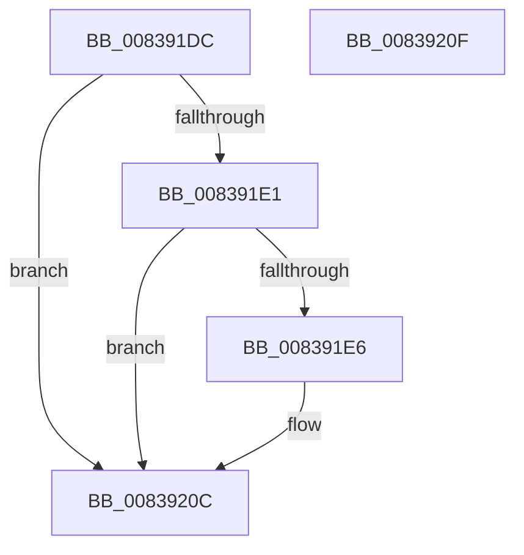

# I_MinCryptBuildErrorPolicy

- RVA: `0x008391DC`–`0x00839210` (길이 `52` bytes)
- VA: `0x00000001408391DC`
- 실행 섹션: `PAGE`
- PDB 이름 있음: `예`; PDB Function 태그: `아니요`
- unwind 정보 RVA: `0x000DB714`
- 디코드: `17`개 명령, `52/52` bytes 표시
- 미해석 바이트: `0` (있으면 어셈블리에 `.byte`로 보존)

> 이 문서는 커널 이미지의 기계어와 PDB 기호를 분석해 생성했습니다. 4번과 5번은 함수 원형과 자료형을 바이너리 사용 방식에서 추정한 C 해석이며 원본 소스 복구 결과는 아닙니다.

## 1. Dependencies

- 직접 호출 지점: **0**; 고유 호출 대상: **0**
- 직접 호출자로 확인된 함수: **6**
- RIP 상대 이미지 참조: **0**

### Outgoing calls
- 직접 디코드된 call 명령이 없습니다.

### Direct callers
- [MincrypK_ParseCertificateChainWithPolicy2](MincrypK_ParseCertificateChainWithPolicy2_function_00837534.md) at `0x008376AA`
- [I_MinCryptGetSigningTime](I_MinCryptGetSigningTime_function_00837F2C.md) at `0x00838062`
- [MinCrypK_VerifySignedDataKModeEx](MinCrypK_VerifySignedDataKModeEx_function_00838568.md) at `0x008389A7`
- [MincrypK_ParseCertificateChainWithPolicy2$fin$0](../B1/MincrypK_ParseCertificateChainWithPolicy2_fin_0_function_00B15CBA.md) at `0x00B15CE1`
- [I_MinCryptGetSigningTime$fin$0](../B1/I_MinCryptGetSigningTime_fin_0_function_00B15D50.md) at `0x00B15D72`
- [MinCrypK_VerifySignedDataKModeEx$fin$0](../B1/MinCrypK_VerifySignedDataKModeEx_fin_0_function_00B15DA6.md) at `0x00B15DC5`

### Static image references
- 디코드된 RIP-relative 메모리 참조가 없습니다.

## 2. Other-region calls and transfers

- 다른 실행 섹션으로 향하는 call: **0**
- 별도 외부 분기/꼬리 이동을 확인하지 못했습니다.

## 3. Assembly (complete function range)

```asm
008391DC  48 85 D2                        test rdx, rdx
008391DF  74 2B                           je 0x14083920c
008391E1  83 3A 00                        cmp dword ptr [rdx], 0
008391E4  75 26                           jne 0x14083920c
008391E6  0F 57 C0                        xorps xmm0, xmm0
008391E9  45 85 C0                        test r8d, r8d
008391EC  0F 11 02                        movups xmmword ptr [rdx], xmm0
008391EF  B8 00 00 00 10                  mov eax, 0x10000000
008391F4  0F 11 42 10                     movups xmmword ptr [rdx + 0x10], xmm0
008391F8  41 0F 45 C0                     cmovne eax, r8d
008391FC  0F 11 42 20                     movups xmmword ptr [rdx + 0x20], xmm0
00839200  C7 02 30 00 00 00               mov dword ptr [rdx], 0x30
00839206  89 42 08                        mov dword ptr [rdx + 8], eax
00839209  89 4A 04                        mov dword ptr [rdx + 4], ecx
0083920C  8B C1                           mov eax, ecx
0083920E  C3                              ret
0083920F  CC                              int3
```

## 4. C-style interpretation (structured pseudocode)

```c
__int64 __fastcall I_MinCryptBuildErrorPolicy(int a1, __int64 a2, int a3)
{
    __int64 result;

    if (a2 == 0) goto loc_0083920C;
    if ((*(unsigned int *)(a2)) == 0) {
        *(unsigned __int64 *)(a2) = v_xmm0;
        result = 0x10000000ULL;
        *(unsigned __int64 *)(a2 + 16) = v_xmm0;
        if (a3 != 0) { result = a3; }
        *(unsigned __int64 *)(a2 + 32) = v_xmm0;
        *(unsigned int *)(a2) = 48;
        *(unsigned int *)(a2 + 8) = (unsigned int)(result);
        *(unsigned int *)(a2 + 4) = a1;
    }
    return (unsigned int)(a1);
}
```

## 5. (Beta) C Style

```c
int64_t I_MinCryptBuildErrorPolicy(int32_t Arg1, int64_t Arg2, int32_t Arg3)
{
    int64_t result;

    if (Arg2 == 0) goto loc_0083920C;
    if ((*(uint32_t *)(Arg2)) == 0) {
        *(uint64_t *)(Arg2) = v_xmm0;
        result = 0x10000000ULL;
        *(uint64_t *)(Arg2 + 0x10) = v_xmm0;
        if (Arg3 != 0) { result = Arg3; }
        *(uint64_t *)(Arg2 + 0x20) = v_xmm0;
        *(uint32_t *)(Arg2) = 48;
        *(uint32_t *)(Arg2 + 0x8) = (uint32_t)(result);
        *(uint32_t *)(Arg2 + 0x4) = Arg1;
    }
    return (uint32_t)(Arg1);
}
```

## 6. Execution-region graph

[열기: 2D/3D 그래프와 함수 탐색 컨트롤 패널](../../../control-panel.html?section=page&rva=0x008391DC&view=graph)

- 2D 그래프는 위에서 아래로 흐르고, 3D 그래프는 빈 공간을 드래그해 회전합니다. Shift+드래그는 이동, 휠은 확대·축소, 함수 노드 선택은 대상 보고서 이동입니다.

### Static fallback


