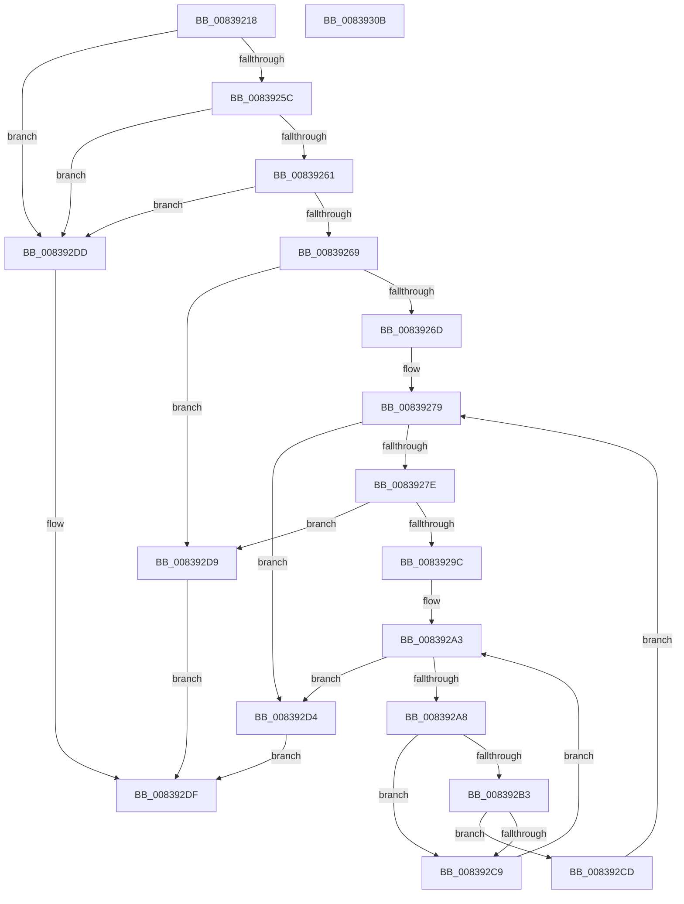

# I_MinCryptCheckEKURequirements

- RVA: `0x00839218`–`0x0083930C` (길이 `244` bytes)
- VA: `0x0000000140839218`
- 실행 섹션: `PAGE`
- PDB 이름 있음: `예`; PDB Function 태그: `아니요`
- unwind 정보 RVA: `0x000DAF78`
- 디코드: `75`개 명령, `244/244` bytes 표시
- 미해석 바이트: `0` (있으면 어셈블리에 `.byte`로 보존)

> 이 문서는 커널 이미지의 기계어와 PDB 기호를 분석해 생성했습니다. 4번과 5번은 함수 원형과 자료형을 바이너리 사용 방식에서 추정한 C 해석이며 원본 소스 복구 결과는 아닙니다.

## 1. Dependencies

- 직접 호출 지점: **3**; 고유 호출 대상: **3**
- 직접 호출자로 확인된 함수: **2**
- RIP 상대 이미지 참조: **1**

### Outgoing calls
- `0x00839293` → [MinAsn1StringToOid](MinAsn1StringToOid_function_0083A494.md) (function, `0x0083A494`)
- `0x008392C0` → [memcmp](../../text/6C/memcmp_function_006C6B10.md) (function, `0x006C6B10`)
- `0x008392EA` → [_security_check_cookie](../../text/6A/_security_check_cookie_function_006AC640.md) (function, `0x006AC640`)

### Direct callers
- [I_MinCryptFindIssuerCertificateByName](I_MinCryptFindIssuerCertificateByName_function_00836530.md) at `0x008365E6`
- [MinCryptVerifyCertificateWithPolicy2](MinCryptVerifyCertificateWithPolicy2_function_008368A8.md) at `0x00836AD8`
- [MinCryptVerifyCertificateWithPolicy2](MinCryptVerifyCertificateWithPolicy2_function_008368A8.md) at `0x00836F30`

### Static image references
- `0x00839231` → RVA `0x00E0A740` (`.data`; read)

## 2. Other-region calls and transfers

- 다른 실행 섹션으로 향하는 call: **2**
  - `0x008392C0` → [memcmp](../../text/6C/memcmp_function_006C6B10.md) (`PAGE` → `.text`)
  - `0x008392EA` → [_security_check_cookie](../../text/6A/_security_check_cookie_function_006AC640.md) (`PAGE` → `.text`)
- 별도 외부 분기/꼬리 이동을 확인하지 못했습니다.

## 3. Assembly (complete function range)

```asm
00839218  48 89 5C 24 08                  mov qword ptr [rsp + 8], rbx
0083921D  48 89 6C 24 10                  mov qword ptr [rsp + 0x10], rbp
00839222  56                              push rsi
00839223  57                              push rdi
00839224  41 54                           push r12
00839226  41 56                           push r14
00839228  41 57                           push r15
0083922A  48 81 EC C0 00 00 00            sub rsp, 0xc0
00839231  48 8B 05 08 15 5D 00            mov rax, qword ptr [rip + 0x5d1508]
00839238  48 33 C4                        xor rax, rsp
0083923B  48 89 84 24 B0 00 00 00         mov qword ptr [rsp + 0xb0], rax
00839243  83 64 24 24 00                  and dword ptr [rsp + 0x24], 0
00839248  40 32 ED                        xor bpl, bpl
0083924B  49 8B D8                        mov rbx, r8
0083924E  4C 8B E2                        mov r12, rdx
00839251  44 8B F1                        mov r14d, ecx
00839254  85 C9                           test ecx, ecx
00839256  0F 84 81 00 00 00               je 0x1408392dd
0083925C  48 85 DB                        test rbx, rbx
0083925F  74 7C                           je 0x1408392dd
00839261  41 8B 40 08                     mov eax, dword ptr [r8 + 8]
00839265  85 C0                           test eax, eax
00839267  74 74                           je 0x1408392dd
00839269  3B C1                           cmp eax, ecx
0083926B  77 6C                           ja 0x1408392d9
0083926D  48 8D 44 24 30                  lea rax, [rsp + 0x30]
00839272  33 FF                           xor edi, edi
00839274  48 89 44 24 28                  mov qword ptr [rsp + 0x28], rax
00839279  3B 7B 08                        cmp edi, dword ptr [rbx + 8]
0083927C  73 56                           jae 0x1408392d4
0083927E  48 8B 4C FB 10                  mov rcx, qword ptr [rbx + rdi*8 + 0x10]
00839283  48 8D 54 24 20                  lea rdx, [rsp + 0x20]
00839288  40 32 ED                        xor bpl, bpl
0083928B  C7 44 24 20 7F 00 00 00         mov dword ptr [rsp + 0x20], 0x7f
00839293  E8 FC 11 00 00                  call 0x14083a494
00839298  85 C0                           test eax, eax
0083929A  78 3D                           js 0x1408392d9
0083929C  44 8B 7C 24 20                  mov r15d, dword ptr [rsp + 0x20]
008392A1  33 F6                           xor esi, esi
008392A3  41 3B F6                        cmp esi, r14d
008392A6  73 2C                           jae 0x1408392d4
008392A8  8B CE                           mov ecx, esi
008392AA  48 03 C9                        add rcx, rcx
008392AD  45 39 3C CC                     cmp dword ptr [r12 + rcx*8], r15d
008392B1  75 16                           jne 0x1408392c9
008392B3  48 8B 54 24 28                  mov rdx, qword ptr [rsp + 0x28]
008392B8  4D 8B C7                        mov r8, r15
008392BB  49 8B 4C CC 08                  mov rcx, qword ptr [r12 + rcx*8 + 8]
008392C0  E8 4B D8 E8 FF                  call 0x1406c6b10
008392C5  85 C0                           test eax, eax
008392C7  74 04                           je 0x1408392cd
008392C9  FF C6                           inc esi
008392CB  EB D6                           jmp 0x1408392a3
008392CD  40 B5 01                        mov bpl, 1
008392D0  FF C7                           inc edi
008392D2  EB A5                           jmp 0x140839279
008392D4  40 8A C5                        mov al, bpl
008392D7  EB 06                           jmp 0x1408392df
008392D9  32 C0                           xor al, al
008392DB  EB 02                           jmp 0x1408392df
008392DD  B0 01                           mov al, 1
008392DF  48 8B 8C 24 B0 00 00 00         mov rcx, qword ptr [rsp + 0xb0]
008392E7  48 33 CC                        xor rcx, rsp
008392EA  E8 51 33 E7 FF                  call 0x1406ac640
008392EF  4C 8D 9C 24 C0 00 00 00         lea r11, [rsp + 0xc0]
008392F7  49 8B 5B 30                     mov rbx, qword ptr [r11 + 0x30]
008392FB  49 8B 6B 38                     mov rbp, qword ptr [r11 + 0x38]
008392FF  49 8B E3                        mov rsp, r11
00839302  41 5F                           pop r15
00839304  41 5E                           pop r14
00839306  41 5C                           pop r12
00839308  5F                              pop rdi
00839309  5E                              pop rsi
0083930A  C3                              ret
0083930B  CC                              int3
```

## 4. C-style interpretation (structured pseudocode)

```c
__int64 __fastcall I_MinCryptCheckEKURequirements(int a1, __int64 a2, __int64 a3)
{
    __int64 result;
    __int64 v_rbp;
    __int64 v_rdi;
    __int64 v_rsi;
    __int64 v_rsp;
    unsigned __int64 v_stack_m28;
    unsigned __int64 v_stack_m38;
    unsigned __int64 v_stack_mB8;
    unsigned __int64 v_stack_mC0;
    unsigned int v_stack_mC4;
    unsigned __int64 v_stack_mC8;
    unsigned __int64 v_stack_p10;
    unsigned __int64 v_stack_p8;

    v_stack_p8 = v_rbx;
    v_stack_p10 = v_rbp;
    v_rsp = (v_rsp) - (192);
    result = (*(unsigned __int64 *)(v_rip + 6100232)) ^ (v_rsp);
    v_stack_m38 = result;
    v_rbp = 0;
    if (a1 == 0) goto loc_008392DD;
    if (a3 == 0) goto loc_008392DD;
    if ((unsigned int)((unsigned int)(*(unsigned int *)(a3 + 8))) == 0) goto loc_008392DD;
    if (((unsigned int)((unsigned int)(*(unsigned int *)(a3 + 8)))) > a1) goto loc_008392D9;
    v_rdi = 0;
    v_stack_mC0 = v_stack_mB8;
loc_00839279:
    if (0 >= (*(unsigned int *)(a3 + 8))) goto loc_008392D4;
    v_rbp = 0;
    v_stack_mC8 = 127;
    result = MinAsn1StringToOid(*(unsigned __int64 *)(a3 + v_rdi * 8 + 16), v_stack_mC8, a3, a4);
    if (sign_flag) goto loc_008392D9;
    v_rsi = 0;
loc_008392A3:
    if (0 >= ((unsigned int)((unsigned int)(a1)))) goto loc_008392D4;
    a1 = (0) + (0);
    if ((*(unsigned int *)(a2 + a1 * 8)) != ((unsigned int)((unsigned int)(v_stack_mC8)))) goto loc_008392C9;
    result = memcmp(*(unsigned __int64 *)(a2 + a1 * 8 + 8), v_stack_mC0, (unsigned int)(v_stack_mC8), a4);
    if ((unsigned int)(result) == 0) goto loc_008392CD;
loc_008392C9:
    v_rsi = (unsigned int)((v_rsi) + 1);
    goto loc_008392A3;
loc_008392CD:
    v_rdi = (unsigned int)((v_rdi) + 1);
    goto loc_00839279;
loc_008392D4:
    goto loc_008392DF;
loc_008392D9:
    result = 0;
    goto loc_008392DF;
loc_008392DD:
loc_008392DF:
    a1 = (v_stack_m38) ^ (v_rsp);
    result = _security_check_cookie(a1, v_stack_mC0, (unsigned int)(v_stack_mC8), a4);
    return result;
}
```

## 5. (Beta) C Style

```c
int64_t I_MinCryptCheckEKURequirements(int32_t Arg1, void *Arg2, void *Arg3)
{
    uint8_t *arg2 = (uint8_t *)Arg2;
    uint8_t *arg3 = (uint8_t *)Arg3;

    int64_t result;
    int64_t local_rbp;
    int64_t local_rdi;
    int64_t local_rsi;
    int64_t local_rsp;
    uint64_t v_stack_m28;
    uint64_t v_stack_m38;
    uint64_t v_stack_mB8;
    uint64_t v_stack_mC0;
    uint32_t v_stack_mC4;
    uint64_t v_stack_mC8;
    uint64_t v_stack_p10;
    uint64_t v_stack_p8;

    v_stack_p8 = local_rbx;
    v_stack_p10 = local_rbp;
    local_rsp = (local_rsp) - (192);
    result = (*(uint64_t *)(v_rip + 0x5D1508)) ^ (local_rsp);
    v_stack_m38 = result;
    local_rbp = 0;
    if (Arg1 == 0) goto loc_008392DD;
    if (Arg3 == NULL) goto loc_008392DD;
    if ((uint32_t)((uint32_t)(*(uint32_t *)(arg3 + 0x8))) == 0) goto loc_008392DD;
    if (((uint32_t)((uint32_t)(*(uint32_t *)(arg3 + 0x8)))) > Arg1) goto loc_008392D9;
    local_rdi = 0;
    v_stack_mC0 = v_stack_mB8;
loc_00839279:
    if (0 >= (*(uint32_t *)(arg3 + 0x8))) goto loc_008392D4;
    local_rbp = 0;
    v_stack_mC8 = 127;
    result = MinAsn1StringToOid(*(uint64_t *)(arg3 + local_rdi * 8 + 0x10), v_stack_mC8, Arg3, a4);
    if (sign_flag) goto loc_008392D9;
    local_rsi = 0;
loc_008392A3:
    if (0 >= ((uint32_t)((uint32_t)(Arg1)))) goto loc_008392D4;
    Arg1 = (0) + (0);
    if ((*(uint32_t *)(arg2 + Arg1 * 8)) != ((uint32_t)((uint32_t)(v_stack_mC8)))) goto loc_008392C9;
    result = memcmp(*(uint64_t *)(arg2 + Arg1 * 8 + 0x8), v_stack_mC0, (uint32_t)(v_stack_mC8), a4);
    if ((uint32_t)(result) == 0) goto loc_008392CD;
loc_008392C9:
    local_rsi = (uint32_t)((local_rsi) + 1);
    goto loc_008392A3;
loc_008392CD:
    local_rdi = (uint32_t)((local_rdi) + 1);
    goto loc_00839279;
loc_008392D4:
    goto loc_008392DF;
loc_008392D9:
    result = 0;
    goto loc_008392DF;
loc_008392DD:
loc_008392DF:
    Arg1 = (v_stack_m38) ^ (local_rsp);
    result = _security_check_cookie(Arg1, v_stack_mC0, (uint32_t)(v_stack_mC8), a4);
    return result;
}
```

### 관측된 메모리 오프셋

구조체 형식이 확인되지 않은 접근은 인자 기준의 오프셋으로만 기록했습니다.

| 기준 인자 | 오프셋 표현 | 폭 (bit) | 접근 |
|---|---:|---:|---|
| `Arg2` | `+ 0x0 + rcx*8` | `32` | `R` |
| `Arg2` | `+ 0x8 + rcx*8` | `64` | `R` |
| `Arg3` | `+ 0x8` | `32` | `R` |

## 6. Execution-region graph

[열기: 2D/3D 그래프와 함수 탐색 컨트롤 패널](../../../control-panel.html?section=page&rva=0x00839218&view=graph)

- 2D 그래프는 위에서 아래로 흐르고, 3D 그래프는 빈 공간을 드래그해 회전합니다. Shift+드래그는 이동, 휠은 확대·축소, 함수 노드 선택은 대상 보고서 이동입니다.

### Static fallback


