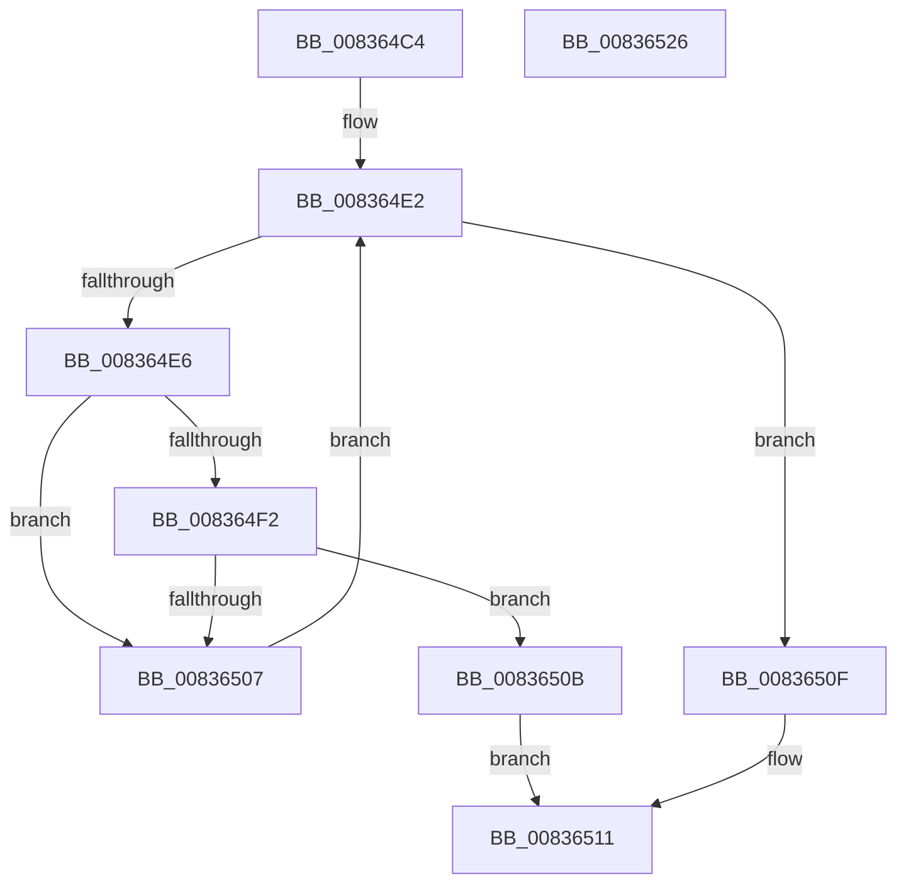

# I_MinCryptCheckEKU

- RVA: `0x008364C4`–`0x00836527` (길이 `99` bytes)
- VA: `0x00000001408364C4`
- 실행 섹션: `PAGE`
- PDB 이름 있음: `예`; PDB Function 태그: `아니요`
- unwind 정보 RVA: `0x0005C954`
- 디코드: `34`개 명령, `99/99` bytes 표시
- 미해석 바이트: `0` (있으면 어셈블리에 `.byte`로 보존)

> 이 문서는 커널 이미지의 기계어와 PDB 기호를 분석해 생성했습니다. 4번과 5번은 함수 원형과 자료형을 바이너리 사용 방식에서 추정한 C 해석이며 원본 소스 복구 결과는 아닙니다.

## 1. Dependencies

- 직접 호출 지점: **1**; 고유 호출 대상: **1**
- 직접 호출자로 확인된 함수: **1**
- RIP 상대 이미지 참조: **0**

### Outgoing calls
- `0x008364FE` → [memcmp](../../text/6C/memcmp_function_006C6B10.md) (function, `0x006C6B10`)

### Direct callers
- [MinCryptVerifyCertificateWithPolicy2](MinCryptVerifyCertificateWithPolicy2_function_008368A8.md) at `0x00836B1F`
- [MinCryptVerifyCertificateWithPolicy2](MinCryptVerifyCertificateWithPolicy2_function_008368A8.md) at `0x00836B79`

### Static image references
- 디코드된 RIP-relative 메모리 참조가 없습니다.

## 2. Other-region calls and transfers

- 다른 실행 섹션으로 향하는 call: **1**
  - `0x008364FE` → [memcmp](../../text/6C/memcmp_function_006C6B10.md) (`PAGE` → `.text`)
- 별도 외부 분기/꼬리 이동을 확인하지 못했습니다.

## 3. Assembly (complete function range)

```asm
008364C4  48 89 5C 24 08                  mov qword ptr [rsp + 8], rbx
008364C9  48 89 6C 24 10                  mov qword ptr [rsp + 0x10], rbp
008364CE  48 89 74 24 18                  mov qword ptr [rsp + 0x18], rsi
008364D3  57                              push rdi
008364D4  48 83 EC 20                     sub rsp, 0x20
008364D8  49 8B F8                        mov rdi, r8
008364DB  8B EA                           mov ebp, edx
008364DD  48 8B F1                        mov rsi, rcx
008364E0  33 DB                           xor ebx, ebx
008364E2  3B DD                           cmp ebx, ebp
008364E4  73 29                           jae 0x14083650f
008364E6  8B 06                           mov eax, dword ptr [rsi]
008364E8  8B CB                           mov ecx, ebx
008364EA  48 03 C9                        add rcx, rcx
008364ED  39 04 CF                        cmp dword ptr [rdi + rcx*8], eax
008364F0  75 15                           jne 0x140836507
008364F2  48 8B 56 08                     mov rdx, qword ptr [rsi + 8]
008364F6  44 8B C0                        mov r8d, eax
008364F9  48 8B 4C CF 08                  mov rcx, qword ptr [rdi + rcx*8 + 8]
008364FE  E8 0D 06 E9 FF                  call 0x1406c6b10
00836503  85 C0                           test eax, eax
00836505  74 04                           je 0x14083650b
00836507  FF C3                           inc ebx
00836509  EB D7                           jmp 0x1408364e2
0083650B  B0 01                           mov al, 1
0083650D  EB 02                           jmp 0x140836511
0083650F  32 C0                           xor al, al
00836511  48 8B 5C 24 30                  mov rbx, qword ptr [rsp + 0x30]
00836516  48 8B 6C 24 38                  mov rbp, qword ptr [rsp + 0x38]
0083651B  48 8B 74 24 40                  mov rsi, qword ptr [rsp + 0x40]
00836520  48 83 C4 20                     add rsp, 0x20
00836524  5F                              pop rdi
00836525  C3                              ret
00836526  CC                              int3
```

## 4. C-style interpretation (structured pseudocode)

```c
__int64 __fastcall I_MinCryptCheckEKU(__int64 a1, int a2, __int64 a3)
{
    __int64 result;
    __int64 v_rbx;
    __int64 v_rsp;
    unsigned __int64 v_stack_p10;
    unsigned __int64 v_stack_p18;
    unsigned __int64 v_stack_p8;

    v_stack_p8 = v_rbx;
    v_stack_p10 = v_rbp;
    v_stack_p18 = v_rsi;
    v_rsp = (v_rsp) - (32);
    v_rbx = 0;
loc_008364E2:
    if (0 >= ((unsigned int)((unsigned int)(a2)))) goto loc_0083650F;
    a1 = (0) + (0);
    if ((*(unsigned int *)(a3 + a1 * 8)) != ((unsigned int)((unsigned int)(*(unsigned int *)(a1))))) goto loc_00836507;
    result = memcmp(*(unsigned __int64 *)(a3 + a1 * 8 + 8), *(unsigned __int64 *)(a1 + 8), (unsigned int)((unsigned int)((unsigned int)(*(unsigned int *)(a1)))), a4);
    if ((unsigned int)(result) == 0) goto loc_0083650B;
loc_00836507:
    v_rbx = (unsigned int)((v_rbx) + 1);
    goto loc_008364E2;
loc_0083650B:
    goto loc_00836511;
loc_0083650F:
    result = 0;
loc_00836511:
    v_rsp = (v_rsp) + (32);
    return result;
}
```

## 5. (Beta) C Style

```c
int64_t I_MinCryptCheckEKU(void *Arg1, int32_t Arg2, void *Arg3)
{
    uint8_t *arg1 = (uint8_t *)Arg1;
    uint8_t *arg3 = (uint8_t *)Arg3;

    int64_t result;
    int64_t local_rbx;
    int64_t local_rsp;
    uint64_t v_stack_p10;
    uint64_t v_stack_p18;
    uint64_t v_stack_p8;

    v_stack_p8 = local_rbx;
    v_stack_p10 = local_rbp;
    v_stack_p18 = local_rsi;
    local_rsp = (local_rsp) - (32);
    local_rbx = 0;
loc_008364E2:
    if (0 >= ((uint32_t)((uint32_t)(Arg2)))) goto loc_0083650F;
    Arg1 = (0) + (0);
    if ((*(uint32_t *)(arg3 + arg1 * 8)) != ((uint32_t)((uint32_t)(*(uint32_t *)(arg1))))) goto loc_00836507;
    result = memcmp(*(uint64_t *)(arg3 + arg1 * 8 + 0x8), *(uint64_t *)(arg1 + 0x8), (uint32_t)((uint32_t)((uint32_t)(*(uint32_t *)(arg1)))), a4);
    if ((uint32_t)(result) == 0) goto loc_0083650B;
loc_00836507:
    local_rbx = (uint32_t)((local_rbx) + 1);
    goto loc_008364E2;
loc_0083650B:
    goto loc_00836511;
loc_0083650F:
    result = 0;
loc_00836511:
    local_rsp = (local_rsp) + (32);
    return result;
}
```

### 관측된 메모리 오프셋

구조체 형식이 확인되지 않은 접근은 인자 기준의 오프셋으로만 기록했습니다.

| 기준 인자 | 오프셋 표현 | 폭 (bit) | 접근 |
|---|---:|---:|---|
| `Arg1` | `+ 0x0` | `32` | `R` |
| `Arg1` | `+ 0x8` | `64` | `R` |
| `Arg3` | `+ 0x0 + rcx*8` | `32` | `R` |
| `Arg3` | `+ 0x8 + rcx*8` | `64` | `R` |

## 6. Execution-region graph

[열기: 2D/3D 그래프와 함수 탐색 컨트롤 패널](../../../control-panel.html?section=page&rva=0x008364C4&view=graph)

- 2D 그래프는 위에서 아래로 흐르고, 3D 그래프는 빈 공간을 드래그해 회전합니다. Shift+드래그는 이동, 휠은 확대·축소, 함수 노드 선택은 대상 보고서 이동입니다.

### Static fallback


