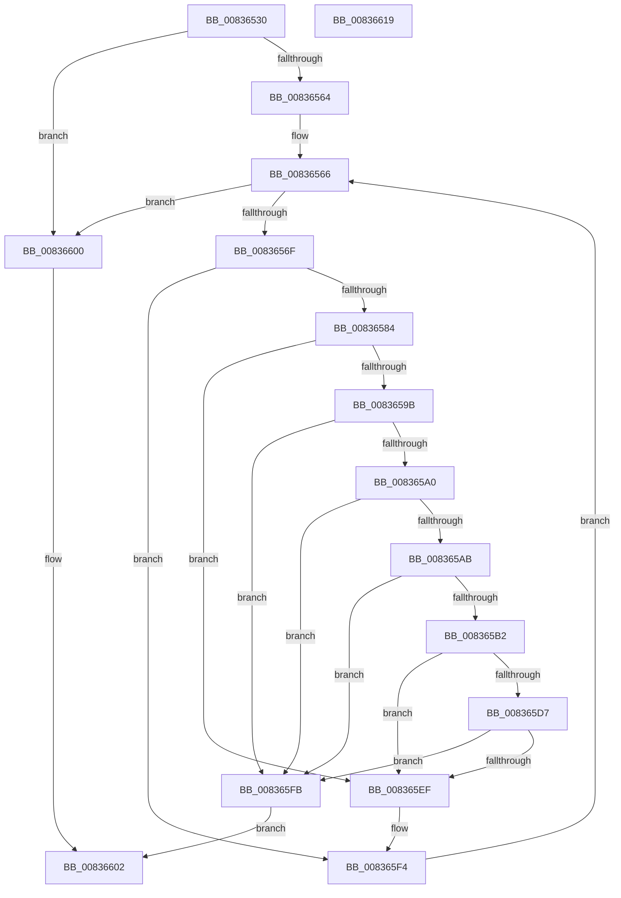

# I_MinCryptFindIssuerCertificateByName

- RVA: `0x00836530`–`0x0083661A` (길이 `234` bytes)
- VA: `0x0000000140836530`
- 실행 섹션: `PAGE`
- PDB 이름 있음: `예`; PDB Function 태그: `아니요`
- unwind 정보 RVA: `0x000DAD84`
- 디코드: `66`개 명령, `234/234` bytes 표시
- 미해석 바이트: `0` (있으면 어셈블리에 `.byte`로 보존)

> 이 문서는 커널 이미지의 기계어와 PDB 기호를 분석해 생성했습니다. 4번과 5번은 함수 원형과 자료형을 바이너리 사용 방식에서 추정한 C 해석이며 원본 소스 복구 결과는 아닙니다.

## 1. Dependencies

- 직접 호출 지점: **3**; 고유 호출 대상: **3**
- 직접 호출자로 확인된 함수: **2**
- RIP 상대 이미지 참조: **0**

### Outgoing calls
- `0x00836591` → [RtlCompareMemory](../../text/6B/RtlCompareMemory_function_006BA670.md) (function, `0x006BA670`)
- `0x008365CE` → [I_MinCryptGetCertificateEKUs](I_MinCryptGetCertificateEKUs_function_008367D0.md) (function, `0x008367D0`)
- `0x008365E6` → [I_MinCryptCheckEKURequirements](I_MinCryptCheckEKURequirements_function_00839218.md) (function, `0x00839218`)

### Direct callers
- [MinCryptCheckCertsAndKeys](../../text/6A/MinCryptCheckCertsAndKeys_function_006A61F8.md) at `0x006A62A8`
- [MinCryptVerifyCertificateWithPolicy2](MinCryptVerifyCertificateWithPolicy2_function_008368A8.md) at `0x0083733F`

### Static image references
- 디코드된 RIP-relative 메모리 참조가 없습니다.

## 2. Other-region calls and transfers

- 다른 실행 섹션으로 향하는 call: **1**
  - `0x00836591` → [RtlCompareMemory](../../text/6B/RtlCompareMemory_function_006BA670.md) (`PAGE` → `.text`)
- 별도 외부 분기/꼬리 이동을 확인하지 못했습니다.

## 3. Assembly (complete function range)

```asm
00836530  48 89 5C 24 10                  mov qword ptr [rsp + 0x10], rbx
00836535  48 89 6C 24 18                  mov qword ptr [rsp + 0x18], rbp
0083653A  56                              push rsi
0083653B  57                              push rdi
0083653C  41 54                           push r12
0083653E  41 55                           push r13
00836540  41 57                           push r15
00836542  48 83 EC 30                     sub rsp, 0x30
00836546  44 8B 39                        mov r15d, dword ptr [rcx]
00836549  49 8B E9                        mov rbp, r9
0083654C  4C 8B 49 08                     mov r9, qword ptr [rcx + 8]
00836550  4D 8B E8                        mov r13, r8
00836553  4C 89 4C 24 20                  mov qword ptr [rsp + 0x20], r9
00836558  44 8B E2                        mov r12d, edx
0083655B  45 85 FF                        test r15d, r15d
0083655E  0F 84 9C 00 00 00               je 0x140836600
00836564  33 FF                           xor edi, edi
00836566  41 3B FC                        cmp edi, r12d
00836569  0F 83 91 00 00 00               jae 0x140836600
0083656F  8B C7                           mov eax, edi
00836571  48 69 F0 F0 00 00 00            imul rsi, rax, 0xf0
00836578  49 03 F5                        add rsi, r13
0083657B  44 3B BE A0 00 00 00            cmp r15d, dword ptr [rsi + 0xa0]
00836582  75 70                           jne 0x1408365f4
00836584  48 8B 96 A8 00 00 00            mov rdx, qword ptr [rsi + 0xa8]
0083658B  4D 8B C7                        mov r8, r15
0083658E  49 8B C9                        mov rcx, r9
00836591  E8 DA 40 E8 FF                  call 0x1406ba670
00836596  49 3B C7                        cmp rax, r15
00836599  75 54                           jne 0x1408365ef
0083659B  48 85 ED                        test rbp, rbp
0083659E  74 5B                           je 0x1408365fb
008365A0  48 83 BC 24 80 00 00 00 00      cmp qword ptr [rsp + 0x80], 0
008365A9  74 50                           je 0x1408365fb
008365AB  8B 45 04                        mov eax, dword ptr [rbp + 4]
008365AE  A8 01                           test al, 1
008365B0  74 49                           je 0x1408365fb
008365B2  4C 8B 84 24 80 00 00 00         mov r8, qword ptr [rsp + 0x80]
008365BA  48 8D 8E E0 00 00 00            lea rcx, [rsi + 0xe0]
008365C1  48 8D 54 24 60                  lea rdx, [rsp + 0x60]
008365C6  C7 44 24 60 32 00 00 00         mov dword ptr [rsp + 0x60], 0x32
008365CE  E8 FD 01 00 00                  call 0x1408367d0
008365D3  85 C0                           test eax, eax
008365D5  78 18                           js 0x1408365ef
008365D7  48 8B 94 24 80 00 00 00         mov rdx, qword ptr [rsp + 0x80]
008365DF  4C 8B C5                        mov r8, rbp
008365E2  8B 4C 24 60                     mov ecx, dword ptr [rsp + 0x60]
008365E6  E8 2D 2C 00 00                  call 0x140839218
008365EB  84 C0                           test al, al
008365ED  75 0C                           jne 0x1408365fb
008365EF  4C 8B 4C 24 20                  mov r9, qword ptr [rsp + 0x20]
008365F4  FF C7                           inc edi
008365F6  E9 6B FF FF FF                  jmp 0x140836566
008365FB  48 8B C6                        mov rax, rsi
008365FE  EB 02                           jmp 0x140836602
00836600  33 C0                           xor eax, eax
00836602  48 8B 5C 24 68                  mov rbx, qword ptr [rsp + 0x68]
00836607  48 8B 6C 24 70                  mov rbp, qword ptr [rsp + 0x70]
0083660C  48 83 C4 30                     add rsp, 0x30
00836610  41 5F                           pop r15
00836612  41 5D                           pop r13
00836614  41 5C                           pop r12
00836616  5F                              pop rdi
00836617  5E                              pop rsi
00836618  C3                              ret
00836619  CC                              int3
```

## 4. C-style interpretation (structured pseudocode)

```c
__int64 __fastcall I_MinCryptFindIssuerCertificateByName(__int64 a1, int a2, __int64 a3, __int64 a4, __int64 a5)
{
    __int64 result;
    __int64 v_rdi;
    __int64 v_rsi;
    __int64 v_rsp;
    unsigned __int64 v_stack_m38;
    unsigned __int64 v_stack_p10;
    unsigned __int64 v_stack_p18;
    unsigned __int64 v_stack_p8;

    v_stack_p10 = v_rbx;
    v_stack_p18 = v_rbp;
    v_rsp = (v_rsp) - (48);
    v_stack_m38 = *(unsigned __int64 *)(a1 + 8);
    if ((unsigned int)((unsigned int)(*(unsigned int *)(a1))) == 0) goto loc_00836600;
    v_rdi = 0;
loc_00836566:
    if (0 >= ((unsigned int)((unsigned int)(a2)))) goto loc_00836600;
    v_rsi = (v_rsi) * (0);
    v_rsi = (v_rsi) + (a3);
    if (((unsigned int)((unsigned int)(*(unsigned int *)(a1)))) != (*(unsigned int *)(v_rsi + 160))) goto loc_008365F4;
    result = RtlCompareMemory(*(unsigned __int64 *)(a1 + 8), *(unsigned __int64 *)(v_rsi + 168), (unsigned int)(*(unsigned int *)(a1)), *(unsigned __int64 *)(a1 + 8));
    if (result != ((unsigned int)(*(unsigned int *)(a1)))) goto loc_008365EF;
    if (a4 == 0) goto loc_008365FB;
    if (a5 == 0) goto loc_008365FB;
    if ((((unsigned __int8)((unsigned int)(*(unsigned int *)(a4 + 4)))) & (1)) == 0) goto loc_008365FB;
    v_stack_p8 = 50;
    result = I_MinCryptGetCertificateEKUs(v_rsi + 224, v_stack_p8, a5, *(unsigned __int64 *)(a1 + 8));
    if (sign_flag) goto loc_008365EF;
    result = I_MinCryptCheckEKURequirements((unsigned int)(v_stack_p8), a5, a4, *(unsigned __int64 *)(a1 + 8));
    if ((unsigned __int8)(result) != 0) goto loc_008365FB;
loc_008365EF:
loc_008365F4:
    v_rdi = (unsigned int)((v_rdi) + 1);
    goto loc_00836566;
loc_008365FB:
    goto loc_00836602;
loc_00836600:
    result = 0;
loc_00836602:
    v_rsp = (v_rsp) + (48);
    return result;
}
```

## 5. (Beta) C Style

```c
int64_t I_MinCryptFindIssuerCertificateByName(void *Arg1, int32_t Arg2, int64_t Arg3, int64_t Arg4, int64_t Arg5)
{
    uint8_t *arg1 = (uint8_t *)Arg1;

    int64_t result;
    int64_t local_rdi;
    int64_t local_rsi;
    int64_t local_rsp;
    uint64_t v_stack_m38;
    uint64_t v_stack_p10;
    uint64_t v_stack_p18;
    uint64_t v_stack_p8;

    v_stack_p10 = local_rbx;
    v_stack_p18 = local_rbp;
    local_rsp = (local_rsp) - (48);
    v_stack_m38 = *(uint64_t *)(arg1 + 0x8);
    if ((uint32_t)((uint32_t)(*(uint32_t *)(arg1))) == 0) goto loc_00836600;
    local_rdi = 0;
loc_00836566:
    if (0 >= ((uint32_t)((uint32_t)(Arg2)))) goto loc_00836600;
    local_rsi = (local_rsi) * (0);
    local_rsi = (local_rsi) + (Arg3);
    if (((uint32_t)((uint32_t)(*(uint32_t *)(arg1)))) != (*(uint32_t *)(local_rsi + 0xA0))) goto loc_008365F4;
    result = RtlCompareMemory(*(uint64_t *)(arg1 + 0x8), *(uint64_t *)(local_rsi + 0xA8), (uint32_t)(*(uint32_t *)(arg1)), *(uint64_t *)(arg1 + 0x8));
    if (result != ((uint32_t)(*(uint32_t *)(arg1)))) goto loc_008365EF;
    if (Arg4 == 0) goto loc_008365FB;
    if (Arg5 == 0) goto loc_008365FB;
    if ((((uint8_t)((uint32_t)(*(uint32_t *)(Arg4 + 0x4)))) & (1)) == 0) goto loc_008365FB;
    v_stack_p8 = 50;
    result = I_MinCryptGetCertificateEKUs(local_rsi + 224, v_stack_p8, Arg5, *(uint64_t *)(arg1 + 0x8));
    if (sign_flag) goto loc_008365EF;
    result = I_MinCryptCheckEKURequirements((uint32_t)(v_stack_p8), Arg5, Arg4, *(uint64_t *)(arg1 + 0x8));
    if ((uint8_t)(result) != 0) goto loc_008365FB;
loc_008365EF:
loc_008365F4:
    local_rdi = (uint32_t)((local_rdi) + 1);
    goto loc_00836566;
loc_008365FB:
    goto loc_00836602;
loc_00836600:
    result = 0;
loc_00836602:
    local_rsp = (local_rsp) + (48);
    return result;
}
```

### 관측된 메모리 오프셋

구조체 형식이 확인되지 않은 접근은 인자 기준의 오프셋으로만 기록했습니다.

| 기준 인자 | 오프셋 표현 | 폭 (bit) | 접근 |
|---|---:|---:|---|
| `Arg1` | `+ 0x0` | `32` | `R` |
| `Arg1` | `+ 0x8` | `64` | `R` |

## 6. Execution-region graph

[열기: 2D/3D 그래프와 함수 탐색 컨트롤 패널](../../../control-panel.html?section=page&rva=0x00836530&view=graph)

- 2D 그래프는 위에서 아래로 흐르고, 3D 그래프는 빈 공간을 드래그해 회전합니다. Shift+드래그는 이동, 휠은 확대·축소, 함수 노드 선택은 대상 보고서 이동입니다.

### Static fallback


