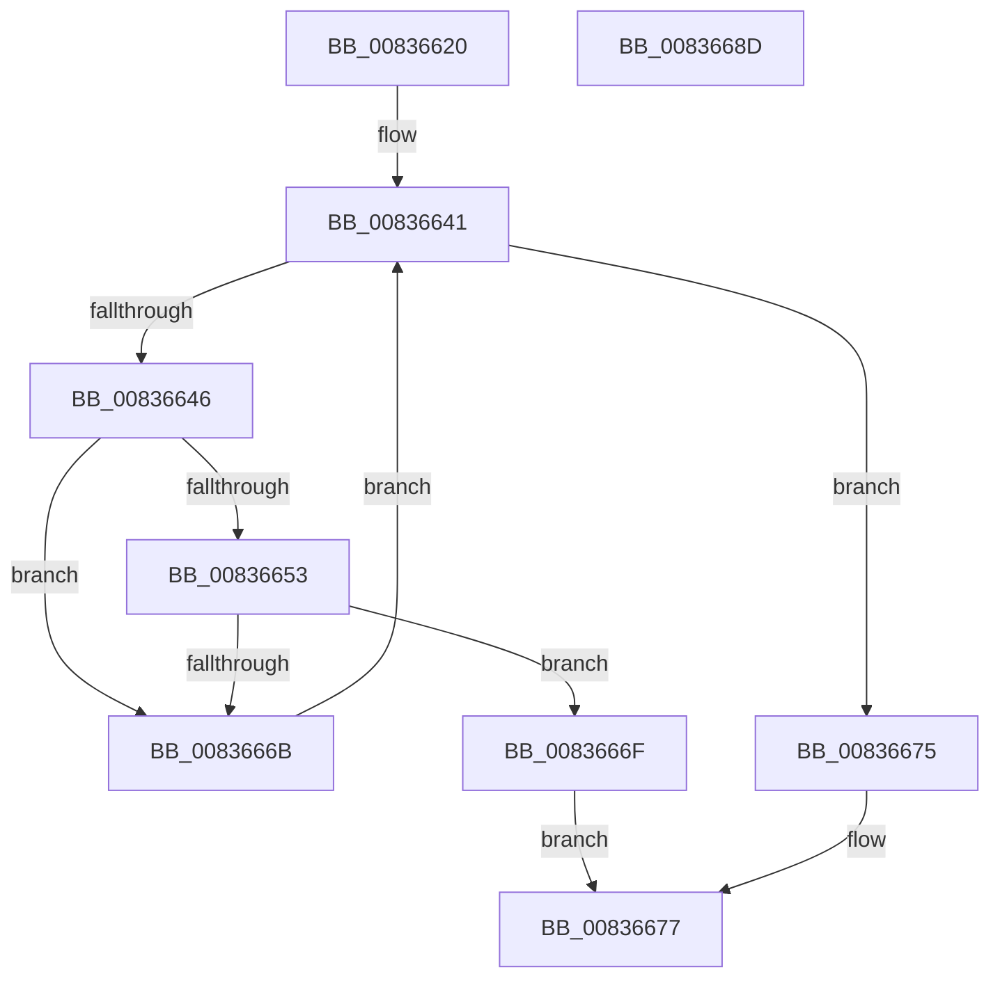

# I_MinCryptFindRootByKey

- RVA: `0x00836620`–`0x0083668E` (길이 `110` bytes)
- VA: `0x0000000140836620`
- 실행 섹션: `PAGE`
- PDB 이름 있음: `예`; PDB Function 태그: `아니요`
- unwind 정보 RVA: `0x0006F978`
- 디코드: `33`개 명령, `110/110` bytes 표시
- 미해석 바이트: `0` (있으면 어셈블리에 `.byte`로 보존)

> 이 문서는 커널 이미지의 기계어와 PDB 기호를 분석해 생성했습니다. 4번과 5번은 함수 원형과 자료형을 바이너리 사용 방식에서 추정한 C 해석이며 원본 소스 복구 결과는 아닙니다.

## 1. Dependencies

- 직접 호출 지점: **1**; 고유 호출 대상: **1**
- 직접 호출자로 확인된 함수: **1**
- RIP 상대 이미지 참조: **1**

### Outgoing calls
- `0x0083665F` → [RtlCompareMemory](../../text/6B/RtlCompareMemory_function_006BA670.md) (function, `0x006BA670`)

### Direct callers
- [MinCryptVerifyCertificateWithPolicy2](MinCryptVerifyCertificateWithPolicy2_function_008368A8.md) at `0x00836FCB`

### Static image references
- `0x00836638` → RVA `0x00B4ED50` (`RootTable`; read)

## 2. Other-region calls and transfers

- 다른 실행 섹션으로 향하는 call: **1**
  - `0x0083665F` → [RtlCompareMemory](../../text/6B/RtlCompareMemory_function_006BA670.md) (`PAGE` → `.text`)
- 별도 외부 분기/꼬리 이동을 확인하지 못했습니다.

## 3. Assembly (complete function range)

```asm
00836620  48 89 5C 24 08                  mov qword ptr [rsp + 8], rbx
00836625  48 89 74 24 10                  mov qword ptr [rsp + 0x10], rsi
0083662A  48 89 7C 24 18                  mov qword ptr [rsp + 0x18], rdi
0083662F  41 56                           push r14
00836631  48 83 EC 20                     sub rsp, 0x20
00836635  48 8B F1                        mov rsi, rcx
00836638  4C 8D 35 11 87 31 00            lea r14, [rip + 0x318711]
0083663F  33 DB                           xor ebx, ebx
00836641  83 FB 13                        cmp ebx, 0x13
00836644  73 2F                           jae 0x140836675
00836646  8B 06                           mov eax, dword ptr [rsi]
00836648  48 8D 3C 9B                     lea rdi, [rbx + rbx*4]
0083664C  41 3B 44 FE 10                  cmp eax, dword ptr [r14 + rdi*8 + 0x10]
00836651  75 18                           jne 0x14083666b
00836653  49 8B 54 FE 18                  mov rdx, qword ptr [r14 + rdi*8 + 0x18]
00836658  44 8B C0                        mov r8d, eax
0083665B  48 8B 4E 08                     mov rcx, qword ptr [rsi + 8]
0083665F  E8 0C 40 E8 FF                  call 0x1406ba670
00836664  8B 0E                           mov ecx, dword ptr [rsi]
00836666  48 3B C1                        cmp rax, rcx
00836669  74 04                           je 0x14083666f
0083666B  FF C3                           inc ebx
0083666D  EB D2                           jmp 0x140836641
0083666F  49 8D 04 FE                     lea rax, [r14 + rdi*8]
00836673  EB 02                           jmp 0x140836677
00836675  33 C0                           xor eax, eax
00836677  48 8B 5C 24 30                  mov rbx, qword ptr [rsp + 0x30]
0083667C  48 8B 74 24 38                  mov rsi, qword ptr [rsp + 0x38]
00836681  48 8B 7C 24 40                  mov rdi, qword ptr [rsp + 0x40]
00836686  48 83 C4 20                     add rsp, 0x20
0083668A  41 5E                           pop r14
0083668C  C3                              ret
0083668D  CC                              int3
```

## 4. C-style interpretation (structured pseudocode)

```c
__int64 __fastcall I_MinCryptFindRootByKey(__int64 a1)
{
    __int64 result;
    __int64 v_rbx;
    __int64 v_rsp;
    unsigned __int64 v_stack_p10;
    unsigned __int64 v_stack_p18;
    unsigned __int64 v_stack_p8;

    v_stack_p8 = v_rbx;
    v_stack_p10 = v_rsi;
    v_stack_p18 = v_rdi;
    v_rsp = (v_rsp) - (32);
    v_rbx = 0;
loc_00836641:
    if (0 >= 19) goto loc_00836675;
    if (((unsigned int)((unsigned int)(*(unsigned int *)(a1)))) != (*(unsigned int *)(v_rip + 3245841 + v_rbx + v_rbx * 4 * 8 + 16))) goto loc_0083666B;
    result = RtlCompareMemory(*(unsigned __int64 *)(a1 + 8), *(unsigned __int64 *)(v_rip + 3245841 + v_rbx + v_rbx * 4 * 8 + 24), (unsigned int)((unsigned int)((unsigned int)(*(unsigned int *)(a1)))), a4);
    if (result == ((unsigned int)(*(unsigned int *)(a1)))) goto loc_0083666F;
loc_0083666B:
    v_rbx = (unsigned int)((v_rbx) + 1);
    goto loc_00836641;
loc_0083666F:
    goto loc_00836677;
loc_00836675:
    result = 0;
loc_00836677:
    v_rsp = (v_rsp) + (32);
    return result;
}
```

## 5. (Beta) C Style

```c
int64_t I_MinCryptFindRootByKey(void *Arg1)
{
    uint8_t *arg1 = (uint8_t *)Arg1;

    int64_t result;
    int64_t local_rbx;
    int64_t local_rsp;
    uint64_t v_stack_p10;
    uint64_t v_stack_p18;
    uint64_t v_stack_p8;

    v_stack_p8 = local_rbx;
    v_stack_p10 = local_rsi;
    v_stack_p18 = local_rdi;
    local_rsp = (local_rsp) - (32);
    local_rbx = 0;
loc_00836641:
    if (0 >= 19) goto loc_00836675;
    if (((uint32_t)((uint32_t)(*(uint32_t *)(arg1)))) != (*(uint32_t *)(v_rip + 0x318711 + local_rbx + local_rbx * 4 * 8 + 0x10))) goto loc_0083666B;
    result = RtlCompareMemory(*(uint64_t *)(arg1 + 0x8), *(uint64_t *)(v_rip + 0x318711 + local_rbx + local_rbx * 4 * 8 + 0x18), (uint32_t)((uint32_t)((uint32_t)(*(uint32_t *)(arg1)))), a4);
    if (result == ((uint32_t)(*(uint32_t *)(arg1)))) goto loc_0083666F;
loc_0083666B:
    local_rbx = (uint32_t)((local_rbx) + 1);
    goto loc_00836641;
loc_0083666F:
    goto loc_00836677;
loc_00836675:
    result = 0;
loc_00836677:
    local_rsp = (local_rsp) + (32);
    return result;
}
```

### 관측된 메모리 오프셋

구조체 형식이 확인되지 않은 접근은 인자 기준의 오프셋으로만 기록했습니다.

| 기준 인자 | 오프셋 표현 | 폭 (bit) | 접근 |
|---|---:|---:|---|
| `Arg1` | `+ 0x0` | `32` | `R` |
| `Arg1` | `+ 0x8` | `64` | `R` |

## 6. Execution-region graph

[열기: 2D/3D 그래프와 함수 탐색 컨트롤 패널](../../../control-panel.html?section=page&rva=0x00836620&view=graph)

- 2D 그래프는 위에서 아래로 흐르고, 3D 그래프는 빈 공간을 드래그해 회전합니다. Shift+드래그는 이동, 휠은 확대·축소, 함수 노드 선택은 대상 보고서 이동입니다.

### Static fallback


