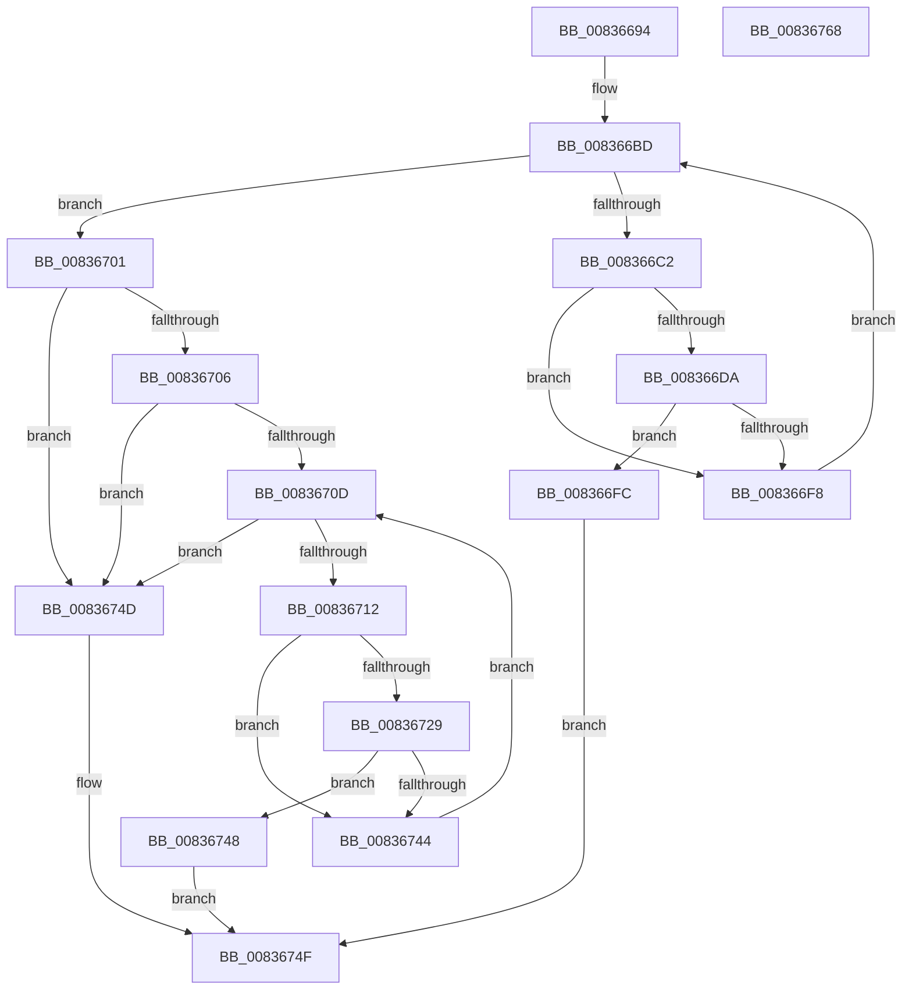

# I_MinCryptFindRootByName

- RVA: `0x00836694`–`0x00836769` (길이 `213` bytes)
- VA: `0x0000000140836694`
- 실행 섹션: `PAGE`
- PDB 이름 있음: `예`; PDB Function 태그: `아니요`
- unwind 정보 RVA: `0x00060300`
- 디코드: `68`개 명령, `213/213` bytes 표시
- 미해석 바이트: `0` (있으면 어셈블리에 `.byte`로 보존)

> 이 문서는 커널 이미지의 기계어와 PDB 기호를 분석해 생성했습니다. 4번과 5번은 함수 원형과 자료형을 바이너리 사용 방식에서 추정한 C 해석이며 원본 소스 복구 결과는 아닙니다.

## 1. Dependencies

- 직접 호출 지점: **2**; 고유 호출 대상: **1**
- 직접 호출자로 확인된 함수: **1**
- RIP 상대 이미지 참조: **1**

### Outgoing calls
- `0x008366E9` → [RtlCompareMemory](../../text/6B/RtlCompareMemory_function_006BA670.md) (function, `0x006BA670`)
- `0x00836738` → [RtlCompareMemory](../../text/6B/RtlCompareMemory_function_006BA670.md) (function, `0x006BA670`)

### Direct callers
- [MinCryptVerifyCertificateWithPolicy2](MinCryptVerifyCertificateWithPolicy2_function_008368A8.md) at `0x00837246`

### Static image references
- `0x008366AE` → RVA `0x00000000` (`image boundary/outside`; read)

## 2. Other-region calls and transfers

- 다른 실행 섹션으로 향하는 call: **2**
  - `0x008366E9` → [RtlCompareMemory](../../text/6B/RtlCompareMemory_function_006BA670.md) (`PAGE` → `.text`)
  - `0x00836738` → [RtlCompareMemory](../../text/6B/RtlCompareMemory_function_006BA670.md) (`PAGE` → `.text`)
- 별도 외부 분기/꼬리 이동을 확인하지 못했습니다.

## 3. Assembly (complete function range)

```asm
00836694  48 89 5C 24 08                  mov qword ptr [rsp + 8], rbx
00836699  48 89 6C 24 10                  mov qword ptr [rsp + 0x10], rbp
0083669E  48 89 74 24 18                  mov qword ptr [rsp + 0x18], rsi
008366A3  57                              push rdi
008366A4  41 56                           push r14
008366A6  41 57                           push r15
008366A8  48 83 EC 20                     sub rsp, 0x20
008366AC  33 DB                           xor ebx, ebx
008366AE  4C 8D 3D 4B 99 7C FF            lea r15, [rip - 0x8366b5]
008366B5  8B FB                           mov edi, ebx
008366B7  48 8B EA                        mov rbp, rdx
008366BA  48 8B F1                        mov rsi, rcx
008366BD  83 FF 13                        cmp edi, 0x13
008366C0  73 3F                           jae 0x140836701
008366C2  8B C7                           mov eax, edi
008366C4  4D 8D B7 50 ED B4 00            lea r14, [r15 + 0xb4ed50]
008366CB  48 8D 14 80                     lea rdx, [rax + rax*4]
008366CF  8B 06                           mov eax, dword ptr [rsi]
008366D1  4D 8D 34 D6                     lea r14, [r14 + rdx*8]
008366D5  41 3B 06                        cmp eax, dword ptr [r14]
008366D8  75 1E                           jne 0x1408366f8
008366DA  49 8B 94 D7 58 ED B4 00         mov rdx, qword ptr [r15 + rdx*8 + 0xb4ed58]
008366E2  44 8B C0                        mov r8d, eax
008366E5  48 8B 4E 08                     mov rcx, qword ptr [rsi + 8]
008366E9  E8 82 3F E8 FF                  call 0x1406ba670
008366EE  48 8B C8                        mov rcx, rax
008366F1  8B 06                           mov eax, dword ptr [rsi]
008366F3  48 3B C8                        cmp rcx, rax
008366F6  74 04                           je 0x1408366fc
008366F8  FF C7                           inc edi
008366FA  EB C1                           jmp 0x1408366bd
008366FC  49 8B C6                        mov rax, r14
008366FF  EB 4E                           jmp 0x14083674f
00836701  48 85 ED                        test rbp, rbp
00836704  74 47                           je 0x14083674d
00836706  8B 45 04                        mov eax, dword ptr [rbp + 4]
00836709  84 C0                           test al, al
0083670B  79 40                           jns 0x14083674d
0083670D  83 FB 02                        cmp ebx, 2
00836710  73 3B                           jae 0x14083674d
00836712  8B C3                           mov eax, ebx
00836714  49 8D BF C0 C6 B4 00            lea rdi, [r15 + 0xb4c6c0]
0083671B  48 8D 14 80                     lea rdx, [rax + rax*4]
0083671F  8B 06                           mov eax, dword ptr [rsi]
00836721  48 8D 3C D7                     lea rdi, [rdi + rdx*8]
00836725  3B 07                           cmp eax, dword ptr [rdi]
00836727  75 1B                           jne 0x140836744
00836729  49 8B 94 D7 C8 C6 B4 00         mov rdx, qword ptr [r15 + rdx*8 + 0xb4c6c8]
00836731  44 8B C0                        mov r8d, eax
00836734  48 8B 4E 08                     mov rcx, qword ptr [rsi + 8]
00836738  E8 33 3F E8 FF                  call 0x1406ba670
0083673D  8B 0E                           mov ecx, dword ptr [rsi]
0083673F  48 3B C1                        cmp rax, rcx
00836742  74 04                           je 0x140836748
00836744  FF C3                           inc ebx
00836746  EB C5                           jmp 0x14083670d
00836748  48 8B C7                        mov rax, rdi
0083674B  EB 02                           jmp 0x14083674f
0083674D  33 C0                           xor eax, eax
0083674F  48 8B 5C 24 40                  mov rbx, qword ptr [rsp + 0x40]
00836754  48 8B 6C 24 48                  mov rbp, qword ptr [rsp + 0x48]
00836759  48 8B 74 24 50                  mov rsi, qword ptr [rsp + 0x50]
0083675E  48 83 C4 20                     add rsp, 0x20
00836762  41 5F                           pop r15
00836764  41 5E                           pop r14
00836766  5F                              pop rdi
00836767  C3                              ret
00836768  CC                              int3
```

## 4. C-style interpretation (structured pseudocode)

```c
__int64 __fastcall I_MinCryptFindRootByName(__int64 a1, __int64 a2)
{
    __int64 result;
    __int64 v_rbx;
    __int64 v_rdi;
    __int64 v_rsp;
    unsigned __int64 v_stack_p10;
    unsigned __int64 v_stack_p18;
    unsigned __int64 v_stack_p8;

    v_stack_p8 = v_rbx;
    v_stack_p10 = v_rbp;
    v_stack_p18 = v_rsi;
    v_rsp = (v_rsp) - (32);
    v_rbx = 0;
loc_008366BD:
    if (0 >= 19) goto loc_00836701;
    if (((unsigned int)((unsigned int)(*(unsigned int *)(a1)))) != (*(unsigned int *)(v_rip - 8611509 + 11857232 + 0 + 0 * 4 * 8))) goto loc_008366F8;
    result = RtlCompareMemory(*(unsigned __int64 *)(a1 + 8), *(unsigned __int64 *)(v_rip - 8611509 + 0 + 0 * 4 * 8 + 11857240), (unsigned int)((unsigned int)((unsigned int)(*(unsigned int *)(a1)))), a4);
    if (result == ((unsigned int)(*(unsigned int *)(a1)))) goto loc_008366FC;
loc_008366F8:
    v_rdi = (unsigned int)((0) + 1);
    goto loc_008366BD;
loc_008366FC:
    goto loc_0083674F;
loc_00836701:
    if (a2 == 0) goto loc_0083674D;
    if (!sign_flag) goto loc_0083674D;
loc_0083670D:
    if (0 >= 2) goto loc_0083674D;
    if (((unsigned int)((unsigned int)(*(unsigned int *)(a1)))) != (*(unsigned int *)(v_rip - 8611509 + 11847360 + 0 + 0 * 4 * 8))) goto loc_00836744;
    result = RtlCompareMemory(*(unsigned __int64 *)(a1 + 8), *(unsigned __int64 *)(v_rip - 8611509 + 0 + 0 * 4 * 8 + 11847368), (unsigned int)((unsigned int)((unsigned int)(*(unsigned int *)(a1)))), a4);
    if (result == ((unsigned int)(*(unsigned int *)(a1)))) goto loc_00836748;
loc_00836744:
    v_rbx = (unsigned int)((v_rbx) + 1);
    goto loc_0083670D;
loc_00836748:
    goto loc_0083674F;
loc_0083674D:
    result = 0;
loc_0083674F:
    v_rsp = (v_rsp) + (32);
    return result;
}
```

## 5. (Beta) C Style

```c
int64_t I_MinCryptFindRootByName(void *Arg1, int64_t Arg2)
{
    uint8_t *arg1 = (uint8_t *)Arg1;

    int64_t result;
    int64_t local_rbx;
    int64_t local_rdi;
    int64_t local_rsp;
    uint64_t v_stack_p10;
    uint64_t v_stack_p18;
    uint64_t v_stack_p8;

    v_stack_p8 = local_rbx;
    v_stack_p10 = local_rbp;
    v_stack_p18 = local_rsi;
    local_rsp = (local_rsp) - (32);
    local_rbx = 0;
loc_008366BD:
    if (0 >= 19) goto loc_00836701;
    if (((uint32_t)((uint32_t)(*(uint32_t *)(arg1)))) != (*(uint32_t *)(v_rip - 0x8366B5 + 0xB4ED50 + 0x0 + 0x0 * 4 * 8))) goto loc_008366F8;
    result = RtlCompareMemory(*(uint64_t *)(arg1 + 0x8), *(uint64_t *)(v_rip - 0x8366B5 + 0x0 + 0x0 * 4 * 8 + 0xB4ED58), (uint32_t)((uint32_t)((uint32_t)(*(uint32_t *)(arg1)))), a4);
    if (result == ((uint32_t)(*(uint32_t *)(arg1)))) goto loc_008366FC;
loc_008366F8:
    local_rdi = (uint32_t)((0) + 1);
    goto loc_008366BD;
loc_008366FC:
    goto loc_0083674F;
loc_00836701:
    if (Arg2 == 0) goto loc_0083674D;
    if (!sign_flag) goto loc_0083674D;
loc_0083670D:
    if (0 >= 2) goto loc_0083674D;
    if (((uint32_t)((uint32_t)(*(uint32_t *)(arg1)))) != (*(uint32_t *)(v_rip - 0x8366B5 + 0xB4C6C0 + 0x0 + 0x0 * 4 * 8))) goto loc_00836744;
    result = RtlCompareMemory(*(uint64_t *)(arg1 + 0x8), *(uint64_t *)(v_rip - 0x8366B5 + 0x0 + 0x0 * 4 * 8 + 0xB4C6C8), (uint32_t)((uint32_t)((uint32_t)(*(uint32_t *)(arg1)))), a4);
    if (result == ((uint32_t)(*(uint32_t *)(arg1)))) goto loc_00836748;
loc_00836744:
    local_rbx = (uint32_t)((local_rbx) + 1);
    goto loc_0083670D;
loc_00836748:
    goto loc_0083674F;
loc_0083674D:
    result = 0;
loc_0083674F:
    local_rsp = (local_rsp) + (32);
    return result;
}
```

### 관측된 메모리 오프셋

구조체 형식이 확인되지 않은 접근은 인자 기준의 오프셋으로만 기록했습니다.

| 기준 인자 | 오프셋 표현 | 폭 (bit) | 접근 |
|---|---:|---:|---|
| `Arg1` | `+ 0x0` | `32` | `R` |
| `Arg1` | `+ 0x8` | `64` | `R` |

## 6. Execution-region graph

[열기: 2D/3D 그래프와 함수 탐색 컨트롤 패널](../../../control-panel.html?section=page&rva=0x00836694&view=graph)

- 2D 그래프는 위에서 아래로 흐르고, 3D 그래프는 빈 공간을 드래그해 회전합니다. Shift+드래그는 이동, 휠은 확대·축소, 함수 노드 선택은 대상 보고서 이동입니다.

### Static fallback


