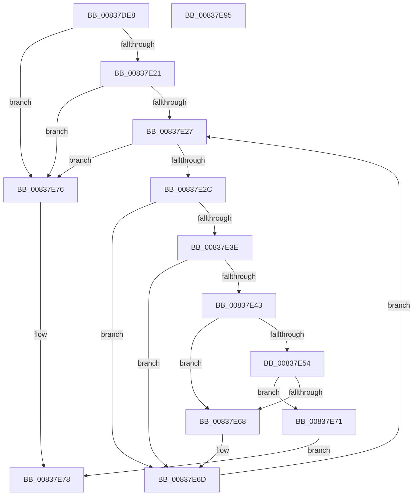

# I_MinCryptFindSignerCertificateByIssuerAndSerialNumber

- RVA: `0x00837DE8`–`0x00837E96` (길이 `174` bytes)
- VA: `0x0000000140837DE8`
- 실행 섹션: `PAGE`
- PDB 이름 있음: `예`; PDB Function 태그: `아니요`
- unwind 정보 RVA: `0x0005D79C`
- 디코드: `58`개 명령, `174/174` bytes 표시
- 미해석 바이트: `0` (있으면 어셈블리에 `.byte`로 보존)

> 이 문서는 커널 이미지의 기계어와 PDB 기호를 분석해 생성했습니다. 4번과 5번은 함수 원형과 자료형을 바이너리 사용 방식에서 추정한 C 해석이며 원본 소스 복구 결과는 아닙니다.

## 1. Dependencies

- 직접 호출 지점: **2**; 고유 호출 대상: **1**
- 직접 호출자로 확인된 함수: **2**
- RIP 상대 이미지 참조: **0**

### Outgoing calls
- `0x00837E4A` → [RtlCompareMemory](../../text/6B/RtlCompareMemory_function_006BA670.md) (function, `0x006BA670`)
- `0x00837E5E` → [RtlCompareMemory](../../text/6B/RtlCompareMemory_function_006BA670.md) (function, `0x006BA670`)

### Direct callers
- [I_MinCryptVerifyAuthenticodeTimeStamp](I_MinCryptVerifyAuthenticodeTimeStamp_function_00838090.md) at `0x00838151`
- [MinCrypK_VerifySignedDataKModeEx](MinCrypK_VerifySignedDataKModeEx_function_00838568.md) at `0x00838712`

### Static image references
- 디코드된 RIP-relative 메모리 참조가 없습니다.

## 2. Other-region calls and transfers

- 다른 실행 섹션으로 향하는 call: **2**
  - `0x00837E4A` → [RtlCompareMemory](../../text/6B/RtlCompareMemory_function_006BA670.md) (`PAGE` → `.text`)
  - `0x00837E5E` → [RtlCompareMemory](../../text/6B/RtlCompareMemory_function_006BA670.md) (`PAGE` → `.text`)
- 별도 외부 분기/꼬리 이동을 확인하지 못했습니다.

## 3. Assembly (complete function range)

```asm
00837DE8  48 89 5C 24 10                  mov qword ptr [rsp + 0x10], rbx
00837DED  48 89 6C 24 18                  mov qword ptr [rsp + 0x18], rbp
00837DF2  48 89 74 24 20                  mov qword ptr [rsp + 0x20], rsi
00837DF7  57                              push rdi
00837DF8  41 54                           push r12
00837DFA  41 55                           push r13
00837DFC  41 56                           push r14
00837DFE  41 57                           push r15
00837E00  48 83 EC 20                     sub rsp, 0x20
00837E04  44 8B 31                        mov r14d, dword ptr [rcx]
00837E07  33 F6                           xor esi, esi
00837E09  4C 8B 69 08                     mov r13, qword ptr [rcx + 8]
00837E0D  4D 8B E1                        mov r12, r9
00837E10  48 8B 4A 08                     mov rcx, qword ptr [rdx + 8]
00837E14  45 8B F8                        mov r15d, r8d
00837E17  48 89 4C 24 50                  mov qword ptr [rsp + 0x50], rcx
00837E1C  45 85 F6                        test r14d, r14d
00837E1F  74 55                           je 0x140837e76
00837E21  8B 2A                           mov ebp, dword ptr [rdx]
00837E23  85 ED                           test ebp, ebp
00837E25  74 4F                           je 0x140837e76
00837E27  41 3B F7                        cmp esi, r15d
00837E2A  73 4A                           jae 0x140837e76
00837E2C  8B C6                           mov eax, esi
00837E2E  48 69 F8 F0 00 00 00            imul rdi, rax, 0xf0
00837E35  49 03 FC                        add rdi, r12
00837E38  44 3B 77 70                     cmp r14d, dword ptr [rdi + 0x70]
00837E3C  75 2F                           jne 0x140837e6d
00837E3E  3B 6F 60                        cmp ebp, dword ptr [rdi + 0x60]
00837E41  75 2A                           jne 0x140837e6d
00837E43  48 8B 57 68                     mov rdx, qword ptr [rdi + 0x68]
00837E47  4C 8B C5                        mov r8, rbp
00837E4A  E8 21 28 E8 FF                  call 0x1406ba670
00837E4F  48 3B C5                        cmp rax, rbp
00837E52  75 14                           jne 0x140837e68
00837E54  48 8B 57 78                     mov rdx, qword ptr [rdi + 0x78]
00837E58  4D 8B C6                        mov r8, r14
00837E5B  49 8B CD                        mov rcx, r13
00837E5E  E8 0D 28 E8 FF                  call 0x1406ba670
00837E63  49 3B C6                        cmp rax, r14
00837E66  74 09                           je 0x140837e71
00837E68  48 8B 4C 24 50                  mov rcx, qword ptr [rsp + 0x50]
00837E6D  FF C6                           inc esi
00837E6F  EB B6                           jmp 0x140837e27
00837E71  48 8B C7                        mov rax, rdi
00837E74  EB 02                           jmp 0x140837e78
00837E76  33 C0                           xor eax, eax
00837E78  48 8B 5C 24 58                  mov rbx, qword ptr [rsp + 0x58]
00837E7D  48 8B 6C 24 60                  mov rbp, qword ptr [rsp + 0x60]
00837E82  48 8B 74 24 68                  mov rsi, qword ptr [rsp + 0x68]
00837E87  48 83 C4 20                     add rsp, 0x20
00837E8B  41 5F                           pop r15
00837E8D  41 5E                           pop r14
00837E8F  41 5D                           pop r13
00837E91  41 5C                           pop r12
00837E93  5F                              pop rdi
00837E94  C3                              ret
00837E95  CC                              int3
```

## 4. C-style interpretation (structured pseudocode)

```c
__int64 __fastcall I_MinCryptFindSignerCertificateByIssuerAndSerialNumber(__int64 a1, __int64 a2, int a3, __int64 a4)
{
    __int64 result;
    __int64 v_rdi;
    __int64 v_rsi;
    __int64 v_rsp;
    unsigned __int64 v_stack_p10;
    unsigned __int64 v_stack_p18;
    unsigned __int64 v_stack_p20;
    unsigned __int64 v_stack_p8;

    v_stack_p10 = v_rbx;
    v_stack_p18 = v_rbp;
    v_stack_p20 = v_rsi;
    v_rsp = (v_rsp) - (32);
    v_rsi = 0;
    v_stack_p8 = *(unsigned __int64 *)(a2 + 8);
    if ((unsigned int)((unsigned int)(*(unsigned int *)(a1))) == 0) goto loc_00837E76;
    if ((unsigned int)((unsigned int)(*(unsigned int *)(a2))) == 0) goto loc_00837E76;
loc_00837E27:
    if (0 >= ((unsigned int)((unsigned int)(a3)))) goto loc_00837E76;
    v_rdi = (v_rdi) * (0);
    v_rdi = (v_rdi) + (a4);
    if (((unsigned int)((unsigned int)(*(unsigned int *)(a1)))) != (*(unsigned int *)(v_rdi + 112))) goto loc_00837E6D;
    if (((unsigned int)((unsigned int)(*(unsigned int *)(a2)))) != (*(unsigned int *)(v_rdi + 96))) goto loc_00837E6D;
    result = RtlCompareMemory(*(unsigned __int64 *)(a2 + 8), *(unsigned __int64 *)(v_rdi + 104), (unsigned int)(*(unsigned int *)(a2)), a4);
    if (result != ((unsigned int)(*(unsigned int *)(a2)))) goto loc_00837E68;
    result = RtlCompareMemory(*(unsigned __int64 *)(a1 + 8), *(unsigned __int64 *)(v_rdi + 120), (unsigned int)(*(unsigned int *)(a1)), a4);
    if (result == ((unsigned int)(*(unsigned int *)(a1)))) goto loc_00837E71;
loc_00837E68:
loc_00837E6D:
    v_rsi = (unsigned int)((v_rsi) + 1);
    goto loc_00837E27;
loc_00837E71:
    goto loc_00837E78;
loc_00837E76:
    result = 0;
loc_00837E78:
    v_rsp = (v_rsp) + (32);
    return result;
}
```

## 5. (Beta) C Style

```c
int64_t I_MinCryptFindSignerCertificateByIssuerAndSerialNumber(void *Arg1, void *Arg2, int32_t Arg3, int64_t Arg4)
{
    uint8_t *arg1 = (uint8_t *)Arg1;
    uint8_t *arg2 = (uint8_t *)Arg2;

    int64_t result;
    int64_t local_rdi;
    int64_t local_rsi;
    int64_t local_rsp;
    uint64_t v_stack_p10;
    uint64_t v_stack_p18;
    uint64_t v_stack_p20;
    uint64_t v_stack_p8;

    v_stack_p10 = local_rbx;
    v_stack_p18 = local_rbp;
    v_stack_p20 = local_rsi;
    local_rsp = (local_rsp) - (32);
    local_rsi = 0;
    v_stack_p8 = *(uint64_t *)(arg2 + 0x8);
    if ((uint32_t)((uint32_t)(*(uint32_t *)(arg1))) == 0) goto loc_00837E76;
    if ((uint32_t)((uint32_t)(*(uint32_t *)(arg2))) == 0) goto loc_00837E76;
loc_00837E27:
    if (0 >= ((uint32_t)((uint32_t)(Arg3)))) goto loc_00837E76;
    local_rdi = (local_rdi) * (0);
    local_rdi = (local_rdi) + (Arg4);
    if (((uint32_t)((uint32_t)(*(uint32_t *)(arg1)))) != (*(uint32_t *)(local_rdi + 0x70))) goto loc_00837E6D;
    if (((uint32_t)((uint32_t)(*(uint32_t *)(arg2)))) != (*(uint32_t *)(local_rdi + 0x60))) goto loc_00837E6D;
    result = RtlCompareMemory(*(uint64_t *)(arg2 + 0x8), *(uint64_t *)(local_rdi + 0x68), (uint32_t)(*(uint32_t *)(arg2)), Arg4);
    if (result != ((uint32_t)(*(uint32_t *)(arg2)))) goto loc_00837E68;
    result = RtlCompareMemory(*(uint64_t *)(arg1 + 0x8), *(uint64_t *)(local_rdi + 0x78), (uint32_t)(*(uint32_t *)(arg1)), Arg4);
    if (result == ((uint32_t)(*(uint32_t *)(arg1)))) goto loc_00837E71;
loc_00837E68:
loc_00837E6D:
    local_rsi = (uint32_t)((local_rsi) + 1);
    goto loc_00837E27;
loc_00837E71:
    goto loc_00837E78;
loc_00837E76:
    result = 0;
loc_00837E78:
    local_rsp = (local_rsp) + (32);
    return result;
}
```

### 관측된 메모리 오프셋

구조체 형식이 확인되지 않은 접근은 인자 기준의 오프셋으로만 기록했습니다.

| 기준 인자 | 오프셋 표현 | 폭 (bit) | 접근 |
|---|---:|---:|---|
| `Arg1` | `+ 0x0` | `32` | `R` |
| `Arg1` | `+ 0x8` | `64` | `R` |
| `Arg2` | `+ 0x0` | `32` | `R` |
| `Arg2` | `+ 0x8` | `64` | `R` |

## 6. Execution-region graph

[열기: 2D/3D 그래프와 함수 탐색 컨트롤 패널](../../../control-panel.html?section=page&rva=0x00837DE8&view=graph)

- 2D 그래프는 위에서 아래로 흐르고, 3D 그래프는 빈 공간을 드래그해 회전합니다. Shift+드래그는 이동, 휠은 확대·축소, 함수 노드 선택은 대상 보고서 이동입니다.

### Static fallback


