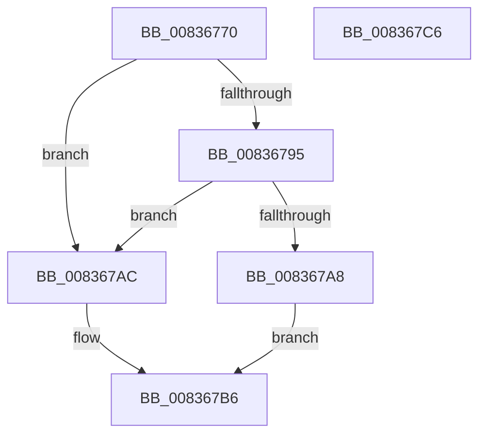

# I_MinCryptGetCertValidityPeriod

- RVA: `0x00836770`–`0x008367C7` (길이 `87` bytes)
- VA: `0x0000000140836770`
- 실행 섹션: `PAGE`
- PDB 이름 있음: `예`; PDB Function 태그: `아니요`
- unwind 정보 RVA: `0x00060BC4`
- 디코드: `27`개 명령, `87/87` bytes 표시
- 미해석 바이트: `0` (있으면 어셈블리에 `.byte`로 보존)

> 이 문서는 커널 이미지의 기계어와 PDB 기호를 분석해 생성했습니다. 4번과 5번은 함수 원형과 자료형을 바이너리 사용 방식에서 추정한 C 해석이며 원본 소스 복구 결과는 아닙니다.

## 1. Dependencies

- 직접 호출 지점: **2**; 고유 호출 대상: **1**
- 직접 호출자로 확인된 함수: **1**
- RIP 상대 이미지 참조: **0**

### Outgoing calls
- `0x0083678C` → [MinAsn1DecodeTime](MinAsn1DecodeTime_function_00839E54.md) (function, `0x00839E54`)
- `0x0083679F` → [MinAsn1DecodeTime](MinAsn1DecodeTime_function_00839E54.md) (function, `0x00839E54`)

### Direct callers
- [MinCryptVerifyCertificateWithPolicy2](MinCryptVerifyCertificateWithPolicy2_function_008368A8.md) at `0x00836B0C`

### Static image references
- 디코드된 RIP-relative 메모리 참조가 없습니다.

## 2. Other-region calls and transfers

- 다른 실행 섹션으로 향하는 call: **0**
- 별도 외부 분기/꼬리 이동을 확인하지 못했습니다.

## 3. Assembly (complete function range)

```asm
00836770  48 89 5C 24 08                  mov qword ptr [rsp + 8], rbx
00836775  48 89 74 24 10                  mov qword ptr [rsp + 0x10], rsi
0083677A  57                              push rdi
0083677B  48 83 EC 20                     sub rsp, 0x20
0083677F  48 8B F1                        mov rsi, rcx
00836782  49 8B D8                        mov rbx, r8
00836785  48 83 E9 80                     sub rcx, -0x80
00836789  48 8B FA                        mov rdi, rdx
0083678C  E8 C3 36 00 00                  call 0x140839e54
00836791  84 C0                           test al, al
00836793  74 17                           je 0x1408367ac
00836795  48 8D 8E 90 00 00 00            lea rcx, [rsi + 0x90]
0083679C  48 8B D3                        mov rdx, rbx
0083679F  E8 B0 36 00 00                  call 0x140839e54
008367A4  84 C0                           test al, al
008367A6  74 04                           je 0x1408367ac
008367A8  B0 01                           mov al, 1
008367AA  EB 0A                           jmp 0x1408367b6
008367AC  48 83 27 00                     and qword ptr [rdi], 0
008367B0  48 83 23 00                     and qword ptr [rbx], 0
008367B4  32 C0                           xor al, al
008367B6  48 8B 5C 24 30                  mov rbx, qword ptr [rsp + 0x30]
008367BB  48 8B 74 24 38                  mov rsi, qword ptr [rsp + 0x38]
008367C0  48 83 C4 20                     add rsp, 0x20
008367C4  5F                              pop rdi
008367C5  C3                              ret
008367C6  CC                              int3
```

## 4. C-style interpretation (structured pseudocode)

```c
__int64 __fastcall I_MinCryptGetCertValidityPeriod(__int64 a1, __int64 a2, __int64 a3)
{
    __int64 result;
    __int64 v_rsp;
    unsigned __int64 v_stack_p10;
    unsigned __int64 v_stack_p8;

    v_stack_p8 = v_rbx;
    v_stack_p10 = v_rsi;
    v_rsp = (v_rsp) - (32);
    a1 = (a1) - (-128);
    result = MinAsn1DecodeTime(a1, a2, a3, a4);
    if ((unsigned __int8)(result) == 0) goto loc_008367AC;
    result = MinAsn1DecodeTime(a1 + 144, a3, a3, a4);
    if ((unsigned __int8)(result) == 0) goto loc_008367AC;
    goto loc_008367B6;
loc_008367AC:
    result = 0;
loc_008367B6:
    v_rsp = (v_rsp) + (32);
    return result;
}
```

## 5. (Beta) C Style

```c
int64_t I_MinCryptGetCertValidityPeriod(void *Arg1, void *Arg2, void *Arg3)
{
    uint8_t *arg1 = (uint8_t *)Arg1;
    uint8_t *arg2 = (uint8_t *)Arg2;
    uint8_t *arg3 = (uint8_t *)Arg3;

    int64_t result;
    int64_t local_rsp;
    uint64_t v_stack_p10;
    uint64_t v_stack_p8;

    v_stack_p8 = local_rbx;
    v_stack_p10 = local_rsi;
    local_rsp = (local_rsp) - (32);
    Arg1 = (Arg1) - (-128);
    result = MinAsn1DecodeTime(Arg1, Arg2, Arg3, a4);
    if ((uint8_t)(result) == 0) goto loc_008367AC;
    result = MinAsn1DecodeTime(Arg1 + 144, Arg3, Arg3, a4);
    if ((uint8_t)(result) == 0) goto loc_008367AC;
    goto loc_008367B6;
loc_008367AC:
    result = 0;
loc_008367B6:
    local_rsp = (local_rsp) + (32);
    return result;
}
```

### 관측된 메모리 오프셋

구조체 형식이 확인되지 않은 접근은 인자 기준의 오프셋으로만 기록했습니다.

| 기준 인자 | 오프셋 표현 | 폭 (bit) | 접근 |
|---|---:|---:|---|
| `Arg1` | `+ 0x90` | `64` | `R` |
| `Arg2` | `+ 0x0` | `64` | `R/W` |
| `Arg3` | `+ 0x0` | `64` | `R/W` |

## 6. Execution-region graph

[열기: 2D/3D 그래프와 함수 탐색 컨트롤 패널](../../../control-panel.html?section=page&rva=0x00836770&view=graph)

- 2D 그래프는 위에서 아래로 흐르고, 3D 그래프는 빈 공간을 드래그해 회전합니다. Shift+드래그는 이동, 휠은 확대·축소, 함수 노드 선택은 대상 보고서 이동입니다.

### Static fallback


