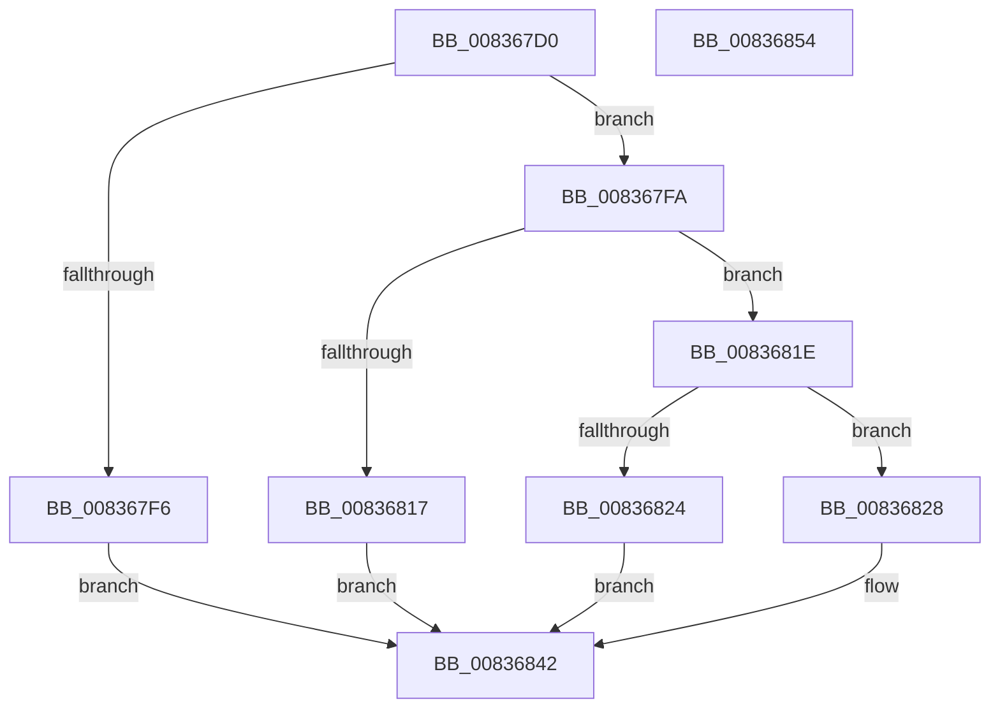

# I_MinCryptGetCertificateEKUs

- RVA: `0x008367D0`–`0x00836855` (길이 `133` bytes)
- VA: `0x00000001408367D0`
- 실행 섹션: `PAGE`
- PDB 이름 있음: `예`; PDB Function 태그: `아니요`
- unwind 정보 RVA: `0x000DAD58`
- 디코드: `42`개 명령, `133/133` bytes 표시
- 미해석 바이트: `0` (있으면 어셈블리에 `.byte`로 보존)

> 이 문서는 커널 이미지의 기계어와 PDB 기호를 분석해 생성했습니다. 4번과 5번은 함수 원형과 자료형을 바이너리 사용 방식에서 추정한 C 해석이며 원본 소스 복구 결과는 아닙니다.

## 1. Dependencies

- 직접 호출 지점: **2**; 고유 호출 대상: **2**
- 직접 호출자로 확인된 함수: **2**
- RIP 상대 이미지 참조: **1**

### Outgoing calls
- `0x0083680E` → [MinAsn1ParseSingleExtensionValue](MinAsn1ParseSingleExtensionValue_function_00839058.md) (function, `0x00839058`)
- `0x00836833` → [MinAsn1ParseOIDSequence](MinAsn1ParseOIDSequence_function_00838DB0.md) (function, `0x00838DB0`)

### Direct callers
- [I_MinCryptFindIssuerCertificateByName](I_MinCryptFindIssuerCertificateByName_function_00836530.md) at `0x008365CE`
- [MinCryptVerifyCertificateWithPolicy2](MinCryptVerifyCertificateWithPolicy2_function_008368A8.md) at `0x008369D0`
- [MinCryptVerifyCertificateWithPolicy2](MinCryptVerifyCertificateWithPolicy2_function_008368A8.md) at `0x00836F10`

### Static image references
- `0x00836807` → RVA `0x00B4BC68` (`PAGE`; read)

## 2. Other-region calls and transfers

- 다른 실행 섹션으로 향하는 call: **0**
- 별도 외부 분기/꼬리 이동을 확인하지 못했습니다.

## 3. Assembly (complete function range)

```asm
008367D0  48 8B C4                        mov rax, rsp
008367D3  48 89 58 08                     mov qword ptr [rax + 8], rbx
008367D7  48 89 70 10                     mov qword ptr [rax + 0x10], rsi
008367DB  57                              push rdi
008367DC  48 83 EC 40                     sub rsp, 0x40
008367E0  49 8B F0                        mov rsi, r8
008367E3  48 8B FA                        mov rdi, rdx
008367E6  33 DB                           xor ebx, ebx
008367E8  88 58 20                        mov byte ptr [rax + 0x20], bl
008367EB  0F 57 C0                        xorps xmm0, xmm0
008367EE  0F 11 40 E0                     movups xmmword ptr [rax - 0x20], xmm0
008367F2  39 19                           cmp dword ptr [rcx], ebx
008367F4  75 04                           jne 0x1408367fa
008367F6  89 1A                           mov dword ptr [rdx], ebx
008367F8  EB 48                           jmp 0x140836842
008367FA  4C 8D 4C 24 28                  lea r9, [rsp + 0x28]
008367FF  4C 8D 44 24 68                  lea r8, [rsp + 0x68]
00836804  48 8B D1                        mov rdx, rcx
00836807  48 8D 0D 5A 54 31 00            lea rcx, [rip + 0x31545a]
0083680E  E8 45 28 00 00                  call 0x140839058
00836813  85 C0                           test eax, eax
00836815  7F 07                           jg 0x14083681e
00836817  BB 28 04 00 C0                  mov ebx, 0xc0000428
0083681C  EB 24                           jmp 0x140836842
0083681E  38 5C 24 68                     cmp byte ptr [rsp + 0x68], bl
00836822  75 04                           jne 0x140836828
00836824  89 1F                           mov dword ptr [rdi], ebx
00836826  EB 1A                           jmp 0x140836842
00836828  4C 8B C6                        mov r8, rsi
0083682B  48 8B D7                        mov rdx, rdi
0083682E  48 8D 4C 24 28                  lea rcx, [rsp + 0x28]
00836833  E8 78 25 00 00                  call 0x140838db0
00836838  B9 28 04 00 C0                  mov ecx, 0xc0000428
0083683D  85 C0                           test eax, eax
0083683F  0F 4E D9                        cmovle ebx, ecx
00836842  8B C3                           mov eax, ebx
00836844  48 8B 5C 24 50                  mov rbx, qword ptr [rsp + 0x50]
00836849  48 8B 74 24 58                  mov rsi, qword ptr [rsp + 0x58]
0083684E  48 83 C4 40                     add rsp, 0x40
00836852  5F                              pop rdi
00836853  C3                              ret
00836854  CC                              int3
```

## 4. C-style interpretation (structured pseudocode)

```c
__int64 __fastcall I_MinCryptGetCertificateEKUs(__int64 a1, __int64 a2, __int64 a3)
{
    __int64 result;
    __int64 v_rbx;
    __int64 v_rsp;
    unsigned __int64 v_stack_m20;
    unsigned __int64 v_stack_p10;
    unsigned __int64 v_stack_p20;
    unsigned __int64 v_stack_p8;

    *(unsigned __int64 *)(v_rsp + 8) = v_rbx;
    *(unsigned __int64 *)(v_rsp + 16) = v_rsi;
    v_rsp = (v_rsp) - (64);
    v_rbx = 0;
    *(unsigned __int8 *)(v_rsp + 32) = 0;
    *(unsigned __int64 *)(v_rsp - 32) = v_xmm0;
    if ((*(unsigned int *)(a1)) != 0) goto loc_008367FA;
    *(unsigned int *)(a2) = 0;
    goto loc_00836842;
loc_008367FA:
    result = MinAsn1ParseSingleExtensionValue(v_rip + 3232858, a1, v_stack_p20, v_stack_m20);
    if (condition_is_greater) goto loc_0083681E;
    goto loc_00836842;
loc_0083681E:
    if (v_stack_p20 != ((unsigned __int8)((unsigned int)(0xC0000428ULL)))) goto loc_00836828;
    *(unsigned int *)(a2) = (unsigned int)((unsigned int)(0xC0000428ULL));
    goto loc_00836842;
loc_00836828:
    result = MinAsn1ParseOIDSequence(v_stack_m20, a2, a3, v_stack_m20);
    v_rbx = (unsigned int)(0xC0000428ULL);
    if (condition_is_less_or_equal) { v_rbx = (unsigned int)((unsigned int)(0xC0000428ULL)); }
loc_00836842:
    v_rsp = (v_rsp) + (64);
    return (unsigned int)((unsigned int)(v_rbx));
}
```

## 5. (Beta) C Style

```c
int64_t I_MinCryptGetCertificateEKUs(void *Arg1, void *Arg2, int64_t Arg3)
{
    uint8_t *arg1 = (uint8_t *)Arg1;
    uint8_t *arg2 = (uint8_t *)Arg2;

    int64_t result;
    int64_t local_rbx;
    int64_t local_rsp;
    uint64_t v_stack_m20;
    uint64_t v_stack_p10;
    uint64_t v_stack_p20;
    uint64_t v_stack_p8;

    *(uint64_t *)(local_rsp + 0x8) = local_rbx;
    *(uint64_t *)(local_rsp + 0x10) = local_rsi;
    local_rsp = (local_rsp) - (64);
    local_rbx = 0;
    *(uint8_t *)(local_rsp + 0x20) = 0;
    *(uint64_t *)(local_rsp - 0x20) = v_xmm0;
    if ((*(uint32_t *)(arg1)) != 0) goto loc_008367FA;
    *(uint32_t *)(arg2) = 0;
    goto loc_00836842;
loc_008367FA:
    result = MinAsn1ParseSingleExtensionValue(v_rip + 3232858, Arg1, v_stack_p20, v_stack_m20);
    if (condition_is_greater) goto loc_0083681E;
    goto loc_00836842;
loc_0083681E:
    if (v_stack_p20 != ((uint8_t)((uint32_t)(0xC0000428ULL)))) goto loc_00836828;
    *(uint32_t *)(arg2) = (uint32_t)((uint32_t)(0xC0000428ULL));
    goto loc_00836842;
loc_00836828:
    result = MinAsn1ParseOIDSequence(v_stack_m20, Arg2, Arg3, v_stack_m20);
    local_rbx = (uint32_t)(0xC0000428ULL);
    if (condition_is_less_or_equal) { local_rbx = (uint32_t)((uint32_t)(0xC0000428ULL)); }
loc_00836842:
    local_rsp = (local_rsp) + (64);
    return (uint32_t)((uint32_t)(local_rbx));
}
```

### 관측된 메모리 오프셋

구조체 형식이 확인되지 않은 접근은 인자 기준의 오프셋으로만 기록했습니다.

| 기준 인자 | 오프셋 표현 | 폭 (bit) | 접근 |
|---|---:|---:|---|
| `Arg1` | `+ 0x0` | `32` | `R` |
| `Arg2` | `+ 0x0` | `32` | `W` |

## 6. Execution-region graph

[열기: 2D/3D 그래프와 함수 탐색 컨트롤 패널](../../../control-panel.html?section=page&rva=0x008367D0&view=graph)

- 2D 그래프는 위에서 아래로 흐르고, 3D 그래프는 빈 공간을 드래그해 회전합니다. Shift+드래그는 이동, 휠은 확대·축소, 함수 노드 선택은 대상 보고서 이동입니다.

### Static fallback


