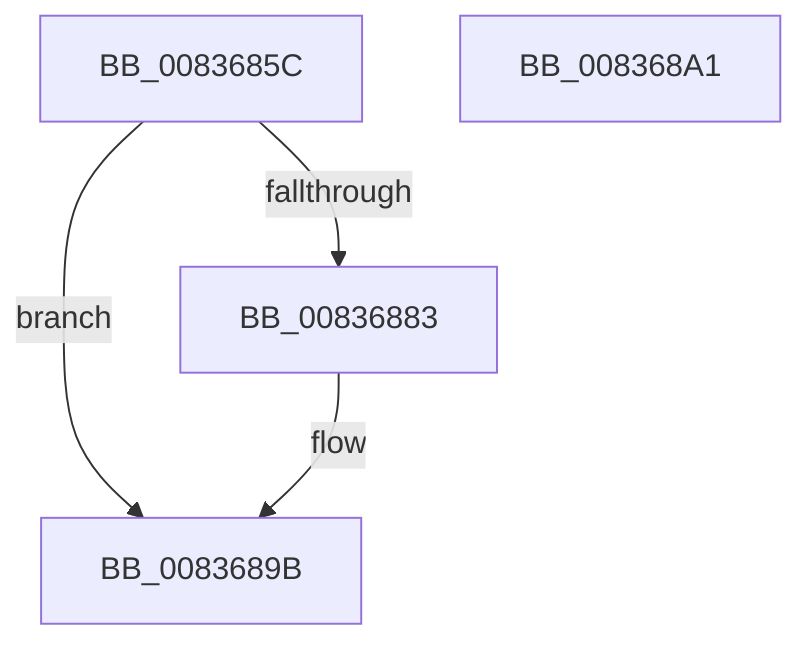

# I_MinCryptGetCommonName

- RVA: `0x0083685C`–`0x008368A2` (길이 `70` bytes)
- VA: `0x000000014083685C`
- 실행 섹션: `PAGE`
- PDB 이름 있음: `예`; PDB Function 태그: `아니요`
- unwind 정보 RVA: `0x000AA39C`
- 디코드: `22`개 명령, `70/70` bytes 표시
- 미해석 바이트: `0` (있으면 어셈블리에 `.byte`로 보존)

> 이 문서는 커널 이미지의 기계어와 PDB 기호를 분석해 생성했습니다. 4번과 5번은 함수 원형과 자료형을 바이너리 사용 방식에서 추정한 C 해석이며 원본 소스 복구 결과는 아닙니다.

## 1. Dependencies

- 직접 호출 지점: **1**; 고유 호출 대상: **1**
- 직접 호출자로 확인된 함수: **1**
- RIP 상대 이미지 참조: **0**

### Outgoing calls
- `0x0083687A` → [MinAsn1ParseAndDecodeRDNComponent](MinAsn1ParseAndDecodeRDNComponent_function_00838BD4.md) (function, `0x00838BD4`)

### Direct callers
- [MinCryptVerifyCertificateWithPolicy2](MinCryptVerifyCertificateWithPolicy2_function_008368A8.md) at `0x00836D5E`
- [MinCryptVerifyCertificateWithPolicy2](MinCryptVerifyCertificateWithPolicy2_function_008368A8.md) at `0x00836DD7`

### Static image references
- 디코드된 RIP-relative 메모리 참조가 없습니다.

## 2. Other-region calls and transfers

- 다른 실행 섹션으로 향하는 call: **0**
- 별도 외부 분기/꼬리 이동을 확인하지 못했습니다.

## 3. Assembly (complete function range)

```asm
0083685C  48 8B C4                        mov rax, rsp
0083685F  53                              push rbx
00836860  48 83 EC 30                     sub rsp, 0x30
00836864  0F 57 C0                        xorps xmm0, xmm0
00836867  C6 40 18 00                     mov byte ptr [rax + 0x18], 0
0083686B  4C 8D 48 E8                     lea r9, [rax - 0x18]
0083686F  48 8B DA                        mov rbx, rdx
00836872  4C 8D 40 18                     lea r8, [rax + 0x18]
00836876  0F 11 40 E8                     movups xmmword ptr [rax - 0x18], xmm0
0083687A  E8 55 23 00 00                  call 0x140838bd4
0083687F  84 C0                           test al, al
00836881  74 18                           je 0x14083689b
00836883  8A 4C 24 50                     mov cl, byte ptr [rsp + 0x50]
00836887  88 4B 0A                        mov byte ptr [rbx + 0xa], cl
0083688A  48 8B 4C 24 28                  mov rcx, qword ptr [rsp + 0x28]
0083688F  48 89 0B                        mov qword ptr [rbx], rcx
00836892  0F B7 4C 24 20                  movzx ecx, word ptr [rsp + 0x20]
00836897  66 89 4B 08                     mov word ptr [rbx + 8], cx
0083689B  48 83 C4 30                     add rsp, 0x30
0083689F  5B                              pop rbx
008368A0  C3                              ret
008368A1  CC                              int3
```

## 4. C-style interpretation (structured pseudocode)

```c
__int64 __fastcall I_MinCryptGetCommonName(__int64 a1, __int64 a2)
{
    __int64 result;
    __int64 v_rsp;
    unsigned __int64 v_stack_m10;
    unsigned __int16 v_stack_m18;
    unsigned __int8 v_stack_p18;

    v_rsp = (v_rsp) - (48);
    *(unsigned __int8 *)(v_rsp + 24) = 0;
    *(unsigned __int64 *)(v_rsp - 24) = v_xmm0;
    result = MinAsn1ParseAndDecodeRDNComponent(a1, a2, v_rsp + 24, v_rsp - 24);
    if ((unsigned __int8)(result) != 0) {
        a1 = v_stack_p18;
        *(unsigned __int8 *)(a2 + 10) = (unsigned __int8)(a1);
        a1 = v_stack_m10;
        *(unsigned __int64 *)(a2) = a1;
        a1 = v_stack_m18;
        *(unsigned __int16 *)(a2 + 8) = (unsigned __int16)(a1);
    }
    v_rsp = (v_rsp) + (48);
    return result;
}
```

## 5. (Beta) C Style

```c
int64_t I_MinCryptGetCommonName(int64_t Arg1, void *Arg2)
{
    uint8_t *arg2 = (uint8_t *)Arg2;

    int64_t result;
    int64_t local_rsp;
    uint64_t v_stack_m10;
    uint16_t v_stack_m18;
    uint8_t v_stack_p18;

    local_rsp = (local_rsp) - (48);
    *(uint8_t *)(local_rsp + 0x18) = 0;
    *(uint64_t *)(local_rsp - 0x18) = v_xmm0;
    result = MinAsn1ParseAndDecodeRDNComponent(Arg1, Arg2, local_rsp + 24, local_rsp - 24);
    if ((uint8_t)(result) != 0) {
        Arg1 = v_stack_p18;
        *(uint8_t *)(arg2 + 0xA) = (uint8_t)(Arg1);
        Arg1 = v_stack_m10;
        *(uint64_t *)(arg2) = Arg1;
        Arg1 = v_stack_m18;
        *(uint16_t *)(arg2 + 0x8) = (uint16_t)(Arg1);
    }
    local_rsp = (local_rsp) + (48);
    return result;
}
```

### 관측된 메모리 오프셋

구조체 형식이 확인되지 않은 접근은 인자 기준의 오프셋으로만 기록했습니다.

| 기준 인자 | 오프셋 표현 | 폭 (bit) | 접근 |
|---|---:|---:|---|
| `Arg2` | `+ 0x0` | `64` | `W` |
| `Arg2` | `+ 0x8` | `16` | `W` |
| `Arg2` | `+ 0xA` | `8` | `W` |

## 6. Execution-region graph

[열기: 2D/3D 그래프와 함수 탐색 컨트롤 패널](../../../control-panel.html?section=page&rva=0x0083685C&view=graph)

- 2D 그래프는 위에서 아래로 흐르고, 3D 그래프는 빈 공간을 드래그해 회전합니다. Shift+드래그는 이동, 휠은 확대·축소, 함수 노드 선택은 대상 보고서 이동입니다.

### Static fallback


