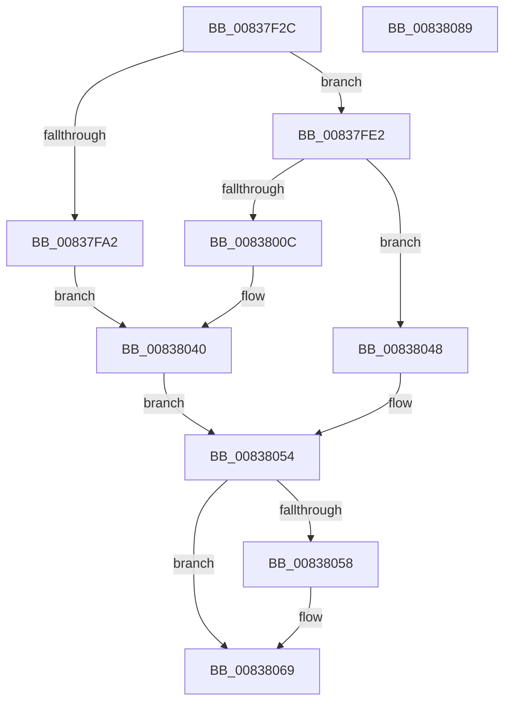

# I_MinCryptGetSigningTime

- RVA: `0x00837F2C`–`0x0083808A` (길이 `350` bytes)
- VA: `0x0000000140837F2C`
- 실행 섹션: `PAGE`
- PDB 이름 있음: `예`; PDB Function 태그: `아니요`
- unwind 정보 RVA: `0x000DAE70`
- 디코드: `85`개 명령, `350/350` bytes 표시
- 미해석 바이트: `0` (있으면 어셈블리에 `.byte`로 보존)

> 이 문서는 커널 이미지의 기계어와 PDB 기호를 분석해 생성했습니다. 4번과 5번은 함수 원형과 자료형을 바이너리 사용 방식에서 추정한 C 해석이며 원본 소스 복구 결과는 아닙니다.

## 1. Dependencies

- 직접 호출 지점: **5**; 고유 호출 대상: **4**
- 직접 호출자로 확인된 함수: **1**
- RIP 상대 이미지 참조: **2**

### Outgoing calls
- `0x00837F99` → [I_MinAsn1ParseSingleAttribute](I_MinAsn1ParseSingleAttribute_function_00838A10.md) (function, `0x00838A10`)
- `0x00837FDB` → [I_MinCryptVerifyAuthenticodeTimeStamp](I_MinCryptVerifyAuthenticodeTimeStamp_function_00838090.md) (function, `0x00838090`)
- `0x00838003` → [I_MinAsn1ParseSingleAttribute](I_MinAsn1ParseSingleAttribute_function_00838A10.md) (function, `0x00838A10`)
- `0x0083803B` → [I_MinCryptVerifyRFC3161TimeStamp](I_MinCryptVerifyRFC3161TimeStamp_function_008382A4.md) (function, `0x008382A4`)
- `0x00838062` → [I_MinCryptBuildErrorPolicy](I_MinCryptBuildErrorPolicy_function_008391DC.md) (function, `0x008391DC`)

### Direct callers
- [MinCrypK_VerifySignedDataKModeEx](MinCrypK_VerifySignedDataKModeEx_function_00838568.md) at `0x00838908`

### Static image references
- `0x00837F79` → RVA `0x00B4B668` (`PAGE`; read)
- `0x00837FEA` → RVA `0x00B4B790` (`PAGE`; read)

## 2. Other-region calls and transfers

- 다른 실행 섹션으로 향하는 call: **0**
- 별도 외부 분기/꼬리 이동을 확인하지 못했습니다.

## 3. Assembly (complete function range)

```asm
00837F2C  48 8B C4                        mov rax, rsp
00837F2F  48 89 58 08                     mov qword ptr [rax + 8], rbx
00837F33  48 89 70 10                     mov qword ptr [rax + 0x10], rsi
00837F37  48 89 78 18                     mov qword ptr [rax + 0x18], rdi
00837F3B  4C 89 48 20                     mov qword ptr [rax + 0x20], r9
00837F3F  41 54                           push r12
00837F41  41 56                           push r14
00837F43  41 57                           push r15
00837F45  48 81 EC 80 00 00 00            sub rsp, 0x80
00837F4C  49 8B F9                        mov rdi, r9
00837F4F  4D 8B F8                        mov r15, r8
00837F52  44 8B E2                        mov r12d, edx
00837F55  48 8B F1                        mov rsi, rcx
00837F58  BB 25 02 00 C0                  mov ebx, 0xc0000225
00837F5D  89 58 B8                        mov dword ptr [rax - 0x48], ebx
00837F60  0F 57 C0                        xorps xmm0, xmm0
00837F63  0F 11 40 D0                     movups xmmword ptr [rax - 0x30], xmm0
00837F67  0F 57 C9                        xorps xmm1, xmm1
00837F6A  0F 11 48 C0                     movups xmmword ptr [rax - 0x40], xmm1
00837F6E  83 60 BC 00                     and dword ptr [rax - 0x44], 0
00837F72  C7 40 C0 09 00 00 00            mov dword ptr [rax - 0x40], 9
00837F79  48 8D 05 E8 36 31 00            lea rax, [rip + 0x3136e8]
00837F80  48 89 44 24 60                  mov qword ptr [rsp + 0x60], rax
00837F85  4C 8D B1 20 01 00 00            lea r14, [rcx + 0x120]
00837F8C  4C 8D 4C 24 68                  lea r9, [rsp + 0x68]
00837F91  49 8B D6                        mov rdx, r14
00837F94  48 8D 4C 24 58                  lea rcx, [rsp + 0x58]
00837F99  E8 72 0A 00 00                  call 0x140838a10
00837F9E  84 C0                           test al, al
00837FA0  74 40                           je 0x140837fe2
00837FA2  48 8B 84 24 C8 00 00 00         mov rax, qword ptr [rsp + 0xc8]
00837FAA  48 89 44 24 40                  mov qword ptr [rsp + 0x40], rax
00837FAF  48 8B 84 24 C0 00 00 00         mov rax, qword ptr [rsp + 0xc0]
00837FB7  48 89 44 24 38                  mov qword ptr [rsp + 0x38], rax
00837FBC  48 8D 44 24 54                  lea rax, [rsp + 0x54]
00837FC1  48 89 44 24 30                  mov qword ptr [rsp + 0x30], rax
00837FC6  48 89 7C 24 28                  mov qword ptr [rsp + 0x28], rdi
00837FCB  4C 89 7C 24 20                  mov qword ptr [rsp + 0x20], r15
00837FD0  45 8B CC                        mov r9d, r12d
00837FD3  4C 8B C6                        mov r8, rsi
00837FD6  48 8D 4C 24 68                  lea rcx, [rsp + 0x68]
00837FDB  E8 B0 00 00 00                  call 0x140838090
00837FE0  EB 5E                           jmp 0x140838040
00837FE2  C7 44 24 58 0A 00 00 00         mov dword ptr [rsp + 0x58], 0xa
00837FEA  48 8D 05 9F 37 31 00            lea rax, [rip + 0x31379f]
00837FF1  48 89 44 24 60                  mov qword ptr [rsp + 0x60], rax
00837FF6  4C 8D 4C 24 68                  lea r9, [rsp + 0x68]
00837FFB  49 8B D6                        mov rdx, r14
00837FFE  48 8D 4C 24 58                  lea rcx, [rsp + 0x58]
00838003  E8 08 0A 00 00                  call 0x140838a10
00838008  84 C0                           test al, al
0083800A  74 3C                           je 0x140838048
0083800C  48 8B 84 24 C8 00 00 00         mov rax, qword ptr [rsp + 0xc8]
00838014  48 89 44 24 30                  mov qword ptr [rsp + 0x30], rax
00838019  48 8B 84 24 C0 00 00 00         mov rax, qword ptr [rsp + 0xc0]
00838021  48 89 44 24 28                  mov qword ptr [rsp + 0x28], rax
00838026  48 8D 44 24 54                  lea rax, [rsp + 0x54]
0083802B  48 89 44 24 20                  mov qword ptr [rsp + 0x20], rax
00838030  4C 8B CF                        mov r9, rdi
00838033  4C 8B C6                        mov r8, rsi
00838036  48 8D 4C 24 68                  lea rcx, [rsp + 0x68]
0083803B  E8 64 02 00 00                  call 0x1408382a4
00838040  8B D8                           mov ebx, eax
00838042  89 44 24 50                     mov dword ptr [rsp + 0x50], eax
00838046  EB 0C                           jmp 0x140838054
00838048  C7 44 24 54 00 00 00 04         mov dword ptr [rsp + 0x54], 0x4000000
00838050  89 5C 24 50                     mov dword ptr [rsp + 0x50], ebx
00838054  85 DB                           test ebx, ebx
00838056  79 11                           jns 0x140838069
00838058  44 8B 44 24 54                  mov r8d, dword ptr [rsp + 0x54]
0083805D  48 8B D7                        mov rdx, rdi
00838060  8B CB                           mov ecx, ebx
00838062  E8 75 11 00 00                  call 0x1408391dc
00838067  8B D8                           mov ebx, eax
00838069  8B C3                           mov eax, ebx
0083806B  4C 8D 9C 24 80 00 00 00         lea r11, [rsp + 0x80]
00838073  49 8B 5B 20                     mov rbx, qword ptr [r11 + 0x20]
00838077  49 8B 73 28                     mov rsi, qword ptr [r11 + 0x28]
0083807B  49 8B 7B 30                     mov rdi, qword ptr [r11 + 0x30]
0083807F  49 8B E3                        mov rsp, r11
00838082  41 5F                           pop r15
00838084  41 5E                           pop r14
00838086  41 5C                           pop r12
00838088  C3                              ret
00838089  CC                              int3
```

## 4. C-style interpretation (structured pseudocode)

```c
__int64 __fastcall I_MinCryptGetSigningTime(__int64 a1, int a2, __int64 a3, __int64 a4, __int64 a5, __int64 a6)
{
    __int64 result;
    __int64 v_rbx;
    __int64 v_rsp;
    unsigned __int64 v_stack_m18;
    unsigned __int64 v_stack_m30;
    unsigned __int64 v_stack_m38;
    unsigned __int64 v_stack_m40;
    unsigned __int64 v_stack_m44;
    unsigned int v_stack_m48;
    unsigned __int64 v_stack_m58;
    unsigned __int64 v_stack_m60;
    unsigned __int64 v_stack_m68;
    unsigned __int64 v_stack_m70;
    unsigned __int64 v_stack_m78;

    *(unsigned __int64 *)(v_rsp + 8) = v_rbx;
    *(unsigned __int64 *)(v_rsp + 16) = v_rsi;
    *(unsigned __int64 *)(v_rsp + 24) = v_rdi;
    *(unsigned __int64 *)(v_rsp + 32) = a4;
    v_rsp = (v_rsp) - (128);
    *(unsigned int *)(v_rsp - 72) = (unsigned int)((unsigned int)(0xC0000225ULL));
    *(unsigned __int64 *)(v_rsp - 48) = v_xmm0;
    *(unsigned __int64 *)(v_rsp - 64) = v_xmm1;
    *(unsigned int *)(v_rsp - 64) = 9;
    v_stack_m38 = v_rip + 3225320;
    result = I_MinAsn1ParseSingleAttribute(v_stack_m40, a1 + 288, a3, v_stack_m30);
    if ((unsigned __int8)(result) == 0) goto loc_00837FE2;
    v_stack_m58 = a6;
    v_stack_m60 = a5;
    v_stack_m68 = v_stack_m44;
    v_stack_m70 = a4;
    v_stack_m78 = a3;
    result = I_MinCryptVerifyAuthenticodeTimeStamp(v_stack_m30, a1 + 288, a1, (unsigned int)((unsigned int)((unsigned int)(a2))));
    goto loc_00838040;
loc_00837FE2:
    v_stack_m40 = 10;
    v_stack_m38 = v_rip + 3225503;
    result = I_MinAsn1ParseSingleAttribute(v_stack_m40, a1 + 288, a1, v_stack_m30);
    if ((unsigned __int8)(result) == 0) goto loc_00838048;
    v_stack_m68 = a6;
    v_stack_m70 = a5;
    v_stack_m78 = v_stack_m44;
    result = I_MinCryptVerifyRFC3161TimeStamp(v_stack_m30, a1 + 288, a1, a4);
loc_00838040:
    v_stack_m48 = (unsigned int)(result);
    goto loc_00838054;
loc_00838048:
    v_stack_m44 = 0x4000000ULL;
    v_stack_m48 = (unsigned int)((unsigned int)((unsigned int)(result)));
loc_00838054:
    v_rbx = (unsigned int)((unsigned int)(result));
    if (sign_flag) {
        a3 = v_stack_m44;
        a2 = a4;
        a1 = (unsigned int)((unsigned int)((unsigned int)(result)));
        result = I_MinCryptBuildErrorPolicy(a1, a2, a3, a4);
        v_rbx = (unsigned int)(result);
    }
    return (unsigned int)((unsigned int)(v_rbx));
}
```

## 5. (Beta) C Style

```c
int64_t I_MinCryptGetSigningTime(void *Arg1, int32_t Arg2, int64_t Arg3, int64_t Arg4, int64_t Arg5, int64_t Arg6)
{
    uint8_t *arg1 = (uint8_t *)Arg1;

    int64_t result;
    int64_t local_rbx;
    int64_t local_rsp;
    uint64_t v_stack_m18;
    uint64_t v_stack_m30;
    uint64_t v_stack_m38;
    uint64_t v_stack_m40;
    uint64_t v_stack_m44;
    uint32_t v_stack_m48;
    uint64_t v_stack_m58;
    uint64_t v_stack_m60;
    uint64_t v_stack_m68;
    uint64_t v_stack_m70;
    uint64_t v_stack_m78;

    *(uint64_t *)(local_rsp + 0x8) = local_rbx;
    *(uint64_t *)(local_rsp + 0x10) = local_rsi;
    *(uint64_t *)(local_rsp + 0x18) = local_rdi;
    *(uint64_t *)(local_rsp + 0x20) = Arg4;
    local_rsp = (local_rsp) - (128);
    *(uint32_t *)(local_rsp - 0x48) = (uint32_t)((uint32_t)(0xC0000225ULL));
    *(uint64_t *)(local_rsp - 0x30) = v_xmm0;
    *(uint64_t *)(local_rsp - 0x40) = v_xmm1;
    *(uint32_t *)(local_rsp - 0x40) = 9;
    v_stack_m38 = v_rip + 3225320;
    result = I_MinAsn1ParseSingleAttribute(v_stack_m40, Arg1 + 288, Arg3, v_stack_m30);
    if ((uint8_t)(result) == 0) goto loc_00837FE2;
    v_stack_m58 = Arg6;
    v_stack_m60 = Arg5;
    v_stack_m68 = v_stack_m44;
    v_stack_m70 = Arg4;
    v_stack_m78 = Arg3;
    result = I_MinCryptVerifyAuthenticodeTimeStamp(v_stack_m30, Arg1 + 288, Arg1, (uint32_t)((uint32_t)((uint32_t)(Arg2))));
    goto loc_00838040;
loc_00837FE2:
    v_stack_m40 = 10;
    v_stack_m38 = v_rip + 3225503;
    result = I_MinAsn1ParseSingleAttribute(v_stack_m40, Arg1 + 288, Arg1, v_stack_m30);
    if ((uint8_t)(result) == 0) goto loc_00838048;
    v_stack_m68 = Arg6;
    v_stack_m70 = Arg5;
    v_stack_m78 = v_stack_m44;
    result = I_MinCryptVerifyRFC3161TimeStamp(v_stack_m30, Arg1 + 288, Arg1, Arg4);
loc_00838040:
    v_stack_m48 = (uint32_t)(result);
    goto loc_00838054;
loc_00838048:
    v_stack_m44 = 0x4000000ULL;
    v_stack_m48 = (uint32_t)((uint32_t)((uint32_t)(result)));
loc_00838054:
    local_rbx = (uint32_t)((uint32_t)(result));
    if (sign_flag) {
        Arg3 = v_stack_m44;
        Arg2 = Arg4;
        Arg1 = (uint32_t)((uint32_t)((uint32_t)(result)));
        result = I_MinCryptBuildErrorPolicy(Arg1, Arg2, Arg3, Arg4);
        local_rbx = (uint32_t)(result);
    }
    return (uint32_t)((uint32_t)(local_rbx));
}
```

### 관측된 메모리 오프셋

구조체 형식이 확인되지 않은 접근은 인자 기준의 오프셋으로만 기록했습니다.

| 기준 인자 | 오프셋 표현 | 폭 (bit) | 접근 |
|---|---:|---:|---|
| `Arg1` | `+ 0x120` | `64` | `R` |

## 6. Execution-region graph

[열기: 2D/3D 그래프와 함수 탐색 컨트롤 패널](../../../control-panel.html?section=page&rva=0x00837F2C&view=graph)

- 2D 그래프는 위에서 아래로 흐르고, 3D 그래프는 빈 공간을 드래그해 회전합니다. Shift+드래그는 이동, 휠은 확대·축소, 함수 노드 선택은 대상 보고서 이동입니다.

### Static fallback


