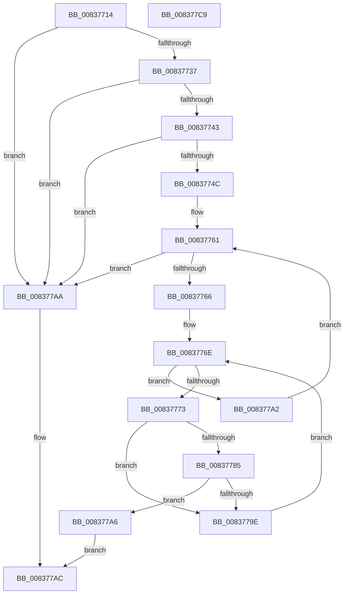

# I_MinCryptIsTimestampSignerTrusted

- RVA: `0x00837714`–`0x008377CA` (길이 `182` bytes)
- VA: `0x0000000140837714`
- 실행 섹션: `PAGE`
- PDB 이름 있음: `예`; PDB Function 태그: `예`
- unwind 정보 RVA: `0x00075C18`
- 디코드: `61`개 명령, `182/182` bytes 표시
- 미해석 바이트: `0` (있으면 어셈블리에 `.byte`로 보존)

> 이 문서는 커널 이미지의 기계어와 PDB 기호를 분석해 생성했습니다. 4번과 5번은 함수 원형과 자료형을 바이너리 사용 방식에서 추정한 C 해석이며 원본 소스 복구 결과는 아닙니다.

## 1. Dependencies

- 직접 호출 지점: **1**; 고유 호출 대상: **1**
- 직접 호출자로 확인된 함수: **1**
- RIP 상대 이미지 참조: **1**

### Outgoing calls
- `0x00837795` → [memcmp](../../text/6C/memcmp_function_006C6B10.md) (function, `0x006C6B10`)

### Direct callers
- [MincryptIsTimestampBeforeRevocation](MincryptIsTimestampBeforeRevocation_function_00837A68.md) at `0x00837B15`

### Static image references
- `0x00837737` → RVA `0x00FD8098` (`PAGEDATA`; read)

## 2. Other-region calls and transfers

- 다른 실행 섹션으로 향하는 call: **1**
  - `0x00837795` → [memcmp](../../text/6C/memcmp_function_006C6B10.md) (`PAGE` → `.text`)
- 별도 외부 분기/꼬리 이동을 확인하지 못했습니다.

## 3. Assembly (complete function range)

```asm
00837714  48 89 5C 24 08                  mov qword ptr [rsp + 8], rbx
00837719  48 89 6C 24 10                  mov qword ptr [rsp + 0x10], rbp
0083771E  48 89 74 24 18                  mov qword ptr [rsp + 0x18], rsi
00837723  57                              push rdi
00837724  41 54                           push r12
00837726  41 55                           push r13
00837728  41 56                           push r14
0083772A  41 57                           push r15
0083772C  48 83 EC 20                     sub rsp, 0x20
00837730  4C 8B F2                        mov r14, rdx
00837733  85 C9                           test ecx, ecx
00837735  74 73                           je 0x1408377aa
00837737  48 8B 05 5A 09 7A 00            mov rax, qword ptr [rip + 0x7a095a]
0083773E  48 85 C0                        test rax, rax
00837741  74 67                           je 0x1408377aa
00837743  83 B8 A0 00 00 00 00            cmp dword ptr [rax + 0xa0], 0
0083774A  74 5E                           je 0x1408377aa
0083774C  4C 8B B8 A8 00 00 00            mov r15, qword ptr [rax + 0xa8]
00837753  44 8B 62 30                     mov r12d, dword ptr [rdx + 0x30]
00837757  8B F9                           mov edi, ecx
00837759  49 03 FF                        add rdi, r15
0083775C  33 DB                           xor ebx, ebx
0083775E  44 8B 2F                        mov r13d, dword ptr [rdi]
00837761  41 3B DC                        cmp ebx, r12d
00837764  73 44                           jae 0x1408377aa
00837766  33 F6                           xor esi, esi
00837768  8B C3                           mov eax, ebx
0083776A  48 6B E8 78                     imul rbp, rax, 0x78
0083776E  41 3B F5                        cmp esi, r13d
00837771  73 2F                           jae 0x1408377a2
00837773  8B 4C B7 04                     mov ecx, dword ptr [rdi + rsi*4 + 4]
00837777  49 8B 56 28                     mov rdx, qword ptr [r14 + 0x28]
0083777B  49 03 CF                        add rcx, r15
0083777E  8B 04 2A                        mov eax, dword ptr [rdx + rbp]
00837781  39 01                           cmp dword ptr [rcx], eax
00837783  75 19                           jne 0x14083779e
00837785  44 8B 44 2A 04                  mov r8d, dword ptr [rdx + rbp + 4]
0083778A  48 83 C1 04                     add rcx, 4
0083778E  48 83 C2 08                     add rdx, 8
00837792  48 03 D5                        add rdx, rbp
00837795  E8 76 F3 E8 FF                  call 0x1406c6b10
0083779A  85 C0                           test eax, eax
0083779C  74 08                           je 0x1408377a6
0083779E  FF C6                           inc esi
008377A0  EB CC                           jmp 0x14083776e
008377A2  FF C3                           inc ebx
008377A4  EB BB                           jmp 0x140837761
008377A6  B0 01                           mov al, 1
008377A8  EB 02                           jmp 0x1408377ac
008377AA  32 C0                           xor al, al
008377AC  48 8B 5C 24 50                  mov rbx, qword ptr [rsp + 0x50]
008377B1  48 8B 6C 24 58                  mov rbp, qword ptr [rsp + 0x58]
008377B6  48 8B 74 24 60                  mov rsi, qword ptr [rsp + 0x60]
008377BB  48 83 C4 20                     add rsp, 0x20
008377BF  41 5F                           pop r15
008377C1  41 5E                           pop r14
008377C3  41 5D                           pop r13
008377C5  41 5C                           pop r12
008377C7  5F                              pop rdi
008377C8  C3                              ret
008377C9  CC                              int3
```

## 4. C-style interpretation (structured pseudocode)

```c
__int64 __fastcall I_MinCryptIsTimestampSignerTrusted(int a1, __int64 a2)
{
    __int64 result;
    __int64 v_rbp;
    __int64 v_rbx;
    __int64 v_rdi;
    __int64 v_rsi;
    __int64 v_rsp;
    unsigned __int64 v_stack_p10;
    unsigned __int64 v_stack_p18;
    unsigned __int64 v_stack_p8;

    v_stack_p8 = v_rbx;
    v_stack_p10 = v_rbp;
    v_stack_p18 = v_rsi;
    v_rsp = (v_rsp) - (32);
    if (a1 == 0) goto loc_008377AA;
    if (*(unsigned __int64 *)(v_rip + 7997786) == 0) goto loc_008377AA;
    if ((*(unsigned int *)(*(unsigned __int64 *)(v_rip + 7997786) + 160)) == 0) goto loc_008377AA;
    v_rdi = ((unsigned int)(a1)) + (*(unsigned __int64 *)(*(unsigned __int64 *)(v_rip + 7997786) + 168));
    v_rbx = 0;
loc_00837761:
    if (0 >= ((unsigned int)((unsigned int)(*(unsigned int *)(a2 + 48))))) goto loc_008377AA;
    v_rsi = 0;
    v_rbp = (v_rbp) * (0);
loc_0083776E:
    if (0 >= ((unsigned int)((unsigned int)(*(unsigned int *)(v_rdi))))) goto loc_008377A2;
    a1 = ((unsigned int)(*(unsigned int *)(v_rdi + v_rsi * 4 + 4))) + (*(unsigned __int64 *)(*(unsigned __int64 *)(v_rip + 7997786) + 168));
    if ((*(unsigned int *)(a1)) != ((unsigned int)((unsigned int)(*(unsigned int *)(*(unsigned __int64 *)(a2 + 40) + v_rbp * 1))))) goto loc_0083779E;
    a1 = (a1) + (4);
    a2 = (*(unsigned __int64 *)(a2 + 40)) + (8);
    a2 = (a2) + (v_rbp);
    result = memcmp(a1, a2, (unsigned int)(*(unsigned int *)(*(unsigned __int64 *)(a2 + 40) + v_rbp * 1 + 4)), a4);
    if ((unsigned int)(result) == 0) goto loc_008377A6;
loc_0083779E:
    v_rsi = (unsigned int)((v_rsi) + 1);
    goto loc_0083776E;
loc_008377A2:
    v_rbx = (unsigned int)((v_rbx) + 1);
    goto loc_00837761;
loc_008377A6:
    goto loc_008377AC;
loc_008377AA:
    result = 0;
loc_008377AC:
    v_rsp = (v_rsp) + (32);
    return result;
}
```

## 5. (Beta) C Style

```c
int64_t I_MinCryptIsTimestampSignerTrusted(int32_t Arg1, void *Arg2)
{
    uint8_t *arg2 = (uint8_t *)Arg2;

    int64_t result;
    int64_t local_rbp;
    int64_t local_rbx;
    int64_t local_rdi;
    int64_t local_rsi;
    int64_t local_rsp;
    uint64_t v_stack_p10;
    uint64_t v_stack_p18;
    uint64_t v_stack_p8;

    v_stack_p8 = local_rbx;
    v_stack_p10 = local_rbp;
    v_stack_p18 = local_rsi;
    local_rsp = (local_rsp) - (32);
    if (Arg1 == 0) goto loc_008377AA;
    if (*(uint64_t *)(v_rip + 0x7A095A) == 0) goto loc_008377AA;
    if ((*(uint32_t *)(*(uint64_t *)(v_rip + 0x7A095A) + 0xA0)) == 0) goto loc_008377AA;
    local_rdi = ((uint32_t)(Arg1)) + (*(uint64_t *)(*(uint64_t *)(v_rip + 0x7A095A) + 0xA8));
    local_rbx = 0;
loc_00837761:
    if (0 >= ((uint32_t)((uint32_t)(*(uint32_t *)(arg2 + 0x30))))) goto loc_008377AA;
    local_rsi = 0;
    local_rbp = (local_rbp) * (0);
loc_0083776E:
    if (0 >= ((uint32_t)((uint32_t)(*(uint32_t *)(local_rdi))))) goto loc_008377A2;
    Arg1 = ((uint32_t)(*(uint32_t *)(local_rdi + local_rsi * 4 + 0x4))) + (*(uint64_t *)(*(uint64_t *)(v_rip + 0x7A095A) + 0xA8));
    if ((*(uint32_t *)(Arg1)) != ((uint32_t)((uint32_t)(*(uint32_t *)(*(uint64_t *)(arg2 + 0x28) + local_rbp * 1))))) goto loc_0083779E;
    Arg1 = (Arg1) + (4);
    Arg2 = (*(uint64_t *)(arg2 + 0x28)) + (8);
    Arg2 = (Arg2) + (local_rbp);
    result = memcmp(Arg1, Arg2, (uint32_t)(*(uint32_t *)(*(uint64_t *)(arg2 + 0x28) + local_rbp * 1 + 0x4)), a4);
    if ((uint32_t)(result) == 0) goto loc_008377A6;
loc_0083779E:
    local_rsi = (uint32_t)((local_rsi) + 1);
    goto loc_0083776E;
loc_008377A2:
    local_rbx = (uint32_t)((local_rbx) + 1);
    goto loc_00837761;
loc_008377A6:
    goto loc_008377AC;
loc_008377AA:
    result = 0;
loc_008377AC:
    local_rsp = (local_rsp) + (32);
    return result;
}
```

### 관측된 메모리 오프셋

구조체 형식이 확인되지 않은 접근은 인자 기준의 오프셋으로만 기록했습니다.

| 기준 인자 | 오프셋 표현 | 폭 (bit) | 접근 |
|---|---:|---:|---|
| `Arg2` | `+ 0x28` | `64` | `R` |
| `Arg2` | `+ 0x30` | `32` | `R` |

## 6. Execution-region graph

[열기: 2D/3D 그래프와 함수 탐색 컨트롤 패널](../../../control-panel.html?section=page&rva=0x00837714&view=graph)

- 2D 그래프는 위에서 아래로 흐르고, 3D 그래프는 빈 공간을 드래그해 회전합니다. Shift+드래그는 이동, 휠은 확대·축소, 함수 노드 선택은 대상 보고서 이동입니다.

### Static fallback


