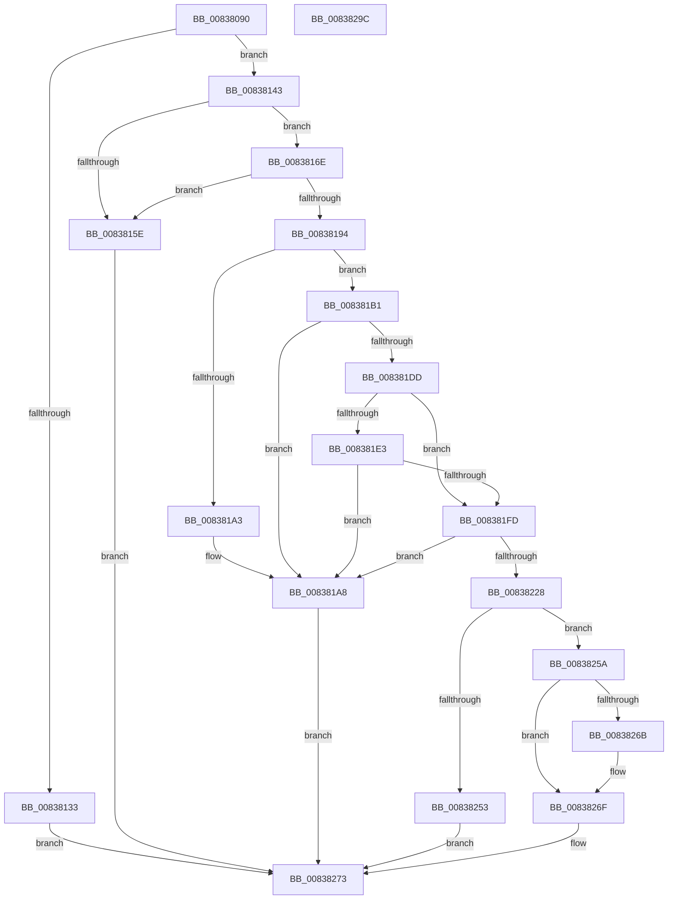

# I_MinCryptVerifyAuthenticodeTimeStamp

- RVA: `0x00838090`–`0x0083829D` (길이 `525` bytes)
- VA: `0x0000000140838090`
- 실행 섹션: `PAGE`
- PDB 이름 있음: `예`; PDB Function 태그: `아니요`
- unwind 정보 RVA: `0x000DAEC8`
- 디코드: `134`개 명령, `525/525` bytes 표시
- 미해석 바이트: `0` (있으면 어셈블리에 `.byte`로 보존)

> 이 문서는 커널 이미지의 기계어와 PDB 기호를 분석해 생성했습니다. 4번과 5번은 함수 원형과 자료형을 바이너리 사용 방식에서 추정한 C 해석이며 원본 소스 복구 결과는 아닙니다.

## 1. Dependencies

- 직접 호출 지점: **10**; 고유 호출 대상: **10**
- 직접 호출자로 확인된 함수: **1**
- RIP 상대 이미지 참조: **4**

### Outgoing calls
- `0x00838123` → [MinAsn1ExtractValues](MinAsn1ExtractValues_function_0083A170.md) (function, `0x0083A170`)
- `0x00838151` → [I_MinCryptFindSignerCertificateByIssuerAndSerialNumber](I_MinCryptFindSignerCertificateByIssuerAndSerialNumber_function_00837DE8.md) (function, `0x00837DE8`)
- `0x0083818B` → [MinCryptVerifyCertificateWithPolicy2](MinCryptVerifyCertificateWithPolicy2_function_008368A8.md) (function, `0x008368A8`)
- `0x00838198` → [MinCryptDecodeHashAlgorithmIdentifier](MinCryptDecodeHashAlgorithmIdentifier_function_008361A0.md) (function, `0x008361A0`)
- `0x008381D2` → [MinCryptHashMemory](../../text/6A/MinCryptHashMemory_function_006A5F04.md) (function, `0x006A5F04`)
- `0x008381F2` → [I_MinCryptVerifySignerAuthenticatedAttributes](I_MinCryptVerifySignerAuthenticatedAttributes_function_00838430.md) (function, `0x00838430`)
- `0x0083821D` → [MinCryptVerifySignedHash2](MinCryptVerifySignedHash2_function_008362A0.md) (function, `0x008362A0`)
- `0x0083824A` → [I_MinAsn1ParseSingleAttribute](I_MinAsn1ParseSingleAttribute_function_00838A10.md) (function, `0x00838A10`)
- `0x00838262` → [MinAsn1DecodeTime](MinAsn1DecodeTime_function_00839E54.md) (function, `0x00839E54`)
- `0x0083827C` → [_security_check_cookie](../../text/6A/_security_check_cookie_function_006AC640.md) (function, `0x006AC640`)

### Direct callers
- [I_MinCryptGetSigningTime](I_MinCryptGetSigningTime_function_00837F2C.md) at `0x00837FDB`

### Static image references
- `0x008380AC` → RVA `0x00E0A740` (`.data`; read)
- `0x008380CF` → RVA `0x0000D1E0` (`.rdata`; read)
- `0x0083817E` → RVA `0x00B4D600` (`PAGE`; read)
- `0x00838228` → RVA `0x00B4B648` (`PAGE`; read)

## 2. Other-region calls and transfers

- 다른 실행 섹션으로 향하는 call: **2**
  - `0x008381D2` → [MinCryptHashMemory](../../text/6A/MinCryptHashMemory_function_006A5F04.md) (`PAGE` → `.text`)
  - `0x0083827C` → [_security_check_cookie](../../text/6A/_security_check_cookie_function_006AC640.md) (`PAGE` → `.text`)
- 별도 외부 분기/꼬리 이동을 확인하지 못했습니다.

## 3. Assembly (complete function range)

```asm
00838090  48 89 5C 24 10                  mov qword ptr [rsp + 0x10], rbx
00838095  55                              push rbp
00838096  56                              push rsi
00838097  57                              push rdi
00838098  41 54                           push r12
0083809A  41 55                           push r13
0083809C  41 56                           push r14
0083809E  41 57                           push r15
008380A0  48 8D 6C 24 B0                  lea rbp, [rsp - 0x50]
008380A5  48 81 EC 50 01 00 00            sub rsp, 0x150
008380AC  48 8B 05 8D 26 5D 00            mov rax, qword ptr [rip + 0x5d268d]
008380B3  48 33 C4                        xor rax, rsp
008380B6  48 89 45 40                     mov qword ptr [rbp + 0x40], rax
008380BA  8B 11                           mov edx, dword ptr [rcx]
008380BC  48 8D 44 24 60                  lea rax, [rsp + 0x60]
008380C1  48 8B 49 08                     mov rcx, qword ptr [rcx + 8]
008380C5  41 8B D9                        mov ebx, r9d
008380C8  48 8B B5 B0 00 00 00            mov rsi, qword ptr [rbp + 0xb0]
008380CF  4C 8D 0D 0A 51 7D FF            lea r9, [rip - 0x82aef6]
008380D6  4C 8B AD B8 00 00 00            mov r13, qword ptr [rbp + 0xb8]
008380DD  0F 57 C0                        xorps xmm0, xmm0
008380E0  48 8B BD C0 00 00 00            mov rdi, qword ptr [rbp + 0xc0]
008380E7  4C 8B BD C8 00 00 00            mov r15, qword ptr [rbp + 0xc8]
008380EE  4C 8B A5 D0 00 00 00            mov r12, qword ptr [rbp + 0xd0]
008380F5  83 64 24 44 00                  and dword ptr [rsp + 0x44], 0
008380FA  83 64 24 30 00                  and dword ptr [rsp + 0x30], 0
008380FF  4C 89 44 24 38                  mov qword ptr [rsp + 0x38], r8
00838104  4C 8D 44 24 34                  lea r8, [rsp + 0x34]
00838109  48 89 44 24 28                  mov qword ptr [rsp + 0x28], rax
0083810E  C7 44 24 20 09 00 00 00         mov dword ptr [rsp + 0x20], 9
00838116  0F 11 44 24 50                  movups xmmword ptr [rsp + 0x50], xmm0
0083811B  C7 44 24 34 0B 00 00 00         mov dword ptr [rsp + 0x34], 0xb
00838123  E8 48 20 00 00                  call 0x14083a170
00838128  85 C0                           test eax, eax
0083812A  0F 4F 44 24 70                  cmovg eax, dword ptr [rsp + 0x70]
0083812F  85 C0                           test eax, eax
00838131  79 10                           jns 0x140838143
00838133  81 0F 00 00 05 00               or dword ptr [rdi], 0x50000
00838139  BB 28 04 00 C0                  mov ebx, 0xc0000428
0083813E  E9 30 01 00 00                  jmp 0x140838273
00838143  4C 8B CE                        mov r9, rsi
00838146  48 8D 55 A0                     lea rdx, [rbp - 0x60]
0083814A  44 8B C3                        mov r8d, ebx
0083814D  48 8D 4D 90                     lea rcx, [rbp - 0x70]
00838151  E8 92 FC FF FF                  call 0x140837de8
00838156  4C 8B F0                        mov r14, rax
00838159  48 85 C0                        test rax, rax
0083815C  75 10                           jne 0x14083816e
0083815E  81 0F 00 00 06 00               or dword ptr [rdi], 0x60000
00838164  BB 28 04 00 C0                  mov ebx, 0xc0000428
00838169  E9 05 01 00 00                  jmp 0x140838273
0083816E  48 83 64 24 28 00               and qword ptr [rsp + 0x28], 0
00838174  4C 8B C6                        mov r8, rsi
00838177  4C 89 6C 24 20                  mov qword ptr [rsp + 0x20], r13
0083817C  8B D3                           mov edx, ebx
0083817E  4C 8D 2D 7B 54 31 00            lea r13, [rip + 0x31547b]
00838185  49 8B CE                        mov rcx, r14
00838188  4D 8B CD                        mov r9, r13
0083818B  E8 18 E7 FF FF                  call 0x1408368a8
00838190  85 C0                           test eax, eax
00838192  78 CA                           js 0x14083815e
00838194  48 8D 4D B0                     lea rcx, [rbp - 0x50]
00838198  E8 03 E0 FF FF                  call 0x1408361a0
0083819D  8B F0                           mov esi, eax
0083819F  85 C0                           test eax, eax
008381A1  75 0E                           jne 0x1408381b1
008381A3  BB 28 04 00 C0                  mov ebx, 0xc0000428
008381A8  0F BA 2F 12                     bts dword ptr [rdi], 0x12
008381AC  E9 C2 00 00 00                  jmp 0x140838273
008381B1  4C 8B 44 24 38                  mov r8, qword ptr [rsp + 0x38]
008381B6  48 8D 44 24 30                  lea rax, [rsp + 0x30]
008381BB  49 81 C0 10 01 00 00            add r8, 0x110
008381C2  48 89 44 24 20                  mov qword ptr [rsp + 0x20], rax
008381C7  4C 8D 4D 00                     lea r9, [rbp]
008381CB  BA 01 00 00 00                  mov edx, 1
008381D0  8B CE                           mov ecx, esi
008381D2  E8 2D DD E6 FF                  call 0x1406a5f04
008381D7  8B D8                           mov ebx, eax
008381D9  85 C0                           test eax, eax
008381DB  78 CB                           js 0x1408381a8
008381DD  83 7D C0 00                     cmp dword ptr [rbp - 0x40], 0
008381E1  74 1A                           je 0x1408381fd
008381E3  4C 8D 4D C0                     lea r9, [rbp - 0x40]
008381E7  8B CE                           mov ecx, esi
008381E9  4C 8D 44 24 30                  lea r8, [rsp + 0x30]
008381EE  48 8D 55 00                     lea rdx, [rbp]
008381F2  E8 39 02 00 00                  call 0x140838430
008381F7  8B D8                           mov ebx, eax
008381F9  85 C0                           test eax, eax
008381FB  78 AB                           js 0x1408381a8
008381FD  44 8B 44 24 30                  mov r8d, dword ptr [rsp + 0x30]
00838202  49 8D 86 B0 00 00 00            lea rax, [r14 + 0xb0]
00838209  4C 89 6C 24 28                  mov qword ptr [rsp + 0x28], r13
0083820E  4C 8D 4D E0                     lea r9, [rbp - 0x20]
00838212  48 8D 55 00                     lea rdx, [rbp]
00838216  48 89 44 24 20                  mov qword ptr [rsp + 0x20], rax
0083821B  8B CE                           mov ecx, esi
0083821D  E8 7E E0 FF FF                  call 0x1408362a0
00838222  8B D8                           mov ebx, eax
00838224  85 C0                           test eax, eax
00838226  78 80                           js 0x1408381a8
00838228  48 8D 05 19 34 31 00            lea rax, [rip + 0x313419]
0083822F  C7 44 24 40 09 00 00 00         mov dword ptr [rsp + 0x40], 9
00838237  4C 8D 4C 24 50                  lea r9, [rsp + 0x50]
0083823C  48 89 44 24 48                  mov qword ptr [rsp + 0x48], rax
00838241  48 8D 55 C0                     lea rdx, [rbp - 0x40]
00838245  48 8D 4C 24 40                  lea rcx, [rsp + 0x40]
0083824A  E8 C1 07 00 00                  call 0x140838a10
0083824F  84 C0                           test al, al
00838251  75 07                           jne 0x14083825a
00838253  BB 28 04 00 C0                  mov ebx, 0xc0000428
00838258  EB 19                           jmp 0x140838273
0083825A  49 8B D7                        mov rdx, r15
0083825D  48 8D 4C 24 50                  lea rcx, [rsp + 0x50]
00838262  E8 ED 1B 00 00                  call 0x140839e54
00838267  84 C0                           test al, al
00838269  75 04                           jne 0x14083826f
0083826B  49 83 27 00                     and qword ptr [r15], 0
0083826F  41 89 34 24                     mov dword ptr [r12], esi
00838273  8B C3                           mov eax, ebx
00838275  48 8B 4D 40                     mov rcx, qword ptr [rbp + 0x40]
00838279  48 33 CC                        xor rcx, rsp
0083827C  E8 BF 43 E7 FF                  call 0x1406ac640
00838281  48 8B 9C 24 98 01 00 00         mov rbx, qword ptr [rsp + 0x198]
00838289  48 81 C4 50 01 00 00            add rsp, 0x150
00838290  41 5F                           pop r15
00838292  41 5E                           pop r14
00838294  41 5D                           pop r13
00838296  41 5C                           pop r12
00838298  5F                              pop rdi
00838299  5E                              pop rsi
0083829A  5D                              pop rbp
0083829B  C3                              ret
0083829C  CC                              int3
```

## 4. C-style interpretation (structured pseudocode)

```c
__int64 __fastcall I_MinCryptVerifyAuthenticodeTimeStamp(__int64 a1, __int64 a2, __int64 a3, int a4, __int64 a5, __int64 a6, __int64 a7, __int64 a8, __int64 a9)
{
    __int64 result;
    __int64 v_rsp;
    unsigned int v_stack_m118;
    unsigned __int64 v_stack_m128;
    unsigned __int64 v_stack_m138;
    unsigned __int64 v_stack_m140;
    unsigned int v_stack_m144;
    unsigned int v_stack_m148;
    unsigned __int64 v_stack_m150;
    unsigned __int64 v_stack_m154;
    unsigned int v_stack_m158;
    unsigned __int64 v_stack_m160;
    unsigned int v_stack_m168;
    unsigned __int64 v_stack_m48;
    unsigned __int64 v_stack_m88;
    unsigned __int64 v_stack_mA8;
    unsigned int v_stack_mC8;
    unsigned __int64 v_stack_mD8;
    unsigned __int64 v_stack_mE8;
    unsigned __int64 v_stack_mF8;
    unsigned __int64 v_stack_p10;

    v_stack_p10 = v_rbx;
    v_rsp = (v_rsp) - (336);
    result = (*(unsigned __int64 *)(v_rip + 6104717)) ^ (v_rsp);
    v_stack_m48 = result;
    v_stack_m150 = a3;
    v_stack_m160 = v_stack_m128;
    v_stack_m168 = 9;
    v_stack_m138 = v_xmm0;
    v_stack_m154 = 11;
    result = MinAsn1ExtractValues(*(unsigned __int64 *)(a1 + 8), (unsigned int)(*(unsigned int *)(a1)), v_stack_m154, v_rip - 8564470);
    if (condition_is_greater) { result = v_stack_m118; }
    if (!sign_flag) goto loc_00838143;
    goto loc_00838273;
loc_00838143:
    result = I_MinCryptFindSignerCertificateByIssuerAndSerialNumber(v_stack_mF8, v_stack_mE8, (unsigned int)((unsigned int)((unsigned int)(0xC0000428ULL))), a5);
    if (result != 0) goto loc_0083816E;
loc_0083815E:
    goto loc_00838273;
loc_0083816E:
    v_stack_m168 = a6;
    result = MinCryptVerifyCertificateWithPolicy2(result, (unsigned int)((unsigned int)((unsigned int)(0xC0000428ULL))), a5, v_rip + 3232891);
    if (sign_flag) goto loc_0083815E;
    result = MinCryptDecodeHashAlgorithmIdentifier(v_stack_mD8, (unsigned int)((unsigned int)((unsigned int)(0xC0000428ULL))), a5, v_rip + 3232891);
    if ((unsigned int)(result) != 0) goto loc_008381B1;
loc_008381A8:
    goto loc_00838273;
loc_008381B1:
    a3 = (v_stack_m150) + (272);
    v_stack_m168 = v_stack_m158;
    result = MinCryptHashMemory((unsigned int)((unsigned int)((unsigned int)((unsigned int)(result)))), 1, a3, v_stack_m88);
    if (sign_flag) goto loc_008381A8;
    if (v_stack_mC8 == 0) goto loc_008381FD;
    result = I_MinCryptVerifySignerAuthenticatedAttributes((unsigned int)((unsigned int)((unsigned int)((unsigned int)(result)))), v_stack_m88, v_stack_m158, v_stack_mC8);
    if (sign_flag) goto loc_008381A8;
loc_008381FD:
    v_stack_m160 = v_rip + 3232891;
    v_stack_m168 = result + 176;
    result = MinCryptVerifySignedHash2((unsigned int)((unsigned int)((unsigned int)((unsigned int)(result)))), v_stack_m88, (unsigned int)(v_stack_m158), v_stack_mA8);
    if (sign_flag) goto loc_008381A8;
    v_stack_m148 = 9;
    v_stack_m140 = v_rip + 3224601;
    result = I_MinAsn1ParseSingleAttribute(v_stack_m148, v_stack_mC8, (unsigned int)(v_stack_m158), v_stack_m138);
    if ((unsigned __int8)(result) != 0) goto loc_0083825A;
    goto loc_00838273;
loc_0083825A:
    result = MinAsn1DecodeTime(v_stack_m138, a8, (unsigned int)(v_stack_m158), v_stack_m138);
    if ((unsigned __int8)(result) == 0) {
    }
    *(unsigned int *)(a9) = (unsigned int)((unsigned int)((unsigned int)(result)));
loc_00838273:
    a1 = (v_stack_m48) ^ (v_rsp);
    result = _security_check_cookie(a1, a8, (unsigned int)(v_stack_m158), v_stack_m138);
    v_rsp = (v_rsp) + (336);
    return result;
}
```

## 5. (Beta) C Style

```c
int64_t I_MinCryptVerifyAuthenticodeTimeStamp(void *Arg1, int64_t Arg2, int64_t Arg3, int32_t Arg4, int64_t Arg5, int64_t Arg6, void *Arg7, void *Arg8, void *Arg9)
{
    uint8_t *arg1 = (uint8_t *)Arg1;
    uint8_t *arg7 = (uint8_t *)Arg7;
    uint8_t *arg8 = (uint8_t *)Arg8;
    uint8_t *arg9 = (uint8_t *)Arg9;

    int64_t result;
    int64_t local_rsp;
    uint32_t v_stack_m118;
    uint64_t v_stack_m128;
    uint64_t v_stack_m138;
    uint64_t v_stack_m140;
    uint32_t v_stack_m144;
    uint32_t v_stack_m148;
    uint64_t v_stack_m150;
    uint64_t v_stack_m154;
    uint32_t v_stack_m158;
    uint64_t v_stack_m160;
    uint32_t v_stack_m168;
    uint64_t v_stack_m48;
    uint64_t v_stack_m88;
    uint64_t v_stack_mA8;
    uint32_t v_stack_mC8;
    uint64_t v_stack_mD8;
    uint64_t v_stack_mE8;
    uint64_t v_stack_mF8;
    uint64_t v_stack_p10;

    v_stack_p10 = local_rbx;
    local_rsp = (local_rsp) - (336);
    result = (*(uint64_t *)(v_rip + 0x5D268D)) ^ (local_rsp);
    v_stack_m48 = result;
    v_stack_m150 = Arg3;
    v_stack_m160 = v_stack_m128;
    v_stack_m168 = 9;
    v_stack_m138 = v_xmm0;
    v_stack_m154 = 11;
    result = MinAsn1ExtractValues(*(uint64_t *)(arg1 + 0x8), (uint32_t)(*(uint32_t *)(arg1)), v_stack_m154, v_rip - 8564470);
    if (condition_is_greater) { result = v_stack_m118; }
    if (!sign_flag) goto loc_00838143;
    goto loc_00838273;
loc_00838143:
    result = I_MinCryptFindSignerCertificateByIssuerAndSerialNumber(v_stack_mF8, v_stack_mE8, (uint32_t)((uint32_t)((uint32_t)(0xC0000428ULL))), Arg5);
    if (result != 0) goto loc_0083816E;
loc_0083815E:
    goto loc_00838273;
loc_0083816E:
    v_stack_m168 = Arg6;
    result = MinCryptVerifyCertificateWithPolicy2(result, (uint32_t)((uint32_t)((uint32_t)(0xC0000428ULL))), Arg5, v_rip + 3232891);
    if (sign_flag) goto loc_0083815E;
    result = MinCryptDecodeHashAlgorithmIdentifier(v_stack_mD8, (uint32_t)((uint32_t)((uint32_t)(0xC0000428ULL))), Arg5, v_rip + 3232891);
    if ((uint32_t)(result) != 0) goto loc_008381B1;
loc_008381A8:
    goto loc_00838273;
loc_008381B1:
    Arg3 = (v_stack_m150) + (272);
    v_stack_m168 = v_stack_m158;
    result = MinCryptHashMemory((uint32_t)((uint32_t)((uint32_t)((uint32_t)(result)))), 1, Arg3, v_stack_m88);
    if (sign_flag) goto loc_008381A8;
    if (v_stack_mC8 == 0) goto loc_008381FD;
    result = I_MinCryptVerifySignerAuthenticatedAttributes((uint32_t)((uint32_t)((uint32_t)((uint32_t)(result)))), v_stack_m88, v_stack_m158, v_stack_mC8);
    if (sign_flag) goto loc_008381A8;
loc_008381FD:
    v_stack_m160 = v_rip + 3232891;
    v_stack_m168 = result + 176;
    result = MinCryptVerifySignedHash2((uint32_t)((uint32_t)((uint32_t)((uint32_t)(result)))), v_stack_m88, (uint32_t)(v_stack_m158), v_stack_mA8);
    if (sign_flag) goto loc_008381A8;
    v_stack_m148 = 9;
    v_stack_m140 = v_rip + 3224601;
    result = I_MinAsn1ParseSingleAttribute(v_stack_m148, v_stack_mC8, (uint32_t)(v_stack_m158), v_stack_m138);
    if ((uint8_t)(result) != 0) goto loc_0083825A;
    goto loc_00838273;
loc_0083825A:
    result = MinAsn1DecodeTime(v_stack_m138, Arg8, (uint32_t)(v_stack_m158), v_stack_m138);
    if ((uint8_t)(result) == 0) {
    }
    *(uint32_t *)(arg9) = (uint32_t)((uint32_t)((uint32_t)(result)));
loc_00838273:
    Arg1 = (v_stack_m48) ^ (local_rsp);
    result = _security_check_cookie(Arg1, Arg8, (uint32_t)(v_stack_m158), v_stack_m138);
    local_rsp = (local_rsp) + (336);
    return result;
}
```

### 관측된 메모리 오프셋

구조체 형식이 확인되지 않은 접근은 인자 기준의 오프셋으로만 기록했습니다.

| 기준 인자 | 오프셋 표현 | 폭 (bit) | 접근 |
|---|---:|---:|---|
| `Arg1` | `+ 0x0` | `32` | `R` |
| `Arg1` | `+ 0x8` | `64` | `R` |
| `Arg7` | `+ 0x0` | `32` | `R/W` |
| `Arg8` | `+ 0x0` | `64` | `R/W` |
| `Arg9` | `+ 0x0` | `32` | `W` |

## 6. Execution-region graph

[열기: 2D/3D 그래프와 함수 탐색 컨트롤 패널](../../../control-panel.html?section=page&rva=0x00838090&view=graph)

- 2D 그래프는 위에서 아래로 흐르고, 3D 그래프는 빈 공간을 드래그해 회전합니다. Shift+드래그는 이동, 휠은 확대·축소, 함수 노드 선택은 대상 보고서 이동입니다.

### Static fallback


