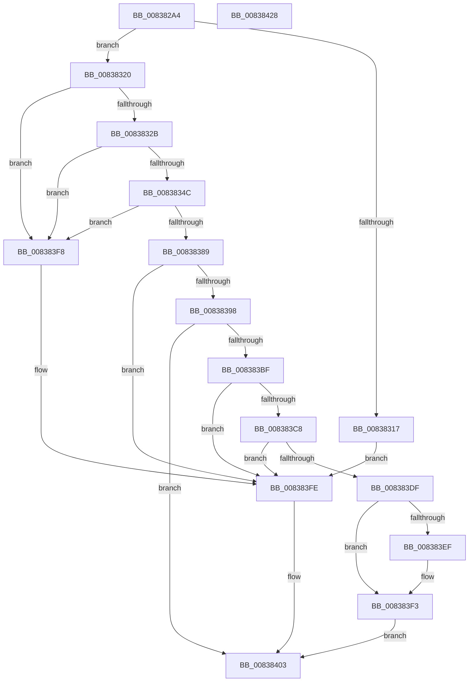

# I_MinCryptVerifyRFC3161TimeStamp

- RVA: `0x008382A4`–`0x00838429` (길이 `389` bytes)
- VA: `0x00000001408382A4`
- 실행 섹션: `PAGE`
- PDB 이름 있음: `예`; PDB Function 태그: `아니요`
- unwind 정보 RVA: `0x000DAEA4`
- 디코드: `99`개 명령, `389/389` bytes 표시
- 미해석 바이트: `0` (있으면 어셈블리에 `.byte`로 보존)

> 이 문서는 커널 이미지의 기계어와 PDB 기호를 분석해 생성했습니다. 4번과 5번은 함수 원형과 자료형을 바이너리 사용 방식에서 추정한 C 해석이며 원본 소스 복구 결과는 아닙니다.

## 1. Dependencies

- 직접 호출 지점: **8**; 고유 호출 대상: **7**
- 직접 호출자로 확인된 함수: **1**
- RIP 상대 이미지 참조: **4**

### Outgoing calls
- `0x0083830E` → [MinCrypK_VerifySignedDataKMode](MinCrypK_VerifySignedDataKMode_function_00838524.md) (function, `0x00838524`)
- `0x0083833D` → [RtlCompareMemory](../../text/6B/RtlCompareMemory_function_006BA670.md) (function, `0x006BA670`)
- `0x0083837A` → [MinAsn1ExtractValues](MinAsn1ExtractValues_function_0083A170.md) (function, `0x0083A170`)
- `0x0083838D` → [MinCryptDecodeHashAlgorithmIdentifier](MinCryptDecodeHashAlgorithmIdentifier_function_008361A0.md) (function, `0x008361A0`)
- `0x008383B4` → [MinCryptHashMemory](../../text/6A/MinCryptHashMemory_function_006A5F04.md) (function, `0x006A5F04`)
- `0x008383D5` → [RtlCompareMemory](../../text/6B/RtlCompareMemory_function_006BA670.md) (function, `0x006BA670`)
- `0x008383E6` → [MinAsn1DecodeGeneralizedTime](MinAsn1DecodeGeneralizedTime_function_00839C20.md) (function, `0x00839C20`)
- `0x0083840C` → [_security_check_cookie](../../text/6A/_security_check_cookie_function_006AC640.md) (function, `0x006AC640`)

### Direct callers
- [I_MinCryptGetSigningTime](I_MinCryptGetSigningTime_function_00837F2C.md) at `0x0083803B`

### Static image references
- `0x008382BC` → RVA `0x00E0A740` (`.data`; read)
- `0x008382FA` → RVA `0x00B4D600` (`PAGE`; read)
- `0x00838330` → RVA `0x00B4B810` (`PAGE`; read)
- `0x00838359` → RVA `0x0000D2A0` (`.rdata`; read)

## 2. Other-region calls and transfers

- 다른 실행 섹션으로 향하는 call: **4**
  - `0x0083833D` → [RtlCompareMemory](../../text/6B/RtlCompareMemory_function_006BA670.md) (`PAGE` → `.text`)
  - `0x008383B4` → [MinCryptHashMemory](../../text/6A/MinCryptHashMemory_function_006A5F04.md) (`PAGE` → `.text`)
  - `0x008383D5` → [RtlCompareMemory](../../text/6B/RtlCompareMemory_function_006BA670.md) (`PAGE` → `.text`)
  - `0x0083840C` → [_security_check_cookie](../../text/6A/_security_check_cookie_function_006AC640.md) (`PAGE` → `.text`)
- 별도 외부 분기/꼬리 이동을 확인하지 못했습니다.

## 3. Assembly (complete function range)

```asm
008382A4  48 89 5C 24 10                  mov qword ptr [rsp + 0x10], rbx
008382A9  55                              push rbp
008382AA  56                              push rsi
008382AB  57                              push rdi
008382AC  41 56                           push r14
008382AE  41 57                           push r15
008382B0  48 8D 6C 24 B0                  lea rbp, [rsp - 0x50]
008382B5  48 81 EC 50 01 00 00            sub rsp, 0x150
008382BC  48 8B 05 7D 24 5D 00            mov rax, qword ptr [rip + 0x5d247d]
008382C3  48 33 C4                        xor rax, rsp
008382C6  48 89 45 40                     mov qword ptr [rbp + 0x40], rax
008382CA  8B 11                           mov edx, dword ptr [rcx]
008382CC  48 8D 44 24 50                  lea rax, [rsp + 0x50]
008382D1  48 8B 49 08                     mov rcx, qword ptr [rcx + 8]
008382D5  49 8B F8                        mov rdi, r8
008382D8  48 8B 9D A0 00 00 00            mov rbx, qword ptr [rbp + 0xa0]
008382DF  45 33 C0                        xor r8d, r8d
008382E2  4C 8B B5 A8 00 00 00            mov r14, qword ptr [rbp + 0xa8]
008382E9  4C 8B BD B0 00 00 00            mov r15, qword ptr [rbp + 0xb0]
008382F0  83 64 24 40 00                  and dword ptr [rsp + 0x40], 0
008382F5  48 89 44 24 30                  mov qword ptr [rsp + 0x30], rax
008382FA  48 8D 05 FF 52 31 00            lea rax, [rip + 0x3152ff]
00838301  4C 89 4C 24 28                  mov qword ptr [rsp + 0x28], r9
00838306  45 33 C9                        xor r9d, r9d
00838309  48 89 44 24 20                  mov qword ptr [rsp + 0x20], rax
0083830E  E8 11 02 00 00                  call 0x140838524
00838313  85 C0                           test eax, eax
00838315  79 09                           jns 0x140838320
00838317  0F BA 2B 12                     bts dword ptr [rbx], 0x12
0083831B  E9 DE 00 00 00                  jmp 0x1408383fe
00838320  83 7C 24 50 0B                  cmp dword ptr [rsp + 0x50], 0xb
00838325  0F 85 CD 00 00 00               jne 0x1408383f8
0083832B  48 8B 54 24 58                  mov rdx, qword ptr [rsp + 0x58]
00838330  48 8D 0D D9 34 31 00            lea rcx, [rip + 0x3134d9]
00838337  41 B8 0B 00 00 00               mov r8d, 0xb
0083833D  E8 2E 23 E8 FF                  call 0x1406ba670
00838342  48 83 F8 0B                     cmp rax, 0xb
00838346  0F 85 AC 00 00 00               jne 0x1408383f8
0083834C  8B 54 24 60                     mov edx, dword ptr [rsp + 0x60]
00838350  48 8D 45 A0                     lea rax, [rbp - 0x60]
00838354  48 8B 4C 24 68                  mov rcx, qword ptr [rsp + 0x68]
00838359  4C 8D 0D 40 4F 7D FF            lea r9, [rip - 0x82b0c0]
00838360  48 89 44 24 28                  mov qword ptr [rsp + 0x28], rax
00838365  4C 8D 44 24 44                  lea r8, [rsp + 0x44]
0083836A  C7 44 24 20 06 00 00 00         mov dword ptr [rsp + 0x20], 6
00838372  C7 44 24 44 0E 00 00 00         mov dword ptr [rsp + 0x44], 0xe
0083837A  E8 F1 1D 00 00                  call 0x14083a170
0083837F  85 C0                           test eax, eax
00838381  0F 4F 45 B0                     cmovg eax, dword ptr [rbp - 0x50]
00838385  85 C0                           test eax, eax
00838387  78 6F                           js 0x1408383f8
00838389  48 8D 4D D0                     lea rcx, [rbp - 0x30]
0083838D  E8 0E DE FF FF                  call 0x1408361a0
00838392  8B F0                           mov esi, eax
00838394  85 C0                           test eax, eax
00838396  74 66                           je 0x1408383fe
00838398  48 8D 44 24 40                  lea rax, [rsp + 0x40]
0083839D  BA 01 00 00 00                  mov edx, 1
008383A2  4C 8D 87 10 01 00 00            lea r8, [rdi + 0x110]
008383A9  48 89 44 24 20                  mov qword ptr [rsp + 0x20], rax
008383AE  4C 8D 4D 00                     lea r9, [rbp]
008383B2  8B CE                           mov ecx, esi
008383B4  E8 4B DB E6 FF                  call 0x1406a5f04
008383B9  8B F8                           mov edi, eax
008383BB  85 C0                           test eax, eax
008383BD  78 44                           js 0x140838403
008383BF  8B 44 24 40                     mov eax, dword ptr [rsp + 0x40]
008383C3  3B 45 E0                        cmp eax, dword ptr [rbp - 0x20]
008383C6  75 36                           jne 0x1408383fe
008383C8  48 8B 55 E8                     mov rdx, qword ptr [rbp - 0x18]
008383CC  48 8D 4D 00                     lea rcx, [rbp]
008383D0  44 8B C0                        mov r8d, eax
008383D3  8B D8                           mov ebx, eax
008383D5  E8 96 22 E8 FF                  call 0x1406ba670
008383DA  48 3B C3                        cmp rax, rbx
008383DD  75 1F                           jne 0x1408383fe
008383DF  49 8B D6                        mov rdx, r14
008383E2  48 8D 4D F0                     lea rcx, [rbp - 0x10]
008383E6  E8 35 18 00 00                  call 0x140839c20
008383EB  84 C0                           test al, al
008383ED  75 04                           jne 0x1408383f3
008383EF  49 83 26 00                     and qword ptr [r14], 0
008383F3  41 89 37                        mov dword ptr [r15], esi
008383F6  EB 0B                           jmp 0x140838403
008383F8  81 0B 00 00 05 00               or dword ptr [rbx], 0x50000
008383FE  BF 28 04 00 C0                  mov edi, 0xc0000428
00838403  8B C7                           mov eax, edi
00838405  48 8B 4D 40                     mov rcx, qword ptr [rbp + 0x40]
00838409  48 33 CC                        xor rcx, rsp
0083840C  E8 2F 42 E7 FF                  call 0x1406ac640
00838411  48 8B 9C 24 88 01 00 00         mov rbx, qword ptr [rsp + 0x188]
00838419  48 81 C4 50 01 00 00            add rsp, 0x150
00838420  41 5F                           pop r15
00838422  41 5E                           pop r14
00838424  5F                              pop rdi
00838425  5E                              pop rsi
00838426  5D                              pop rbp
00838427  C3                              ret
00838428  CC                              int3
```

## 4. C-style interpretation (structured pseudocode)

```c
__int64 __fastcall I_MinCryptVerifyRFC3161TimeStamp(__int64 a1, __int64 a2, __int64 a3, __int64 a4, __int64 a5, __int64 a6, __int64 a7)
{
    __int64 result;
    __int64 v_rsp;
    unsigned __int64 v_stack_m110;
    unsigned int v_stack_m118;
    unsigned __int64 v_stack_m120;
    unsigned __int64 v_stack_m128;
    unsigned __int64 v_stack_m134;
    unsigned int v_stack_m138;
    unsigned __int64 v_stack_m148;
    unsigned __int64 v_stack_m150;
    unsigned __int64 v_stack_m158;
    unsigned __int64 v_stack_m38;
    unsigned __int64 v_stack_m78;
    unsigned __int64 v_stack_m88;
    unsigned __int64 v_stack_m90;
    unsigned int v_stack_m98;
    unsigned __int64 v_stack_mA8;
    unsigned int v_stack_mC8;
    unsigned __int64 v_stack_mD8;
    unsigned __int64 v_stack_p10;

    v_stack_p10 = v_rbx;
    v_rsp = (v_rsp) - (336);
    result = (*(unsigned __int64 *)(v_rip + 6104189)) ^ (v_rsp);
    v_stack_m38 = result;
    a3 = 0;
    v_stack_m148 = v_stack_m128;
    v_stack_m150 = a4;
    a4 = 0;
    v_stack_m158 = v_rip + 3232511;
    result = MinCrypK_VerifySignedDataKMode(*(unsigned __int64 *)(a1 + 8), (unsigned int)(*(unsigned int *)(a1)), a3, a4);
    if (!sign_flag) goto loc_00838320;
    goto loc_008383FE;
loc_00838320:
    if (v_stack_m128 != 11) goto loc_008383F8;
    result = RtlCompareMemory(v_rip + 3224793, v_stack_m120, 11, a4);
    if (result != 11) goto loc_008383F8;
    v_stack_m150 = v_stack_mD8;
    v_stack_m158 = 6;
    v_stack_m134 = 14;
    result = MinAsn1ExtractValues(v_stack_m110, (unsigned int)(v_stack_m118), v_stack_m134, v_rip - 8564928);
    if (condition_is_greater) { result = v_stack_mC8; }
    if (sign_flag) goto loc_008383F8;
    result = MinCryptDecodeHashAlgorithmIdentifier(v_stack_mA8, (unsigned int)(v_stack_m118), v_stack_m134, v_rip - 8564928);
    if ((unsigned int)(result) == 0) goto loc_008383FE;
    v_stack_m158 = v_stack_m138;
    result = MinCryptHashMemory((unsigned int)((unsigned int)((unsigned int)((unsigned int)(result)))), 1, a3 + 272, v_stack_m78);
    if (sign_flag) goto loc_00838403;
    if (((unsigned int)((unsigned int)(v_stack_m138))) != v_stack_m98) goto loc_008383FE;
    result = RtlCompareMemory(v_stack_m78, v_stack_m90, (unsigned int)((unsigned int)((unsigned int)(v_stack_m138))), v_stack_m78);
    if (result != ((unsigned int)((unsigned int)((unsigned int)(v_stack_m138))))) goto loc_008383FE;
    result = MinAsn1DecodeGeneralizedTime(v_stack_m88, a6, (unsigned int)((unsigned int)((unsigned int)(v_stack_m138))), v_stack_m78);
    if ((unsigned __int8)(result) == 0) {
    }
    *(unsigned int *)(a7) = (unsigned int)((unsigned int)((unsigned int)(result)));
    goto loc_00838403;
loc_008383F8:
loc_008383FE:
loc_00838403:
    a1 = (v_stack_m38) ^ (v_rsp);
    result = _security_check_cookie(a1, a6, (unsigned int)((unsigned int)((unsigned int)(v_stack_m138))), v_stack_m78);
    v_rsp = (v_rsp) + (336);
    return result;
}
```

## 5. (Beta) C Style

```c
int64_t I_MinCryptVerifyRFC3161TimeStamp(void *Arg1, int64_t Arg2, void *Arg3, int64_t Arg4, void *Arg5, void *Arg6, void *Arg7)
{
    uint8_t *arg1 = (uint8_t *)Arg1;
    uint8_t *arg3 = (uint8_t *)Arg3;
    uint8_t *arg5 = (uint8_t *)Arg5;
    uint8_t *arg6 = (uint8_t *)Arg6;
    uint8_t *arg7 = (uint8_t *)Arg7;

    int64_t result;
    int64_t local_rsp;
    uint64_t v_stack_m110;
    uint32_t v_stack_m118;
    uint64_t v_stack_m120;
    uint64_t v_stack_m128;
    uint64_t v_stack_m134;
    uint32_t v_stack_m138;
    uint64_t v_stack_m148;
    uint64_t v_stack_m150;
    uint64_t v_stack_m158;
    uint64_t v_stack_m38;
    uint64_t v_stack_m78;
    uint64_t v_stack_m88;
    uint64_t v_stack_m90;
    uint32_t v_stack_m98;
    uint64_t v_stack_mA8;
    uint32_t v_stack_mC8;
    uint64_t v_stack_mD8;
    uint64_t v_stack_p10;

    v_stack_p10 = local_rbx;
    local_rsp = (local_rsp) - (336);
    result = (*(uint64_t *)(v_rip + 0x5D247D)) ^ (local_rsp);
    v_stack_m38 = result;
    Arg3 = 0;
    v_stack_m148 = v_stack_m128;
    v_stack_m150 = Arg4;
    Arg4 = 0;
    v_stack_m158 = v_rip + 3232511;
    result = MinCrypK_VerifySignedDataKMode(*(uint64_t *)(arg1 + 0x8), (uint32_t)(*(uint32_t *)(arg1)), Arg3, Arg4);
    if (!sign_flag) goto loc_00838320;
    goto loc_008383FE;
loc_00838320:
    if (v_stack_m128 != 11) goto loc_008383F8;
    result = RtlCompareMemory(v_rip + 3224793, v_stack_m120, 11, Arg4);
    if (result != 11) goto loc_008383F8;
    v_stack_m150 = v_stack_mD8;
    v_stack_m158 = 6;
    v_stack_m134 = 14;
    result = MinAsn1ExtractValues(v_stack_m110, (uint32_t)(v_stack_m118), v_stack_m134, v_rip - 8564928);
    if (condition_is_greater) { result = v_stack_mC8; }
    if (sign_flag) goto loc_008383F8;
    result = MinCryptDecodeHashAlgorithmIdentifier(v_stack_mA8, (uint32_t)(v_stack_m118), v_stack_m134, v_rip - 8564928);
    if ((uint32_t)(result) == 0) goto loc_008383FE;
    v_stack_m158 = v_stack_m138;
    result = MinCryptHashMemory((uint32_t)((uint32_t)((uint32_t)((uint32_t)(result)))), 1, Arg3 + 272, v_stack_m78);
    if (sign_flag) goto loc_00838403;
    if (((uint32_t)((uint32_t)(v_stack_m138))) != v_stack_m98) goto loc_008383FE;
    result = RtlCompareMemory(v_stack_m78, v_stack_m90, (uint32_t)((uint32_t)((uint32_t)(v_stack_m138))), v_stack_m78);
    if (result != ((uint32_t)((uint32_t)((uint32_t)(v_stack_m138))))) goto loc_008383FE;
    result = MinAsn1DecodeGeneralizedTime(v_stack_m88, Arg6, (uint32_t)((uint32_t)((uint32_t)(v_stack_m138))), v_stack_m78);
    if ((uint8_t)(result) == 0) {
    }
    *(uint32_t *)(arg7) = (uint32_t)((uint32_t)((uint32_t)(result)));
    goto loc_00838403;
loc_008383F8:
loc_008383FE:
loc_00838403:
    Arg1 = (v_stack_m38) ^ (local_rsp);
    result = _security_check_cookie(Arg1, Arg6, (uint32_t)((uint32_t)((uint32_t)(v_stack_m138))), v_stack_m78);
    local_rsp = (local_rsp) + (336);
    return result;
}
```

### 관측된 메모리 오프셋

구조체 형식이 확인되지 않은 접근은 인자 기준의 오프셋으로만 기록했습니다.

| 기준 인자 | 오프셋 표현 | 폭 (bit) | 접근 |
|---|---:|---:|---|
| `Arg1` | `+ 0x0` | `32` | `R` |
| `Arg1` | `+ 0x8` | `64` | `R` |
| `Arg3` | `+ 0x110` | `64` | `R` |
| `Arg5` | `+ 0x0` | `32` | `R/W` |
| `Arg6` | `+ 0x0` | `64` | `R/W` |
| `Arg7` | `+ 0x0` | `32` | `W` |

## 6. Execution-region graph

[열기: 2D/3D 그래프와 함수 탐색 컨트롤 패널](../../../control-panel.html?section=page&rva=0x008382A4&view=graph)

- 2D 그래프는 위에서 아래로 흐르고, 3D 그래프는 빈 공간을 드래그해 회전합니다. Shift+드래그는 이동, 휠은 확대·축소, 함수 노드 선택은 대상 보고서 이동입니다.

### Static fallback


