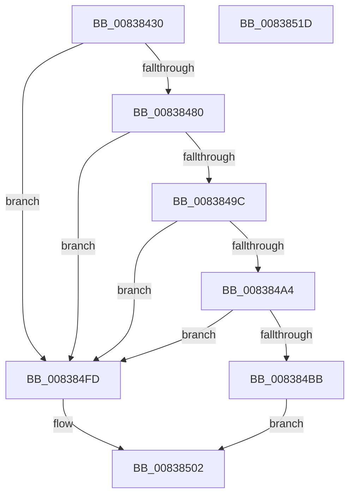

# I_MinCryptVerifySignerAuthenticatedAttributes

- RVA: `0x00838430`–`0x0083851E` (길이 `238` bytes)
- VA: `0x0000000140838430`
- 실행 섹션: `PAGE`
- PDB 이름 있음: `예`; PDB Function 태그: `아니요`
- unwind 정보 RVA: `0x000DAEF0`
- 디코드: `65`개 명령, `238/238` bytes 표시
- 미해석 바이트: `0` (있으면 어셈블리에 `.byte`로 보존)

> 이 문서는 커널 이미지의 기계어와 PDB 기호를 분석해 생성했습니다. 4번과 5번은 함수 원형과 자료형을 바이너리 사용 방식에서 추정한 C 해석이며 원본 소스 복구 결과는 아닙니다.

## 1. Dependencies

- 직접 호출 지점: **4**; 고유 호출 대상: **4**
- 직접 호출자로 확인된 함수: **2**
- RIP 상대 이미지 참조: **1**

### Outgoing calls
- `0x00838477` → [I_MinAsn1ParseSingleAttribute](I_MinAsn1ParseSingleAttribute_function_00838A10.md) (function, `0x00838A10`)
- `0x00838493` → [MinAsn1ExtractContent](MinAsn1ExtractContent_function_0083A00C.md) (function, `0x0083A00C`)
- `0x008384B1` → [RtlCompareMemory](../../text/6B/RtlCompareMemory_function_006BA670.md) (function, `0x006BA670`)
- `0x008384F6` → [MinCryptHashMemory](../../text/6A/MinCryptHashMemory_function_006A5F04.md) (function, `0x006A5F04`)

### Direct callers
- [I_MinCryptVerifyAuthenticodeTimeStamp](I_MinCryptVerifyAuthenticodeTimeStamp_function_00838090.md) at `0x008381F2`
- [MinCrypK_VerifySignedDataKModeEx](MinCrypK_VerifySignedDataKModeEx_function_00838568.md) at `0x0083887F`

### Static image references
- `0x00838470` → RVA `0x00B4BC28` (`PAGE`; read)

## 2. Other-region calls and transfers

- 다른 실행 섹션으로 향하는 call: **2**
  - `0x008384B1` → [RtlCompareMemory](../../text/6B/RtlCompareMemory_function_006BA670.md) (`PAGE` → `.text`)
  - `0x008384F6` → [MinCryptHashMemory](../../text/6A/MinCryptHashMemory_function_006A5F04.md) (`PAGE` → `.text`)
- 별도 외부 분기/꼬리 이동을 확인하지 못했습니다.

## 3. Assembly (complete function range)

```asm
00838430  48 8B C4                        mov rax, rsp
00838433  48 89 58 08                     mov qword ptr [rax + 8], rbx
00838437  48 89 70 10                     mov qword ptr [rax + 0x10], rsi
0083843B  48 89 78 18                     mov qword ptr [rax + 0x18], rdi
0083843F  4C 89 70 20                     mov qword ptr [rax + 0x20], r14
00838443  41 57                           push r15
00838445  48 83 EC 60                     sub rsp, 0x60
00838449  49 8B F1                        mov rsi, r9
0083844C  49 8B F8                        mov rdi, r8
0083844F  4C 8B F2                        mov r14, rdx
00838452  44 8B F9                        mov r15d, ecx
00838455  0F 57 C0                        xorps xmm0, xmm0
00838458  0F 11 40 D8                     movups xmmword ptr [rax - 0x28], xmm0
0083845C  48 83 60 D0 00                  and qword ptr [rax - 0x30], 0
00838461  83 60 CC 00                     and dword ptr [rax - 0x34], 0
00838465  C6 40 C8 31                     mov byte ptr [rax - 0x38], 0x31
00838469  4C 8D 48 D8                     lea r9, [rax - 0x28]
0083846D  48 8B D6                        mov rdx, rsi
00838470  48 8D 0D B1 37 31 00            lea rcx, [rip + 0x3137b1]
00838477  E8 94 05 00 00                  call 0x140838a10
0083847C  84 C0                           test al, al
0083847E  74 7D                           je 0x1408384fd
00838480  4C 8D 4C 24 38                  lea r9, [rsp + 0x38]
00838485  4C 8D 44 24 34                  lea r8, [rsp + 0x34]
0083848A  8B 54 24 40                     mov edx, dword ptr [rsp + 0x40]
0083848E  48 8B 4C 24 48                  mov rcx, qword ptr [rsp + 0x48]
00838493  E8 74 1B 00 00                  call 0x14083a00c
00838498  85 C0                           test eax, eax
0083849A  78 61                           js 0x1408384fd
0083849C  8B 44 24 34                     mov eax, dword ptr [rsp + 0x34]
008384A0  39 07                           cmp dword ptr [rdi], eax
008384A2  75 59                           jne 0x1408384fd
008384A4  8B D8                           mov ebx, eax
008384A6  44 8B C0                        mov r8d, eax
008384A9  48 8B 54 24 38                  mov rdx, qword ptr [rsp + 0x38]
008384AE  49 8B CE                        mov rcx, r14
008384B1  E8 BA 21 E8 FF                  call 0x1406ba670
008384B6  48 3B C3                        cmp rax, rbx
008384B9  75 42                           jne 0x1408384fd
008384BB  48 8D 44 24 30                  lea rax, [rsp + 0x30]
008384C0  48 89 44 24 48                  mov qword ptr [rsp + 0x48], rax
008384C5  C7 44 24 40 01 00 00 00         mov dword ptr [rsp + 0x40], 1
008384CD  48 8B 46 08                     mov rax, qword ptr [rsi + 8]
008384D1  48 FF C0                        inc rax
008384D4  48 89 44 24 58                  mov qword ptr [rsp + 0x58], rax
008384D9  8B 06                           mov eax, dword ptr [rsi]
008384DB  FF C8                           dec eax
008384DD  89 44 24 50                     mov dword ptr [rsp + 0x50], eax
008384E1  48 89 7C 24 20                  mov qword ptr [rsp + 0x20], rdi
008384E6  4D 8B CE                        mov r9, r14
008384E9  4C 8D 44 24 40                  lea r8, [rsp + 0x40]
008384EE  BA 02 00 00 00                  mov edx, 2
008384F3  41 8B CF                        mov ecx, r15d
008384F6  E8 09 DA E6 FF                  call 0x1406a5f04
008384FB  EB 05                           jmp 0x140838502
008384FD  B8 28 04 00 C0                  mov eax, 0xc0000428
00838502  4C 8D 5C 24 60                  lea r11, [rsp + 0x60]
00838507  49 8B 5B 10                     mov rbx, qword ptr [r11 + 0x10]
0083850B  49 8B 73 18                     mov rsi, qword ptr [r11 + 0x18]
0083850F  49 8B 7B 20                     mov rdi, qword ptr [r11 + 0x20]
00838513  4D 8B 73 28                     mov r14, qword ptr [r11 + 0x28]
00838517  49 8B E3                        mov rsp, r11
0083851A  41 5F                           pop r15
0083851C  C3                              ret
0083851D  CC                              int3
```

## 4. C-style interpretation (structured pseudocode)

```c
__int64 __fastcall I_MinCryptVerifySignerAuthenticatedAttributes(int a1, __int64 a2, __int64 a3, __int64 a4)
{
    __int64 result;
    __int64 v_rsp;
    unsigned __int64 v_stack_m10;
    unsigned int v_stack_m18;
    unsigned __int64 v_stack_m20;
    unsigned int v_stack_m28;
    unsigned __int64 v_stack_m30;
    unsigned __int64 v_stack_m34;
    unsigned __int64 v_stack_m38;
    unsigned __int64 v_stack_m48;
    unsigned __int64 v_stack_m8;

    *(unsigned __int64 *)(v_rsp + 8) = v_rbx;
    *(unsigned __int64 *)(v_rsp + 16) = v_rsi;
    *(unsigned __int64 *)(v_rsp + 24) = v_rdi;
    *(unsigned __int64 *)(v_rsp + 32) = v_r14;
    v_rsp = (v_rsp) - (96);
    *(unsigned __int64 *)(v_rsp - 40) = v_xmm0;
    *(unsigned __int8 *)(v_rsp - 56) = 49;
    result = I_MinAsn1ParseSingleAttribute(v_rip + 3225521, a4, a3, v_rsp - 40);
    if ((unsigned __int8)(result) == 0) goto loc_008384FD;
    result = MinAsn1ExtractContent(v_stack_m20, (unsigned int)(v_stack_m28), v_stack_m34, v_stack_m30);
    if (sign_flag) goto loc_008384FD;
    if ((*(unsigned int *)(a3)) != ((unsigned int)((unsigned int)(v_stack_m34)))) goto loc_008384FD;
    result = RtlCompareMemory(a2, v_stack_m30, (unsigned int)((unsigned int)((unsigned int)(v_stack_m34))), v_stack_m30);
    if (result != ((unsigned int)((unsigned int)((unsigned int)(v_stack_m34))))) goto loc_008384FD;
    v_stack_m20 = v_stack_m38;
    v_stack_m28 = 1;
    result = (*(unsigned __int64 *)(a4 + 8)) + 1;
    v_stack_m10 = result;
    result = (unsigned int)(((unsigned int)(*(unsigned int *)(a4))) - 1);
    v_stack_m18 = (unsigned int)(result);
    v_stack_m48 = a3;
    result = MinCryptHashMemory((unsigned int)((unsigned int)((unsigned int)(a1))), 2, v_stack_m28, a2);
    goto loc_00838502;
loc_008384FD:
loc_00838502:
    return (unsigned int)(0xC0000428ULL);
}
```

## 5. (Beta) C Style

```c
int64_t I_MinCryptVerifySignerAuthenticatedAttributes(int32_t Arg1, int64_t Arg2, void *Arg3, void *Arg4)
{
    uint8_t *arg3 = (uint8_t *)Arg3;
    uint8_t *arg4 = (uint8_t *)Arg4;

    int64_t result;
    int64_t local_rsp;
    uint64_t v_stack_m10;
    uint32_t v_stack_m18;
    uint64_t v_stack_m20;
    uint32_t v_stack_m28;
    uint64_t v_stack_m30;
    uint64_t v_stack_m34;
    uint64_t v_stack_m38;
    uint64_t v_stack_m48;
    uint64_t v_stack_m8;

    *(uint64_t *)(local_rsp + 0x8) = local_rbx;
    *(uint64_t *)(local_rsp + 0x10) = local_rsi;
    *(uint64_t *)(local_rsp + 0x18) = local_rdi;
    *(uint64_t *)(local_rsp + 0x20) = local_r14;
    local_rsp = (local_rsp) - (96);
    *(uint64_t *)(local_rsp - 0x28) = v_xmm0;
    *(uint8_t *)(local_rsp - 0x38) = 49;
    result = I_MinAsn1ParseSingleAttribute(v_rip + 3225521, Arg4, Arg3, local_rsp - 40);
    if ((uint8_t)(result) == 0) goto loc_008384FD;
    result = MinAsn1ExtractContent(v_stack_m20, (uint32_t)(v_stack_m28), v_stack_m34, v_stack_m30);
    if (sign_flag) goto loc_008384FD;
    if ((*(uint32_t *)(arg3)) != ((uint32_t)((uint32_t)(v_stack_m34)))) goto loc_008384FD;
    result = RtlCompareMemory(Arg2, v_stack_m30, (uint32_t)((uint32_t)((uint32_t)(v_stack_m34))), v_stack_m30);
    if (result != ((uint32_t)((uint32_t)((uint32_t)(v_stack_m34))))) goto loc_008384FD;
    v_stack_m20 = v_stack_m38;
    v_stack_m28 = 1;
    result = (*(uint64_t *)(arg4 + 0x8)) + 1;
    v_stack_m10 = result;
    result = (uint32_t)(((uint32_t)(*(uint32_t *)(arg4))) - 1);
    v_stack_m18 = (uint32_t)(result);
    v_stack_m48 = Arg3;
    result = MinCryptHashMemory((uint32_t)((uint32_t)((uint32_t)(Arg1))), 2, v_stack_m28, Arg2);
    goto loc_00838502;
loc_008384FD:
loc_00838502:
    return (uint32_t)(0xC0000428ULL);
}
```

### 관측된 메모리 오프셋

구조체 형식이 확인되지 않은 접근은 인자 기준의 오프셋으로만 기록했습니다.

| 기준 인자 | 오프셋 표현 | 폭 (bit) | 접근 |
|---|---:|---:|---|
| `Arg3` | `+ 0x0` | `32` | `R` |
| `Arg4` | `+ 0x0` | `32` | `R` |
| `Arg4` | `+ 0x8` | `64` | `R` |

## 6. Execution-region graph

[열기: 2D/3D 그래프와 함수 탐색 컨트롤 패널](../../../control-panel.html?section=page&rva=0x00838430&view=graph)

- 2D 그래프는 위에서 아래로 흐르고, 3D 그래프는 빈 공간을 드래그해 회전합니다. Shift+드래그는 이동, 휠은 확대·축소, 함수 노드 선택은 대상 보고서 이동입니다.

### Static fallback


