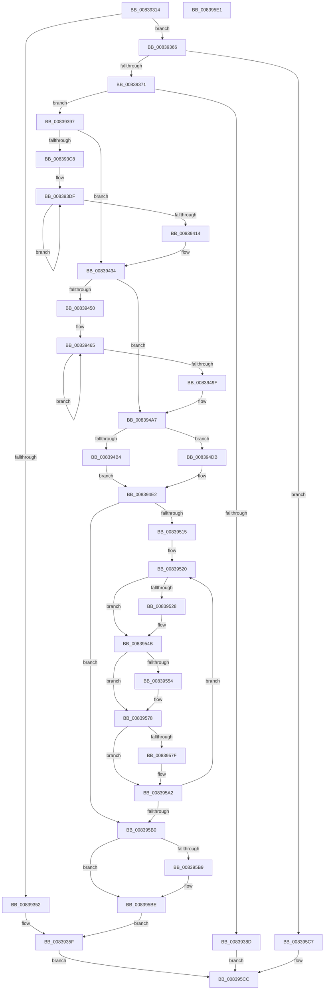

# I_MincryptAddChainInfo

- RVA: `0x00839314`–`0x008395E2` (길이 `718` bytes)
- VA: `0x0000000140839314`
- 실행 섹션: `PAGE`
- PDB 이름 있음: `예`; PDB Function 태그: `아니요`
- unwind 정보 RVA: `0x000CBFC4`
- 디코드: `200`개 명령, `718/718` bytes 표시
- 미해석 바이트: `0` (있으면 어셈블리에 `.byte`로 보존)

> 이 문서는 커널 이미지의 기계어와 PDB 기호를 분석해 생성했습니다. 4번과 5번은 함수 원형과 자료형을 바이너리 사용 방식에서 추정한 C 해석이며 원본 소스 복구 결과는 아닙니다.

## 1. Dependencies

- 직접 호출 지점: **10**; 고유 호출 대상: **3**
- 직접 호출자로 확인된 함수: **2**
- RIP 상대 이미지 참조: **0**

### Outgoing calls
- `0x00839356` → [I_MincryptFreeChainInfo](I_MincryptFreeChainInfo_function_008395E8.md) (function, `0x008395E8`)
- `0x00839380` → [ExAllocatePool2](../../poolcode/B8/ExAllocatePool2_function_00B820F0.md) (function, `0x00B820F0`)
- `0x008393EE` → [memcpy](../../text/6C/memcpy_function_006C6840.md) (function, `0x006C6840`)
- `0x0083946F` → [memcpy](../../text/6C/memcpy_function_006C6840.md) (function, `0x006C6840`)
- `0x008394BE` → [memcpy](../../text/6C/memcpy_function_006C6840.md) (function, `0x006C6840`)
- `0x00839502` → [memcpy](../../text/6C/memcpy_function_006C6840.md) (function, `0x006C6840`)
- `0x00839532` → [memcpy](../../text/6C/memcpy_function_006C6840.md) (function, `0x006C6840`)
- `0x0083955E` → [memcpy](../../text/6C/memcpy_function_006C6840.md) (function, `0x006C6840`)
- `0x00839589` → [memcpy](../../text/6C/memcpy_function_006C6840.md) (function, `0x006C6840`)
- `0x008395B9` → [I_MincryptFreeChainInfo](I_MincryptFreeChainInfo_function_008395E8.md) (function, `0x008395E8`)

### Direct callers
- [MinCryptVerifyCertificateWithPolicy2](MinCryptVerifyCertificateWithPolicy2_function_008368A8.md) at `0x008374D4`
- [MinCryptVerifyCertificateWithPolicy2$fin$0](../B1/MinCryptVerifyCertificateWithPolicy2_fin_0_function_00B15BD6.md) at `0x00B15C88`

### Static image references
- 디코드된 RIP-relative 메모리 참조가 없습니다.

## 2. Other-region calls and transfers

- 다른 실행 섹션으로 향하는 call: **8**
  - `0x00839380` → [ExAllocatePool2](../../poolcode/B8/ExAllocatePool2_function_00B820F0.md) (`PAGE` → `POOLCODE`)
  - `0x008393EE` → [memcpy](../../text/6C/memcpy_function_006C6840.md) (`PAGE` → `.text`)
  - `0x0083946F` → [memcpy](../../text/6C/memcpy_function_006C6840.md) (`PAGE` → `.text`)
  - `0x008394BE` → [memcpy](../../text/6C/memcpy_function_006C6840.md) (`PAGE` → `.text`)
  - `0x00839502` → [memcpy](../../text/6C/memcpy_function_006C6840.md) (`PAGE` → `.text`)
  - `0x00839532` → [memcpy](../../text/6C/memcpy_function_006C6840.md) (`PAGE` → `.text`)
  - `0x0083955E` → [memcpy](../../text/6C/memcpy_function_006C6840.md) (`PAGE` → `.text`)
  - `0x00839589` → [memcpy](../../text/6C/memcpy_function_006C6840.md) (`PAGE` → `.text`)
- 별도 외부 분기/꼬리 이동을 확인하지 못했습니다.

## 3. Assembly (complete function range)

```asm
00839314  48 89 5C 24 10                  mov qword ptr [rsp + 0x10], rbx
00839319  44 89 4C 24 20                  mov dword ptr [rsp + 0x20], r9d
0083931E  48 89 4C 24 08                  mov qword ptr [rsp + 8], rcx
00839323  55                              push rbp
00839324  56                              push rsi
00839325  57                              push rdi
00839326  41 54                           push r12
00839328  41 55                           push r13
0083932A  41 56                           push r14
0083932C  41 57                           push r15
0083932E  48 83 EC 30                     sub rsp, 0x30
00839332  44 8B AC 24 90 00 00 00         mov r13d, dword ptr [rsp + 0x90]
0083933A  45 33 FF                        xor r15d, r15d
0083933D  45 8B F0                        mov r14d, r8d
00839340  45 8B E1                        mov r12d, r9d
00839343  48 8B E9                        mov rbp, rcx
00839346  43 8D 1C 0E                     lea ebx, [r14 + r9]
0083934A  42 8D 04 2B                     lea eax, [rbx + r13]
0083934E  85 C0                           test eax, eax
00839350  75 14                           jne 0x140839366
00839352  48 8B 49 10                     mov rcx, qword ptr [rcx + 0x10]
00839356  E8 8D 02 00 00                  call 0x1408395e8
0083935B  4C 89 7D 10                     mov qword ptr [rbp + 0x10], r15
0083935F  33 C0                           xor eax, eax
00839361  E9 66 02 00 00                  jmp 0x1408395cc
00839366  8D 42 68                        lea eax, [rdx + 0x68]
00839369  3B C2                           cmp eax, edx
0083936B  0F 82 56 02 00 00               jb 0x1408395c7
00839371  8B D0                           mov edx, eax
00839373  B9 02 01 00 00                  mov ecx, 0x102
00839378  41 B8 43 49 63 72               mov r8d, 0x72634943
0083937E  8B F8                           mov edi, eax
00839380  E8 6B 8D 34 00                  call 0x140b820f0
00839385  48 8B F0                        mov rsi, rax
00839388  48 85 C0                        test rax, rax
0083938B  75 0A                           jne 0x140839397
0083938D  B8 17 00 00 C0                  mov eax, 0xc0000017
00839392  E9 35 02 00 00                  jmp 0x1408395cc
00839397  89 38                           mov dword ptr [rax], edi
00839399  48 8D 7E 68                     lea rdi, [rsi + 0x68]
0083939D  8B 84 24 98 00 00 00            mov eax, dword ptr [rsp + 0x98]
008393A4  48 8B CF                        mov rcx, rdi
008393A7  89 46 34                        mov dword ptr [rsi + 0x34], eax
008393AA  8B C3                           mov eax, ebx
008393AC  48 C1 E0 04                     shl rax, 4
008393B0  48 89 7E 18                     mov qword ptr [rsi + 0x18], rdi
008393B4  48 03 F8                        add rdi, rax
008393B7  48 89 4C 24 20                  mov qword ptr [rsp + 0x20], rcx
008393BC  44 89 76 20                     mov dword ptr [rsi + 0x20], r14d
008393C0  41 8B C7                        mov eax, r15d
008393C3  45 85 F6                        test r14d, r14d
008393C6  74 6C                           je 0x140839434
008393C8  4C 8B BC 24 A0 00 00 00         mov r15, qword ptr [rsp + 0xa0]
008393D0  48 8B E9                        mov rbp, rcx
008393D3  4D 8B EF                        mov r13, r15
008393D6  4D 8B E6                        mov r12, r14
008393D9  4C 2B E9                        sub r13, rcx
008393DC  49 2B EF                        sub rbp, r15
008393DF  45 8B 07                        mov r8d, dword ptr [r15]
008393E2  49 8D 1C 2F                     lea rbx, [r15 + rbp]
008393E6  4A 8B 54 2B 08                  mov rdx, qword ptr [rbx + r13 + 8]
008393EB  48 8B CF                        mov rcx, rdi
008393EE  E8 4D D4 E8 FF                  call 0x1406c6840
008393F3  48 89 7B 08                     mov qword ptr [rbx + 8], rdi
008393F7  41 8B 07                        mov eax, dword ptr [r15]
008393FA  89 03                           mov dword ptr [rbx], eax
008393FC  41 8B 07                        mov eax, dword ptr [r15]
008393FF  4D 8D 7F 10                     lea r15, [r15 + 0x10]
00839403  48 83 C0 03                     add rax, 3
00839407  48 83 E0 FC                     and rax, 0xfffffffffffffffc
0083940B  48 03 F8                        add rdi, rax
0083940E  49 83 EC 01                     sub r12, 1
00839412  75 CB                           jne 0x1408393df
00839414  48 8B 6C 24 70                  mov rbp, qword ptr [rsp + 0x70]
00839419  49 8B C6                        mov rax, r14
0083941C  44 8B A4 24 88 00 00 00         mov r12d, dword ptr [rsp + 0x88]
00839424  45 33 FF                        xor r15d, r15d
00839427  44 8B AC 24 90 00 00 00         mov r13d, dword ptr [rsp + 0x90]
0083942F  48 8B 4C 24 20                  mov rcx, qword ptr [rsp + 0x20]
00839434  48 C1 E0 04                     shl rax, 4
00839438  48 03 C1                        add rax, rcx
0083943B  44 89 66 10                     mov dword ptr [rsi + 0x10], r12d
0083943F  48 89 46 08                     mov qword ptr [rsi + 8], rax
00839443  44 89 BC 24 88 00 00 00         mov dword ptr [rsp + 0x88], r15d
0083944B  45 85 E4                        test r12d, r12d
0083944E  74 57                           je 0x1408394a7
00839450  48 8B 9C 24 A8 00 00 00         mov rbx, qword ptr [rsp + 0xa8]
00839458  4C 8B 7C 24 20                  mov r15, qword ptr [rsp + 0x20]
0083945D  44 8B AC 24 88 00 00 00         mov r13d, dword ptr [rsp + 0x88]
00839465  44 8B 03                        mov r8d, dword ptr [rbx]
00839468  48 8B CF                        mov rcx, rdi
0083946B  48 8B 53 08                     mov rdx, qword ptr [rbx + 8]
0083946F  E8 CC D3 E8 FF                  call 0x1406c6840
00839474  43 8D 0C 2E                     lea ecx, [r14 + r13]
00839478  41 FF C5                        inc r13d
0083947B  48 03 C9                        add rcx, rcx
0083947E  49 89 7C CF 08                  mov qword ptr [r15 + rcx*8 + 8], rdi
00839483  8B 03                           mov eax, dword ptr [rbx]
00839485  41 89 04 CF                     mov dword ptr [r15 + rcx*8], eax
00839489  8B 03                           mov eax, dword ptr [rbx]
0083948B  48 8D 5B 10                     lea rbx, [rbx + 0x10]
0083948F  48 83 C0 03                     add rax, 3
00839493  48 83 E0 FC                     and rax, 0xfffffffffffffffc
00839497  48 03 F8                        add rdi, rax
0083949A  45 3B EC                        cmp r13d, r12d
0083949D  72 C6                           jb 0x140839465
0083949F  44 8B AC 24 90 00 00 00         mov r13d, dword ptr [rsp + 0x90]
008394A7  48 8B 9C 24 B8 00 00 00         mov rbx, qword ptr [rsp + 0xb8]
008394AF  48 85 DB                        test rbx, rbx
008394B2  74 27                           je 0x1408394db
008394B4  44 8B 03                        mov r8d, dword ptr [rbx]
008394B7  48 8B CF                        mov rcx, rdi
008394BA  48 8B 53 08                     mov rdx, qword ptr [rbx + 8]
008394BE  E8 7D D3 E8 FF                  call 0x1406c6840
008394C3  48 89 7E 40                     mov qword ptr [rsi + 0x40], rdi
008394C7  8B 03                           mov eax, dword ptr [rbx]
008394C9  89 46 38                        mov dword ptr [rsi + 0x38], eax
008394CC  8B 03                           mov eax, dword ptr [rbx]
008394CE  48 83 C0 03                     add rax, 3
008394D2  48 83 E0 FC                     and rax, 0xfffffffffffffffc
008394D6  48 03 F8                        add rdi, rax
008394D9  EB 07                           jmp 0x1408394e2
008394DB  0F 57 C0                        xorps xmm0, xmm0
008394DE  0F 11 46 38                     movups xmmword ptr [rsi + 0x38], xmm0
008394E2  4C 8B BC 24 B0 00 00 00         mov r15, qword ptr [rsp + 0xb0]
008394EA  48 8B CF                        mov rcx, rdi
008394ED  45 8B E5                        mov r12d, r13d
008394F0  49 8B D7                        mov rdx, r15
008394F3  49 6B DC 78                     imul rbx, r12, 0x78
008394F7  48 89 7E 28                     mov qword ptr [rsi + 0x28], rdi
008394FB  4C 8B C3                        mov r8, rbx
008394FE  44 89 6E 30                     mov dword ptr [rsi + 0x30], r13d
00839502  E8 39 D3 E8 FF                  call 0x1406c6840
00839507  33 D2                           xor edx, edx
00839509  48 03 FB                        add rdi, rbx
0083950C  45 85 ED                        test r13d, r13d
0083950F  0F 84 9B 00 00 00               je 0x1408395b0
00839515  4C 8D 72 B0                     lea r14, [rdx - 0x50]
00839519  4D 2B F7                        sub r14, r15
0083951C  49 8D 5F 50                     lea rbx, [r15 + 0x50]
00839520  0F B7 03                        movzx eax, word ptr [rbx]
00839523  66 85 C0                        test ax, ax
00839526  74 23                           je 0x14083954b
00839528  48 8B 53 F8                     mov rdx, qword ptr [rbx - 8]
0083952C  44 8B C0                        mov r8d, eax
0083952F  48 8B CF                        mov rcx, rdi
00839532  E8 09 D3 E8 FF                  call 0x1406c6840
00839537  48 8B 4E 28                     mov rcx, qword ptr [rsi + 0x28]
0083953B  49 03 CE                        add rcx, r14
0083953E  48 89 7C 19 48                  mov qword ptr [rcx + rbx + 0x48], rdi
00839543  0F B7 03                        movzx eax, word ptr [rbx]
00839546  48 03 F8                        add rdi, rax
00839549  33 D2                           xor edx, edx
0083954B  0F B7 43 10                     movzx eax, word ptr [rbx + 0x10]
0083954F  66 85 C0                        test ax, ax
00839552  74 24                           je 0x140839578
00839554  48 8B 53 08                     mov rdx, qword ptr [rbx + 8]
00839558  44 8B C0                        mov r8d, eax
0083955B  48 8B CF                        mov rcx, rdi
0083955E  E8 DD D2 E8 FF                  call 0x1406c6840
00839563  48 8B 4E 28                     mov rcx, qword ptr [rsi + 0x28]
00839567  49 03 CE                        add rcx, r14
0083956A  48 89 7C 19 58                  mov qword ptr [rcx + rbx + 0x58], rdi
0083956F  0F B7 43 10                     movzx eax, word ptr [rbx + 0x10]
00839573  48 03 F8                        add rdi, rax
00839576  33 D2                           xor edx, edx
00839578  8B 43 18                        mov eax, dword ptr [rbx + 0x18]
0083957B  85 C0                           test eax, eax
0083957D  74 23                           je 0x1408395a2
0083957F  48 8B 53 20                     mov rdx, qword ptr [rbx + 0x20]
00839583  44 8B C0                        mov r8d, eax
00839586  48 8B CF                        mov rcx, rdi
00839589  E8 B2 D2 E8 FF                  call 0x1406c6840
0083958E  48 8B 4E 28                     mov rcx, qword ptr [rsi + 0x28]
00839592  49 03 CE                        add rcx, r14
00839595  48 89 7C 19 70                  mov qword ptr [rcx + rbx + 0x70], rdi
0083959A  8B 43 18                        mov eax, dword ptr [rbx + 0x18]
0083959D  48 03 F8                        add rdi, rax
008395A0  33 D2                           xor edx, edx
008395A2  48 83 C3 78                     add rbx, 0x78
008395A6  49 83 EC 01                     sub r12, 1
008395AA  0F 85 70 FF FF FF               jne 0x140839520
008395B0  48 8B 4D 10                     mov rcx, qword ptr [rbp + 0x10]
008395B4  48 85 C9                        test rcx, rcx
008395B7  74 05                           je 0x1408395be
008395B9  E8 2A 00 00 00                  call 0x1408395e8
008395BE  48 89 75 10                     mov qword ptr [rbp + 0x10], rsi
008395C2  E9 98 FD FF FF                  jmp 0x14083935f
008395C7  B8 95 00 00 C0                  mov eax, 0xc0000095
008395CC  48 8B 5C 24 78                  mov rbx, qword ptr [rsp + 0x78]
008395D1  48 83 C4 30                     add rsp, 0x30
008395D5  41 5F                           pop r15
008395D7  41 5E                           pop r14
008395D9  41 5D                           pop r13
008395DB  41 5C                           pop r12
008395DD  5F                              pop rdi
008395DE  5E                              pop rsi
008395DF  5D                              pop rbp
008395E0  C3                              ret
008395E1  CC                              int3
```

## 4. C-style interpretation (structured pseudocode)

```c
__int64 __fastcall I_MincryptAddChainInfo(__int64 a1, __int64 a2, int a3, __int64 a4, unsigned int a5, unsigned int a6, __int64 a7, __int64 a8, __int64 a9, __int64 a10)
{
    __int64 result;
    __int64 v_r12;
    __int64 v_r13;
    __int64 v_r14;
    __int64 v_r15;
    __int64 v_rbp;
    __int64 v_rbx;
    __int64 v_rdi;
    __int64 v_rsp;
    unsigned __int64 v_stack_m48;
    unsigned __int64 v_stack_p10;
    unsigned int v_stack_p20;
    unsigned __int64 v_stack_p8;

    v_stack_p10 = v_rbx;
    v_stack_p20 = (unsigned int)(a4);
    v_stack_p8 = a1;
    v_rsp = (v_rsp) - (48);
    v_r15 = 0;
    if ((unsigned int)((unsigned int)(a3) + a4 * 1 + (unsigned int)(a5) * 1) != 0) goto loc_00839366;
    result = I_MincryptFreeChainInfo(*(unsigned __int64 *)(a1 + 16), a2, a3, a4);
    *(unsigned __int64 *)(a1 + 16) = 0;
loc_0083935F:
    result = 0;
    goto loc_008395CC;
loc_00839366:
    if (((unsigned int)(a2 + 104)) < ((unsigned int)(a2))) goto loc_008395C7;
    result = ExAllocatePool2(258, (unsigned int)((unsigned int)(a2 + 104)), (unsigned int)(0x72634943ULL), a4);
    if (result != 0) goto loc_00839397;
    goto loc_008395CC;
loc_00839397:
    *(unsigned int *)((unsigned int)(0xC0000017ULL)) = (unsigned int)((unsigned int)((unsigned int)(a2 + 104)));
    *(unsigned int *)(result + 52) = (unsigned int)((unsigned int)(a6));
    result = ((unsigned int)((unsigned int)((unsigned int)(a3) + a4 * 1))) << (4);
    *(unsigned __int64 *)(result + 24) = result + 104;
    v_rdi = (result + 104) + (result);
    v_stack_m48 = result + 104;
    *(unsigned int *)(result + 32) = (unsigned int)((unsigned int)(a3));
    if ((unsigned int)((unsigned int)(a3)) == 0) goto loc_00839434;
    v_r13 = (a7) - (result + 104);
    v_rbp = (result + 104) - (a7);
loc_008393DF:
    result = memcpy(v_rdi, *(unsigned __int64 *)(a7 + v_rbp * 1 + v_r13 * 1 + 8), (unsigned int)(*(unsigned int *)(a7)), a4);
    *(unsigned __int64 *)(a7 + v_rbp * 1 + 8) = v_rdi;
    *(unsigned int *)(a7 + v_rbp * 1) = (unsigned int)((unsigned int)(*(unsigned int *)(a7)));
    result = ((unsigned int)(*(unsigned int *)(a7))) + (3);
    result = (result) & (-4);
    v_rdi = (v_rdi) + (result);
    v_r12 = ((unsigned int)(a3)) - (1);
    if (condition_is_not_equal) goto loc_008393DF;
    v_r15 = 0;
loc_00839434:
    result = ((unsigned int)(a3)) << (4);
    result = (result) + (v_stack_m48);
    *(unsigned int *)(result + 16) = (unsigned int)((unsigned int)(v_stack_p20));
    *(unsigned __int64 *)(result + 8) = result;
    v_stack_p20 = 0;
    if ((unsigned int)((unsigned int)(v_stack_p20)) == 0) goto loc_008394A7;
loc_00839465:
    result = memcpy(v_rdi, *(unsigned __int64 *)(a8 + 8), (unsigned int)(*(unsigned int *)(a8)), a4);
    v_r13 = (unsigned int)(((unsigned int)(v_stack_p20)) + 1);
    a1 = ((unsigned int)(a3) + (unsigned int)(v_stack_p20) * 1) + ((unsigned int)(a3) + (unsigned int)(v_stack_p20) * 1);
    *(unsigned __int64 *)(v_stack_m48 + a1 * 8 + 8) = v_rdi;
    *(unsigned int *)(v_stack_m48 + a1 * 8) = (unsigned int)((unsigned int)(*(unsigned int *)(a8)));
    result = ((unsigned int)(*(unsigned int *)(a8))) + (3);
    result = (result) & (-4);
    v_rdi = (v_rdi) + (result);
    if (((unsigned int)(v_r13)) < ((unsigned int)((unsigned int)(v_stack_p20)))) goto loc_00839465;
loc_008394A7:
    if (a10 == 0) goto loc_008394DB;
    result = memcpy(v_rdi, *(unsigned __int64 *)(a10 + 8), (unsigned int)(*(unsigned int *)(a10)), a4);
    *(unsigned __int64 *)(result + 64) = v_rdi;
    *(unsigned int *)(result + 56) = (unsigned int)((unsigned int)(*(unsigned int *)(a10)));
    result = ((unsigned int)(*(unsigned int *)(a10))) + (3);
    result = (result) & (-4);
    v_rdi = (v_rdi) + (result);
    goto loc_008394E2;
loc_008394DB:
    *(unsigned __int64 *)(result + 56) = v_xmm0;
loc_008394E2:
    v_rbx = (a10) * ((unsigned int)((unsigned int)((unsigned int)(a5))));
    *(unsigned __int64 *)(result + 40) = v_rdi;
    *(unsigned int *)(result + 48) = (unsigned int)((unsigned int)(a5));
    result = memcpy(v_rdi, a9, v_rbx, a4);
    a2 = 0;
    v_rdi = (v_rdi) + (v_rbx);
    if ((unsigned int)((unsigned int)(a5)) == 0) goto loc_008395B0;
    v_r14 = (a2 - 80) - (a9);
loc_00839520:
    result = *(unsigned __int16 *)(a9 + 80);
    if ((unsigned __int16)(*(unsigned __int16 *)(a9 + 80)) != 0) {
        a2 = *(unsigned __int64 *)(a9 + 80 - 8);
        a3 = (unsigned int)(*(unsigned __int16 *)(a9 + 80));
        a1 = v_rdi;
        result = memcpy(a1, a2, a3, a4);
        a1 = *(unsigned __int64 *)(result + 40);
        a1 = (a1) + (v_r14);
        *(unsigned __int64 *)(a1 + a9 + 80 * 1 + 72) = v_rdi;
        result = *(unsigned __int16 *)(a9 + 80);
        v_rdi = (v_rdi) + (result);
        a2 = 0;
    }
    result = *(unsigned __int16 *)(a9 + 80 + 16);
    if ((unsigned __int16)(*(unsigned __int16 *)(a9 + 80 + 16)) != 0) {
        a2 = *(unsigned __int64 *)(a9 + 80 + 8);
        a3 = (unsigned int)(*(unsigned __int16 *)(a9 + 80 + 16));
        a1 = v_rdi;
        result = memcpy(a1, a2, a3, a4);
        a1 = *(unsigned __int64 *)(result + 40);
        a1 = (a1) + (v_r14);
        *(unsigned __int64 *)(a1 + a9 + 80 * 1 + 88) = v_rdi;
        result = *(unsigned __int16 *)(a9 + 80 + 16);
        v_rdi = (v_rdi) + (result);
        a2 = 0;
    }
    result = (unsigned int)(*(unsigned int *)(a9 + 80 + 24));
    if ((unsigned int)((unsigned int)(*(unsigned int *)(a9 + 80 + 24))) != 0) {
        a2 = *(unsigned __int64 *)(a9 + 80 + 32);
        a3 = (unsigned int)((unsigned int)(*(unsigned int *)(a9 + 80 + 24)));
        a1 = v_rdi;
        result = memcpy(a1, a2, a3, a4);
        a1 = *(unsigned __int64 *)(result + 40);
        a1 = (a1) + (v_r14);
        *(unsigned __int64 *)(a1 + a9 + 80 * 1 + 112) = v_rdi;
        result = *(unsigned int *)(a9 + 80 + 24);
        v_rdi = (v_rdi) + (result);
        a2 = 0;
    }
    v_rbx = (a9 + 80) + (120);
    v_r12 = ((unsigned int)((unsigned int)((unsigned int)(a5)))) - (1);
    if (condition_is_not_equal) goto loc_00839520;
loc_008395B0:
    if (*(unsigned __int64 *)(v_stack_p8 + 16) != 0) {
        result = I_MincryptFreeChainInfo(*(unsigned __int64 *)(v_stack_p8 + 16), a2, a3, a4);
    }
    *(unsigned __int64 *)(v_stack_p8 + 16) = result;
    goto loc_0083935F;
loc_008395C7:
loc_008395CC:
    v_rsp = (v_rsp) + (48);
    return (unsigned int)(0xC0000095ULL);
}
```

## 5. (Beta) C Style

```c
int64_t I_MincryptAddChainInfo(void *Arg1, void *Arg2, void *Arg3, int64_t Arg4, uint32_t Arg5, uint32_t Arg6, void *Arg7, void *Arg8, void *Arg9, int64_t Arg10)
{
    uint8_t *arg1 = (uint8_t *)Arg1;
    uint8_t *arg2 = (uint8_t *)Arg2;
    uint8_t *arg3 = (uint8_t *)Arg3;
    uint8_t *arg7 = (uint8_t *)Arg7;
    uint8_t *arg8 = (uint8_t *)Arg8;
    uint8_t *arg9 = (uint8_t *)Arg9;

    int64_t result;
    int64_t local_r12;
    int64_t local_r13;
    int64_t local_r14;
    int64_t local_r15;
    int64_t local_rbp;
    int64_t local_rbx;
    int64_t local_rdi;
    int64_t local_rsp;
    uint64_t v_stack_m48;
    uint64_t v_stack_p10;
    uint32_t v_stack_p20;
    uint64_t v_stack_p8;

    v_stack_p10 = local_rbx;
    v_stack_p20 = (uint32_t)(Arg4);
    v_stack_p8 = Arg1;
    local_rsp = (local_rsp) - (48);
    local_r15 = 0;
    if ((uint32_t)((uint32_t)(Arg3) + Arg4 * 1 + (uint32_t)(Arg5) * 1) != 0) goto loc_00839366;
    result = I_MincryptFreeChainInfo(*(uint64_t *)(arg1 + 0x10), Arg2, Arg3, Arg4);
    *(uint64_t *)(arg1 + 0x10) = 0;
loc_0083935F:
    result = 0;
    goto loc_008395CC;
loc_00839366:
    if (((uint32_t)(Arg2 + 104)) < ((uint32_t)(Arg2))) goto loc_008395C7;
    result = ExAllocatePool2(258, (uint32_t)((uint32_t)(Arg2 + 104)), (uint32_t)(0x72634943ULL), Arg4);
    if (result != 0) goto loc_00839397;
    goto loc_008395CC;
loc_00839397:
    *(uint32_t *)((uint32_t)(0xC0000017ULL)) = (uint32_t)((uint32_t)((uint32_t)(Arg2 + 104)));
    *(uint32_t *)(result + 0x34) = (uint32_t)((uint32_t)(Arg6));
    result = ((uint32_t)((uint32_t)((uint32_t)(Arg3) + Arg4 * 1))) << (4);
    *(uint64_t *)(result + 0x18) = result + 104;
    local_rdi = (result + 104) + (result);
    v_stack_m48 = result + 104;
    *(uint32_t *)(result + 0x20) = (uint32_t)((uint32_t)(Arg3));
    if ((uint32_t)((uint32_t)(Arg3)) == 0) goto loc_00839434;
    local_r13 = (Arg7) - (result + 104);
    local_rbp = (result + 104) - (Arg7);
loc_008393DF:
    result = memcpy(local_rdi, *(uint64_t *)(arg7 + local_rbp * 1 + local_r13 * 1 + 0x8), (uint32_t)(*(uint32_t *)(arg7)), Arg4);
    *(uint64_t *)(arg7 + local_rbp * 1 + 0x8) = local_rdi;
    *(uint32_t *)(arg7 + local_rbp * 1) = (uint32_t)((uint32_t)(*(uint32_t *)(arg7)));
    result = ((uint32_t)(*(uint32_t *)(arg7))) + (3);
    result = (result) & (-4);
    local_rdi = (local_rdi) + (result);
    local_r12 = ((uint32_t)(Arg3)) - (1);
    if (condition_is_not_equal) goto loc_008393DF;
    local_r15 = 0;
loc_00839434:
    result = ((uint32_t)(Arg3)) << (4);
    result = (result) + (v_stack_m48);
    *(uint32_t *)(result + 0x10) = (uint32_t)((uint32_t)(v_stack_p20));
    *(uint64_t *)(result + 0x8) = result;
    v_stack_p20 = 0;
    if ((uint32_t)((uint32_t)(v_stack_p20)) == 0) goto loc_008394A7;
loc_00839465:
    result = memcpy(local_rdi, *(uint64_t *)(arg8 + 0x8), (uint32_t)(*(uint32_t *)(arg8)), Arg4);
    local_r13 = (uint32_t)(((uint32_t)(v_stack_p20)) + 1);
    Arg1 = ((uint32_t)(Arg3) + (uint32_t)(v_stack_p20) * 1) + ((uint32_t)(Arg3) + (uint32_t)(v_stack_p20) * 1);
    *(uint64_t *)(v_stack_m48 + arg1 * 8 + 0x8) = local_rdi;
    *(uint32_t *)(v_stack_m48 + arg1 * 8) = (uint32_t)((uint32_t)(*(uint32_t *)(arg8)));
    result = ((uint32_t)(*(uint32_t *)(arg8))) + (3);
    result = (result) & (-4);
    local_rdi = (local_rdi) + (result);
    if (((uint32_t)(local_r13)) < ((uint32_t)((uint32_t)(v_stack_p20)))) goto loc_00839465;
loc_008394A7:
    if (Arg10 == 0) goto loc_008394DB;
    result = memcpy(local_rdi, *(uint64_t *)(Arg10 + 0x8), (uint32_t)(*(uint32_t *)(Arg10)), Arg4);
    *(uint64_t *)(result + 0x40) = local_rdi;
    *(uint32_t *)(result + 0x38) = (uint32_t)((uint32_t)(*(uint32_t *)(Arg10)));
    result = ((uint32_t)(*(uint32_t *)(Arg10))) + (3);
    result = (result) & (-4);
    local_rdi = (local_rdi) + (result);
    goto loc_008394E2;
loc_008394DB:
    *(uint64_t *)(result + 0x38) = v_xmm0;
loc_008394E2:
    local_rbx = (Arg10) * ((uint32_t)((uint32_t)((uint32_t)(Arg5))));
    *(uint64_t *)(result + 0x28) = local_rdi;
    *(uint32_t *)(result + 0x30) = (uint32_t)((uint32_t)(Arg5));
    result = memcpy(local_rdi, Arg9, local_rbx, Arg4);
    Arg2 = 0;
    local_rdi = (local_rdi) + (local_rbx);
    if ((uint32_t)((uint32_t)(Arg5)) == 0) goto loc_008395B0;
    local_r14 = (Arg2 - 80) - (Arg9);
loc_00839520:
    result = *(uint16_t *)(arg9 + 0x50);
    if ((uint16_t)(*(uint16_t *)(arg9 + 0x50)) != 0) {
        Arg2 = *(uint64_t *)(arg9 + 0x50 - 0x8);
        Arg3 = (uint32_t)(*(uint16_t *)(arg9 + 0x50));
        Arg1 = local_rdi;
        result = memcpy(Arg1, Arg2, Arg3, Arg4);
        Arg1 = *(uint64_t *)(result + 0x28);
        Arg1 = (Arg1) + (local_r14);
        *(uint64_t *)(arg1 + arg9 + 0x50 * 1 + 0x48) = local_rdi;
        result = *(uint16_t *)(arg9 + 0x50);
        local_rdi = (local_rdi) + (result);
        Arg2 = 0;
    }
    result = *(uint16_t *)(arg9 + 0x50 + 0x10);
    if ((uint16_t)(*(uint16_t *)(arg9 + 0x50 + 0x10)) != 0) {
        Arg2 = *(uint64_t *)(arg9 + 0x50 + 0x8);
        Arg3 = (uint32_t)(*(uint16_t *)(arg9 + 0x50 + 0x10));
        Arg1 = local_rdi;
        result = memcpy(Arg1, Arg2, Arg3, Arg4);
        Arg1 = *(uint64_t *)(result + 0x28);
        Arg1 = (Arg1) + (local_r14);
        *(uint64_t *)(arg1 + arg9 + 0x50 * 1 + 0x58) = local_rdi;
        result = *(uint16_t *)(arg9 + 0x50 + 0x10);
        local_rdi = (local_rdi) + (result);
        Arg2 = 0;
    }
    result = (uint32_t)(*(uint32_t *)(arg9 + 0x50 + 0x18));
    if ((uint32_t)((uint32_t)(*(uint32_t *)(arg9 + 0x50 + 0x18))) != 0) {
        Arg2 = *(uint64_t *)(arg9 + 0x50 + 0x20);
        Arg3 = (uint32_t)((uint32_t)(*(uint32_t *)(arg9 + 0x50 + 0x18)));
        Arg1 = local_rdi;
        result = memcpy(Arg1, Arg2, Arg3, Arg4);
        Arg1 = *(uint64_t *)(result + 0x28);
        Arg1 = (Arg1) + (local_r14);
        *(uint64_t *)(arg1 + arg9 + 0x50 * 1 + 0x70) = local_rdi;
        result = *(uint32_t *)(arg9 + 0x50 + 0x18);
        local_rdi = (local_rdi) + (result);
        Arg2 = 0;
    }
    local_rbx = (Arg9 + 80) + (120);
    local_r12 = ((uint32_t)((uint32_t)((uint32_t)(Arg5)))) - (1);
    if (condition_is_not_equal) goto loc_00839520;
loc_008395B0:
    if (*(uint64_t *)(v_stack_p8 + 0x10) != 0) {
        result = I_MincryptFreeChainInfo(*(uint64_t *)(v_stack_p8 + 0x10), Arg2, Arg3, Arg4);
    }
    *(uint64_t *)(v_stack_p8 + 0x10) = result;
    goto loc_0083935F;
loc_008395C7:
loc_008395CC:
    local_rsp = (local_rsp) + (48);
    return (uint32_t)(0xC0000095ULL);
}
```

### 관측된 메모리 오프셋

구조체 형식이 확인되지 않은 접근은 인자 기준의 오프셋으로만 기록했습니다.

| 기준 인자 | 오프셋 표현 | 폭 (bit) | 접근 |
|---|---:|---:|---|
| `Arg1` | `+ 0x10` | `64` | `R` |
| `Arg1` | `+ 0x10` | `64` | `W` |
| `Arg2` | `+ 0x68` | `32` | `R` |
| `Arg3` | `+ 0x0 + r13*1` | `32` | `R` |
| `Arg3` | `+ 0x0 + r9*1` | `32` | `R` |
| `Arg7` | `+ 0x0` | `32` | `R` |
| `Arg7` | `+ 0x0` | `32` | `W` |
| `Arg7` | `+ 0x0 + rbp*1` | `64` | `R` |
| `Arg7` | `+ 0x8` | `64` | `W` |
| `Arg7` | `+ 0x8 + r13*1` | `64` | `R` |
| `Arg7` | `+ 0x10` | `64` | `R` |
| `Arg8` | `+ 0x0` | `32` | `R` |
| `Arg8` | `+ 0x8` | `64` | `R` |
| `Arg8` | `+ 0x10` | `64` | `R` |
| `Arg9` | `- 0x8` | `64` | `R` |
| `Arg9` | `+ 0x0` | `16` | `R` |
| `Arg9` | `+ 0x8` | `64` | `R` |
| `Arg9` | `+ 0x10` | `16` | `R` |
| `Arg9` | `+ 0x18` | `32` | `R` |
| `Arg9` | `+ 0x20` | `64` | `R` |
| `Arg9` | `+ 0x50` | `64` | `R` |

## 6. Execution-region graph

[열기: 2D/3D 그래프와 함수 탐색 컨트롤 패널](../../../control-panel.html?section=page&rva=0x00839314&view=graph)

- 2D 그래프는 위에서 아래로 흐르고, 3D 그래프는 빈 공간을 드래그해 회전합니다. Shift+드래그는 이동, 휠은 확대·축소, 함수 노드 선택은 대상 보고서 이동입니다.

### Static fallback


