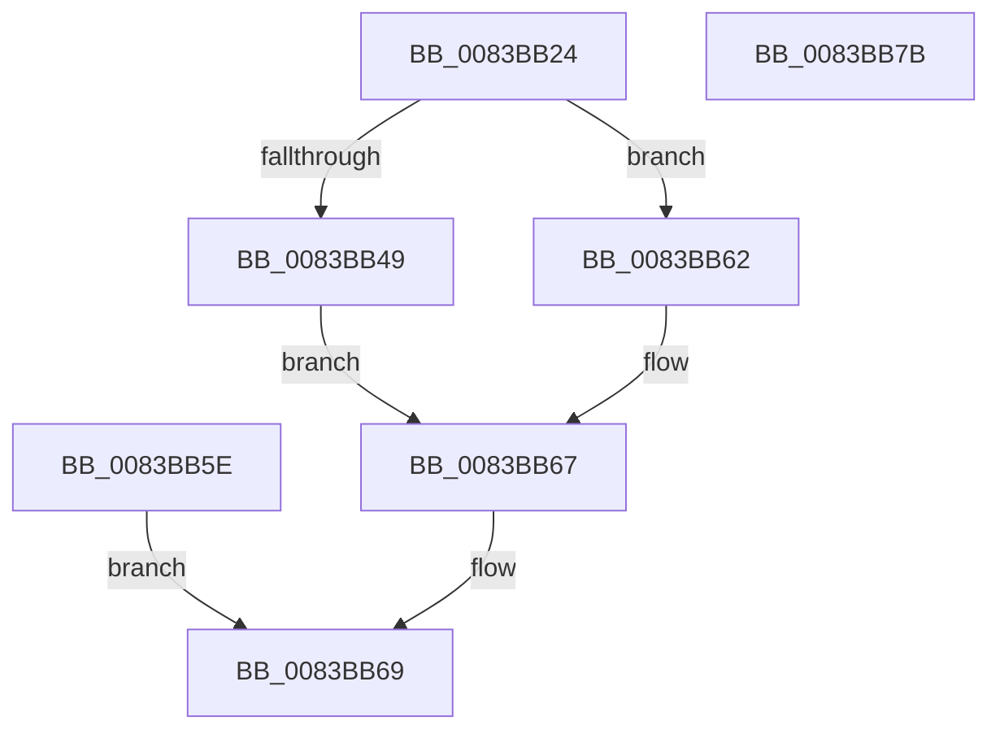

# IoQueryVhdBootInformation

- RVA: `0x0083BB24`–`0x0083BB7C` (길이 `88` bytes)
- VA: `0x000000014083BB24`
- 실행 섹션: `PAGE`
- PDB 이름 있음: `예`; PDB Function 태그: `아니요`
- unwind 정보 RVA: `0x000DB248`
- 디코드: `28`개 명령, `88/88` bytes 표시
- 미해석 바이트: `0` (있으면 어셈블리에 `.byte`로 보존)

> 이 문서는 커널 이미지의 기계어와 PDB 기호를 분석해 생성했습니다. 4번과 5번은 함수 원형과 자료형을 바이너리 사용 방식에서 추정한 C 해석이며 원본 소스 복구 결과는 아닙니다.

## 1. Dependencies

- 직접 호출 지점: **1**; 고유 호출 대상: **1**
- 직접 호출자로 확인된 함수: **1**
- RIP 상대 이미지 참조: **2**

### Outgoing calls
- `0x0083BB56` → [memcpy](../../text/6C/memcpy_function_006C6840.md) (function, `0x006C6840`)

### Direct callers
- [ExpQuerySystemInformation](../A5/ExpQuerySystemInformation_function_00A57858.md) at `0x00A595BB`

### Static image references
- `0x0083BB3E` → RVA `0x00E0F19C` (`.data`; read)
- `0x0083BB4C` → RVA `0x00E0A668` (`.data`; read)

## 2. Other-region calls and transfers

- 다른 실행 섹션으로 향하는 call: **1**
  - `0x0083BB56` → [memcpy](../../text/6C/memcpy_function_006C6840.md) (`PAGE` → `.text`)
- 별도 외부 분기/꼬리 이동을 확인하지 못했습니다.

## 3. Assembly (complete function range)

```asm
0083BB24  48 89 5C 24 08                  mov qword ptr [rsp + 8], rbx
0083BB29  48 89 74 24 10                  mov qword ptr [rsp + 0x10], rsi
0083BB2E  57                              push rdi
0083BB2F  48 83 EC 20                     sub rsp, 0x20
0083BB33  49 8B F1                        mov rsi, r9
0083BB36  48 8B C2                        mov rax, rdx
0083BB39  33 DB                           xor ebx, ebx
0083BB3B  41 89 19                        mov dword ptr [r9], ebx
0083BB3E  8B 3D 58 36 5D 00               mov edi, dword ptr [rip + 0x5d3658]
0083BB44  44 3B C7                        cmp r8d, edi
0083BB47  72 19                           jb 0x14083bb62
0083BB49  44 8B C7                        mov r8d, edi
0083BB4C  48 8B 15 15 EB 5C 00            mov rdx, qword ptr [rip + 0x5ceb15]
0083BB53  48 8B C8                        mov rcx, rax
0083BB56  E8 E5 AC E8 FF                  call 0x1406c6840
0083BB5B  90                              nop
0083BB5C  EB 09                           jmp 0x14083bb67
0083BB5E  8B D8                           mov ebx, eax
0083BB60  EB 07                           jmp 0x14083bb69
0083BB62  BB 23 00 00 C0                  mov ebx, 0xc0000023
0083BB67  89 3E                           mov dword ptr [rsi], edi
0083BB69  8B C3                           mov eax, ebx
0083BB6B  48 8B 5C 24 30                  mov rbx, qword ptr [rsp + 0x30]
0083BB70  48 8B 74 24 38                  mov rsi, qword ptr [rsp + 0x38]
0083BB75  48 83 C4 20                     add rsp, 0x20
0083BB79  5F                              pop rdi
0083BB7A  C3                              ret
0083BB7B  CC                              int3
```

## 4. C-style interpretation (structured pseudocode)

```c
__int64 __fastcall IoQueryVhdBootInformation(__int64 a1, __int64 a2, int a3, __int64 a4)
{
    __int64 result;
    __int64 v_rbx;
    __int64 v_rsp;
    unsigned __int64 v_stack_p10;
    unsigned __int64 v_stack_p8;

    v_stack_p8 = v_rbx;
    v_stack_p10 = v_rsi;
    v_rsp = (v_rsp) - (32);
    v_rbx = 0;
    *(unsigned int *)(a4) = 0;
    if (a3 < ((unsigned int)((unsigned int)(*(unsigned int *)(v_rip + 6108760))))) goto loc_0083BB62;
    result = memcpy(a2, *(unsigned __int64 *)(v_rip + 6089493), (unsigned int)((unsigned int)((unsigned int)(*(unsigned int *)(v_rip + 6108760)))), a4);
    goto loc_0083BB67;
loc_0083BB62:
loc_0083BB67:
    *(unsigned int *)(a4) = (unsigned int)((unsigned int)(*(unsigned int *)(v_rip + 6108760)));
loc_0083BB69:
    v_rsp = (v_rsp) + (32);
    return (unsigned int)((unsigned int)((unsigned int)(0xC0000023ULL)));
}
```

## 5. (Beta) C Style

```c
int64_t IoQueryVhdBootInformation(int64_t Arg1, int64_t Arg2, int32_t Arg3, void *Arg4)
{
    uint8_t *arg4 = (uint8_t *)Arg4;

    int64_t result;
    int64_t local_rbx;
    int64_t local_rsp;
    uint64_t v_stack_p10;
    uint64_t v_stack_p8;

    v_stack_p8 = local_rbx;
    v_stack_p10 = local_rsi;
    local_rsp = (local_rsp) - (32);
    local_rbx = 0;
    *(uint32_t *)(arg4) = 0;
    if (Arg3 < ((uint32_t)((uint32_t)(*(uint32_t *)(v_rip + 0x5D3658))))) goto loc_0083BB62;
    result = memcpy(Arg2, *(uint64_t *)(v_rip + 0x5CEB15), (uint32_t)((uint32_t)((uint32_t)(*(uint32_t *)(v_rip + 0x5D3658)))), Arg4);
    goto loc_0083BB67;
loc_0083BB62:
loc_0083BB67:
    *(uint32_t *)(arg4) = (uint32_t)((uint32_t)(*(uint32_t *)(v_rip + 0x5D3658)));
loc_0083BB69:
    local_rsp = (local_rsp) + (32);
    return (uint32_t)((uint32_t)((uint32_t)(0xC0000023ULL)));
}
```

### 관측된 메모리 오프셋

구조체 형식이 확인되지 않은 접근은 인자 기준의 오프셋으로만 기록했습니다.

| 기준 인자 | 오프셋 표현 | 폭 (bit) | 접근 |
|---|---:|---:|---|
| `Arg4` | `+ 0x0` | `32` | `W` |

## 6. Execution-region graph

[열기: 2D/3D 그래프와 함수 탐색 컨트롤 패널](../../../control-panel.html?section=page&rva=0x0083BB24&view=graph)

- 2D 그래프는 위에서 아래로 흐르고, 3D 그래프는 빈 공간을 드래그해 회전합니다. Shift+드래그는 이동, 휠은 확대·축소, 함수 노드 선택은 대상 보고서 이동입니다.

### Static fallback


