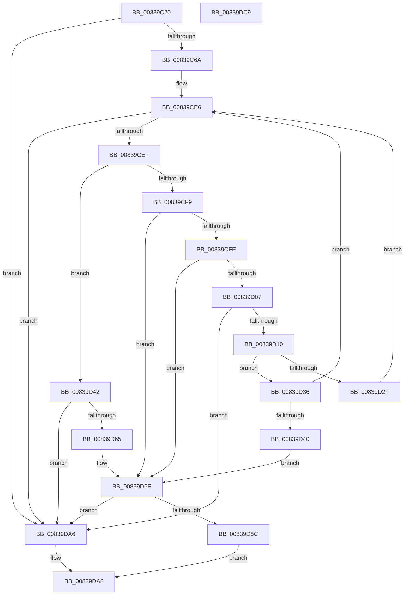

# MinAsn1DecodeGeneralizedTime

- RVA: `0x00839C20`–`0x00839DCA` (길이 `426` bytes)
- VA: `0x0000000140839C20`
- 실행 섹션: `PAGE`
- PDB 이름 있음: `예`; PDB Function 태그: `아니요`
- unwind 정보 RVA: `0x000DB028`
- 디코드: `132`개 명령, `426/426` bytes 표시
- 미해석 바이트: `0` (있으면 어셈블리에 `.byte`로 보존)

> 이 문서는 커널 이미지의 기계어와 PDB 기호를 분석해 생성했습니다. 4번과 5번은 함수 원형과 자료형을 바이너리 사용 방식에서 추정한 C 해석이며 원본 소스 복구 결과는 아닙니다.

## 1. Dependencies

- 직접 호출 지점: **10**; 고유 호출 대상: **6**
- 직접 호출자로 확인된 함수: **2**
- RIP 상대 이미지 참조: **1**

### Outgoing calls
- `0x00839C89` → [atoi](../../text/4F/atoi_function_004FF8B0.md) (function, `0x004FF8B0`)
- `0x00839CA5` → [atoi](../../text/4F/atoi_function_004FF8B0.md) (function, `0x004FF8B0`)
- `0x00839CBD` → [atoi](../../text/4F/atoi_function_004FF8B0.md) (function, `0x004FF8B0`)
- `0x00839CD5` → [atoi](../../text/4F/atoi_function_004FF8B0.md) (function, `0x004FF8B0`)
- `0x00839CFE` → [isdigit](../../text/50/isdigit_function_00500680.md) (function, `0x00500680`)
- `0x00839D26` → [atoi](../../text/4F/atoi_function_004FF8B0.md) (function, `0x004FF8B0`)
- `0x00839D5C` → [I_MinAsn1DecodeGeneralizedTimeFraction](I_MinAsn1DecodeGeneralizedTimeFraction_function_0083994C.md) (function, `0x0083994C`)
- `0x00839D83` → [I_MinAsn1CalculateTimeOffset](I_MinAsn1CalculateTimeOffset_function_008397B8.md) (function, `0x008397B8`)
- `0x00839D9A` → [I_MinAsn1ConvertTime](I_MinAsn1ConvertTime_function_008398A8.md) (function, `0x008398A8`)
- `0x00839DAF` → [_security_check_cookie](../../text/6A/_security_check_cookie_function_006AC640.md) (function, `0x006AC640`)

### Direct callers
- [I_MinCryptVerifyRFC3161TimeStamp](I_MinCryptVerifyRFC3161TimeStamp_function_008382A4.md) at `0x008383E6`
- [MinAsn1DecodeTime](MinAsn1DecodeTime_function_00839E54.md) at `0x00839EAF`

### Static image references
- `0x00839C35` → RVA `0x00E0A740` (`.data`; read)

## 2. Other-region calls and transfers

- 다른 실행 섹션으로 향하는 call: **7**
  - `0x00839C89` → [atoi](../../text/4F/atoi_function_004FF8B0.md) (`PAGE` → `.text`)
  - `0x00839CA5` → [atoi](../../text/4F/atoi_function_004FF8B0.md) (`PAGE` → `.text`)
  - `0x00839CBD` → [atoi](../../text/4F/atoi_function_004FF8B0.md) (`PAGE` → `.text`)
  - `0x00839CD5` → [atoi](../../text/4F/atoi_function_004FF8B0.md) (`PAGE` → `.text`)
  - `0x00839CFE` → [isdigit](../../text/50/isdigit_function_00500680.md) (`PAGE` → `.text`)
  - `0x00839D26` → [atoi](../../text/4F/atoi_function_004FF8B0.md) (`PAGE` → `.text`)
  - `0x00839DAF` → [_security_check_cookie](../../text/6A/_security_check_cookie_function_006AC640.md) (`PAGE` → `.text`)
- 별도 외부 분기/꼬리 이동을 확인하지 못했습니다.

## 3. Assembly (complete function range)

```asm
00839C20  48 89 5C 24 18                  mov qword ptr [rsp + 0x18], rbx
00839C25  48 89 74 24 20                  mov qword ptr [rsp + 0x20], rsi
00839C2A  55                              push rbp
00839C2B  57                              push rdi
00839C2C  41 56                           push r14
00839C2E  48 8B EC                        mov rbp, rsp
00839C31  48 83 EC 70                     sub rsp, 0x70
00839C35  48 8B 05 04 0B 5D 00            mov rax, qword ptr [rip + 0x5d0b04]
00839C3C  48 33 C4                        xor rax, rsp
00839C3F  48 89 45 F8                     mov qword ptr [rbp - 8], rax
00839C43  48 83 65 E0 00                  and qword ptr [rbp - 0x20], 0
00839C48  4C 8B F2                        mov r14, rdx
00839C4B  83 65 E8 00                     and dword ptr [rbp - 0x18], 0
00839C4F  83 65 C8 00                     and dword ptr [rbp - 0x38], 0
00839C53  83 65 C4 00                     and dword ptr [rbp - 0x3c], 0
00839C57  8B 39                           mov edi, dword ptr [rcx]
00839C59  48 8B 59 08                     mov rbx, qword ptr [rcx + 8]
00839C5D  C6 45 C0 00                     mov byte ptr [rbp - 0x40], 0
00839C61  83 FF 0A                        cmp edi, 0xa
00839C64  0F 82 3C 01 00 00               jb 0x140839da6
00839C6A  C6 45 F4 00                     mov byte ptr [rbp - 0xc], 0
00839C6E  48 8D 4D F0                     lea rcx, [rbp - 0x10]
00839C72  8A 03                           mov al, byte ptr [rbx]
00839C74  88 45 F0                        mov byte ptr [rbp - 0x10], al
00839C77  8A 43 01                        mov al, byte ptr [rbx + 1]
00839C7A  88 45 F1                        mov byte ptr [rbp - 0xf], al
00839C7D  8A 43 02                        mov al, byte ptr [rbx + 2]
00839C80  88 45 F2                        mov byte ptr [rbp - 0xe], al
00839C83  8A 43 03                        mov al, byte ptr [rbx + 3]
00839C86  88 45 F3                        mov byte ptr [rbp - 0xd], al
00839C89  E8 22 5C CC FF                  call 0x1404ff8b0
00839C8E  89 45 D0                        mov dword ptr [rbp - 0x30], eax
00839C91  48 8D 4D F0                     lea rcx, [rbp - 0x10]
00839C95  C6 45 F2 00                     mov byte ptr [rbp - 0xe], 0
00839C99  8A 43 04                        mov al, byte ptr [rbx + 4]
00839C9C  88 45 F0                        mov byte ptr [rbp - 0x10], al
00839C9F  8A 43 05                        mov al, byte ptr [rbx + 5]
00839CA2  88 45 F1                        mov byte ptr [rbp - 0xf], al
00839CA5  E8 06 5C CC FF                  call 0x1404ff8b0
00839CAA  89 45 D4                        mov dword ptr [rbp - 0x2c], eax
00839CAD  48 8D 4D F0                     lea rcx, [rbp - 0x10]
00839CB1  8A 43 06                        mov al, byte ptr [rbx + 6]
00839CB4  88 45 F0                        mov byte ptr [rbp - 0x10], al
00839CB7  8A 43 07                        mov al, byte ptr [rbx + 7]
00839CBA  88 45 F1                        mov byte ptr [rbp - 0xf], al
00839CBD  E8 EE 5B CC FF                  call 0x1404ff8b0
00839CC2  89 45 D8                        mov dword ptr [rbp - 0x28], eax
00839CC5  48 8D 4D F0                     lea rcx, [rbp - 0x10]
00839CC9  8A 43 08                        mov al, byte ptr [rbx + 8]
00839CCC  88 45 F0                        mov byte ptr [rbp - 0x10], al
00839CCF  8A 43 09                        mov al, byte ptr [rbx + 9]
00839CD2  88 45 F1                        mov byte ptr [rbp - 0xf], al
00839CD5  E8 D6 5B CC FF                  call 0x1404ff8b0
00839CDA  48 83 C3 0A                     add rbx, 0xa
00839CDE  89 45 DC                        mov dword ptr [rbp - 0x24], eax
00839CE1  83 C7 F6                        add edi, -0xa
00839CE4  33 F6                           xor esi, esi
00839CE6  83 FF 01                        cmp edi, 1
00839CE9  0F 82 B7 00 00 00               jb 0x140839da6
00839CEF  0F B6 0B                        movzx ecx, byte ptr [rbx]
00839CF2  8D 41 D4                        lea eax, [rcx - 0x2c]
00839CF5  A8 FD                           test al, 0xfd
00839CF7  74 49                           je 0x140839d42
00839CF9  83 FE 02                        cmp esi, 2
00839CFC  7D 70                           jge 0x140839d6e
00839CFE  E8 7D 69 CC FF                  call 0x140500680
00839D03  85 C0                           test eax, eax
00839D05  74 67                           je 0x140839d6e
00839D07  83 FF 02                        cmp edi, 2
00839D0A  0F 82 96 00 00 00               jb 0x140839da6
00839D10  8A 03                           mov al, byte ptr [rbx]
00839D12  48 8D 4D F0                     lea rcx, [rbp - 0x10]
00839D16  88 45 F0                        mov byte ptr [rbp - 0x10], al
00839D19  83 C7 FE                        add edi, -2
00839D1C  8A 43 01                        mov al, byte ptr [rbx + 1]
00839D1F  48 83 C3 02                     add rbx, 2
00839D23  88 45 F1                        mov byte ptr [rbp - 0xf], al
00839D26  E8 85 5B CC FF                  call 0x1404ff8b0
00839D2B  85 F6                           test esi, esi
00839D2D  75 07                           jne 0x140839d36
00839D2F  89 45 E0                        mov dword ptr [rbp - 0x20], eax
00839D32  FF C6                           inc esi
00839D34  EB B0                           jmp 0x140839ce6
00839D36  FF C6                           inc esi
00839D38  89 45 E4                        mov dword ptr [rbp - 0x1c], eax
00839D3B  83 FE 03                        cmp esi, 3
00839D3E  7C A6                           jl 0x140839ce6
00839D40  EB 2C                           jmp 0x140839d6e
00839D42  48 8D 45 C4                     lea rax, [rbp - 0x3c]
00839D46  48 FF C3                        inc rbx
00839D49  FF CF                           dec edi
00839D4B  48 89 44 24 20                  mov qword ptr [rsp + 0x20], rax
00839D50  44 8B C7                        mov r8d, edi
00839D53  4C 8D 4D D0                     lea r9, [rbp - 0x30]
00839D57  48 8B D3                        mov rdx, rbx
00839D5A  8B CE                           mov ecx, esi
00839D5C  E8 EB FB FF FF                  call 0x14083994c
00839D61  84 C0                           test al, al
00839D63  74 41                           je 0x140839da6
00839D65  8B 45 C4                        mov eax, dword ptr [rbp - 0x3c]
00839D68  48 03 D8                        add rbx, rax
00839D6B  2B 7D C4                        sub edi, dword ptr [rbp - 0x3c]
00839D6E  48 8D 45 C0                     lea rax, [rbp - 0x40]
00839D72  41 B0 01                        mov r8b, 1
00839D75  4C 8D 4D C8                     lea r9, [rbp - 0x38]
00839D79  48 89 44 24 20                  mov qword ptr [rsp + 0x20], rax
00839D7E  8B D7                           mov edx, edi
00839D80  48 8B CB                        mov rcx, rbx
00839D83  E8 30 FA FF FF                  call 0x1408397b8
00839D88  84 C0                           test al, al
00839D8A  74 1A                           je 0x140839da6
00839D8C  44 8A 45 C0                     mov r8b, byte ptr [rbp - 0x40]
00839D90  48 8D 4D D0                     lea rcx, [rbp - 0x30]
00839D94  8B 55 C8                        mov edx, dword ptr [rbp - 0x38]
00839D97  4D 8B CE                        mov r9, r14
00839D9A  E8 09 FB FF FF                  call 0x1408398a8
00839D9F  84 C0                           test al, al
00839DA1  0F 95 C0                        setne al
00839DA4  EB 02                           jmp 0x140839da8
00839DA6  32 C0                           xor al, al
00839DA8  48 8B 4D F8                     mov rcx, qword ptr [rbp - 8]
00839DAC  48 33 CC                        xor rcx, rsp
00839DAF  E8 8C 28 E7 FF                  call 0x1406ac640
00839DB4  4C 8D 5C 24 70                  lea r11, [rsp + 0x70]
00839DB9  49 8B 5B 30                     mov rbx, qword ptr [r11 + 0x30]
00839DBD  49 8B 73 38                     mov rsi, qword ptr [r11 + 0x38]
00839DC1  49 8B E3                        mov rsp, r11
00839DC4  41 5E                           pop r14
00839DC6  5F                              pop rdi
00839DC7  5D                              pop rbp
00839DC8  C3                              ret
00839DC9  CC                              int3
```

## 4. C-style interpretation (structured pseudocode)

```c
__int64 __fastcall MinAsn1DecodeGeneralizedTime(__int64 a1, __int64 a2)
{
    __int64 result;
    __int64 v_rbx;
    __int64 v_rdi;
    __int64 v_rsi;
    __int64 v_rsp;
    unsigned __int64 v_stack_m18;
    unsigned __int64 v_stack_m20;
    unsigned __int8 v_stack_m24;
    unsigned __int8 v_stack_m25;
    unsigned __int8 v_stack_m26;
    unsigned __int8 v_stack_m27;
    unsigned __int64 v_stack_m28;
    unsigned int v_stack_m30;
    unsigned int v_stack_m34;
    unsigned __int64 v_stack_m38;
    unsigned int v_stack_m3C;
    unsigned int v_stack_m40;
    unsigned int v_stack_m44;
    unsigned int v_stack_m48;
    unsigned int v_stack_m50;
    unsigned int v_stack_m54;
    unsigned __int8 v_stack_m58;
    unsigned __int64 v_stack_m68;
    unsigned __int64 v_stack_p18;
    unsigned __int64 v_stack_p20;

    v_stack_p18 = v_rbx;
    v_stack_p20 = v_rsi;
    v_rsp = (v_rsp) - (112);
    result = (*(unsigned __int64 *)(v_rip + 6097668)) ^ (v_rsp);
    v_stack_m20 = result;
    v_stack_m58 = 0;
    if (((unsigned int)((unsigned int)(*(unsigned int *)(a1)))) < 10) goto loc_00839DA6;
    v_stack_m24 = 0;
    v_stack_m28 = (unsigned __int8)(*(unsigned __int8 *)(*(unsigned __int64 *)(a1 + 8)));
    v_stack_m27 = (unsigned __int8)(*(unsigned __int8 *)(*(unsigned __int64 *)(a1 + 8) + 1));
    v_stack_m26 = (unsigned __int8)(*(unsigned __int8 *)(*(unsigned __int64 *)(a1 + 8) + 2));
    v_stack_m25 = (unsigned __int8)(*(unsigned __int8 *)(*(unsigned __int64 *)(a1 + 8) + 3));
    result = atoi(v_stack_m28, a2, a3, a4);
    v_stack_m48 = (unsigned int)(result);
    v_stack_m26 = 0;
    v_stack_m28 = (unsigned __int8)(*(unsigned __int8 *)(*(unsigned __int64 *)(a1 + 8) + 4));
    v_stack_m27 = (unsigned __int8)(*(unsigned __int8 *)(*(unsigned __int64 *)(a1 + 8) + 5));
    result = atoi(v_stack_m28, a2, a3, a4);
    v_stack_m44 = (unsigned int)(result);
    v_stack_m28 = (unsigned __int8)(*(unsigned __int8 *)(*(unsigned __int64 *)(a1 + 8) + 6));
    v_stack_m27 = (unsigned __int8)(*(unsigned __int8 *)(*(unsigned __int64 *)(a1 + 8) + 7));
    result = atoi(v_stack_m28, a2, a3, a4);
    v_stack_m40 = (unsigned int)(result);
    v_stack_m28 = (unsigned __int8)(*(unsigned __int8 *)(*(unsigned __int64 *)(a1 + 8) + 8));
    v_stack_m27 = (unsigned __int8)(*(unsigned __int8 *)(*(unsigned __int64 *)(a1 + 8) + 9));
    result = atoi(v_stack_m28, a2, a3, a4);
    v_rbx = (*(unsigned __int64 *)(a1 + 8)) + (10);
    v_stack_m3C = (unsigned int)(result);
    v_rdi = (unsigned int)(((unsigned int)(*(unsigned int *)(a1))) + (-10));
    v_rsi = 0;
loc_00839CE6:
    if (((unsigned int)(v_rdi)) < 1) goto loc_00839DA6;
    if ((((unsigned __int8)(*(unsigned __int8 *)(v_rbx) - 44)) & (253)) == 0) goto loc_00839D42;
    if (0 >= 2) goto loc_00839D6E;
    result = isdigit(*(unsigned __int8 *)(v_rbx), a2, a3, a4);
    if ((unsigned int)(result) == 0) goto loc_00839D6E;
    if (((unsigned int)(v_rdi)) < 2) goto loc_00839DA6;
    v_stack_m28 = (unsigned __int8)(*(unsigned __int8 *)(v_rbx));
    v_rdi = (unsigned int)((v_rdi) + (-2));
    v_rbx = (v_rbx) + (2);
    v_stack_m27 = (unsigned __int8)(*(unsigned __int8 *)(v_rbx + 1));
    result = atoi(v_stack_m28, a2, a3, a4);
    if (0 != 0) goto loc_00839D36;
    v_stack_m38 = (unsigned int)(result);
    v_rsi = (unsigned int)((v_rsi) + 1);
    goto loc_00839CE6;
loc_00839D36:
    v_rsi = (unsigned int)((v_rsi) + 1);
    v_stack_m34 = (unsigned int)(result);
    if (((unsigned int)(v_rsi)) < 3) goto loc_00839CE6;
    goto loc_00839D6E;
loc_00839D42:
    v_rbx = (v_rbx) + 1;
    v_rdi = (unsigned int)((v_rdi) - 1);
    v_stack_m68 = v_stack_m54;
    result = I_MinAsn1DecodeGeneralizedTimeFraction((unsigned int)((unsigned int)(v_rsi)), v_rbx, (unsigned int)((unsigned int)(v_rdi)), v_stack_m48);
    if ((unsigned __int8)(result) == 0) goto loc_00839DA6;
    v_rbx = (v_rbx) + ((unsigned int)(v_stack_m54));
    v_rdi = (unsigned int)((v_rdi) - (v_stack_m54));
loc_00839D6E:
    v_stack_m68 = v_stack_m58;
    result = I_MinAsn1CalculateTimeOffset(v_rbx, (unsigned int)((unsigned int)(v_rdi)), 1, v_stack_m50);
    if ((unsigned __int8)(result) == 0) goto loc_00839DA6;
    result = I_MinAsn1ConvertTime(v_stack_m48, (unsigned int)(v_stack_m50), v_stack_m58, a2);
    result = ((unsigned __int8)(result) != 0) ? 1 : 0;
    goto loc_00839DA8;
loc_00839DA6:
    result = 0;
loc_00839DA8:
    a1 = (v_stack_m20) ^ (v_rsp);
    result = _security_check_cookie(a1, (unsigned int)(v_stack_m50), v_stack_m58, a2);
    return result;
}
```

## 5. (Beta) C Style

```c
int64_t MinAsn1DecodeGeneralizedTime(void *Arg1, int64_t Arg2)
{
    uint8_t *arg1 = (uint8_t *)Arg1;

    int64_t result;
    int64_t local_rbx;
    int64_t local_rdi;
    int64_t local_rsi;
    int64_t local_rsp;
    uint64_t v_stack_m18;
    uint64_t v_stack_m20;
    uint8_t v_stack_m24;
    uint8_t v_stack_m25;
    uint8_t v_stack_m26;
    uint8_t v_stack_m27;
    uint64_t v_stack_m28;
    uint32_t v_stack_m30;
    uint32_t v_stack_m34;
    uint64_t v_stack_m38;
    uint32_t v_stack_m3C;
    uint32_t v_stack_m40;
    uint32_t v_stack_m44;
    uint32_t v_stack_m48;
    uint32_t v_stack_m50;
    uint32_t v_stack_m54;
    uint8_t v_stack_m58;
    uint64_t v_stack_m68;
    uint64_t v_stack_p18;
    uint64_t v_stack_p20;

    v_stack_p18 = local_rbx;
    v_stack_p20 = local_rsi;
    local_rsp = (local_rsp) - (112);
    result = (*(uint64_t *)(v_rip + 0x5D0B04)) ^ (local_rsp);
    v_stack_m20 = result;
    v_stack_m58 = 0;
    if (((uint32_t)((uint32_t)(*(uint32_t *)(arg1)))) < 10) goto loc_00839DA6;
    v_stack_m24 = 0;
    v_stack_m28 = (uint8_t)(*(uint8_t *)(*(uint64_t *)(arg1 + 0x8)));
    v_stack_m27 = (uint8_t)(*(uint8_t *)(*(uint64_t *)(arg1 + 0x8) + 0x1));
    v_stack_m26 = (uint8_t)(*(uint8_t *)(*(uint64_t *)(arg1 + 0x8) + 0x2));
    v_stack_m25 = (uint8_t)(*(uint8_t *)(*(uint64_t *)(arg1 + 0x8) + 0x3));
    result = atoi(v_stack_m28, Arg2, a3, a4);
    v_stack_m48 = (uint32_t)(result);
    v_stack_m26 = 0;
    v_stack_m28 = (uint8_t)(*(uint8_t *)(*(uint64_t *)(arg1 + 0x8) + 0x4));
    v_stack_m27 = (uint8_t)(*(uint8_t *)(*(uint64_t *)(arg1 + 0x8) + 0x5));
    result = atoi(v_stack_m28, Arg2, a3, a4);
    v_stack_m44 = (uint32_t)(result);
    v_stack_m28 = (uint8_t)(*(uint8_t *)(*(uint64_t *)(arg1 + 0x8) + 0x6));
    v_stack_m27 = (uint8_t)(*(uint8_t *)(*(uint64_t *)(arg1 + 0x8) + 0x7));
    result = atoi(v_stack_m28, Arg2, a3, a4);
    v_stack_m40 = (uint32_t)(result);
    v_stack_m28 = (uint8_t)(*(uint8_t *)(*(uint64_t *)(arg1 + 0x8) + 0x8));
    v_stack_m27 = (uint8_t)(*(uint8_t *)(*(uint64_t *)(arg1 + 0x8) + 0x9));
    result = atoi(v_stack_m28, Arg2, a3, a4);
    local_rbx = (*(uint64_t *)(arg1 + 0x8)) + (10);
    v_stack_m3C = (uint32_t)(result);
    local_rdi = (uint32_t)(((uint32_t)(*(uint32_t *)(arg1))) + (-10));
    local_rsi = 0;
loc_00839CE6:
    if (((uint32_t)(local_rdi)) < 1) goto loc_00839DA6;
    if ((((uint8_t)(*(uint8_t *)(local_rbx) - 44)) & (253)) == 0) goto loc_00839D42;
    if (0 >= 2) goto loc_00839D6E;
    result = isdigit(*(uint8_t *)(local_rbx), Arg2, a3, a4);
    if ((uint32_t)(result) == 0) goto loc_00839D6E;
    if (((uint32_t)(local_rdi)) < 2) goto loc_00839DA6;
    v_stack_m28 = (uint8_t)(*(uint8_t *)(local_rbx));
    local_rdi = (uint32_t)((local_rdi) + (-2));
    local_rbx = (local_rbx) + (2);
    v_stack_m27 = (uint8_t)(*(uint8_t *)(local_rbx + 0x1));
    result = atoi(v_stack_m28, Arg2, a3, a4);
    if (0 != 0) goto loc_00839D36;
    v_stack_m38 = (uint32_t)(result);
    local_rsi = (uint32_t)((local_rsi) + 1);
    goto loc_00839CE6;
loc_00839D36:
    local_rsi = (uint32_t)((local_rsi) + 1);
    v_stack_m34 = (uint32_t)(result);
    if (((uint32_t)(local_rsi)) < 3) goto loc_00839CE6;
    goto loc_00839D6E;
loc_00839D42:
    local_rbx = (local_rbx) + 1;
    local_rdi = (uint32_t)((local_rdi) - 1);
    v_stack_m68 = v_stack_m54;
    result = I_MinAsn1DecodeGeneralizedTimeFraction((uint32_t)((uint32_t)(local_rsi)), local_rbx, (uint32_t)((uint32_t)(local_rdi)), v_stack_m48);
    if ((uint8_t)(result) == 0) goto loc_00839DA6;
    local_rbx = (local_rbx) + ((uint32_t)(v_stack_m54));
    local_rdi = (uint32_t)((local_rdi) - (v_stack_m54));
loc_00839D6E:
    v_stack_m68 = v_stack_m58;
    result = I_MinAsn1CalculateTimeOffset(local_rbx, (uint32_t)((uint32_t)(local_rdi)), 1, v_stack_m50);
    if ((uint8_t)(result) == 0) goto loc_00839DA6;
    result = I_MinAsn1ConvertTime(v_stack_m48, (uint32_t)(v_stack_m50), v_stack_m58, Arg2);
    result = ((uint8_t)(result) != 0) ? 1 : 0;
    goto loc_00839DA8;
loc_00839DA6:
    result = 0;
loc_00839DA8:
    Arg1 = (v_stack_m20) ^ (local_rsp);
    result = _security_check_cookie(Arg1, (uint32_t)(v_stack_m50), v_stack_m58, Arg2);
    return result;
}
```

### 관측된 메모리 오프셋

구조체 형식이 확인되지 않은 접근은 인자 기준의 오프셋으로만 기록했습니다.

| 기준 인자 | 오프셋 표현 | 폭 (bit) | 접근 |
|---|---:|---:|---|
| `Arg1` | `+ 0x0` | `32` | `R` |
| `Arg1` | `+ 0x8` | `64` | `R` |

## 6. Execution-region graph

[열기: 2D/3D 그래프와 함수 탐색 컨트롤 패널](../../../control-panel.html?section=page&rva=0x00839C20&view=graph)

- 2D 그래프는 위에서 아래로 흐르고, 3D 그래프는 빈 공간을 드래그해 회전합니다. Shift+드래그는 이동, 휠은 확대·축소, 함수 노드 선택은 대상 보고서 이동입니다.

### Static fallback


