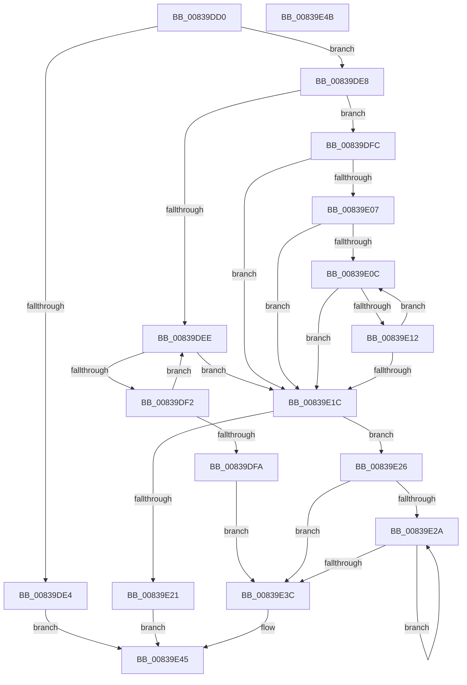

# MinAsn1DecodeInteger

- RVA: `0x00839DD0`–`0x00839E4C` (길이 `124` bytes)
- VA: `0x0000000140839DD0`
- 실행 섹션: `PAGE`
- PDB 이름 있음: `예`; PDB Function 태그: `아니요`
- unwind 정보 RVA: `0x000DB048`
- 디코드: `48`개 명령, `124/124` bytes 표시
- 미해석 바이트: `0` (있으면 어셈블리에 `.byte`로 보존)

> 이 문서는 커널 이미지의 기계어와 PDB 기호를 분석해 생성했습니다. 4번과 5번은 함수 원형과 자료형을 바이너리 사용 방식에서 추정한 C 해석이며 원본 소스 복구 결과는 아닙니다.

## 1. Dependencies

- 직접 호출 지점: **0**; 고유 호출 대상: **0**
- 직접 호출자로 확인된 함수: **2**
- RIP 상대 이미지 참조: **0**

### Outgoing calls
- 직접 디코드된 call 명령이 없습니다.

### Direct callers
- [MincryptValidateBasicConstraints](MincryptValidateBasicConstraints_function_00837B84.md) at `0x00837C60`
- [MinAsn1SignedDataGetContent](MinAsn1SignedDataGetContent_function_0083A3EC.md) at `0x0083A41A`

### Static image references
- 디코드된 RIP-relative 메모리 참조가 없습니다.

## 2. Other-region calls and transfers

- 다른 실행 섹션으로 향하는 call: **0**
- 별도 외부 분기/꼬리 이동을 확인하지 못했습니다.

## 3. Assembly (complete function range)

```asm
00839DD0  48 89 5C 24 18                  mov qword ptr [rsp + 0x18], rbx
00839DD5  32 DB                           xor bl, bl
00839DD7  45 33 D2                        xor r10d, r10d
00839DDA  4C 8B D9                        mov r11, rcx
00839DDD  48 8B C1                        mov rax, rcx
00839DE0  85 D2                           test edx, edx
00839DE2  75 04                           jne 0x140839de8
00839DE4  33 C0                           xor eax, eax
00839DE6  EB 5D                           jmp 0x140839e45
00839DE8  8A 09                           mov cl, byte ptr [rcx]
00839DEA  84 C9                           test cl, cl
00839DEC  78 0E                           js 0x140839dfc
00839DEE  38 18                           cmp byte ptr [rax], bl
00839DF0  75 2A                           jne 0x140839e1c
00839DF2  48 FF C0                        inc rax
00839DF5  83 C2 FF                        add edx, -1
00839DF8  75 F4                           jne 0x140839dee
00839DFA  EB 40                           jmp 0x140839e3c
00839DFC  49 83 CA FF                     or r10, 0xffffffffffffffff
00839E00  B3 01                           mov bl, 1
00839E02  83 FA 02                        cmp edx, 2
00839E05  72 15                           jb 0x140839e1c
00839E07  80 F9 FF                        cmp cl, 0xff
00839E0A  75 10                           jne 0x140839e1c
00839E0C  80 78 01 FF                     cmp byte ptr [rax + 1], 0xff
00839E10  75 0A                           jne 0x140839e1c
00839E12  48 FF C0                        inc rax
00839E15  FF CA                           dec edx
00839E17  83 FA 02                        cmp edx, 2
00839E1A  73 F0                           jae 0x140839e0c
00839E1C  83 FA 08                        cmp edx, 8
00839E1F  76 05                           jbe 0x140839e26
00839E21  83 C8 FF                        or eax, 0xffffffff
00839E24  EB 1F                           jmp 0x140839e45
00839E26  85 D2                           test edx, edx
00839E28  74 12                           je 0x140839e3c
00839E2A  0F B6 08                        movzx ecx, byte ptr [rax]
00839E2D  48 FF C0                        inc rax
00839E30  49 C1 E2 08                     shl r10, 8
00839E34  4C 0B D1                        or r10, rcx
00839E37  83 C2 FF                        add edx, -1
00839E3A  75 EE                           jne 0x140839e2a
00839E3C  4D 89 10                        mov qword ptr [r8], r10
00839E3F  41 2B C3                        sub eax, r11d
00839E42  41 88 19                        mov byte ptr [r9], bl
00839E45  48 8B 5C 24 18                  mov rbx, qword ptr [rsp + 0x18]
00839E4A  C3                              ret
00839E4B  CC                              int3
```

## 4. C-style interpretation (structured pseudocode)

```c
__int64 __fastcall MinAsn1DecodeInteger(__int64 a1, int a2, __int64 a3, __int64 a4)
{
    __int64 result;
    __int64 v_r10;
    __int64 v_rbx;
    unsigned __int64 v_stack_p18;

    v_stack_p18 = v_rbx;
    v_rbx = 0;
    v_r10 = 0;
    if (a2 != 0) goto loc_00839DE8;
    result = 0;
    goto loc_00839E45;
loc_00839DE8:
    if (sign_flag) goto loc_00839DFC;
loc_00839DEE:
    if ((*(unsigned __int8 *)(result)) != 0) goto loc_00839E1C;
    result = (result) + 1;
    a2 = (unsigned int)((a2) + (-1));
    if (condition_is_not_equal) goto loc_00839DEE;
    goto loc_00839E3C;
loc_00839DFC:
    v_r10 = (v_r10) | (-1);
    if (a2 < 2) goto loc_00839E1C;
    if (((unsigned __int8)(*(unsigned __int8 *)(a1))) != 255) goto loc_00839E1C;
loc_00839E0C:
    if ((*(unsigned __int8 *)(result + 1)) != 255) goto loc_00839E1C;
    result = (result) + 1;
    a2 = (unsigned int)((a2) - 1);
    if (a2 >= 2) goto loc_00839E0C;
loc_00839E1C:
    if (a2 <= 8) goto loc_00839E26;
    result = (unsigned int)((result) | (0xFFFFFFFFULL));
    goto loc_00839E45;
loc_00839E26:
    if (a2 == 0) goto loc_00839E3C;
loc_00839E2A:
    result = (result) + 1;
    v_r10 = (v_r10) << (8);
    v_r10 = (v_r10) | (*(unsigned __int8 *)(result));
    a2 = (unsigned int)((a2) + (-1));
    if (condition_is_not_equal) goto loc_00839E2A;
loc_00839E3C:
    *(unsigned __int64 *)(a3) = v_r10;
    result = (unsigned int)((result) - ((unsigned int)(a1)));
    *(unsigned __int8 *)(a4) = 1;
loc_00839E45:
    return result;
}
```

## 5. (Beta) C Style

```c
int64_t MinAsn1DecodeInteger(void *Arg1, int32_t Arg2, void *Arg3, void *Arg4)
{
    uint8_t *arg1 = (uint8_t *)Arg1;
    uint8_t *arg3 = (uint8_t *)Arg3;
    uint8_t *arg4 = (uint8_t *)Arg4;

    int64_t result;
    int64_t local_r10;
    int64_t local_rbx;
    uint64_t v_stack_p18;

    v_stack_p18 = local_rbx;
    local_rbx = 0;
    local_r10 = 0;
    if (Arg2 != 0) goto loc_00839DE8;
    result = 0;
    goto loc_00839E45;
loc_00839DE8:
    if (sign_flag) goto loc_00839DFC;
loc_00839DEE:
    if ((*(uint8_t *)(result)) != 0) goto loc_00839E1C;
    result = (result) + 1;
    Arg2 = (uint32_t)((Arg2) + (-1));
    if (condition_is_not_equal) goto loc_00839DEE;
    goto loc_00839E3C;
loc_00839DFC:
    local_r10 = (local_r10) | (-1);
    if (Arg2 < 2) goto loc_00839E1C;
    if (((uint8_t)(*(uint8_t *)(arg1))) != 255) goto loc_00839E1C;
loc_00839E0C:
    if ((*(uint8_t *)(result + 0x1)) != 255) goto loc_00839E1C;
    result = (result) + 1;
    Arg2 = (uint32_t)((Arg2) - 1);
    if (Arg2 >= 2) goto loc_00839E0C;
loc_00839E1C:
    if (Arg2 <= 8) goto loc_00839E26;
    result = (uint32_t)((result) | (0xFFFFFFFFULL));
    goto loc_00839E45;
loc_00839E26:
    if (Arg2 == 0) goto loc_00839E3C;
loc_00839E2A:
    result = (result) + 1;
    local_r10 = (local_r10) << (8);
    local_r10 = (local_r10) | (*(uint8_t *)(result));
    Arg2 = (uint32_t)((Arg2) + (-1));
    if (condition_is_not_equal) goto loc_00839E2A;
loc_00839E3C:
    *(uint64_t *)(arg3) = local_r10;
    result = (uint32_t)((result) - ((uint32_t)(Arg1)));
    *(uint8_t *)(arg4) = 1;
loc_00839E45:
    return result;
}
```

### 관측된 메모리 오프셋

구조체 형식이 확인되지 않은 접근은 인자 기준의 오프셋으로만 기록했습니다.

| 기준 인자 | 오프셋 표현 | 폭 (bit) | 접근 |
|---|---:|---:|---|
| `Arg1` | `+ 0x0` | `8` | `R` |
| `Arg3` | `+ 0x0` | `64` | `W` |
| `Arg4` | `+ 0x0` | `8` | `W` |

## 6. Execution-region graph

[열기: 2D/3D 그래프와 함수 탐색 컨트롤 패널](../../../control-panel.html?section=page&rva=0x00839DD0&view=graph)

- 2D 그래프는 위에서 아래로 흐르고, 3D 그래프는 빈 공간을 드래그해 회전합니다. Shift+드래그는 이동, 휠은 확대·축소, 함수 노드 선택은 대상 보고서 이동입니다.

### Static fallback


