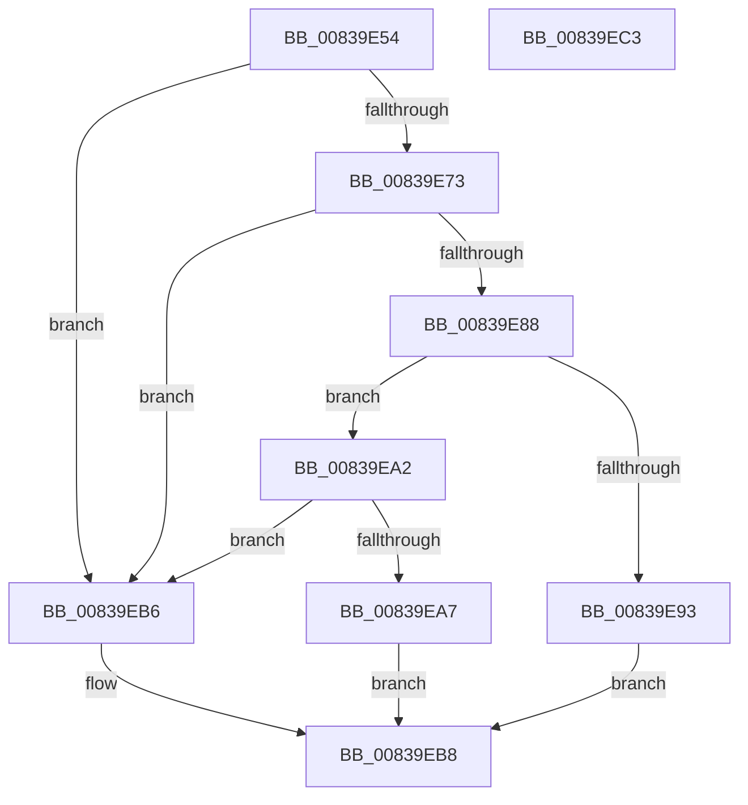

# MinAsn1DecodeTime

- RVA: `0x00839E54`–`0x00839EC4` (길이 `112` bytes)
- VA: `0x0000000140839E54`
- 실행 섹션: `PAGE`
- PDB 이름 있음: `예`; PDB Function 태그: `아니요`
- unwind 정보 RVA: `0x00084AC0`
- 디코드: `37`개 명령, `112/112` bytes 표시
- 미해석 바이트: `0` (있으면 어셈블리에 `.byte`로 보존)

> 이 문서는 커널 이미지의 기계어와 PDB 기호를 분석해 생성했습니다. 4번과 5번은 함수 원형과 자료형을 바이너리 사용 방식에서 추정한 C 해석이며 원본 소스 복구 결과는 아닙니다.

## 1. Dependencies

- 직접 호출 지점: **3**; 고유 호출 대상: **3**
- 직접 호출자로 확인된 함수: **3**
- RIP 상대 이미지 참조: **0**

### Outgoing calls
- `0x00839E7F` → [MinAsn1ExtractContent](MinAsn1ExtractContent_function_0083A00C.md) (function, `0x0083A00C`)
- `0x00839E9B` → [MinAsn1DecodeUtcTime](MinAsn1DecodeUtcTime_function_00839ECC.md) (function, `0x00839ECC`)
- `0x00839EAF` → [MinAsn1DecodeGeneralizedTime](MinAsn1DecodeGeneralizedTime_function_00839C20.md) (function, `0x00839C20`)

### Direct callers
- [MinCrypK_ParseRevocationList](../../text/6A/MinCrypK_ParseRevocationList_function_006A602C.md) at `0x006A610A`
- [I_MinCryptGetCertValidityPeriod](I_MinCryptGetCertValidityPeriod_function_00836770.md) at `0x0083678C`
- [I_MinCryptGetCertValidityPeriod](I_MinCryptGetCertValidityPeriod_function_00836770.md) at `0x0083679F`
- [I_MinCryptVerifyAuthenticodeTimeStamp](I_MinCryptVerifyAuthenticodeTimeStamp_function_00838090.md) at `0x00838262`

### Static image references
- 디코드된 RIP-relative 메모리 참조가 없습니다.

## 2. Other-region calls and transfers

- 다른 실행 섹션으로 향하는 call: **0**
- 별도 외부 분기/꼬리 이동을 확인하지 못했습니다.

## 3. Assembly (complete function range)

```asm
00839E54  48 8B C4                        mov rax, rsp
00839E57  48 89 58 08                     mov qword ptr [rax + 8], rbx
00839E5B  57                              push rdi
00839E5C  48 83 EC 30                     sub rsp, 0x30
00839E60  48 8B FA                        mov rdi, rdx
00839E63  0F 57 C0                        xorps xmm0, xmm0
00839E66  8B 11                           mov edx, dword ptr [rcx]
00839E68  48 8B D9                        mov rbx, rcx
00839E6B  0F 11 40 E8                     movups xmmword ptr [rax - 0x18], xmm0
00839E6F  85 D2                           test edx, edx
00839E71  74 43                           je 0x140839eb6
00839E73  48 8B 49 08                     mov rcx, qword ptr [rcx + 8]
00839E77  4C 8D 48 F0                     lea r9, [rax - 0x10]
00839E7B  4C 8D 40 E8                     lea r8, [rax - 0x18]
00839E7F  E8 88 01 00 00                  call 0x14083a00c
00839E84  85 C0                           test eax, eax
00839E86  78 2E                           js 0x140839eb6
00839E88  48 8B 43 08                     mov rax, qword ptr [rbx + 8]
00839E8C  8A 08                           mov cl, byte ptr [rax]
00839E8E  80 F9 17                        cmp cl, 0x17
00839E91  75 0F                           jne 0x140839ea2
00839E93  48 8B D7                        mov rdx, rdi
00839E96  48 8D 4C 24 20                  lea rcx, [rsp + 0x20]
00839E9B  E8 2C 00 00 00                  call 0x140839ecc
00839EA0  EB 16                           jmp 0x140839eb8
00839EA2  80 F9 18                        cmp cl, 0x18
00839EA5  75 0F                           jne 0x140839eb6
00839EA7  48 8B D7                        mov rdx, rdi
00839EAA  48 8D 4C 24 20                  lea rcx, [rsp + 0x20]
00839EAF  E8 6C FD FF FF                  call 0x140839c20
00839EB4  EB 02                           jmp 0x140839eb8
00839EB6  32 C0                           xor al, al
00839EB8  48 8B 5C 24 40                  mov rbx, qword ptr [rsp + 0x40]
00839EBD  48 83 C4 30                     add rsp, 0x30
00839EC1  5F                              pop rdi
00839EC2  C3                              ret
00839EC3  CC                              int3
```

## 4. C-style interpretation (structured pseudocode)

```c
__int64 __fastcall MinAsn1DecodeTime(__int64 a1, __int64 a2)
{
    __int64 result;
    __int64 v_rsp;
    unsigned __int64 v_stack_m18;
    unsigned __int64 v_stack_p8;

    *(unsigned __int64 *)(v_rsp + 8) = v_rbx;
    v_rsp = (v_rsp) - (48);
    *(unsigned __int64 *)(v_rsp - 24) = v_xmm0;
    if ((unsigned int)((unsigned int)(*(unsigned int *)(a1))) == 0) goto loc_00839EB6;
    result = MinAsn1ExtractContent(*(unsigned __int64 *)(a1 + 8), (unsigned int)(*(unsigned int *)(a1)), v_rsp - 24, v_rsp - 16);
    if (sign_flag) goto loc_00839EB6;
    if (((unsigned __int8)(*(unsigned __int8 *)(*(unsigned __int64 *)(a1 + 8)))) != 23) goto loc_00839EA2;
    result = MinAsn1DecodeUtcTime(v_stack_m18, a2, v_rsp - 24, v_rsp - 16);
    goto loc_00839EB8;
loc_00839EA2:
    if (((unsigned __int8)(v_stack_m18)) != 24) goto loc_00839EB6;
    result = MinAsn1DecodeGeneralizedTime(v_stack_m18, a2, v_rsp - 24, v_rsp - 16);
    goto loc_00839EB8;
loc_00839EB6:
    result = 0;
loc_00839EB8:
    v_rsp = (v_rsp) + (48);
    return result;
}
```

## 5. (Beta) C Style

```c
int64_t MinAsn1DecodeTime(void *Arg1, int64_t Arg2)
{
    uint8_t *arg1 = (uint8_t *)Arg1;

    int64_t result;
    int64_t local_rsp;
    uint64_t v_stack_m18;
    uint64_t v_stack_p8;

    *(uint64_t *)(local_rsp + 0x8) = local_rbx;
    local_rsp = (local_rsp) - (48);
    *(uint64_t *)(local_rsp - 0x18) = v_xmm0;
    if ((uint32_t)((uint32_t)(*(uint32_t *)(arg1))) == 0) goto loc_00839EB6;
    result = MinAsn1ExtractContent(*(uint64_t *)(arg1 + 0x8), (uint32_t)(*(uint32_t *)(arg1)), local_rsp - 24, local_rsp - 16);
    if (sign_flag) goto loc_00839EB6;
    if (((uint8_t)(*(uint8_t *)(*(uint64_t *)(arg1 + 0x8)))) != 23) goto loc_00839EA2;
    result = MinAsn1DecodeUtcTime(v_stack_m18, Arg2, local_rsp - 24, local_rsp - 16);
    goto loc_00839EB8;
loc_00839EA2:
    if (((uint8_t)(v_stack_m18)) != 24) goto loc_00839EB6;
    result = MinAsn1DecodeGeneralizedTime(v_stack_m18, Arg2, local_rsp - 24, local_rsp - 16);
    goto loc_00839EB8;
loc_00839EB6:
    result = 0;
loc_00839EB8:
    local_rsp = (local_rsp) + (48);
    return result;
}
```

### 관측된 메모리 오프셋

구조체 형식이 확인되지 않은 접근은 인자 기준의 오프셋으로만 기록했습니다.

| 기준 인자 | 오프셋 표현 | 폭 (bit) | 접근 |
|---|---:|---:|---|
| `Arg1` | `+ 0x0` | `32` | `R` |
| `Arg1` | `+ 0x8` | `64` | `R` |

## 6. Execution-region graph

[열기: 2D/3D 그래프와 함수 탐색 컨트롤 패널](../../../control-panel.html?section=page&rva=0x00839E54&view=graph)

- 2D 그래프는 위에서 아래로 흐르고, 3D 그래프는 빈 공간을 드래그해 회전합니다. Shift+드래그는 이동, 휠은 확대·축소, 함수 노드 선택은 대상 보고서 이동입니다.

### Static fallback


