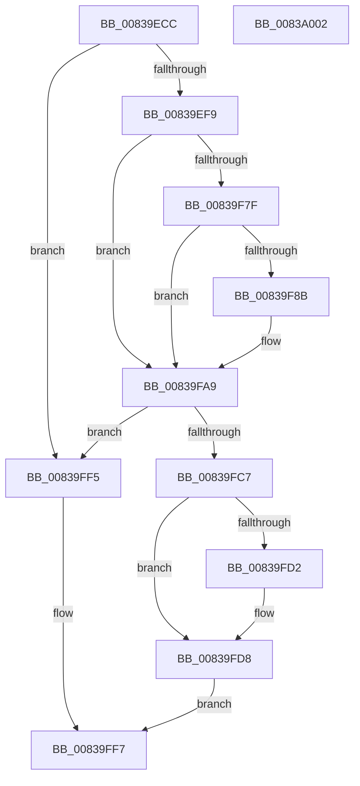

# MinAsn1DecodeUtcTime

- RVA: `0x00839ECC`–`0x0083A003` (길이 `311` bytes)
- VA: `0x0000000140839ECC`
- 실행 섹션: `PAGE`
- PDB 이름 있음: `예`; PDB Function 태그: `아니요`
- unwind 정보 RVA: `0x000DAFBC`
- 디코드: `99`개 명령, `311/311` bytes 표시
- 미해석 바이트: `0` (있으면 어셈블리에 `.byte`로 보존)

> 이 문서는 커널 이미지의 기계어와 PDB 기호를 분석해 생성했습니다. 4번과 5번은 함수 원형과 자료형을 바이너리 사용 방식에서 추정한 C 해석이며 원본 소스 복구 결과는 아닙니다.

## 1. Dependencies

- 직접 호출 지점: **9**; 고유 호출 대상: **4**
- 직접 호출자로 확인된 함수: **1**
- RIP 상대 이미지 참조: **0**

### Outgoing calls
- `0x00839F0C` → [atoi](../../text/4F/atoi_function_004FF8B0.md) (function, `0x004FF8B0`)
- `0x00839F23` → [atoi](../../text/4F/atoi_function_004FF8B0.md) (function, `0x004FF8B0`)
- `0x00839F3B` → [atoi](../../text/4F/atoi_function_004FF8B0.md) (function, `0x004FF8B0`)
- `0x00839F53` → [atoi](../../text/4F/atoi_function_004FF8B0.md) (function, `0x004FF8B0`)
- `0x00839F6B` → [atoi](../../text/4F/atoi_function_004FF8B0.md) (function, `0x004FF8B0`)
- `0x00839F82` → [isdigit](../../text/50/isdigit_function_00500680.md) (function, `0x00500680`)
- `0x00839F9A` → [atoi](../../text/4F/atoi_function_004FF8B0.md) (function, `0x004FF8B0`)
- `0x00839FBE` → [I_MinAsn1CalculateTimeOffset](I_MinAsn1CalculateTimeOffset_function_008397B8.md) (function, `0x008397B8`)
- `0x00839FE9` → [I_MinAsn1ConvertTime](I_MinAsn1ConvertTime_function_008398A8.md) (function, `0x008398A8`)

### Direct callers
- [MinAsn1DecodeTime](MinAsn1DecodeTime_function_00839E54.md) at `0x00839E9B`

### Static image references
- 디코드된 RIP-relative 메모리 참조가 없습니다.

## 2. Other-region calls and transfers

- 다른 실행 섹션으로 향하는 call: **7**
  - `0x00839F0C` → [atoi](../../text/4F/atoi_function_004FF8B0.md) (`PAGE` → `.text`)
  - `0x00839F23` → [atoi](../../text/4F/atoi_function_004FF8B0.md) (`PAGE` → `.text`)
  - `0x00839F3B` → [atoi](../../text/4F/atoi_function_004FF8B0.md) (`PAGE` → `.text`)
  - `0x00839F53` → [atoi](../../text/4F/atoi_function_004FF8B0.md) (`PAGE` → `.text`)
  - `0x00839F6B` → [atoi](../../text/4F/atoi_function_004FF8B0.md) (`PAGE` → `.text`)
  - `0x00839F82` → [isdigit](../../text/50/isdigit_function_00500680.md) (`PAGE` → `.text`)
  - `0x00839F9A` → [atoi](../../text/4F/atoi_function_004FF8B0.md) (`PAGE` → `.text`)
- 별도 외부 분기/꼬리 이동을 확인하지 못했습니다.

## 3. Assembly (complete function range)

```asm
00839ECC  40 55                           push rbp
00839ECE  53                              push rbx
00839ECF  56                              push rsi
00839ED0  57                              push rdi
00839ED1  41 56                           push r14
00839ED3  48 8B EC                        mov rbp, rsp
00839ED6  48 83 EC 50                     sub rsp, 0x50
00839EDA  48 83 65 F4 00                  and qword ptr [rbp - 0xc], 0
00839EDF  4C 8B F2                        mov r14, rdx
00839EE2  83 65 48 00                     and dword ptr [rbp + 0x48], 0
00839EE6  8B 39                           mov edi, dword ptr [rcx]
00839EE8  48 8B 59 08                     mov rbx, qword ptr [rcx + 8]
00839EEC  C6 45 30 00                     mov byte ptr [rbp + 0x30], 0
00839EF0  83 FF 0A                        cmp edi, 0xa
00839EF3  0F 82 FC 00 00 00               jb 0x140839ff5
00839EF9  C6 45 42 00                     mov byte ptr [rbp + 0x42], 0
00839EFD  48 8D 4D 40                     lea rcx, [rbp + 0x40]
00839F01  8A 03                           mov al, byte ptr [rbx]
00839F03  88 45 40                        mov byte ptr [rbp + 0x40], al
00839F06  8A 43 01                        mov al, byte ptr [rbx + 1]
00839F09  88 45 41                        mov byte ptr [rbp + 0x41], al
00839F0C  E8 9F 59 CC FF                  call 0x1404ff8b0
00839F11  8A 4B 02                        mov cl, byte ptr [rbx + 2]
00839F14  8B F0                           mov esi, eax
00839F16  88 4D 40                        mov byte ptr [rbp + 0x40], cl
00839F19  8A 4B 03                        mov cl, byte ptr [rbx + 3]
00839F1C  88 4D 41                        mov byte ptr [rbp + 0x41], cl
00839F1F  48 8D 4D 40                     lea rcx, [rbp + 0x40]
00839F23  E8 88 59 CC FF                  call 0x1404ff8b0
00839F28  8A 4B 04                        mov cl, byte ptr [rbx + 4]
00839F2B  88 4D 40                        mov byte ptr [rbp + 0x40], cl
00839F2E  8A 4B 05                        mov cl, byte ptr [rbx + 5]
00839F31  88 4D 41                        mov byte ptr [rbp + 0x41], cl
00839F34  48 8D 4D 40                     lea rcx, [rbp + 0x40]
00839F38  89 45 E4                        mov dword ptr [rbp - 0x1c], eax
00839F3B  E8 70 59 CC FF                  call 0x1404ff8b0
00839F40  89 45 E8                        mov dword ptr [rbp - 0x18], eax
00839F43  48 8D 4D 40                     lea rcx, [rbp + 0x40]
00839F47  8A 43 06                        mov al, byte ptr [rbx + 6]
00839F4A  88 45 40                        mov byte ptr [rbp + 0x40], al
00839F4D  8A 43 07                        mov al, byte ptr [rbx + 7]
00839F50  88 45 41                        mov byte ptr [rbp + 0x41], al
00839F53  E8 58 59 CC FF                  call 0x1404ff8b0
00839F58  89 45 EC                        mov dword ptr [rbp - 0x14], eax
00839F5B  48 8D 4D 40                     lea rcx, [rbp + 0x40]
00839F5F  8A 43 08                        mov al, byte ptr [rbx + 8]
00839F62  88 45 40                        mov byte ptr [rbp + 0x40], al
00839F65  8A 43 09                        mov al, byte ptr [rbx + 9]
00839F68  88 45 41                        mov byte ptr [rbp + 0x41], al
00839F6B  E8 40 59 CC FF                  call 0x1404ff8b0
00839F70  48 83 C3 0A                     add rbx, 0xa
00839F74  89 45 F0                        mov dword ptr [rbp - 0x10], eax
00839F77  83 C7 F6                        add edi, -0xa
00839F7A  83 FF 02                        cmp edi, 2
00839F7D  72 2A                           jb 0x140839fa9
00839F7F  0F B6 0B                        movzx ecx, byte ptr [rbx]
00839F82  E8 F9 66 CC FF                  call 0x140500680
00839F87  85 C0                           test eax, eax
00839F89  74 1E                           je 0x140839fa9
00839F8B  8A 03                           mov al, byte ptr [rbx]
00839F8D  48 8D 4D 40                     lea rcx, [rbp + 0x40]
00839F91  88 45 40                        mov byte ptr [rbp + 0x40], al
00839F94  8A 43 01                        mov al, byte ptr [rbx + 1]
00839F97  88 45 41                        mov byte ptr [rbp + 0x41], al
00839F9A  E8 11 59 CC FF                  call 0x1404ff8b0
00839F9F  48 83 C3 02                     add rbx, 2
00839FA3  89 45 F4                        mov dword ptr [rbp - 0xc], eax
00839FA6  83 C7 FE                        add edi, -2
00839FA9  48 8D 45 30                     lea rax, [rbp + 0x30]
00839FAD  45 33 C0                        xor r8d, r8d
00839FB0  4C 8D 4D 48                     lea r9, [rbp + 0x48]
00839FB4  48 89 44 24 20                  mov qword ptr [rsp + 0x20], rax
00839FB9  8B D7                           mov edx, edi
00839FBB  48 8B CB                        mov rcx, rbx
00839FBE  E8 F5 F7 FF FF                  call 0x1408397b8
00839FC3  84 C0                           test al, al
00839FC5  74 2E                           je 0x140839ff5
00839FC7  8D 86 6C 07 00 00               lea eax, [rsi + 0x76c]
00839FCD  83 FE 32                        cmp esi, 0x32
00839FD0  7D 06                           jge 0x140839fd8
00839FD2  8D 86 D0 07 00 00               lea eax, [rsi + 0x7d0]
00839FD8  44 8A 45 30                     mov r8b, byte ptr [rbp + 0x30]
00839FDC  48 8D 4D E0                     lea rcx, [rbp - 0x20]
00839FE0  8B 55 48                        mov edx, dword ptr [rbp + 0x48]
00839FE3  4D 8B CE                        mov r9, r14
00839FE6  89 45 E0                        mov dword ptr [rbp - 0x20], eax
00839FE9  E8 BA F8 FF FF                  call 0x1408398a8
00839FEE  84 C0                           test al, al
00839FF0  0F 95 C0                        setne al
00839FF3  EB 02                           jmp 0x140839ff7
00839FF5  32 C0                           xor al, al
00839FF7  48 83 C4 50                     add rsp, 0x50
00839FFB  41 5E                           pop r14
00839FFD  5F                              pop rdi
00839FFE  5E                              pop rsi
00839FFF  5B                              pop rbx
0083A000  5D                              pop rbp
0083A001  C3                              ret
0083A002  CC                              int3
```

## 4. C-style interpretation (structured pseudocode)

```c
__int64 __fastcall MinAsn1DecodeUtcTime(__int64 a1, __int64 a2, int a3)
{
    __int64 result;
    __int64 v_rbx;
    __int64 v_rdi;
    __int64 v_rsp;
    unsigned __int64 v_stack_m34;
    unsigned int v_stack_m38;
    unsigned int v_stack_m3C;
    unsigned int v_stack_m40;
    unsigned int v_stack_m44;
    unsigned __int64 v_stack_m48;
    unsigned __int64 v_stack_m58;
    unsigned __int64 v_stack_p18;
    unsigned __int8 v_stack_p19;
    unsigned __int8 v_stack_p1A;
    unsigned int v_stack_p20;
    unsigned __int8 v_stack_p8;

    v_rsp = (v_rsp) - (80);
    v_stack_p8 = 0;
    if (((unsigned int)((unsigned int)(*(unsigned int *)(a1)))) < 10) goto loc_00839FF5;
    v_stack_p1A = 0;
    v_stack_p18 = (unsigned __int8)(*(unsigned __int8 *)(*(unsigned __int64 *)(a1 + 8)));
    v_stack_p19 = (unsigned __int8)(*(unsigned __int8 *)(*(unsigned __int64 *)(a1 + 8) + 1));
    result = atoi(v_stack_p18, a2, a3, a4);
    v_stack_p18 = (unsigned __int8)(*(unsigned __int8 *)(*(unsigned __int64 *)(a1 + 8) + 2));
    v_stack_p19 = (unsigned __int8)(*(unsigned __int8 *)(*(unsigned __int64 *)(a1 + 8) + 3));
    result = atoi(v_stack_p18, a2, a3, a4);
    v_stack_p18 = (unsigned __int8)(*(unsigned __int8 *)(*(unsigned __int64 *)(a1 + 8) + 4));
    v_stack_p19 = (unsigned __int8)(*(unsigned __int8 *)(*(unsigned __int64 *)(a1 + 8) + 5));
    v_stack_m44 = (unsigned int)(result);
    result = atoi(v_stack_p18, a2, a3, a4);
    v_stack_m40 = (unsigned int)(result);
    v_stack_p18 = (unsigned __int8)(*(unsigned __int8 *)(*(unsigned __int64 *)(a1 + 8) + 6));
    v_stack_p19 = (unsigned __int8)(*(unsigned __int8 *)(*(unsigned __int64 *)(a1 + 8) + 7));
    result = atoi(v_stack_p18, a2, a3, a4);
    v_stack_m3C = (unsigned int)(result);
    v_stack_p18 = (unsigned __int8)(*(unsigned __int8 *)(*(unsigned __int64 *)(a1 + 8) + 8));
    v_stack_p19 = (unsigned __int8)(*(unsigned __int8 *)(*(unsigned __int64 *)(a1 + 8) + 9));
    result = atoi(v_stack_p18, a2, a3, a4);
    v_rbx = (*(unsigned __int64 *)(a1 + 8)) + (10);
    v_stack_m38 = (unsigned int)(result);
    v_rdi = (unsigned int)(((unsigned int)(*(unsigned int *)(a1))) + (-10));
    if (((unsigned int)(v_rdi)) < 2) goto loc_00839FA9;
    result = isdigit(*(unsigned __int8 *)(v_rbx), a2, a3, a4);
    if ((unsigned int)(result) != 0) {
        result = *(unsigned __int8 *)(v_rbx);
        a1 = v_stack_p18;
        v_stack_p18 = (unsigned __int8)(result);
        result = *(unsigned __int8 *)(v_rbx + 1);
        v_stack_p19 = (unsigned __int8)(result);
        result = atoi(a1, a2, a3, a4);
        v_rbx = (v_rbx) + (2);
        v_stack_m34 = (unsigned int)(result);
        v_rdi = (unsigned int)((v_rdi) + (-2));
    }
    a3 = 0;
    v_stack_m58 = v_stack_p8;
    result = I_MinAsn1CalculateTimeOffset(v_rbx, (unsigned int)((unsigned int)(v_rdi)), a3, v_stack_p20);
    if ((unsigned __int8)(result) == 0) goto loc_00839FF5;
    result = (unsigned int)((unsigned int)(result)) + 1900;
    if (((unsigned int)((unsigned int)((unsigned int)(result)))) < 50) {
        result = (unsigned int)((unsigned int)(result)) + 2000;
    }
    v_stack_m48 = (unsigned int)(result);
    result = I_MinAsn1ConvertTime(v_stack_m48, (unsigned int)(v_stack_p20), v_stack_p8, a2);
    result = ((unsigned __int8)(result) != 0) ? 1 : 0;
    goto loc_00839FF7;
loc_00839FF5:
    result = 0;
loc_00839FF7:
    v_rsp = (v_rsp) + (80);
    return result;
}
```

## 5. (Beta) C Style

```c
int64_t MinAsn1DecodeUtcTime(void *Arg1, int64_t Arg2, int32_t Arg3)
{
    uint8_t *arg1 = (uint8_t *)Arg1;

    int64_t result;
    int64_t local_rbx;
    int64_t local_rdi;
    int64_t local_rsp;
    uint64_t v_stack_m34;
    uint32_t v_stack_m38;
    uint32_t v_stack_m3C;
    uint32_t v_stack_m40;
    uint32_t v_stack_m44;
    uint64_t v_stack_m48;
    uint64_t v_stack_m58;
    uint64_t v_stack_p18;
    uint8_t v_stack_p19;
    uint8_t v_stack_p1A;
    uint32_t v_stack_p20;
    uint8_t v_stack_p8;

    local_rsp = (local_rsp) - (80);
    v_stack_p8 = 0;
    if (((uint32_t)((uint32_t)(*(uint32_t *)(arg1)))) < 10) goto loc_00839FF5;
    v_stack_p1A = 0;
    v_stack_p18 = (uint8_t)(*(uint8_t *)(*(uint64_t *)(arg1 + 0x8)));
    v_stack_p19 = (uint8_t)(*(uint8_t *)(*(uint64_t *)(arg1 + 0x8) + 0x1));
    result = atoi(v_stack_p18, Arg2, Arg3, a4);
    v_stack_p18 = (uint8_t)(*(uint8_t *)(*(uint64_t *)(arg1 + 0x8) + 0x2));
    v_stack_p19 = (uint8_t)(*(uint8_t *)(*(uint64_t *)(arg1 + 0x8) + 0x3));
    result = atoi(v_stack_p18, Arg2, Arg3, a4);
    v_stack_p18 = (uint8_t)(*(uint8_t *)(*(uint64_t *)(arg1 + 0x8) + 0x4));
    v_stack_p19 = (uint8_t)(*(uint8_t *)(*(uint64_t *)(arg1 + 0x8) + 0x5));
    v_stack_m44 = (uint32_t)(result);
    result = atoi(v_stack_p18, Arg2, Arg3, a4);
    v_stack_m40 = (uint32_t)(result);
    v_stack_p18 = (uint8_t)(*(uint8_t *)(*(uint64_t *)(arg1 + 0x8) + 0x6));
    v_stack_p19 = (uint8_t)(*(uint8_t *)(*(uint64_t *)(arg1 + 0x8) + 0x7));
    result = atoi(v_stack_p18, Arg2, Arg3, a4);
    v_stack_m3C = (uint32_t)(result);
    v_stack_p18 = (uint8_t)(*(uint8_t *)(*(uint64_t *)(arg1 + 0x8) + 0x8));
    v_stack_p19 = (uint8_t)(*(uint8_t *)(*(uint64_t *)(arg1 + 0x8) + 0x9));
    result = atoi(v_stack_p18, Arg2, Arg3, a4);
    local_rbx = (*(uint64_t *)(arg1 + 0x8)) + (10);
    v_stack_m38 = (uint32_t)(result);
    local_rdi = (uint32_t)(((uint32_t)(*(uint32_t *)(arg1))) + (-10));
    if (((uint32_t)(local_rdi)) < 2) goto loc_00839FA9;
    result = isdigit(*(uint8_t *)(local_rbx), Arg2, Arg3, a4);
    if ((uint32_t)(result) != 0) {
        result = *(uint8_t *)(local_rbx);
        Arg1 = v_stack_p18;
        v_stack_p18 = (uint8_t)(result);
        result = *(uint8_t *)(local_rbx + 0x1);
        v_stack_p19 = (uint8_t)(result);
        result = atoi(Arg1, Arg2, Arg3, a4);
        local_rbx = (local_rbx) + (2);
        v_stack_m34 = (uint32_t)(result);
        local_rdi = (uint32_t)((local_rdi) + (-2));
    }
    Arg3 = 0;
    v_stack_m58 = v_stack_p8;
    result = I_MinAsn1CalculateTimeOffset(local_rbx, (uint32_t)((uint32_t)(local_rdi)), Arg3, v_stack_p20);
    if ((uint8_t)(result) == 0) goto loc_00839FF5;
    result = (uint32_t)((uint32_t)(result)) + 1900;
    if (((uint32_t)((uint32_t)((uint32_t)(result)))) < 50) {
        result = (uint32_t)((uint32_t)(result)) + 2000;
    }
    v_stack_m48 = (uint32_t)(result);
    result = I_MinAsn1ConvertTime(v_stack_m48, (uint32_t)(v_stack_p20), v_stack_p8, Arg2);
    result = ((uint8_t)(result) != 0) ? 1 : 0;
    goto loc_00839FF7;
loc_00839FF5:
    result = 0;
loc_00839FF7:
    local_rsp = (local_rsp) + (80);
    return result;
}
```

### 관측된 메모리 오프셋

구조체 형식이 확인되지 않은 접근은 인자 기준의 오프셋으로만 기록했습니다.

| 기준 인자 | 오프셋 표현 | 폭 (bit) | 접근 |
|---|---:|---:|---|
| `Arg1` | `+ 0x0` | `32` | `R` |
| `Arg1` | `+ 0x8` | `64` | `R` |

## 6. Execution-region graph

[열기: 2D/3D 그래프와 함수 탐색 컨트롤 패널](../../../control-panel.html?section=page&rva=0x00839ECC&view=graph)

- 2D 그래프는 위에서 아래로 흐르고, 3D 그래프는 빈 공간을 드래그해 회전합니다. Shift+드래그는 이동, 휠은 확대·축소, 함수 노드 선택은 대상 보고서 이동입니다.

### Static fallback


