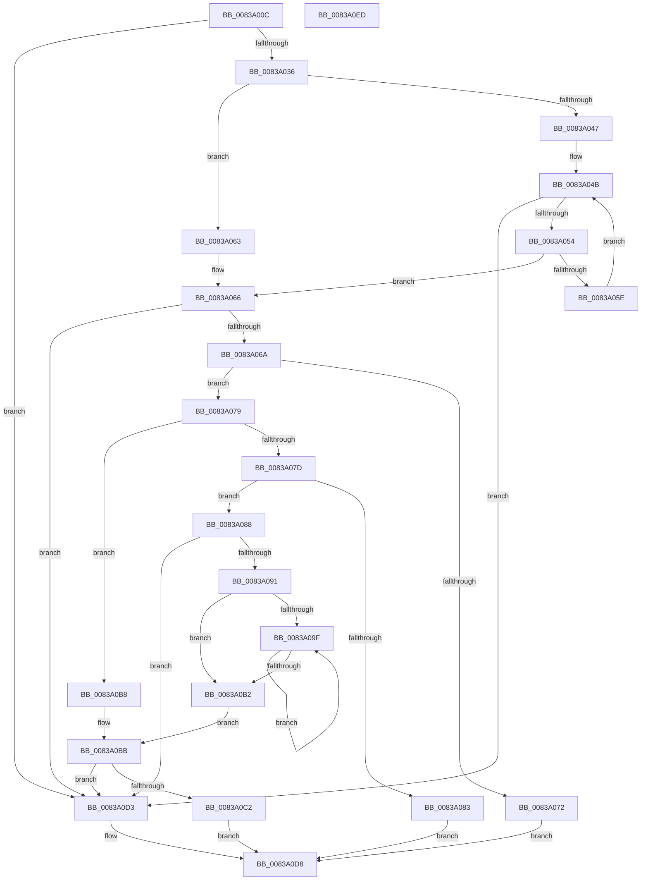

# MinAsn1ExtractContent

- RVA: `0x0083A00C`–`0x0083A0EE` (길이 `226` bytes)
- VA: `0x000000014083A00C`
- 실행 섹션: `PAGE`
- PDB 이름 있음: `예`; PDB Function 태그: `아니요`
- unwind 정보 RVA: `0x0007AE6C`
- 디코드: `78`개 명령, `226/226` bytes 표시
- 미해석 바이트: `0` (있으면 어셈블리에 `.byte`로 보존)

> 이 문서는 커널 이미지의 기계어와 PDB 기호를 분석해 생성했습니다. 4번과 5번은 함수 원형과 자료형을 바이너리 사용 방식에서 추정한 C 해석이며 원본 소스 복구 결과는 아닙니다.

## 1. Dependencies

- 직접 호출 지점: **0**; 고유 호출 대상: **0**
- 직접 호출자로 확인된 함수: **11**
- RIP 상대 이미지 참조: **0**

### Outgoing calls
- 직접 디코드된 call 명령이 없습니다.

### Direct callers
- [I_MinCryptGetPlatformManifestBinaryIDAttribute](I_MinCryptGetPlatformManifestBinaryIDAttribute_function_00837E9C.md) at `0x00837EEE`
- [I_MinCryptVerifySignerAuthenticatedAttributes](I_MinCryptVerifySignerAuthenticatedAttributes_function_00838430.md) at `0x00838493`
- [MinCrypK_VerifySignedDataKModeEx](MinCrypK_VerifySignedDataKModeEx_function_00838568.md) at `0x0083880B`
- [I_MinAsn1ParseSingleAttribute](I_MinAsn1ParseSingleAttribute_function_00838A10.md) at `0x00838A6A`
- [MinAsn1ParseAndDecodeRDNComponent](MinAsn1ParseAndDecodeRDNComponent_function_00838BD4.md) at `0x00838C19`
- [MinAsn1ParseAndDecodeRDNComponent](MinAsn1ParseAndDecodeRDNComponent_function_00838BD4.md) at `0x00838CAE`
- [MinAsn1ParseOIDSequence](MinAsn1ParseOIDSequence_function_00838DB0.md) at `0x00838DF3`
- [MinAsn1ParseSignedDataCertificatesEx](MinAsn1ParseSignedDataCertificatesEx_function_00838F68.md) at `0x00838FAF`
- [MinAsn1ParseSignedDataCertificatesEx](MinAsn1ParseSignedDataCertificatesEx_function_00838F68.md) at `0x00838FEA`
- [MinAsn1ParseSingleExtensionValue](MinAsn1ParseSingleExtensionValue_function_00839058.md) at `0x008390B9`
- [MinAsn1DecodeTime](MinAsn1DecodeTime_function_00839E54.md) at `0x00839E7F`
- [MinAsn1ExtractValues](MinAsn1ExtractValues_function_0083A170.md) at `0x0083A2DF`
- [MinAsn1SignedDataGetContent](MinAsn1SignedDataGetContent_function_0083A3EC.md) at `0x0083A44F`

### Static image references
- 디코드된 RIP-relative 메모리 참조가 없습니다.

## 2. Other-region calls and transfers

- 다른 실행 섹션으로 향하는 call: **0**
- 별도 외부 분기/꼬리 이동을 확인하지 못했습니다.

## 3. Assembly (complete function range)

```asm
0083A00C  48 8B C4                        mov rax, rsp
0083A00F  48 89 58 08                     mov qword ptr [rax + 8], rbx
0083A013  48 89 70 10                     mov qword ptr [rax + 0x10], rsi
0083A017  48 89 78 18                     mov qword ptr [rax + 0x18], rdi
0083A01B  4C 89 70 20                     mov qword ptr [rax + 0x20], r14
0083A01F  8B C2                           mov eax, edx
0083A021  4D 8B F0                        mov r14, r8
0083A024  41 83 C8 FF                     or r8d, 0xffffffff
0083A028  49 8B F1                        mov rsi, r9
0083A02B  41 03 D0                        add edx, r8d
0083A02E  85 C0                           test eax, eax
0083A030  0F 84 9D 00 00 00               je 0x14083a0d3
0083A036  8A 01                           mov al, byte ptr [rcx]
0083A038  4C 8D 49 01                     lea r9, [rcx + 1]
0083A03C  24 1F                           and al, 0x1f
0083A03E  B9 01 00 00 00                  mov ecx, 1
0083A043  3C 1F                           cmp al, 0x1f
0083A045  75 1C                           jne 0x14083a063
0083A047  44 8D 59 01                     lea r11d, [rcx + 1]
0083A04B  8B C2                           mov eax, edx
0083A04D  41 03 D0                        add edx, r8d
0083A050  85 C0                           test eax, eax
0083A052  74 7F                           je 0x14083a0d3
0083A054  41 8A 01                        mov al, byte ptr [r9]
0083A057  4C 03 C9                        add r9, rcx
0083A05A  84 C0                           test al, al
0083A05C  79 08                           jns 0x14083a066
0083A05E  44 03 D9                        add r11d, ecx
0083A061  EB E8                           jmp 0x14083a04b
0083A063  44 8B D9                        mov r11d, ecx
0083A066  3B D1                           cmp edx, ecx
0083A068  72 69                           jb 0x14083a0d3
0083A06A  41 0F B6 01                     movzx eax, byte ptr [r9]
0083A06E  3C 80                           cmp al, 0x80
0083A070  75 07                           jne 0x14083a079
0083A072  B8 FD FF FF FF                  mov eax, 0xfffffffd
0083A077  EB 5F                           jmp 0x14083a0d8
0083A079  84 C0                           test al, al
0083A07B  79 3B                           jns 0x14083a0b8
0083A07D  24 7F                           and al, 0x7f
0083A07F  3C 04                           cmp al, 4
0083A081  76 05                           jbe 0x14083a088
0083A083  83 C8 FF                        or eax, 0xffffffff
0083A086  EB 50                           jmp 0x14083a0d8
0083A088  44 0F B6 D0                     movzx r10d, al
0083A08C  44 3B D2                        cmp r10d, edx
0083A08F  73 42                           jae 0x14083a0d3
0083A091  45 33 C0                        xor r8d, r8d
0083A094  49 8D 59 01                     lea rbx, [r9 + 1]
0083A098  41 8B FA                        mov edi, r10d
0083A09B  84 C0                           test al, al
0083A09D  74 13                           je 0x14083a0b2
0083A09F  0F B6 03                        movzx eax, byte ptr [rbx]
0083A0A2  2B F9                           sub edi, ecx
0083A0A4  41 C1 E0 08                     shl r8d, 8
0083A0A8  48 03 D9                        add rbx, rcx
0083A0AB  44 03 C0                        add r8d, eax
0083A0AE  85 FF                           test edi, edi
0083A0B0  7F ED                           jg 0x14083a09f
0083A0B2  41 8D 4A 01                     lea ecx, [r10 + 1]
0083A0B6  EB 03                           jmp 0x14083a0bb
0083A0B8  44 8B C0                        mov r8d, eax
0083A0BB  2B D1                           sub edx, ecx
0083A0BD  44 3B C2                        cmp r8d, edx
0083A0C0  77 11                           ja 0x14083a0d3
0083A0C2  8B C1                           mov eax, ecx
0083A0C4  49 03 C1                        add rax, r9
0083A0C7  45 89 06                        mov dword ptr [r14], r8d
0083A0CA  48 89 06                        mov qword ptr [rsi], rax
0083A0CD  42 8D 04 19                     lea eax, [rcx + r11]
0083A0D1  EB 05                           jmp 0x14083a0d8
0083A0D3  B8 FE FF FF FF                  mov eax, 0xfffffffe
0083A0D8  48 8B 5C 24 08                  mov rbx, qword ptr [rsp + 8]
0083A0DD  48 8B 74 24 10                  mov rsi, qword ptr [rsp + 0x10]
0083A0E2  48 8B 7C 24 18                  mov rdi, qword ptr [rsp + 0x18]
0083A0E7  4C 8B 74 24 20                  mov r14, qword ptr [rsp + 0x20]
0083A0EC  C3                              ret
0083A0ED  CC                              int3
```

## 4. C-style interpretation (structured pseudocode)

```c
__int64 __fastcall MinAsn1ExtractContent(__int64 a1, int a2, __int64 a3, __int64 a4)
{
    __int64 result;
    __int64 v_r11;
    __int64 v_rbx;
    __int64 v_rdi;
    unsigned __int64 v_stack_p10;
    unsigned __int64 v_stack_p18;
    unsigned __int64 v_stack_p20;
    unsigned __int64 v_stack_p8;

    *(unsigned __int64 *)(v_rsp + 8) = v_rbx;
    *(unsigned __int64 *)(v_rsp + 16) = v_rsi;
    *(unsigned __int64 *)(v_rsp + 24) = v_rdi;
    *(unsigned __int64 *)(v_rsp + 32) = v_r14;
    a3 = (unsigned int)((a3) | (0xFFFFFFFFULL));
    a2 = (unsigned int)((a2) + ((unsigned int)(a3)));
    if ((unsigned int)((unsigned int)(a2)) == 0) goto loc_0083A0D3;
    result = (unsigned __int8)((*(unsigned __int8 *)(a1)) & (31));
    if (((unsigned __int8)(result)) != 31) goto loc_0083A063;
loc_0083A04B:
    a2 = (unsigned int)((a2) + ((unsigned int)(a3)));
    if ((unsigned int)((unsigned int)(a2)) == 0) goto loc_0083A0D3;
    a4 = (a1 + 1) + (1);
    if (!sign_flag) goto loc_0083A066;
    v_r11 = (unsigned int)((1 + 1) + (1));
    goto loc_0083A04B;
loc_0083A063:
loc_0083A066:
    if (a2 < 1) goto loc_0083A0D3;
    if (((unsigned __int8)(*(unsigned __int8 *)(a4))) != 128) goto loc_0083A079;
    goto loc_0083A0D8;
loc_0083A079:
    if (!sign_flag) goto loc_0083A0B8;
    result = (unsigned __int8)(((unsigned int)(0xFFFFFFFDULL)) & (127));
    if (((unsigned __int8)(result)) <= 4) goto loc_0083A088;
    result = (unsigned int)((result) | (0xFFFFFFFFULL));
    goto loc_0083A0D8;
loc_0083A088:
    if (((unsigned int)((unsigned __int8)(result))) >= a2) goto loc_0083A0D3;
    a3 = 0;
    if ((unsigned __int8)(result) == 0) goto loc_0083A0B2;
loc_0083A09F:
    v_rdi = (unsigned int)(((unsigned int)((unsigned int)((unsigned __int8)(result)))) - (1));
    a3 = (unsigned int)((a3) << (8));
    v_rbx = (a4 + 1) + (1);
    a3 = (unsigned int)((a3) + ((unsigned int)(*(unsigned __int8 *)(a4 + 1))));
    if (condition_is_greater) goto loc_0083A09F;
loc_0083A0B2:
    goto loc_0083A0BB;
loc_0083A0B8:
loc_0083A0BB:
    a2 = (unsigned int)((a2) - ((unsigned int)((unsigned __int8)(result) + 1)));
    if (((unsigned int)((unsigned int)((unsigned int)(*(unsigned __int8 *)(a4 + 1))))) > a2) goto loc_0083A0D3;
    result = ((unsigned int)((unsigned int)((unsigned __int8)(result) + 1))) + (a4);
    *(unsigned int *)(a3) = (unsigned int)((unsigned int)((unsigned int)(*(unsigned __int8 *)(a4 + 1))));
    *(unsigned __int64 *)(a4) = result;
    goto loc_0083A0D8;
loc_0083A0D3:
loc_0083A0D8:
    return (unsigned int)(0xFFFFFFFEULL);
}
```

## 5. (Beta) C Style

```c
int64_t MinAsn1ExtractContent(void *Arg1, int32_t Arg2, void *Arg3, void *Arg4)
{
    uint8_t *arg1 = (uint8_t *)Arg1;
    uint8_t *arg3 = (uint8_t *)Arg3;
    uint8_t *arg4 = (uint8_t *)Arg4;

    int64_t result;
    int64_t local_r11;
    int64_t local_rbx;
    int64_t local_rdi;
    uint64_t v_stack_p10;
    uint64_t v_stack_p18;
    uint64_t v_stack_p20;
    uint64_t v_stack_p8;

    *(uint64_t *)(local_rsp + 0x8) = local_rbx;
    *(uint64_t *)(local_rsp + 0x10) = local_rsi;
    *(uint64_t *)(local_rsp + 0x18) = local_rdi;
    *(uint64_t *)(local_rsp + 0x20) = local_r14;
    Arg3 = (uint32_t)((Arg3) | (0xFFFFFFFFULL));
    Arg2 = (uint32_t)((Arg2) + ((uint32_t)(Arg3)));
    if ((uint32_t)((uint32_t)(Arg2)) == 0) goto loc_0083A0D3;
    result = (uint8_t)((*(uint8_t *)(arg1)) & (31));
    if (((uint8_t)(result)) != 31) goto loc_0083A063;
loc_0083A04B:
    Arg2 = (uint32_t)((Arg2) + ((uint32_t)(Arg3)));
    if ((uint32_t)((uint32_t)(Arg2)) == 0) goto loc_0083A0D3;
    Arg4 = (Arg1 + 1) + (1);
    if (!sign_flag) goto loc_0083A066;
    local_r11 = (uint32_t)((1 + 1) + (1));
    goto loc_0083A04B;
loc_0083A063:
loc_0083A066:
    if (Arg2 < 1) goto loc_0083A0D3;
    if (((uint8_t)(*(uint8_t *)(arg4))) != 128) goto loc_0083A079;
    goto loc_0083A0D8;
loc_0083A079:
    if (!sign_flag) goto loc_0083A0B8;
    result = (uint8_t)(((uint32_t)(0xFFFFFFFDULL)) & (127));
    if (((uint8_t)(result)) <= 4) goto loc_0083A088;
    result = (uint32_t)((result) | (0xFFFFFFFFULL));
    goto loc_0083A0D8;
loc_0083A088:
    if (((uint32_t)((uint8_t)(result))) >= Arg2) goto loc_0083A0D3;
    Arg3 = 0;
    if ((uint8_t)(result) == 0) goto loc_0083A0B2;
loc_0083A09F:
    local_rdi = (uint32_t)(((uint32_t)((uint32_t)((uint8_t)(result)))) - (1));
    Arg3 = (uint32_t)((Arg3) << (8));
    local_rbx = (Arg4 + 1) + (1);
    Arg3 = (uint32_t)((Arg3) + ((uint32_t)(*(uint8_t *)(arg4 + 0x1))));
    if (condition_is_greater) goto loc_0083A09F;
loc_0083A0B2:
    goto loc_0083A0BB;
loc_0083A0B8:
loc_0083A0BB:
    Arg2 = (uint32_t)((Arg2) - ((uint32_t)((uint8_t)(result) + 1)));
    if (((uint32_t)((uint32_t)((uint32_t)(*(uint8_t *)(arg4 + 0x1))))) > Arg2) goto loc_0083A0D3;
    result = ((uint32_t)((uint32_t)((uint8_t)(result) + 1))) + (Arg4);
    *(uint32_t *)(arg3) = (uint32_t)((uint32_t)((uint32_t)(*(uint8_t *)(arg4 + 0x1))));
    *(uint64_t *)(arg4) = result;
    goto loc_0083A0D8;
loc_0083A0D3:
loc_0083A0D8:
    return (uint32_t)(0xFFFFFFFEULL);
}
```

### 관측된 메모리 오프셋

구조체 형식이 확인되지 않은 접근은 인자 기준의 오프셋으로만 기록했습니다.

| 기준 인자 | 오프셋 표현 | 폭 (bit) | 접근 |
|---|---:|---:|---|
| `Arg1` | `+ 0x0` | `8` | `R` |
| `Arg1` | `+ 0x1` | `64` | `R` |
| `Arg3` | `+ 0x0` | `32` | `W` |
| `Arg4` | `+ 0x0` | `64` | `W` |

## 6. Execution-region graph

[열기: 2D/3D 그래프와 함수 탐색 컨트롤 패널](../../../control-panel.html?section=page&rva=0x0083A00C&view=graph)

- 2D 그래프는 위에서 아래로 흐르고, 3D 그래프는 빈 공간을 드래그해 회전합니다. Shift+드래그는 이동, 휠은 확대·축소, 함수 노드 선택은 대상 보고서 이동입니다.

### Static fallback


