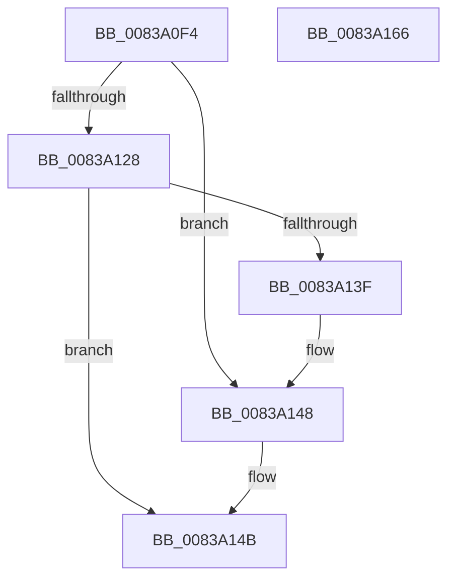

# MinAsn1ExtractParsedCertificatesFromSignedData

- RVA: `0x0083A0F4`–`0x0083A167` (길이 `115` bytes)
- VA: `0x000000014083A0F4`
- 실행 섹션: `PAGE`
- PDB 이름 있음: `예`; PDB Function 태그: `아니요`
- unwind 정보 RVA: `0x000DB054`
- 디코드: `32`개 명령, `115/115` bytes 표시
- 미해석 바이트: `0` (있으면 어셈블리에 `.byte`로 보존)

> 이 문서는 커널 이미지의 기계어와 PDB 기호를 분석해 생성했습니다. 4번과 5번은 함수 원형과 자료형을 바이너리 사용 방식에서 추정한 C 해석이며 원본 소스 복구 결과는 아닙니다.

## 1. Dependencies

- 직접 호출 지점: **3**; 고유 호출 대상: **3**
- 직접 호출자로 확인된 함수: **1**
- RIP 상대 이미지 참조: **1**

### Outgoing calls
- `0x0083A11F` → [MinAsn1ParseSignedData](MinAsn1ParseSignedData_function_00838F24.md) (function, `0x00838F24`)
- `0x0083A136` → [MinAsn1ParseSignedDataCertificatesEx](MinAsn1ParseSignedDataCertificatesEx_function_00838F68.md) (function, `0x00838F68`)
- `0x0083A156` → [_security_check_cookie](../../text/6A/_security_check_cookie_function_006AC640.md) (function, `0x006AC640`)

### Direct callers
- [MincrypK_ParseCertificateChainWithPolicy2](MincrypK_ParseCertificateChainWithPolicy2_function_00837534.md) at `0x008375AA`

### Static image references
- `0x0083A0FF` → RVA `0x00E0A740` (`.data`; read)

## 2. Other-region calls and transfers

- 다른 실행 섹션으로 향하는 call: **1**
  - `0x0083A156` → [_security_check_cookie](../../text/6A/_security_check_cookie_function_006AC640.md) (`PAGE` → `.text`)
- 별도 외부 분기/꼬리 이동을 확인하지 못했습니다.

## 3. Assembly (complete function range)

```asm
0083A0F4  40 53                           push rbx
0083A0F6  56                              push rsi
0083A0F7  57                              push rdi
0083A0F8  48 81 EC 60 01 00 00            sub rsp, 0x160
0083A0FF  48 8B 05 3A 06 5D 00            mov rax, qword ptr [rip + 0x5d063a]
0083A106  48 33 C4                        xor rax, rsp
0083A109  48 89 84 24 50 01 00 00         mov qword ptr [rsp + 0x150], rax
0083A111  49 8B F8                        mov rdi, r8
0083A114  49 8B F1                        mov rsi, r9
0083A117  4C 8D 44 24 20                  lea r8, [rsp + 0x20]
0083A11C  48 8B D9                        mov rbx, rcx
0083A11F  E8 00 EE FF FF                  call 0x140838f24
0083A124  85 C0                           test eax, eax
0083A126  7E 20                           jle 0x14083a148
0083A128  4C 8B C6                        mov r8, rsi
0083A12B  48 8D 8C 24 90 00 00 00         lea rcx, [rsp + 0x90]
0083A133  48 8B D7                        mov rdx, rdi
0083A136  E8 2D EE FF FF                  call 0x140838f68
0083A13B  85 C0                           test eax, eax
0083A13D  79 0C                           jns 0x14083a14b
0083A13F  2B 9C 24 98 00 00 00            sub ebx, dword ptr [rsp + 0x98]
0083A146  03 C3                           add eax, ebx
0083A148  83 27 00                        and dword ptr [rdi], 0
0083A14B  48 8B 8C 24 50 01 00 00         mov rcx, qword ptr [rsp + 0x150]
0083A153  48 33 CC                        xor rcx, rsp
0083A156  E8 E5 24 E7 FF                  call 0x1406ac640
0083A15B  48 81 C4 60 01 00 00            add rsp, 0x160
0083A162  5F                              pop rdi
0083A163  5E                              pop rsi
0083A164  5B                              pop rbx
0083A165  C3                              ret
0083A166  CC                              int3
```

## 4. C-style interpretation (structured pseudocode)

```c
__int64 __fastcall MinAsn1ExtractParsedCertificatesFromSignedData(__int64 a1, __int64 a2, __int64 a3, __int64 a4)
{
    __int64 result;
    __int64 v_rbx;
    __int64 v_rsp;
    unsigned __int64 v_stack_m158;
    unsigned __int64 v_stack_m28;
    unsigned int v_stack_mE0;
    unsigned __int64 v_stack_mE8;

    v_rsp = (v_rsp) - (352);
    result = (*(unsigned __int64 *)(v_rip + 6096442)) ^ (v_rsp);
    v_stack_m28 = result;
    result = MinAsn1ParseSignedData(a1, a2, v_stack_m158, a4);
    if (condition_is_less_or_equal) goto loc_0083A148;
    result = MinAsn1ParseSignedDataCertificatesEx(v_stack_mE8, a3, a4, a4);
    if (!sign_flag) goto loc_0083A14B;
    v_rbx = (unsigned int)((a1) - (v_stack_mE0));
    result = (unsigned int)((result) + ((unsigned int)(v_rbx)));
loc_0083A148:
loc_0083A14B:
    a1 = (v_stack_m28) ^ (v_rsp);
    result = _security_check_cookie(a1, a3, a4, a4);
    v_rsp = (v_rsp) + (352);
    return result;
}
```

## 5. (Beta) C Style

```c
int64_t MinAsn1ExtractParsedCertificatesFromSignedData(int64_t Arg1, int64_t Arg2, void *Arg3, int64_t Arg4)
{
    uint8_t *arg3 = (uint8_t *)Arg3;

    int64_t result;
    int64_t local_rbx;
    int64_t local_rsp;
    uint64_t v_stack_m158;
    uint64_t v_stack_m28;
    uint32_t v_stack_mE0;
    uint64_t v_stack_mE8;

    local_rsp = (local_rsp) - (352);
    result = (*(uint64_t *)(v_rip + 0x5D063A)) ^ (local_rsp);
    v_stack_m28 = result;
    result = MinAsn1ParseSignedData(Arg1, Arg2, v_stack_m158, Arg4);
    if (condition_is_less_or_equal) goto loc_0083A148;
    result = MinAsn1ParseSignedDataCertificatesEx(v_stack_mE8, Arg3, Arg4, Arg4);
    if (!sign_flag) goto loc_0083A14B;
    local_rbx = (uint32_t)((Arg1) - (v_stack_mE0));
    result = (uint32_t)((result) + ((uint32_t)(local_rbx)));
loc_0083A148:
loc_0083A14B:
    Arg1 = (v_stack_m28) ^ (local_rsp);
    result = _security_check_cookie(Arg1, Arg3, Arg4, Arg4);
    local_rsp = (local_rsp) + (352);
    return result;
}
```

### 관측된 메모리 오프셋

구조체 형식이 확인되지 않은 접근은 인자 기준의 오프셋으로만 기록했습니다.

| 기준 인자 | 오프셋 표현 | 폭 (bit) | 접근 |
|---|---:|---:|---|
| `Arg3` | `+ 0x0` | `32` | `R/W` |

## 6. Execution-region graph

[열기: 2D/3D 그래프와 함수 탐색 컨트롤 패널](../../../control-panel.html?section=page&rva=0x0083A0F4&view=graph)

- 2D 그래프는 위에서 아래로 흐르고, 3D 그래프는 빈 공간을 드래그해 회전합니다. Shift+드래그는 이동, 휠은 확대·축소, 함수 노드 선택은 대상 보고서 이동입니다.

### Static fallback


