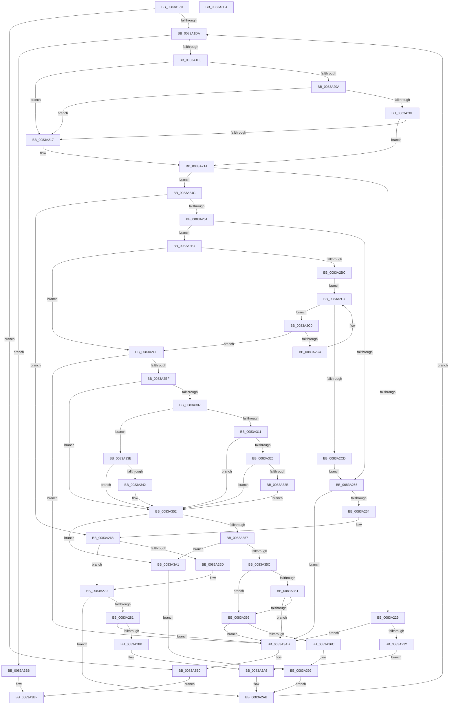

# MinAsn1ExtractValues

- RVA: `0x0083A170`–`0x0083A3E5` (길이 `629` bytes)
- VA: `0x000000014083A170`
- 실행 섹션: `PAGE`
- PDB 이름 있음: `예`; PDB Function 태그: `아니요`
- unwind 정보 RVA: `0x000C7D9C`
- 디코드: `188`개 명령, `629/629` bytes 표시
- 미해석 바이트: `0` (있으면 어셈블리에 `.byte`로 보존)

> 이 문서는 커널 이미지의 기계어와 PDB 기호를 분석해 생성했습니다. 4번과 5번은 함수 원형과 자료형을 바이너리 사용 방식에서 추정한 C 해석이며 원본 소스 복구 결과는 아닙니다.

## 1. Dependencies

- 직접 호출 지점: **2**; 고유 호출 대상: **2**
- 직접 호출자로 확인된 함수: **13**
- RIP 상대 이미지 참조: **1**

### Outgoing calls
- `0x0083A2DF` → [MinAsn1ExtractContent](MinAsn1ExtractContent_function_0083A00C.md) (function, `0x0083A00C`)
- `0x0083A3CB` → [_security_check_cookie](../../text/6A/_security_check_cookie_function_006AC640.md) (function, `0x006AC640`)

### Direct callers
- [MincryptValidateBasicConstraints](MincryptValidateBasicConstraints_function_00837B84.md) at `0x00837C2B`
- [I_MinCryptVerifyAuthenticodeTimeStamp](I_MinCryptVerifyAuthenticodeTimeStamp_function_00838090.md) at `0x00838123`
- [I_MinCryptVerifyRFC3161TimeStamp](I_MinCryptVerifyRFC3161TimeStamp_function_008382A4.md) at `0x0083837A`
- [I_MinAsn1ParseSingleAttribute](I_MinAsn1ParseSingleAttribute_function_00838A10.md) at `0x00838AB6`
- [MinAsn1ParseAlgorithmIdentifier](MinAsn1ParseAlgorithmIdentifier_function_00838B8C.md) at `0x00838BBA`
- [MinAsn1ParseAndDecodeRDNComponent](MinAsn1ParseAndDecodeRDNComponent_function_00838BD4.md) at `0x00838C56`
- [MinAsn1ParseCTL](MinAsn1ParseCTL_function_00838CF0.md) at `0x00838D1E`
- [MinAsn1ParseCertificate](MinAsn1ParseCertificate_function_00838D38.md) at `0x00838D60`
- [MinAsn1ParseOIDSequence](MinAsn1ParseOIDSequence_function_00838DB0.md) at `0x00838E45`
- [MinAsn1ParsePublicKeyInfo](MinAsn1ParsePublicKeyInfo_function_00838E94.md) at `0x00838EC2`
- [MinAsn1ParseRSAPublicKey](MinAsn1ParseRSAPublicKey_function_00838EDC.md) at `0x00838F0A`
- [MinAsn1ParseSignedData](MinAsn1ParseSignedData_function_00838F24.md) at `0x00838F4C`
- [MinAsn1ParseSingleExtensionValue](MinAsn1ParseSingleExtensionValue_function_00839058.md) at `0x00839104`

### Static image references
- `0x0083A189` → RVA `0x00E0A740` (`.data`; read)

## 2. Other-region calls and transfers

- 다른 실행 섹션으로 향하는 call: **1**
  - `0x0083A3CB` → [_security_check_cookie](../../text/6A/_security_check_cookie_function_006AC640.md) (`PAGE` → `.text`)
- 별도 외부 분기/꼬리 이동을 확인하지 못했습니다.

## 3. Assembly (complete function range)

```asm
0083A170  40 55                           push rbp
0083A172  53                              push rbx
0083A173  56                              push rsi
0083A174  57                              push rdi
0083A175  41 54                           push r12
0083A177  41 55                           push r13
0083A179  41 56                           push r14
0083A17B  41 57                           push r15
0083A17D  48 8D 6C 24 F1                  lea rbp, [rsp - 0xf]
0083A182  48 81 EC F8 00 00 00            sub rsp, 0xf8
0083A189  48 8B 05 B0 05 5D 00            mov rax, qword ptr [rip + 0x5d05b0]
0083A190  48 33 C4                        xor rax, rsp
0083A193  48 89 45 F7                     mov qword ptr [rbp - 9], rax
0083A197  4C 8B 55 7F                     mov r10, qword ptr [rbp + 0x7f]
0083A19B  45 33 DB                        xor r11d, r11d
0083A19E  4C 89 4C 24 50                  mov qword ptr [rsp + 0x50], r9
0083A1A3  49 8B C0                        mov rax, r8
0083A1A6  48 89 44 24 40                  mov qword ptr [rsp + 0x40], rax
0083A1AB  48 8B F1                        mov rsi, rcx
0083A1AE  41 8B 08                        mov ecx, dword ptr [r8]
0083A1B1  44 8B EA                        mov r13d, edx
0083A1B4  4C 89 54 24 30                  mov qword ptr [rsp + 0x30], r10
0083A1B9  48 8B DE                        mov rbx, rsi
0083A1BC  89 4C 24 3C                     mov dword ptr [rsp + 0x3c], ecx
0083A1C0  45 8A C3                        mov r8b, r11b
0083A1C3  44 88 5C 24 20                  mov byte ptr [rsp + 0x20], r11b
0083A1C8  45 8B F3                        mov r14d, r11d
0083A1CB  45 8B FB                        mov r15d, r11d
0083A1CE  81 FA FF FF FF 7F               cmp edx, 0x7fffffff
0083A1D4  0F 83 D6 01 00 00               jae 0x14083a3b0
0083A1DA  44 3B F9                        cmp r15d, ecx
0083A1DD  0F 83 D3 01 00 00               jae 0x14083a3b6
0083A1E3  41 8B C7                        mov eax, r15d
0083A1E6  48 03 C0                        add rax, rax
0083A1E9  41 8B 14 C1                     mov edx, dword ptr [r9 + rax*8]
0083A1ED  49 8B 4C C1 08                  mov rcx, qword ptr [r9 + rax*8 + 8]
0083A1F2  41 8B 44 C1 04                  mov eax, dword ptr [r9 + rax*8 + 4]
0083A1F7  89 44 24 24                     mov dword ptr [rsp + 0x24], eax
0083A1FB  89 54 24 38                     mov dword ptr [rsp + 0x38], edx
0083A1FF  0F B6 FA                        movzx edi, dl
0083A202  F7 C2 00 00 00 C0               test edx, 0xc0000000
0083A208  74 0D                           je 0x14083a217
0083A20A  4D 85 D2                        test r10, r10
0083A20D  74 08                           je 0x14083a217
0083A20F  41 B4 01                        mov r12b, 1
0083A212  3B 45 77                        cmp eax, dword ptr [rbp + 0x77]
0083A215  72 03                           jb 0x14083a21a
0083A217  45 8A E3                        mov r12b, r11b
0083A21A  44 89 5C 24 28                  mov dword ptr [rsp + 0x28], r11d
0083A21F  4C 89 5C 24 48                  mov qword ptr [rsp + 0x48], r11
0083A224  83 FF 05                        cmp edi, 5
0083A227  75 23                           jne 0x14083a24c
0083A229  45 85 F6                        test r14d, r14d
0083A22C  0F 84 79 01 00 00               je 0x14083a3ab
0083A232  41 FF CE                        dec r14d
0083A235  41 8B C6                        mov eax, r14d
0083A238  48 03 C0                        add rax, rax
0083A23B  48 8B 5C C4 60                  mov rbx, qword ptr [rsp + rax*8 + 0x60]
0083A240  44 8B 6C C4 68                  mov r13d, dword ptr [rsp + rax*8 + 0x68]
0083A245  44 8A 44 C5 83                  mov r8b, byte ptr [rbp + rax*8 - 0x7d]
0083A24A  EB 5A                           jmp 0x14083a2a6
0083A24C  45 84 C0                        test r8b, r8b
0083A24F  75 17                           jne 0x14083a268
0083A251  45 85 ED                        test r13d, r13d
0083A254  75 61                           jne 0x14083a2b7
0083A256  8D 47 FE                        lea eax, [rdi - 2]
0083A259  A9 FD FF FF FF                  test eax, 0xfffffffd
0083A25E  0F 85 47 01 00 00               jne 0x14083a3ab
0083A264  8B 44 24 24                     mov eax, dword ptr [rsp + 0x24]
0083A268  45 84 E4                        test r12b, r12b
0083A26B  74 0C                           je 0x14083a279
0083A26D  48 03 C0                        add rax, rax
0083A270  4D 89 5C C2 08                  mov qword ptr [r10 + rax*8 + 8], r11
0083A275  45 89 1C C2                     mov dword ptr [r10 + rax*8], r11d
0083A279  8D 47 FD                        lea eax, [rdi - 3]
0083A27C  83 F8 01                        cmp eax, 1
0083A27F  77 2A                           ja 0x14083a2ab
0083A281  41 83 FE 08                     cmp r14d, 8
0083A285  0F 83 20 01 00 00               jae 0x14083a3ab
0083A28B  41 8B C6                        mov eax, r14d
0083A28E  48 03 C0                        add rax, rax
0083A291  41 FF C6                        inc r14d
0083A294  44 88 44 C5 83                  mov byte ptr [rbp + rax*8 - 0x7d], r8b
0083A299  41 B0 01                        mov r8b, 1
0083A29C  48 89 5C C4 60                  mov qword ptr [rsp + rax*8 + 0x60], rbx
0083A2A1  44 89 6C C4 68                  mov dword ptr [rsp + rax*8 + 0x68], r13d
0083A2A6  44 88 44 24 20                  mov byte ptr [rsp + 0x20], r8b
0083A2AB  8B 4C 24 3C                     mov ecx, dword ptr [rsp + 0x3c]
0083A2AF  41 FF C7                        inc r15d
0083A2B2  E9 23 FF FF FF                  jmp 0x14083a1da
0083A2B7  48 85 C9                        test rcx, rcx
0083A2BA  74 13                           je 0x14083a2cf
0083A2BC  8A 13                           mov dl, byte ptr [rbx]
0083A2BE  EB 07                           jmp 0x14083a2c7
0083A2C0  3A C2                           cmp al, dl
0083A2C2  74 0B                           je 0x14083a2cf
0083A2C4  48 FF C1                        inc rcx
0083A2C7  8A 01                           mov al, byte ptr [rcx]
0083A2C9  84 C0                           test al, al
0083A2CB  75 F3                           jne 0x14083a2c0
0083A2CD  EB 87                           jmp 0x14083a256
0083A2CF  4C 8D 4C 24 48                  lea r9, [rsp + 0x48]
0083A2D4  41 8B D5                        mov edx, r13d
0083A2D7  4C 8D 44 24 28                  lea r8, [rsp + 0x28]
0083A2DC  48 8B CB                        mov rcx, rbx
0083A2DF  E8 28 FD FF FF                  call 0x14083a00c
0083A2E4  45 33 DB                        xor r11d, r11d
0083A2E7  85 C0                           test eax, eax
0083A2E9  0F 8E BC 00 00 00               jle 0x14083a3ab
0083A2EF  44 8B 44 24 28                  mov r8d, dword ptr [rsp + 0x28]
0083A2F4  4C 8B 4C 24 48                  mov r9, qword ptr [rsp + 0x48]
0083A2F9  4C 8B 54 24 30                  mov r10, qword ptr [rsp + 0x30]
0083A2FE  41 8D 14 00                     lea edx, [r8 + rax]
0083A302  45 84 E4                        test r12b, r12b
0083A305  74 4B                           je 0x14083a352
0083A307  8B 44 24 38                     mov eax, dword ptr [rsp + 0x38]
0083A30B  0F BA E0 1E                     bt eax, 0x1e
0083A30F  73 2D                           jae 0x14083a33e
0083A311  8B 4C 24 24                     mov ecx, dword ptr [rsp + 0x24]
0083A315  48 03 C9                        add rcx, rcx
0083A318  4D 89 4C CA 08                  mov qword ptr [r10 + rcx*8 + 8], r9
0083A31D  45 89 04 CA                     mov dword ptr [r10 + rcx*8], r8d
0083A321  80 3B 03                        cmp byte ptr [rbx], 3
0083A324  75 2C                           jne 0x14083a352
0083A326  45 85 C0                        test r8d, r8d
0083A329  74 27                           je 0x14083a352
0083A32B  49 8D 41 01                     lea rax, [r9 + 1]
0083A32F  49 89 44 CA 08                  mov qword ptr [r10 + rcx*8 + 8], rax
0083A334  41 8D 40 FF                     lea eax, [r8 - 1]
0083A338  41 89 04 CA                     mov dword ptr [r10 + rcx*8], eax
0083A33C  EB 14                           jmp 0x14083a352
0083A33E  85 C0                           test eax, eax
0083A340  79 10                           jns 0x14083a352
0083A342  8B 44 24 24                     mov eax, dword ptr [rsp + 0x24]
0083A346  48 03 C0                        add rax, rax
0083A349  49 89 5C C2 08                  mov qword ptr [r10 + rax*8 + 8], rbx
0083A34E  41 89 14 C2                     mov dword ptr [r10 + rax*8], edx
0083A352  83 EF 01                        sub edi, 1
0083A355  74 4A                           je 0x14083a3a1
0083A357  83 EF 01                        sub edi, 1
0083A35A  74 45                           je 0x14083a3a1
0083A35C  83 EF 01                        sub edi, 1
0083A35F  74 05                           je 0x14083a366
0083A361  83 FF 01                        cmp edi, 1
0083A364  75 45                           jne 0x14083a3ab
0083A366  41 83 FE 08                     cmp r14d, 8
0083A36A  73 3F                           jae 0x14083a3ab
0083A36C  44 2B EA                        sub r13d, edx
0083A36F  41 8B CE                        mov ecx, r14d
0083A372  48 03 C9                        add rcx, rcx
0083A375  8B C2                           mov eax, edx
0083A377  48 03 C3                        add rax, rbx
0083A37A  49 8B D9                        mov rbx, r9
0083A37D  41 FF C6                        inc r14d
0083A380  44 89 6C CC 68                  mov dword ptr [rsp + rcx*8 + 0x68], r13d
0083A385  45 8B E8                        mov r13d, r8d
0083A388  48 89 44 CC 60                  mov qword ptr [rsp + rcx*8 + 0x60], rax
0083A38D  44 88 5C CD 83                  mov byte ptr [rbp + rcx*8 - 0x7d], r11b
0083A392  44 8A 44 24 20                  mov r8b, byte ptr [rsp + 0x20]
0083A397  4C 8B 4C 24 50                  mov r9, qword ptr [rsp + 0x50]
0083A39C  E9 0A FF FF FF                  jmp 0x14083a2ab
0083A3A1  8B C2                           mov eax, edx
0083A3A3  48 03 D8                        add rbx, rax
0083A3A6  44 2B EA                        sub r13d, edx
0083A3A9  EB E7                           jmp 0x14083a392
0083A3AB  48 8B 44 24 40                  mov rax, qword ptr [rsp + 0x40]
0083A3B0  2B F3                           sub esi, ebx
0083A3B2  FF CE                           dec esi
0083A3B4  EB 09                           jmp 0x14083a3bf
0083A3B6  48 8B 44 24 40                  mov rax, qword ptr [rsp + 0x40]
0083A3BB  2B DE                           sub ebx, esi
0083A3BD  8B F3                           mov esi, ebx
0083A3BF  44 89 38                        mov dword ptr [rax], r15d
0083A3C2  8B C6                           mov eax, esi
0083A3C4  48 8B 4D F7                     mov rcx, qword ptr [rbp - 9]
0083A3C8  48 33 CC                        xor rcx, rsp
0083A3CB  E8 70 22 E7 FF                  call 0x1406ac640
0083A3D0  48 81 C4 F8 00 00 00            add rsp, 0xf8
0083A3D7  41 5F                           pop r15
0083A3D9  41 5E                           pop r14
0083A3DB  41 5D                           pop r13
0083A3DD  41 5C                           pop r12
0083A3DF  5F                              pop rdi
0083A3E0  5E                              pop rsi
0083A3E1  5B                              pop rbx
0083A3E2  5D                              pop rbp
0083A3E3  C3                              ret
0083A3E4  CC                              int3
```

## 4. C-style interpretation (structured pseudocode)

```c
__int64 __fastcall MinAsn1ExtractValues(__int64 a1, int a2, __int64 a3, __int64 a4, unsigned int a5, __int64 a6)
{
    __int64 result;
    __int64 v_r11;
    __int64 v_r12;
    __int64 v_r13;
    __int64 v_r14;
    __int64 v_r15;
    __int64 v_rbx;
    __int64 v_rdi;
    __int64 v_rsi;
    __int64 v_rsp;
    unsigned int v_stack_m100;
    unsigned __int64 v_stack_m108;
    unsigned int v_stack_m110;
    unsigned int v_stack_m114;
    unsigned __int8 v_stack_m118;
    unsigned __int64 v_stack_m4F;
    unsigned __int64 v_stack_m58;
    unsigned __int64 v_stack_mE8;
    unsigned __int64 v_stack_mF0;
    unsigned __int64 v_stack_mF8;
    unsigned int v_stack_mFC;

    v_rsp = (v_rsp) - (248);
    result = (*(unsigned __int64 *)(v_rip + 6096304)) ^ (v_rsp);
    v_stack_m58 = result;
    v_r11 = 0;
    v_stack_mE8 = a4;
    v_stack_mF8 = a3;
    v_stack_m108 = a6;
    v_stack_mFC = (unsigned int)((unsigned int)(*(unsigned int *)(a3)));
    v_stack_m118 = 0;
    if (a2 >= 0x7FFFFFFFULL) goto loc_0083A3B0;
loc_0083A1DA:
    if (0 >= ((unsigned int)((unsigned int)(*(unsigned int *)(a3))))) goto loc_0083A3B6;
    result = (0) + (0);
    v_stack_m114 = (unsigned int)((unsigned int)(*(unsigned int *)(a4 + result * 8 + 4)));
    v_stack_m100 = (unsigned int)((unsigned int)(*(unsigned int *)(a4 + result * 8)));
    if ((((unsigned int)((unsigned int)(*(unsigned int *)(a4 + result * 8)))) & (0xC0000000ULL)) == 0) goto loc_0083A217;
    if (a6 == 0) goto loc_0083A217;
    v_r12 = 1;
    if (((unsigned int)((unsigned int)(*(unsigned int *)(a4 + result * 8 + 4)))) >= a5) {
        v_r12 = 0;
    }
    v_stack_m110 = 0;
    v_stack_mF0 = 0;
    if (((unsigned int)((unsigned __int8)((unsigned int)(*(unsigned int *)(a4 + result * 8))))) != 5) goto loc_0083A24C;
    if (0 == 0) goto loc_0083A3AB;
    v_r14 = (unsigned int)((0) - 1);
    result = ((unsigned int)((unsigned int)(v_r14))) + ((unsigned int)((unsigned int)(v_r14)));
    goto loc_0083A2A6;
loc_0083A24C:
    if ((unsigned __int8)(*(unsigned __int8 *)(v_stack_m4F + result * 8 - 125)) != 0) goto loc_0083A268;
    if ((unsigned int)((unsigned int)(*(unsigned int *)(v_rsp + result * 8 + 104))) != 0) goto loc_0083A2B7;
loc_0083A256:
    if ((((unsigned int)((unsigned __int8)((unsigned int)(*(unsigned int *)(a4 + result * 8))) - 2)) & (0xFFFFFFFDULL)) != 0) goto loc_0083A3AB;
loc_0083A268:
    result = (unsigned int)(v_stack_m114);
    if ((unsigned __int8)(v_r12) != 0) {
        result = ((unsigned int)(v_stack_m114)) + ((unsigned int)(v_stack_m114));
        *(unsigned __int64 *)(a6 + result * 8 + 8) = 0;
        *(unsigned int *)(a6 + result * 8) = 0;
    }
    if (((unsigned int)((unsigned __int8)((unsigned int)(*(unsigned int *)(a4 + result * 8))) - 3)) > 1) goto loc_0083A2AB;
    if (((unsigned int)(v_r14)) >= 8) goto loc_0083A3AB;
    result = ((unsigned int)((unsigned int)(v_r14))) + ((unsigned int)((unsigned int)(v_r14)));
    v_r14 = (unsigned int)((v_r14) + 1);
    *(unsigned __int8 *)(v_stack_m4F + result * 8 - 125) = (unsigned __int8)(*(unsigned __int8 *)(v_stack_m4F + result * 8 - 125));
    *(unsigned __int64 *)(v_rsp + result * 8 + 96) = *(unsigned __int64 *)(v_rsp + result * 8 + 96);
    *(unsigned int *)(v_rsp + result * 8 + 104) = (unsigned int)((unsigned int)(*(unsigned int *)(v_rsp + result * 8 + 104)));
loc_0083A2A6:
    v_stack_m118 = 1;
loc_0083A2AB:
    v_r15 = (unsigned int)((0) + 1);
    goto loc_0083A1DA;
loc_0083A2B7:
    if ((unsigned int)(v_stack_mFC) == 0) goto loc_0083A2CF;
    goto loc_0083A2C7;
loc_0083A2C0:
    if (((unsigned __int8)(result)) == ((unsigned __int8)(*(unsigned __int8 *)(*(unsigned __int64 *)(v_rsp + result * 8 + 96))))) goto loc_0083A2CF;
    a1 = ((unsigned int)(v_stack_mFC)) + 1;
loc_0083A2C7:
    if ((unsigned __int8)(*(unsigned __int8 *)(a1)) != 0) goto loc_0083A2C0;
    goto loc_0083A256;
loc_0083A2CF:
    result = MinAsn1ExtractContent(*(unsigned __int64 *)(v_rsp + result * 8 + 96), (unsigned int)((unsigned int)((unsigned int)(*(unsigned int *)(v_rsp + result * 8 + 104)))), v_stack_m110, v_stack_mF0);
    v_r11 = 0;
    if (condition_is_less_or_equal) goto loc_0083A3AB;
    if ((unsigned __int8)(v_r12) == 0) goto loc_0083A352;
    if (condition_is_above_or_equal) goto loc_0083A33E;
    a1 = ((unsigned int)(v_stack_m114)) + ((unsigned int)(v_stack_m114));
    *(unsigned __int64 *)(v_stack_m108 + a1 * 8 + 8) = v_stack_mF0;
    *(unsigned int *)(v_stack_m108 + a1 * 8) = (unsigned int)((unsigned int)(v_stack_m110));
    if ((*(unsigned __int8 *)(*(unsigned __int64 *)(v_rsp + result * 8 + 96))) != 3) goto loc_0083A352;
    if ((unsigned int)((unsigned int)(v_stack_m110)) == 0) goto loc_0083A352;
    *(unsigned __int64 *)(v_stack_m108 + a1 * 8 + 8) = v_stack_mF0 + 1;
    *(unsigned int *)(v_stack_m108 + a1 * 8) = (unsigned int)((unsigned int)(v_stack_m110) - 1);
    goto loc_0083A352;
loc_0083A33E:
    result = (unsigned int)(v_stack_m110) - 1;
    if (sign_flag) {
        result = v_stack_m114;
        result = (result) + (result);
        *(unsigned __int64 *)(v_stack_m108 + result * 8 + 8) = *(unsigned __int64 *)(v_rsp + result * 8 + 96);
        *(unsigned int *)(v_stack_m108 + result * 8) = (unsigned int)((unsigned int)(v_stack_m110) + result * 1);
    }
    v_rdi = (unsigned int)(((unsigned __int8)((unsigned int)(*(unsigned int *)(a4 + result * 8)))) - (1));
    if (condition_is_equal) goto loc_0083A3A1;
    v_rdi = (unsigned int)((v_rdi) - (1));
    if (condition_is_equal) goto loc_0083A3A1;
    v_rdi = (unsigned int)((v_rdi) - (1));
    if (condition_is_equal) goto loc_0083A366;
    if (((unsigned int)(v_rdi)) != 1) goto loc_0083A3AB;
loc_0083A366:
    if (((unsigned int)(v_r14)) >= 8) goto loc_0083A3AB;
    v_r13 = (unsigned int)(((unsigned int)(*(unsigned int *)(v_rsp + result * 8 + 104))) - ((unsigned int)((unsigned int)(v_stack_m110) + result * 1)));
    a1 = ((unsigned int)((unsigned int)(v_r14))) + ((unsigned int)((unsigned int)(v_r14)));
    result = ((unsigned int)((unsigned int)((unsigned int)(v_stack_m110) + result * 1))) + (*(unsigned __int64 *)(v_rsp + result * 8 + 96));
    v_r14 = (unsigned int)((v_r14) + 1);
    *(unsigned int *)(v_rsp + a1 * 8 + 104) = (unsigned int)(v_r13);
    *(unsigned __int64 *)(v_rsp + a1 * 8 + 96) = result;
    *(unsigned __int8 *)(v_stack_m4F + a1 * 8 - 125) = 0;
loc_0083A392:
    goto loc_0083A2AB;
loc_0083A3A1:
    v_rbx = (v_stack_mF0) + ((unsigned int)((unsigned int)((unsigned int)(v_stack_m110) + result * 1)));
    v_r13 = (unsigned int)(((unsigned int)((unsigned int)((unsigned int)(v_stack_m110)))) - ((unsigned int)((unsigned int)(v_stack_m110) + result * 1)));
    goto loc_0083A392;
loc_0083A3AB:
loc_0083A3B0:
    v_rsi = (unsigned int)((a1) - ((unsigned int)(v_rbx)));
    v_rsi = (unsigned int)((v_rsi) - 1);
    goto loc_0083A3BF;
loc_0083A3B6:
    v_rbx = (unsigned int)((v_rbx) - ((unsigned int)(v_rsi)));
loc_0083A3BF:
    *(unsigned int *)(v_stack_mF8) = (unsigned int)(v_r15);
    a1 = (v_stack_m58) ^ (v_rsp);
    result = _security_check_cookie(a1, (unsigned int)(v_stack_m110) + result * 1, v_stack_m118, v_stack_mE8);
    v_rsp = (v_rsp) + (248);
    return result;
}
```

## 5. (Beta) C Style

```c
int64_t MinAsn1ExtractValues(int64_t Arg1, int32_t Arg2, void *Arg3, int64_t Arg4, uint32_t Arg5, int64_t Arg6)
{
    uint8_t *arg3 = (uint8_t *)Arg3;

    int64_t result;
    int64_t local_r11;
    int64_t local_r12;
    int64_t local_r13;
    int64_t local_r14;
    int64_t local_r15;
    int64_t local_rbx;
    int64_t local_rdi;
    int64_t local_rsi;
    int64_t local_rsp;
    uint32_t v_stack_m100;
    uint64_t v_stack_m108;
    uint32_t v_stack_m110;
    uint32_t v_stack_m114;
    uint8_t v_stack_m118;
    uint64_t v_stack_m4F;
    uint64_t v_stack_m58;
    uint64_t v_stack_mE8;
    uint64_t v_stack_mF0;
    uint64_t v_stack_mF8;
    uint32_t v_stack_mFC;

    local_rsp = (local_rsp) - (248);
    result = (*(uint64_t *)(v_rip + 0x5D05B0)) ^ (local_rsp);
    v_stack_m58 = result;
    local_r11 = 0;
    v_stack_mE8 = Arg4;
    v_stack_mF8 = Arg3;
    v_stack_m108 = Arg6;
    v_stack_mFC = (uint32_t)((uint32_t)(*(uint32_t *)(arg3)));
    v_stack_m118 = 0;
    if (Arg2 >= 0x7FFFFFFFULL) goto loc_0083A3B0;
loc_0083A1DA:
    if (0 >= ((uint32_t)((uint32_t)(*(uint32_t *)(arg3))))) goto loc_0083A3B6;
    result = (0) + (0);
    v_stack_m114 = (uint32_t)((uint32_t)(*(uint32_t *)(Arg4 + result * 8 + 0x4)));
    v_stack_m100 = (uint32_t)((uint32_t)(*(uint32_t *)(Arg4 + result * 8)));
    if ((((uint32_t)((uint32_t)(*(uint32_t *)(Arg4 + result * 8)))) & (0xC0000000ULL)) == 0) goto loc_0083A217;
    if (Arg6 == 0) goto loc_0083A217;
    local_r12 = 1;
    if (((uint32_t)((uint32_t)(*(uint32_t *)(Arg4 + result * 8 + 0x4)))) >= Arg5) {
        local_r12 = 0;
    }
    v_stack_m110 = 0;
    v_stack_mF0 = 0;
    if (((uint32_t)((uint8_t)((uint32_t)(*(uint32_t *)(Arg4 + result * 8))))) != 5) goto loc_0083A24C;
    if (0 == 0) goto loc_0083A3AB;
    local_r14 = (uint32_t)((0) - 1);
    result = ((uint32_t)((uint32_t)(local_r14))) + ((uint32_t)((uint32_t)(local_r14)));
    goto loc_0083A2A6;
loc_0083A24C:
    if ((uint8_t)(*(uint8_t *)(v_stack_m4F + result * 8 - 0x7D)) != 0) goto loc_0083A268;
    if ((uint32_t)((uint32_t)(*(uint32_t *)(local_rsp + result * 8 + 0x68))) != 0) goto loc_0083A2B7;
loc_0083A256:
    if ((((uint32_t)((uint8_t)((uint32_t)(*(uint32_t *)(Arg4 + result * 8))) - 2)) & (0xFFFFFFFDULL)) != 0) goto loc_0083A3AB;
loc_0083A268:
    result = (uint32_t)(v_stack_m114);
    if ((uint8_t)(local_r12) != 0) {
        result = ((uint32_t)(v_stack_m114)) + ((uint32_t)(v_stack_m114));
        *(uint64_t *)(Arg6 + result * 8 + 0x8) = 0;
        *(uint32_t *)(Arg6 + result * 8) = 0;
    }
    if (((uint32_t)((uint8_t)((uint32_t)(*(uint32_t *)(Arg4 + result * 8))) - 3)) > 1) goto loc_0083A2AB;
    if (((uint32_t)(local_r14)) >= 8) goto loc_0083A3AB;
    result = ((uint32_t)((uint32_t)(local_r14))) + ((uint32_t)((uint32_t)(local_r14)));
    local_r14 = (uint32_t)((local_r14) + 1);
    *(uint8_t *)(v_stack_m4F + result * 8 - 0x7D) = (uint8_t)(*(uint8_t *)(v_stack_m4F + result * 8 - 0x7D));
    *(uint64_t *)(local_rsp + result * 8 + 0x60) = *(uint64_t *)(local_rsp + result * 8 + 0x60);
    *(uint32_t *)(local_rsp + result * 8 + 0x68) = (uint32_t)((uint32_t)(*(uint32_t *)(local_rsp + result * 8 + 0x68)));
loc_0083A2A6:
    v_stack_m118 = 1;
loc_0083A2AB:
    local_r15 = (uint32_t)((0) + 1);
    goto loc_0083A1DA;
loc_0083A2B7:
    if ((uint32_t)(v_stack_mFC) == 0) goto loc_0083A2CF;
    goto loc_0083A2C7;
loc_0083A2C0:
    if (((uint8_t)(result)) == ((uint8_t)(*(uint8_t *)(*(uint64_t *)(local_rsp + result * 8 + 0x60))))) goto loc_0083A2CF;
    Arg1 = ((uint32_t)(v_stack_mFC)) + 1;
loc_0083A2C7:
    if ((uint8_t)(*(uint8_t *)(Arg1)) != 0) goto loc_0083A2C0;
    goto loc_0083A256;
loc_0083A2CF:
    result = MinAsn1ExtractContent(*(uint64_t *)(local_rsp + result * 8 + 0x60), (uint32_t)((uint32_t)((uint32_t)(*(uint32_t *)(local_rsp + result * 8 + 0x68)))), v_stack_m110, v_stack_mF0);
    local_r11 = 0;
    if (condition_is_less_or_equal) goto loc_0083A3AB;
    if ((uint8_t)(local_r12) == 0) goto loc_0083A352;
    if (condition_is_above_or_equal) goto loc_0083A33E;
    Arg1 = ((uint32_t)(v_stack_m114)) + ((uint32_t)(v_stack_m114));
    *(uint64_t *)(v_stack_m108 + Arg1 * 8 + 0x8) = v_stack_mF0;
    *(uint32_t *)(v_stack_m108 + Arg1 * 8) = (uint32_t)((uint32_t)(v_stack_m110));
    if ((*(uint8_t *)(*(uint64_t *)(local_rsp + result * 8 + 0x60))) != 3) goto loc_0083A352;
    if ((uint32_t)((uint32_t)(v_stack_m110)) == 0) goto loc_0083A352;
    *(uint64_t *)(v_stack_m108 + Arg1 * 8 + 0x8) = v_stack_mF0 + 1;
    *(uint32_t *)(v_stack_m108 + Arg1 * 8) = (uint32_t)((uint32_t)(v_stack_m110) - 1);
    goto loc_0083A352;
loc_0083A33E:
    result = (uint32_t)(v_stack_m110) - 1;
    if (sign_flag) {
        result = v_stack_m114;
        result = (result) + (result);
        *(uint64_t *)(v_stack_m108 + result * 8 + 0x8) = *(uint64_t *)(local_rsp + result * 8 + 0x60);
        *(uint32_t *)(v_stack_m108 + result * 8) = (uint32_t)((uint32_t)(v_stack_m110) + result * 1);
    }
    local_rdi = (uint32_t)(((uint8_t)((uint32_t)(*(uint32_t *)(Arg4 + result * 8)))) - (1));
    if (condition_is_equal) goto loc_0083A3A1;
    local_rdi = (uint32_t)((local_rdi) - (1));
    if (condition_is_equal) goto loc_0083A3A1;
    local_rdi = (uint32_t)((local_rdi) - (1));
    if (condition_is_equal) goto loc_0083A366;
    if (((uint32_t)(local_rdi)) != 1) goto loc_0083A3AB;
loc_0083A366:
    if (((uint32_t)(local_r14)) >= 8) goto loc_0083A3AB;
    local_r13 = (uint32_t)(((uint32_t)(*(uint32_t *)(local_rsp + result * 8 + 0x68))) - ((uint32_t)((uint32_t)(v_stack_m110) + result * 1)));
    Arg1 = ((uint32_t)((uint32_t)(local_r14))) + ((uint32_t)((uint32_t)(local_r14)));
    result = ((uint32_t)((uint32_t)((uint32_t)(v_stack_m110) + result * 1))) + (*(uint64_t *)(local_rsp + result * 8 + 0x60));
    local_r14 = (uint32_t)((local_r14) + 1);
    *(uint32_t *)(local_rsp + Arg1 * 8 + 0x68) = (uint32_t)(local_r13);
    *(uint64_t *)(local_rsp + Arg1 * 8 + 0x60) = result;
    *(uint8_t *)(v_stack_m4F + Arg1 * 8 - 0x7D) = 0;
loc_0083A392:
    goto loc_0083A2AB;
loc_0083A3A1:
    local_rbx = (v_stack_mF0) + ((uint32_t)((uint32_t)((uint32_t)(v_stack_m110) + result * 1)));
    local_r13 = (uint32_t)(((uint32_t)((uint32_t)((uint32_t)(v_stack_m110)))) - ((uint32_t)((uint32_t)(v_stack_m110) + result * 1)));
    goto loc_0083A392;
loc_0083A3AB:
loc_0083A3B0:
    local_rsi = (uint32_t)((Arg1) - ((uint32_t)(local_rbx)));
    local_rsi = (uint32_t)((local_rsi) - 1);
    goto loc_0083A3BF;
loc_0083A3B6:
    local_rbx = (uint32_t)((local_rbx) - ((uint32_t)(local_rsi)));
loc_0083A3BF:
    *(uint32_t *)(v_stack_mF8) = (uint32_t)(local_r15);
    Arg1 = (v_stack_m58) ^ (local_rsp);
    result = _security_check_cookie(Arg1, (uint32_t)(v_stack_m110) + result * 1, v_stack_m118, v_stack_mE8);
    local_rsp = (local_rsp) + (248);
    return result;
}
```

### 관측된 메모리 오프셋

구조체 형식이 확인되지 않은 접근은 인자 기준의 오프셋으로만 기록했습니다.

| 기준 인자 | 오프셋 표현 | 폭 (bit) | 접근 |
|---|---:|---:|---|
| `Arg3` | `+ 0x0` | `32` | `R` |

## 6. Execution-region graph

[열기: 2D/3D 그래프와 함수 탐색 컨트롤 패널](../../../control-panel.html?section=page&rva=0x0083A170&view=graph)

- 2D 그래프는 위에서 아래로 흐르고, 3D 그래프는 빈 공간을 드래그해 회전합니다. Shift+드래그는 이동, 휠은 확대·축소, 함수 노드 선택은 대상 보고서 이동입니다.

### Static fallback


