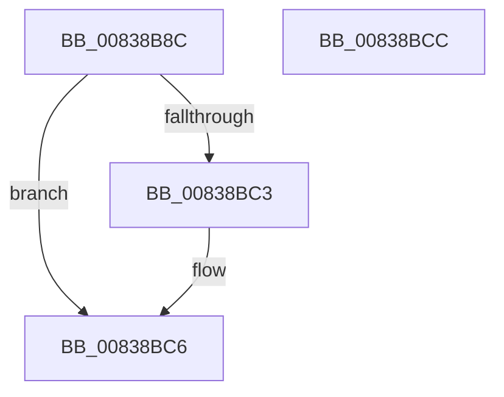

# MinAsn1ParseAlgorithmIdentifier

- RVA: `0x00838B8C`–`0x00838BCD` (길이 `65` bytes)
- VA: `0x0000000140838B8C`
- 실행 섹션: `PAGE`
- PDB 이름 있음: `예`; PDB Function 태그: `아니요`
- unwind 정보 RVA: `0x000AA39C`
- 디코드: `19`개 명령, `65/65` bytes 표시
- 미해석 바이트: `0` (있으면 어셈블리에 `.byte`로 보존)

> 이 문서는 커널 이미지의 기계어와 PDB 기호를 분석해 생성했습니다. 4번과 5번은 함수 원형과 자료형을 바이너리 사용 방식에서 추정한 C 해석이며 원본 소스 복구 결과는 아닙니다.

## 1. Dependencies

- 직접 호출 지점: **1**; 고유 호출 대상: **1**
- 직접 호출자로 확인된 함수: **2**
- RIP 상대 이미지 참조: **1**

### Outgoing calls
- `0x00838BBA` → [MinAsn1ExtractValues](MinAsn1ExtractValues_function_0083A170.md) (function, `0x0083A170`)

### Direct callers
- [MinCryptDecodeHashAlgorithmIdentifier](MinCryptDecodeHashAlgorithmIdentifier_function_008361A0.md) at `0x008361B8`
- [MinCryptVerifySignedHash2](MinCryptVerifySignedHash2_function_008362A0.md) at `0x008362F5`

### Static image references
- `0x00838B98` → RVA `0x0000D3F0` (`.rdata`; read)

## 2. Other-region calls and transfers

- 다른 실행 섹션으로 향하는 call: **0**
- 별도 외부 분기/꼬리 이동을 확인하지 못했습니다.

## 3. Assembly (complete function range)

```asm
00838B8C  48 8B C4                        mov rax, rsp
00838B8F  53                              push rbx
00838B90  48 83 EC 30                     sub rsp, 0x30
00838B94  48 89 50 F0                     mov qword ptr [rax - 0x10], rdx
00838B98  4C 8D 0D 51 48 7D FF            lea r9, [rip - 0x82b7af]
00838B9F  48 8B DA                        mov rbx, rdx
00838BA2  C7 40 08 03 00 00 00            mov dword ptr [rax + 8], 3
00838BA9  8B 11                           mov edx, dword ptr [rcx]
00838BAB  4C 8D 40 08                     lea r8, [rax + 8]
00838BAF  48 8B 49 08                     mov rcx, qword ptr [rcx + 8]
00838BB3  C7 40 E8 04 00 00 00            mov dword ptr [rax - 0x18], 4
00838BBA  E8 B1 15 00 00                  call 0x14083a170
00838BBF  85 C0                           test eax, eax
00838BC1  7E 03                           jle 0x140838bc6
00838BC3  8B 43 10                        mov eax, dword ptr [rbx + 0x10]
00838BC6  48 83 C4 30                     add rsp, 0x30
00838BCA  5B                              pop rbx
00838BCB  C3                              ret
00838BCC  CC                              int3
```

## 4. C-style interpretation (structured pseudocode)

```c
__int64 __fastcall MinAsn1ParseAlgorithmIdentifier(__int64 a1, __int64 a2)
{
    __int64 result;
    __int64 v_rsp;

    v_rsp = (v_rsp) - (48);
    *(unsigned __int64 *)(v_rsp - 16) = a2;
    *(unsigned int *)(v_rsp + 8) = 3;
    *(unsigned int *)(v_rsp - 24) = 4;
    result = MinAsn1ExtractValues(*(unsigned __int64 *)(a1 + 8), (unsigned int)(*(unsigned int *)(a1)), v_rsp + 8, v_rip - 8566703);
    if (!(condition_is_less_or_equal)) {
        result = *(unsigned int *)(a2 + 16);
    }
    v_rsp = (v_rsp) + (48);
    return result;
}
```

## 5. (Beta) C Style

```c
int64_t MinAsn1ParseAlgorithmIdentifier(void *Arg1, void *Arg2)
{
    uint8_t *arg1 = (uint8_t *)Arg1;
    uint8_t *arg2 = (uint8_t *)Arg2;

    int64_t result;
    int64_t local_rsp;

    local_rsp = (local_rsp) - (48);
    *(void **)(local_rsp - 0x10) = Arg2;
    *(uint32_t *)(local_rsp + 0x8) = 3;
    *(uint32_t *)(local_rsp - 0x18) = 4;
    result = MinAsn1ExtractValues(*(uint64_t *)(arg1 + 0x8), (uint32_t)(*(uint32_t *)(arg1)), local_rsp + 8, v_rip - 8566703);
    if (!(condition_is_less_or_equal)) {
        result = *(uint32_t *)(arg2 + 0x10);
    }
    local_rsp = (local_rsp) + (48);
    return result;
}
```

### 관측된 메모리 오프셋

구조체 형식이 확인되지 않은 접근은 인자 기준의 오프셋으로만 기록했습니다.

| 기준 인자 | 오프셋 표현 | 폭 (bit) | 접근 |
|---|---:|---:|---|
| `Arg1` | `+ 0x0` | `32` | `R` |
| `Arg1` | `+ 0x8` | `64` | `R` |
| `Arg2` | `+ 0x10` | `32` | `R` |

## 6. Execution-region graph

[열기: 2D/3D 그래프와 함수 탐색 컨트롤 패널](../../../control-panel.html?section=page&rva=0x00838B8C&view=graph)

- 2D 그래프는 위에서 아래로 흐르고, 3D 그래프는 빈 공간을 드래그해 회전합니다. Shift+드래그는 이동, 휠은 확대·축소, 함수 노드 선택은 대상 보고서 이동입니다.

### Static fallback


