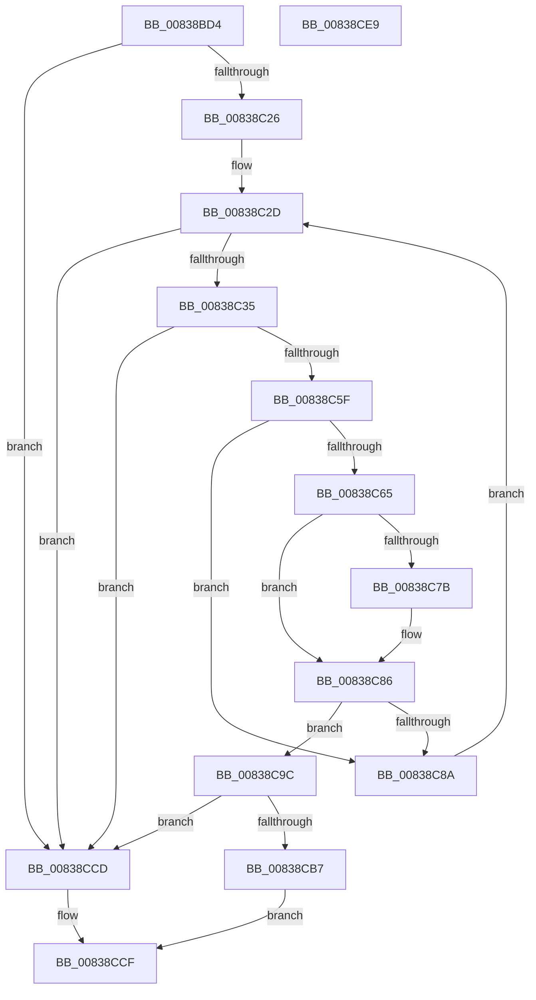

# MinAsn1ParseAndDecodeRDNComponent

- RVA: `0x00838BD4`–`0x00838CEA` (길이 `278` bytes)
- VA: `0x0000000140838BD4`
- 실행 섹션: `PAGE`
- PDB 이름 있음: `예`; PDB Function 태그: `아니요`
- unwind 정보 RVA: `0x000DAF58`
- 디코드: `83`개 명령, `278/278` bytes 표시
- 미해석 바이트: `0` (있으면 어셈블리에 `.byte`로 보존)

> 이 문서는 커널 이미지의 기계어와 PDB 기호를 분석해 생성했습니다. 4번과 5번은 함수 원형과 자료형을 바이너리 사용 방식에서 추정한 C 해석이며 원본 소스 복구 결과는 아닙니다.

## 1. Dependencies

- 직접 호출 지점: **4**; 고유 호출 대상: **3**
- 직접 호출자로 확인된 함수: **1**
- RIP 상대 이미지 참조: **3**

### Outgoing calls
- `0x00838C19` → [MinAsn1ExtractContent](MinAsn1ExtractContent_function_0083A00C.md) (function, `0x0083A00C`)
- `0x00838C56` → [MinAsn1ExtractValues](MinAsn1ExtractValues_function_0083A170.md) (function, `0x0083A170`)
- `0x00838CAE` → [MinAsn1ExtractContent](MinAsn1ExtractContent_function_0083A00C.md) (function, `0x0083A00C`)
- `0x00838CD6` → [_security_check_cookie](../../text/6A/_security_check_cookie_function_006AC640.md) (function, `0x006AC640`)

### Direct callers
- [I_MinCryptGetCommonName](I_MinCryptGetCommonName_function_0083685C.md) at `0x0083687A`

### Static image references
- `0x00838BE7` → RVA `0x00E0A740` (`.data`; read)
- `0x00838C40` → RVA `0x0000D420` (`.rdata`; read)
- `0x00838C69` → RVA `0x00B4BCB0` (`PAGE`; read)

## 2. Other-region calls and transfers

- 다른 실행 섹션으로 향하는 call: **1**
  - `0x00838CD6` → [_security_check_cookie](../../text/6A/_security_check_cookie_function_006AC640.md) (`PAGE` → `.text`)
- 별도 외부 분기/꼬리 이동을 확인하지 못했습니다.

## 3. Assembly (complete function range)

```asm
00838BD4  40 55                           push rbp
00838BD6  53                              push rbx
00838BD7  56                              push rsi
00838BD8  57                              push rdi
00838BD9  41 56                           push r14
00838BDB  48 8D 6C 24 C9                  lea rbp, [rsp - 0x37]
00838BE0  48 81 EC A0 00 00 00            sub rsp, 0xa0
00838BE7  48 8B 05 52 1B 5D 00            mov rax, qword ptr [rip + 0x5d1b52]
00838BEE  48 33 C4                        xor rax, rsp
00838BF1  48 89 45 27                     mov qword ptr [rbp + 0x27], rax
00838BF5  8B 11                           mov edx, dword ptr [rcx]
00838BF7  49 8B F1                        mov rsi, r9
00838BFA  48 8B 49 08                     mov rcx, qword ptr [rcx + 8]
00838BFE  4C 8D 4D CF                     lea r9, [rbp - 0x31]
00838C02  48 83 65 CF 00                  and qword ptr [rbp - 0x31], 0
00838C07  4D 8B F0                        mov r14, r8
00838C0A  83 65 C7 00                     and dword ptr [rbp - 0x39], 0
00838C0E  4C 8D 45 C7                     lea r8, [rbp - 0x39]
00838C12  C7 45 D7 04 00 00 00            mov dword ptr [rbp - 0x29], 4
00838C19  E8 EE 13 00 00                  call 0x14083a00c
00838C1E  85 C0                           test eax, eax
00838C20  0F 8E A7 00 00 00               jle 0x140838ccd
00838C26  48 8B 7D CF                     mov rdi, qword ptr [rbp - 0x31]
00838C2A  8B 5D C7                        mov ebx, dword ptr [rbp - 0x39]
00838C2D  85 DB                           test ebx, ebx
00838C2F  0F 84 98 00 00 00               je 0x140838ccd
00838C35  48 8D 45 E7                     lea rax, [rbp - 0x19]
00838C39  8B D3                           mov edx, ebx
00838C3B  48 89 44 24 28                  mov qword ptr [rsp + 0x28], rax
00838C40  4C 8D 0D D9 47 7D FF            lea r9, [rip - 0x82b827]
00838C47  4C 8D 45 D7                     lea r8, [rbp - 0x29]
00838C4B  C7 44 24 20 04 00 00 00         mov dword ptr [rsp + 0x20], 4
00838C53  48 8B CF                        mov rcx, rdi
00838C56  E8 15 15 00 00                  call 0x14083a170
00838C5B  85 C0                           test eax, eax
00838C5D  7E 6E                           jle 0x140838ccd
00838C5F  83 7D 07 03                     cmp dword ptr [rbp + 7], 3
00838C63  75 25                           jne 0x140838c8a
00838C65  48 8B 55 0F                     mov rdx, qword ptr [rbp + 0xf]
00838C69  4C 8B 05 40 30 31 00            mov r8, qword ptr [rip + 0x313040]
00838C70  0F B7 0A                        movzx ecx, word ptr [rdx]
00838C73  41 0F B7 00                     movzx eax, word ptr [r8]
00838C77  2B C8                           sub ecx, eax
00838C79  75 0B                           jne 0x140838c86
00838C7B  0F B6 4A 02                     movzx ecx, byte ptr [rdx + 2]
00838C7F  41 0F B6 40 02                  movzx eax, byte ptr [r8 + 2]
00838C84  2B C8                           sub ecx, eax
00838C86  85 C9                           test ecx, ecx
00838C88  74 12                           je 0x140838c9c
00838C8A  8B 45 F7                        mov eax, dword ptr [rbp - 9]
00838C8D  48 03 F8                        add rdi, rax
00838C90  2B 5D F7                        sub ebx, dword ptr [rbp - 9]
00838C93  89 5D C7                        mov dword ptr [rbp - 0x39], ebx
00838C96  48 89 7D CF                     mov qword ptr [rbp - 0x31], rdi
00838C9A  EB 91                           jmp 0x140838c2d
00838C9C  48 8B 5D 1F                     mov rbx, qword ptr [rbp + 0x1f]
00838CA0  4C 8D 4D CF                     lea r9, [rbp - 0x31]
00838CA4  8B 55 17                        mov edx, dword ptr [rbp + 0x17]
00838CA7  4C 8D 45 C7                     lea r8, [rbp - 0x39]
00838CAB  48 8B CB                        mov rcx, rbx
00838CAE  E8 59 13 00 00                  call 0x14083a00c
00838CB3  85 C0                           test eax, eax
00838CB5  7E 16                           jle 0x140838ccd
00838CB7  8A 03                           mov al, byte ptr [rbx]
00838CB9  41 88 06                        mov byte ptr [r14], al
00838CBC  48 8B 45 CF                     mov rax, qword ptr [rbp - 0x31]
00838CC0  48 89 46 08                     mov qword ptr [rsi + 8], rax
00838CC4  8B 45 C7                        mov eax, dword ptr [rbp - 0x39]
00838CC7  89 06                           mov dword ptr [rsi], eax
00838CC9  B0 01                           mov al, 1
00838CCB  EB 02                           jmp 0x140838ccf
00838CCD  32 C0                           xor al, al
00838CCF  48 8B 4D 27                     mov rcx, qword ptr [rbp + 0x27]
00838CD3  48 33 CC                        xor rcx, rsp
00838CD6  E8 65 39 E7 FF                  call 0x1406ac640
00838CDB  48 81 C4 A0 00 00 00            add rsp, 0xa0
00838CE2  41 5E                           pop r14
00838CE4  5F                              pop rdi
00838CE5  5E                              pop rsi
00838CE6  5B                              pop rbx
00838CE7  5D                              pop rbp
00838CE8  C3                              ret
00838CE9  CC                              int3
```

## 4. C-style interpretation (structured pseudocode)

```c
__int64 __fastcall MinAsn1ParseAndDecodeRDNComponent(__int64 a1, __int64 a2, __int64 a3, __int64 a4)
{
    __int64 result;
    __int64 v_rbx;
    __int64 v_rdi;
    __int64 v_rsp;
    unsigned __int64 v_stack_m38;
    unsigned __int64 v_stack_m40;
    unsigned int v_stack_m48;
    unsigned __int64 v_stack_m50;
    unsigned int v_stack_m58;
    unsigned __int64 v_stack_m5F;
    unsigned int v_stack_m68;
    unsigned __int64 v_stack_m78;
    unsigned int v_stack_m88;
    unsigned __int64 v_stack_m90;
    unsigned int v_stack_m98;
    unsigned __int64 v_stack_mA0;
    unsigned int v_stack_mA8;

    v_rsp = (v_rsp) - (160);
    result = (*(unsigned __int64 *)(v_rip + 6101842)) ^ (v_rsp);
    v_stack_m38 = result;
    v_stack_m88 = 4;
    result = MinAsn1ExtractContent(*(unsigned __int64 *)(a1 + 8), (unsigned int)(*(unsigned int *)(a1)), v_stack_m98, v_stack_m90);
    if (condition_is_less_or_equal) goto loc_00838CCD;
loc_00838C2D:
    if ((unsigned int)((unsigned int)(v_stack_m98)) == 0) goto loc_00838CCD;
    v_stack_mA0 = v_stack_m78;
    v_stack_mA8 = 4;
    result = MinAsn1ExtractValues(v_stack_m90, (unsigned int)((unsigned int)((unsigned int)(v_stack_m98))), v_stack_m88, v_rip - 8566823);
    if (condition_is_less_or_equal) goto loc_00838CCD;
    if (v_stack_m58 != 3) goto loc_00838C8A;
    a1 = (unsigned int)((*(unsigned __int16 *)(v_stack_m50)) - ((unsigned int)(*(unsigned __int16 *)(*(unsigned __int64 *)(v_rip + 3223616)))));
    result = *(unsigned __int16 *)(*(unsigned __int64 *)(v_rip + 3223616));
    if (!(condition_is_not_equal)) {
        a1 = *(unsigned __int8 *)(v_stack_m50 + 2);
        result = *(unsigned __int8 *)(*(unsigned __int64 *)(v_rip + 3223616) + 2);
        a1 = (unsigned int)((a1) - ((unsigned int)(result)));
    }
    if ((unsigned int)(a1) == 0) goto loc_00838C9C;
loc_00838C8A:
    v_rdi = (v_stack_m90) + ((unsigned int)(v_stack_m68));
    v_rbx = (unsigned int)(((unsigned int)(v_stack_m98)) - (v_stack_m68));
    v_stack_m98 = (unsigned int)(v_rbx);
    v_stack_m90 = v_rdi;
    goto loc_00838C2D;
loc_00838C9C:
    result = MinAsn1ExtractContent(v_stack_m40, (unsigned int)(v_stack_m48), v_stack_m98, v_stack_m90);
    if (condition_is_less_or_equal) goto loc_00838CCD;
    *(unsigned __int8 *)(a3) = (unsigned __int8)(*(unsigned __int8 *)(v_stack_m40));
    *(unsigned __int64 *)(a4 + 8) = v_stack_m90;
    *(unsigned int *)(a4) = (unsigned int)((unsigned int)(v_stack_m98));
    goto loc_00838CCF;
loc_00838CCD:
    result = 0;
loc_00838CCF:
    a1 = (v_stack_m38) ^ (v_rsp);
    result = _security_check_cookie(a1, (unsigned int)(v_stack_m48), v_stack_m98, v_stack_m90);
    v_rsp = (v_rsp) + (160);
    return result;
}
```

## 5. (Beta) C Style

```c
int64_t MinAsn1ParseAndDecodeRDNComponent(void *Arg1, int64_t Arg2, void *Arg3, void *Arg4)
{
    uint8_t *arg1 = (uint8_t *)Arg1;
    uint8_t *arg3 = (uint8_t *)Arg3;
    uint8_t *arg4 = (uint8_t *)Arg4;

    int64_t result;
    int64_t local_rbx;
    int64_t local_rdi;
    int64_t local_rsp;
    uint64_t v_stack_m38;
    uint64_t v_stack_m40;
    uint32_t v_stack_m48;
    uint64_t v_stack_m50;
    uint32_t v_stack_m58;
    uint64_t v_stack_m5F;
    uint32_t v_stack_m68;
    uint64_t v_stack_m78;
    uint32_t v_stack_m88;
    uint64_t v_stack_m90;
    uint32_t v_stack_m98;
    uint64_t v_stack_mA0;
    uint32_t v_stack_mA8;

    local_rsp = (local_rsp) - (160);
    result = (*(uint64_t *)(v_rip + 0x5D1B52)) ^ (local_rsp);
    v_stack_m38 = result;
    v_stack_m88 = 4;
    result = MinAsn1ExtractContent(*(uint64_t *)(arg1 + 0x8), (uint32_t)(*(uint32_t *)(arg1)), v_stack_m98, v_stack_m90);
    if (condition_is_less_or_equal) goto loc_00838CCD;
loc_00838C2D:
    if ((uint32_t)((uint32_t)(v_stack_m98)) == 0) goto loc_00838CCD;
    v_stack_mA0 = v_stack_m78;
    v_stack_mA8 = 4;
    result = MinAsn1ExtractValues(v_stack_m90, (uint32_t)((uint32_t)((uint32_t)(v_stack_m98))), v_stack_m88, v_rip - 8566823);
    if (condition_is_less_or_equal) goto loc_00838CCD;
    if (v_stack_m58 != 3) goto loc_00838C8A;
    Arg1 = (uint32_t)((*(uint16_t *)(v_stack_m50)) - ((uint32_t)(*(uint16_t *)(*(uint64_t *)(v_rip + 0x313040)))));
    result = *(uint16_t *)(*(uint64_t *)(v_rip + 0x313040));
    if (!(condition_is_not_equal)) {
        Arg1 = *(uint8_t *)(v_stack_m50 + 0x2);
        result = *(uint8_t *)(*(uint64_t *)(v_rip + 0x313040) + 0x2);
        Arg1 = (uint32_t)((Arg1) - ((uint32_t)(result)));
    }
    if ((uint32_t)(Arg1) == 0) goto loc_00838C9C;
loc_00838C8A:
    local_rdi = (v_stack_m90) + ((uint32_t)(v_stack_m68));
    local_rbx = (uint32_t)(((uint32_t)(v_stack_m98)) - (v_stack_m68));
    v_stack_m98 = (uint32_t)(local_rbx);
    v_stack_m90 = local_rdi;
    goto loc_00838C2D;
loc_00838C9C:
    result = MinAsn1ExtractContent(v_stack_m40, (uint32_t)(v_stack_m48), v_stack_m98, v_stack_m90);
    if (condition_is_less_or_equal) goto loc_00838CCD;
    *(uint8_t *)(arg3) = (uint8_t)(*(uint8_t *)(v_stack_m40));
    *(uint64_t *)(arg4 + 0x8) = v_stack_m90;
    *(uint32_t *)(arg4) = (uint32_t)((uint32_t)(v_stack_m98));
    goto loc_00838CCF;
loc_00838CCD:
    result = 0;
loc_00838CCF:
    Arg1 = (v_stack_m38) ^ (local_rsp);
    result = _security_check_cookie(Arg1, (uint32_t)(v_stack_m48), v_stack_m98, v_stack_m90);
    local_rsp = (local_rsp) + (160);
    return result;
}
```

### 관측된 메모리 오프셋

구조체 형식이 확인되지 않은 접근은 인자 기준의 오프셋으로만 기록했습니다.

| 기준 인자 | 오프셋 표현 | 폭 (bit) | 접근 |
|---|---:|---:|---|
| `Arg1` | `+ 0x0` | `32` | `R` |
| `Arg1` | `+ 0x8` | `64` | `R` |
| `Arg3` | `+ 0x0` | `8` | `W` |
| `Arg4` | `+ 0x0` | `32` | `W` |
| `Arg4` | `+ 0x8` | `64` | `W` |

## 6. Execution-region graph

[열기: 2D/3D 그래프와 함수 탐색 컨트롤 패널](../../../control-panel.html?section=page&rva=0x00838BD4&view=graph)

- 2D 그래프는 위에서 아래로 흐르고, 3D 그래프는 빈 공간을 드래그해 회전합니다. Shift+드래그는 이동, 휠은 확대·축소, 함수 노드 선택은 대상 보고서 이동입니다.

### Static fallback


