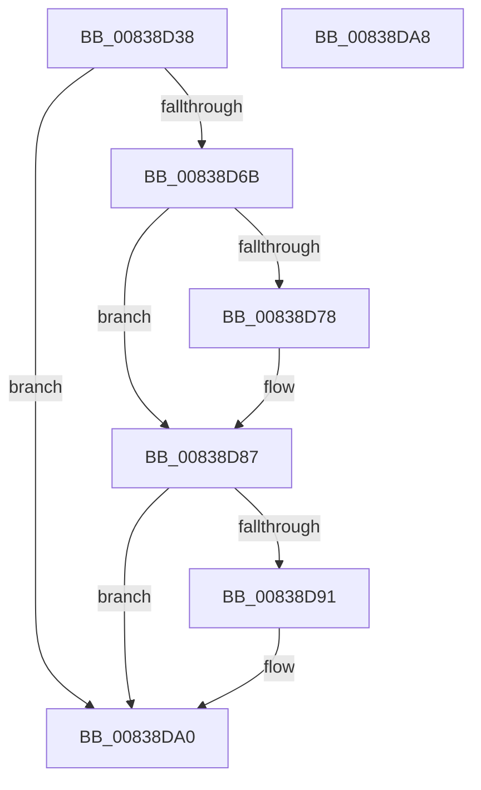

# MinAsn1ParseCertificate

- RVA: `0x00838D38`–`0x00838DA9` (길이 `113` bytes)
- VA: `0x0000000140838D38`
- 실행 섹션: `PAGE`
- PDB 이름 있음: `예`; PDB Function 태그: `아니요`
- unwind 정보 RVA: `0x000AA39C`
- 디코드: `31`개 명령, `113/113` bytes 표시
- 미해석 바이트: `0` (있으면 어셈블리에 `.byte`로 보존)

> 이 문서는 커널 이미지의 기계어와 PDB 기호를 분석해 생성했습니다. 4번과 5번은 함수 원형과 자료형을 바이너리 사용 방식에서 추정한 C 해석이며 원본 소스 복구 결과는 아닙니다.

## 1. Dependencies

- 직접 호출 지점: **1**; 고유 호출 대상: **1**
- 직접 호출자로 확인된 함수: **2**
- RIP 상대 이미지 참조: **1**

### Outgoing calls
- `0x00838D60` → [MinAsn1ExtractValues](MinAsn1ExtractValues_function_0083A170.md) (function, `0x0083A170`)

### Direct callers
- [MinCryptCheckCertsAndKeys](../../text/6A/MinCryptCheckCertsAndKeys_function_006A61F8.md) at `0x006A626C`
- [MinAsn1ParseSignedDataCertificatesEx](MinAsn1ParseSignedDataCertificatesEx_function_00838F68.md) at `0x00839009`

### Static image references
- `0x00838D4E` → RVA `0x0000D0A0` (`.rdata`; read)

## 2. Other-region calls and transfers

- 다른 실행 섹션으로 향하는 call: **0**
- 별도 외부 분기/꼬리 이동을 확인하지 못했습니다.

## 3. Assembly (complete function range)

```asm
00838D38  48 8B C4                        mov rax, rsp
00838D3B  53                              push rbx
00838D3C  48 83 EC 30                     sub rsp, 0x30
00838D40  49 8B D8                        mov rbx, r8
00838D43  C7 40 20 14 00 00 00            mov dword ptr [rax + 0x20], 0x14
00838D4A  48 89 58 F0                     mov qword ptr [rax - 0x10], rbx
00838D4E  4C 8D 0D 4B 43 7D FF            lea r9, [rip - 0x82bcb5]
00838D55  4C 8D 40 20                     lea r8, [rax + 0x20]
00838D59  C7 40 E8 0F 00 00 00            mov dword ptr [rax - 0x18], 0xf
00838D60  E8 0B 14 00 00                  call 0x14083a170
00838D65  8B C8                           mov ecx, eax
00838D67  85 C0                           test eax, eax
00838D69  7E 35                           jle 0x140838da0
00838D6B  8B 83 C0 00 00 00               mov eax, dword ptr [rbx + 0xc0]
00838D71  8B 4B 10                        mov ecx, dword ptr [rbx + 0x10]
00838D74  85 C0                           test eax, eax
00838D76  74 0F                           je 0x140838d87
00838D78  48 FF 83 C8 00 00 00            inc qword ptr [rbx + 0xc8]
00838D7F  FF C8                           dec eax
00838D81  89 83 C0 00 00 00               mov dword ptr [rbx + 0xc0], eax
00838D87  8B 83 D0 00 00 00               mov eax, dword ptr [rbx + 0xd0]
00838D8D  85 C0                           test eax, eax
00838D8F  74 0F                           je 0x140838da0
00838D91  48 FF 83 D8 00 00 00            inc qword ptr [rbx + 0xd8]
00838D98  FF C8                           dec eax
00838D9A  89 83 D0 00 00 00               mov dword ptr [rbx + 0xd0], eax
00838DA0  8B C1                           mov eax, ecx
00838DA2  48 83 C4 30                     add rsp, 0x30
00838DA6  5B                              pop rbx
00838DA7  C3                              ret
00838DA8  CC                              int3
```

## 4. C-style interpretation (structured pseudocode)

```c
__int64 __fastcall MinAsn1ParseCertificate(__int64 a1, __int64 a2, __int64 a3)
{
    __int64 result;
    __int64 v_rsp;

    v_rsp = (v_rsp) - (48);
    *(unsigned int *)(v_rsp + 32) = 20;
    *(unsigned __int64 *)(v_rsp - 16) = a3;
    *(unsigned int *)(v_rsp - 24) = 15;
    result = MinAsn1ExtractValues(a1, a2, v_rsp + 32, v_rip - 8567989);
    if (condition_is_less_or_equal) goto loc_00838DA0;
    result = (unsigned int)(*(unsigned int *)(a3 + 192));
    if ((unsigned int)((unsigned int)(*(unsigned int *)(a3 + 192))) != 0) {
        result = (unsigned int)(((unsigned int)(*(unsigned int *)(a3 + 192))) - 1);
        *(unsigned int *)(a3 + 192) = (unsigned int)(result);
    }
    result = (unsigned int)(*(unsigned int *)(a3 + 208));
    if ((unsigned int)((unsigned int)(*(unsigned int *)(a3 + 208))) != 0) {
        result = (unsigned int)(((unsigned int)(*(unsigned int *)(a3 + 208))) - 1);
        *(unsigned int *)(a3 + 208) = (unsigned int)(result);
    }
    v_rsp = (v_rsp) + (48);
    return (unsigned int)((unsigned int)((unsigned int)(*(unsigned int *)(a3 + 16))));
}
```

## 5. (Beta) C Style

```c
int64_t MinAsn1ParseCertificate(int64_t Arg1, int64_t Arg2, void *Arg3)
{
    uint8_t *arg3 = (uint8_t *)Arg3;

    int64_t result;
    int64_t local_rsp;

    local_rsp = (local_rsp) - (48);
    *(uint32_t *)(local_rsp + 0x20) = 20;
    *(void **)(local_rsp - 0x10) = Arg3;
    *(uint32_t *)(local_rsp - 0x18) = 15;
    result = MinAsn1ExtractValues(Arg1, Arg2, local_rsp + 32, v_rip - 8567989);
    if (condition_is_less_or_equal) goto loc_00838DA0;
    result = (uint32_t)(*(uint32_t *)(arg3 + 0xC0));
    if ((uint32_t)((uint32_t)(*(uint32_t *)(arg3 + 0xC0))) != 0) {
        result = (uint32_t)(((uint32_t)(*(uint32_t *)(arg3 + 0xC0))) - 1);
        *(uint32_t *)(arg3 + 0xC0) = (uint32_t)(result);
    }
    result = (uint32_t)(*(uint32_t *)(arg3 + 0xD0));
    if ((uint32_t)((uint32_t)(*(uint32_t *)(arg3 + 0xD0))) != 0) {
        result = (uint32_t)(((uint32_t)(*(uint32_t *)(arg3 + 0xD0))) - 1);
        *(uint32_t *)(arg3 + 0xD0) = (uint32_t)(result);
    }
    local_rsp = (local_rsp) + (48);
    return (uint32_t)((uint32_t)((uint32_t)(*(uint32_t *)(arg3 + 0x10))));
}
```

### 관측된 메모리 오프셋

구조체 형식이 확인되지 않은 접근은 인자 기준의 오프셋으로만 기록했습니다.

| 기준 인자 | 오프셋 표현 | 폭 (bit) | 접근 |
|---|---:|---:|---|
| `Arg3` | `+ 0x10` | `32` | `R` |
| `Arg3` | `+ 0xC0` | `32` | `R` |
| `Arg3` | `+ 0xC0` | `32` | `W` |
| `Arg3` | `+ 0xC8` | `64` | `R/W` |
| `Arg3` | `+ 0xD0` | `32` | `R` |
| `Arg3` | `+ 0xD0` | `32` | `W` |
| `Arg3` | `+ 0xD8` | `64` | `R/W` |

## 6. Execution-region graph

[열기: 2D/3D 그래프와 함수 탐색 컨트롤 패널](../../../control-panel.html?section=page&rva=0x00838D38&view=graph)

- 2D 그래프는 위에서 아래로 흐르고, 3D 그래프는 빈 공간을 드래그해 회전합니다. Shift+드래그는 이동, 휠은 확대·축소, 함수 노드 선택은 대상 보고서 이동입니다.

### Static fallback


