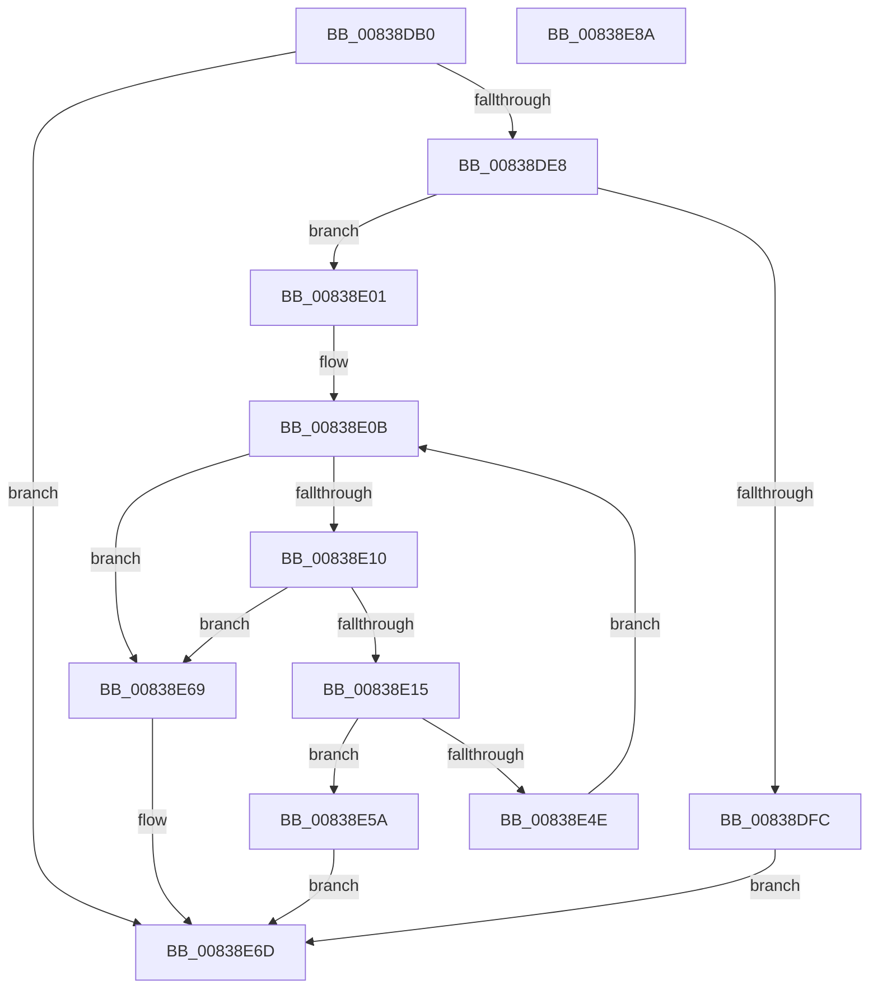

# MinAsn1ParseOIDSequence

- RVA: `0x00838DB0`–`0x00838E8B` (길이 `219` bytes)
- VA: `0x0000000140838DB0`
- 실행 섹션: `PAGE`
- PDB 이름 있음: `예`; PDB Function 태그: `아니요`
- unwind 정보 RVA: `0x000C4330`
- 디코드: `74`개 명령, `219/219` bytes 표시
- 미해석 바이트: `0` (있으면 어셈블리에 `.byte`로 보존)

> 이 문서는 커널 이미지의 기계어와 PDB 기호를 분석해 생성했습니다. 4번과 5번은 함수 원형과 자료형을 바이너리 사용 방식에서 추정한 C 해석이며 원본 소스 복구 결과는 아닙니다.

## 1. Dependencies

- 직접 호출 지점: **2**; 고유 호출 대상: **2**
- 직접 호출자로 확인된 함수: **1**
- RIP 상대 이미지 참조: **1**

### Outgoing calls
- `0x00838DF3` → [MinAsn1ExtractContent](MinAsn1ExtractContent_function_0083A00C.md) (function, `0x0083A00C`)
- `0x00838E45` → [MinAsn1ExtractValues](MinAsn1ExtractValues_function_0083A170.md) (function, `0x0083A170`)

### Direct callers
- [I_MinCryptGetCertificateEKUs](I_MinCryptGetCertificateEKUs_function_008367D0.md) at `0x00836833`

### Static image references
- `0x00838E17` → RVA `0x0000D290` (`.rdata`; read)

## 2. Other-region calls and transfers

- 다른 실행 섹션으로 향하는 call: **0**
- 별도 외부 분기/꼬리 이동을 확인하지 못했습니다.

## 3. Assembly (complete function range)

```asm
00838DB0  48 8B C4                        mov rax, rsp
00838DB3  48 89 58 18                     mov qword ptr [rax + 0x18], rbx
00838DB7  55                              push rbp
00838DB8  56                              push rsi
00838DB9  57                              push rdi
00838DBA  41 54                           push r12
00838DBC  41 55                           push r13
00838DBE  41 56                           push r14
00838DC0  41 57                           push r15
00838DC2  48 83 EC 30                     sub rsp, 0x30
00838DC6  48 8B 69 08                     mov rbp, qword ptr [rcx + 8]
00838DCA  33 DB                           xor ebx, ebx
00838DCC  4C 8B FA                        mov r15, rdx
00838DCF  48 89 58 10                     mov qword ptr [rax + 0x10], rbx
00838DD3  8B 11                           mov edx, dword ptr [rcx]
00838DD5  4D 8B E8                        mov r13, r8
00838DD8  89 58 08                        mov dword ptr [rax + 8], ebx
00838DDB  8B F3                           mov esi, ebx
00838DDD  45 8B 27                        mov r12d, dword ptr [r15]
00838DE0  85 D2                           test edx, edx
00838DE2  0F 84 85 00 00 00               je 0x140838e6d
00838DE8  4C 8D 48 10                     lea r9, [rax + 0x10]
00838DEC  48 8B CD                        mov rcx, rbp
00838DEF  4C 8D 40 08                     lea r8, [rax + 8]
00838DF3  E8 14 12 00 00                  call 0x14083a00c
00838DF8  85 C0                           test eax, eax
00838DFA  7F 05                           jg 0x140838e01
00838DFC  83 CB FF                        or ebx, 0xffffffff
00838DFF  EB 6C                           jmp 0x140838e6d
00838E01  48 8B 7C 24 78                  mov rdi, qword ptr [rsp + 0x78]
00838E06  44 8B 74 24 70                  mov r14d, dword ptr [rsp + 0x70]
00838E0B  45 85 F6                        test r14d, r14d
00838E0E  74 59                           je 0x140838e69
00838E10  41 3B F4                        cmp esi, r12d
00838E13  73 54                           jae 0x140838e69
00838E15  8B C6                           mov eax, esi
00838E17  4C 8D 0D 72 44 7D FF            lea r9, [rip - 0x82bb8e]
00838E1E  48 C1 E0 04                     shl rax, 4
00838E22  4C 8D 44 24 70                  lea r8, [rsp + 0x70]
00838E27  49 03 C5                        add rax, r13
00838E2A  C7 44 24 70 01 00 00 00         mov dword ptr [rsp + 0x70], 1
00838E32  48 89 44 24 28                  mov qword ptr [rsp + 0x28], rax
00838E37  41 8B D6                        mov edx, r14d
00838E3A  48 8B CF                        mov rcx, rdi
00838E3D  C7 44 24 20 01 00 00 00         mov dword ptr [rsp + 0x20], 1
00838E45  E8 26 13 00 00                  call 0x14083a170
00838E4A  85 C0                           test eax, eax
00838E4C  7E 0C                           jle 0x140838e5a
00838E4E  8B C8                           mov ecx, eax
00838E50  44 2B F0                        sub r14d, eax
00838E53  48 03 F9                        add rdi, rcx
00838E56  FF C6                           inc esi
00838E58  EB B1                           jmp 0x140838e0b
00838E5A  83 C9 FF                        or ecx, 0xffffffff
00838E5D  85 C0                           test eax, eax
00838E5F  0F 44 C1                        cmove eax, ecx
00838E62  2B EF                           sub ebp, edi
00838E64  8D 1C 28                        lea ebx, [rax + rbp]
00838E67  EB 04                           jmp 0x140838e6d
00838E69  2B FD                           sub edi, ebp
00838E6B  8B DF                           mov ebx, edi
00838E6D  8B C3                           mov eax, ebx
00838E6F  41 89 37                        mov dword ptr [r15], esi
00838E72  48 8B 9C 24 80 00 00 00         mov rbx, qword ptr [rsp + 0x80]
00838E7A  48 83 C4 30                     add rsp, 0x30
00838E7E  41 5F                           pop r15
00838E80  41 5E                           pop r14
00838E82  41 5D                           pop r13
00838E84  41 5C                           pop r12
00838E86  5F                              pop rdi
00838E87  5E                              pop rsi
00838E88  5D                              pop rbp
00838E89  C3                              ret
00838E8A  CC                              int3
```

## 4. C-style interpretation (structured pseudocode)

```c
__int64 __fastcall MinAsn1ParseOIDSequence(__int64 a1, __int64 a2, __int64 a3)
{
    __int64 result;
    __int64 v_r14;
    __int64 v_rbp;
    __int64 v_rbx;
    __int64 v_rdi;
    __int64 v_rsi;
    __int64 v_rsp;
    unsigned __int64 v_stack_m40;
    unsigned int v_stack_m48;
    unsigned __int64 v_stack_p10;
    unsigned __int64 v_stack_p18;
    unsigned int v_stack_p8;

    *(unsigned __int64 *)(v_rsp + 24) = v_rbx;
    v_rsp = (v_rsp) - (48);
    v_rbx = 0;
    *(unsigned __int64 *)(v_rsp + 16) = 0;
    *(unsigned int *)(v_rsp + 8) = 0;
    if ((unsigned int)((unsigned int)(*(unsigned int *)(a1))) == 0) goto loc_00838E6D;
    result = MinAsn1ExtractContent(*(unsigned __int64 *)(a1 + 8), (unsigned int)(*(unsigned int *)(a1)), v_rsp + 8, v_rsp + 16);
    if (condition_is_greater) goto loc_00838E01;
    v_rbx = (unsigned int)((v_rbx) | (0xFFFFFFFFULL));
    goto loc_00838E6D;
loc_00838E01:
loc_00838E0B:
    if ((unsigned int)((unsigned int)(v_stack_p8)) == 0) goto loc_00838E69;
    if (0 >= ((unsigned int)((unsigned int)(*(unsigned int *)(a2))))) goto loc_00838E69;
    result = (0) << (4);
    result = (result) + (a3);
    v_stack_p8 = 1;
    v_stack_m40 = result;
    v_stack_m48 = 1;
    result = MinAsn1ExtractValues(v_stack_p10, (unsigned int)((unsigned int)((unsigned int)(v_stack_p8))), v_stack_p8, v_rip - 8567694);
    if (condition_is_less_or_equal) goto loc_00838E5A;
    v_r14 = (unsigned int)(((unsigned int)(v_stack_p8)) - ((unsigned int)(result)));
    v_rdi = (v_stack_p10) + ((unsigned int)((unsigned int)(result)));
    v_rsi = (unsigned int)((0) + 1);
    goto loc_00838E0B;
loc_00838E5A:
    a1 = (unsigned int)(((unsigned int)((unsigned int)(result))) | (0xFFFFFFFFULL));
    if ((unsigned int)(result) == 0) { result = (unsigned int)(a1); }
    v_rbp = (unsigned int)((*(unsigned __int64 *)(a1 + 8)) - ((unsigned int)(v_rdi)));
    goto loc_00838E6D;
loc_00838E69:
    v_rdi = (unsigned int)((v_rdi) - ((unsigned int)(v_rbp)));
loc_00838E6D:
    *(unsigned int *)(a2) = (unsigned int)(v_rsi);
    v_rsp = (v_rsp) + (48);
    return (unsigned int)((unsigned int)((unsigned int)((unsigned int)(v_rdi))));
}
```

## 5. (Beta) C Style

```c
int64_t MinAsn1ParseOIDSequence(void *Arg1, void *Arg2, int64_t Arg3)
{
    uint8_t *arg1 = (uint8_t *)Arg1;
    uint8_t *arg2 = (uint8_t *)Arg2;

    int64_t result;
    int64_t local_r14;
    int64_t local_rbp;
    int64_t local_rbx;
    int64_t local_rdi;
    int64_t local_rsi;
    int64_t local_rsp;
    uint64_t v_stack_m40;
    uint32_t v_stack_m48;
    uint64_t v_stack_p10;
    uint64_t v_stack_p18;
    uint32_t v_stack_p8;

    *(uint64_t *)(local_rsp + 0x18) = local_rbx;
    local_rsp = (local_rsp) - (48);
    local_rbx = 0;
    *(uint64_t *)(local_rsp + 0x10) = 0;
    *(uint32_t *)(local_rsp + 0x8) = 0;
    if ((uint32_t)((uint32_t)(*(uint32_t *)(arg1))) == 0) goto loc_00838E6D;
    result = MinAsn1ExtractContent(*(uint64_t *)(arg1 + 0x8), (uint32_t)(*(uint32_t *)(arg1)), local_rsp + 8, local_rsp + 16);
    if (condition_is_greater) goto loc_00838E01;
    local_rbx = (uint32_t)((local_rbx) | (0xFFFFFFFFULL));
    goto loc_00838E6D;
loc_00838E01:
loc_00838E0B:
    if ((uint32_t)((uint32_t)(v_stack_p8)) == 0) goto loc_00838E69;
    if (0 >= ((uint32_t)((uint32_t)(*(uint32_t *)(arg2))))) goto loc_00838E69;
    result = (0) << (4);
    result = (result) + (Arg3);
    v_stack_p8 = 1;
    v_stack_m40 = result;
    v_stack_m48 = 1;
    result = MinAsn1ExtractValues(v_stack_p10, (uint32_t)((uint32_t)((uint32_t)(v_stack_p8))), v_stack_p8, v_rip - 8567694);
    if (condition_is_less_or_equal) goto loc_00838E5A;
    local_r14 = (uint32_t)(((uint32_t)(v_stack_p8)) - ((uint32_t)(result)));
    local_rdi = (v_stack_p10) + ((uint32_t)((uint32_t)(result)));
    local_rsi = (uint32_t)((0) + 1);
    goto loc_00838E0B;
loc_00838E5A:
    Arg1 = (uint32_t)(((uint32_t)((uint32_t)(result))) | (0xFFFFFFFFULL));
    if ((uint32_t)(result) == 0) { result = (uint32_t)(Arg1); }
    local_rbp = (uint32_t)((*(uint64_t *)(arg1 + 0x8)) - ((uint32_t)(local_rdi)));
    goto loc_00838E6D;
loc_00838E69:
    local_rdi = (uint32_t)((local_rdi) - ((uint32_t)(local_rbp)));
loc_00838E6D:
    *(uint32_t *)(arg2) = (uint32_t)(local_rsi);
    local_rsp = (local_rsp) + (48);
    return (uint32_t)((uint32_t)((uint32_t)((uint32_t)(local_rdi))));
}
```

### 관측된 메모리 오프셋

구조체 형식이 확인되지 않은 접근은 인자 기준의 오프셋으로만 기록했습니다.

| 기준 인자 | 오프셋 표현 | 폭 (bit) | 접근 |
|---|---:|---:|---|
| `Arg1` | `+ 0x0` | `32` | `R` |
| `Arg1` | `+ 0x8` | `64` | `R` |
| `Arg2` | `+ 0x0` | `32` | `R` |
| `Arg2` | `+ 0x0` | `32` | `W` |

## 6. Execution-region graph

[열기: 2D/3D 그래프와 함수 탐색 컨트롤 패널](../../../control-panel.html?section=page&rva=0x00838DB0&view=graph)

- 2D 그래프는 위에서 아래로 흐르고, 3D 그래프는 빈 공간을 드래그해 회전합니다. Shift+드래그는 이동, 휠은 확대·축소, 함수 노드 선택은 대상 보고서 이동입니다.

### Static fallback


