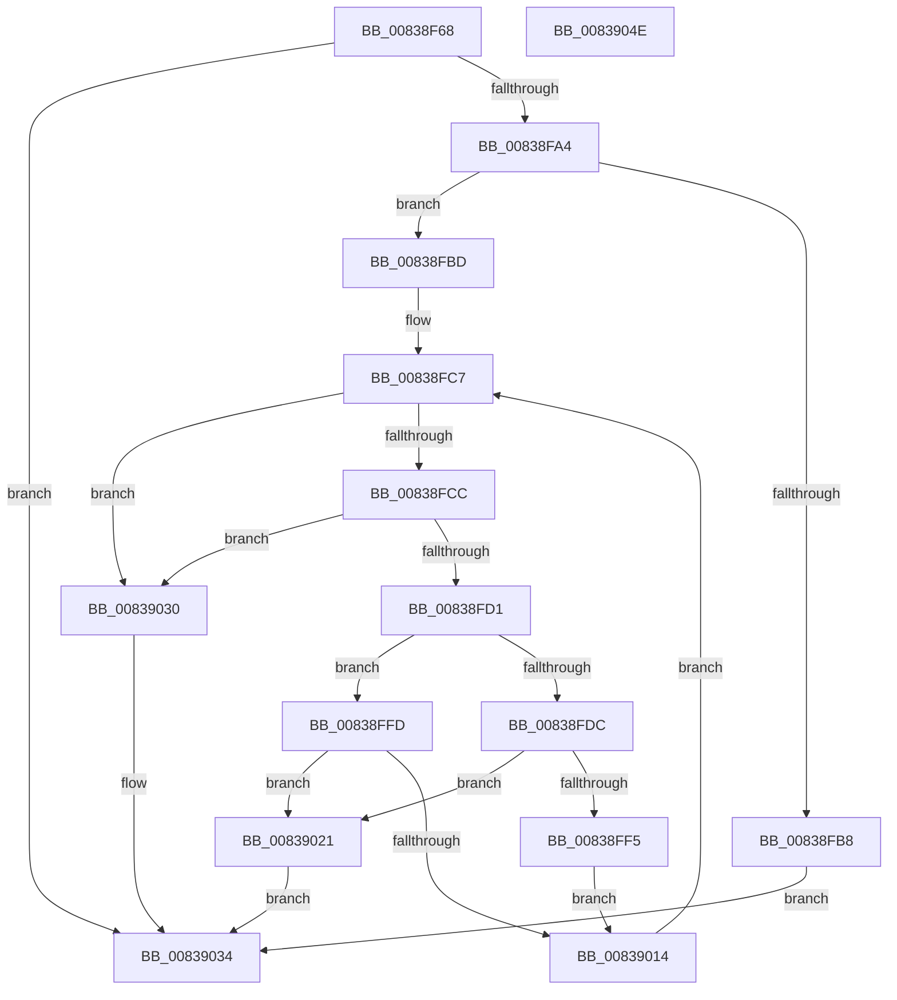

# MinAsn1ParseSignedDataCertificatesEx

- RVA: `0x00838F68`–`0x0083904F` (길이 `231` bytes)
- VA: `0x0000000140838F68`
- 실행 섹션: `PAGE`
- PDB 이름 있음: `예`; PDB Function 태그: `아니요`
- unwind 정보 RVA: `0x000CDF9C`
- 디코드: `83`개 명령, `231/231` bytes 표시
- 미해석 바이트: `0` (있으면 어셈블리에 `.byte`로 보존)

> 이 문서는 커널 이미지의 기계어와 PDB 기호를 분석해 생성했습니다. 4번과 5번은 함수 원형과 자료형을 바이너리 사용 방식에서 추정한 C 해석이며 원본 소스 복구 결과는 아닙니다.

## 1. Dependencies

- 직접 호출 지점: **3**; 고유 호출 대상: **2**
- 직접 호출자로 확인된 함수: **2**
- RIP 상대 이미지 참조: **0**

### Outgoing calls
- `0x00838FAF` → [MinAsn1ExtractContent](MinAsn1ExtractContent_function_0083A00C.md) (function, `0x0083A00C`)
- `0x00838FEA` → [MinAsn1ExtractContent](MinAsn1ExtractContent_function_0083A00C.md) (function, `0x0083A00C`)
- `0x00839009` → [MinAsn1ParseCertificate](MinAsn1ParseCertificate_function_00838D38.md) (function, `0x00838D38`)

### Direct callers
- [MinCrypK_VerifySignedDataKModeEx](MinCrypK_VerifySignedDataKModeEx_function_00838568.md) at `0x008386EB`
- [MinAsn1ExtractParsedCertificatesFromSignedData](MinAsn1ExtractParsedCertificatesFromSignedData_function_0083A0F4.md) at `0x0083A136`

### Static image references
- 디코드된 RIP-relative 메모리 참조가 없습니다.

## 2. Other-region calls and transfers

- 다른 실행 섹션으로 향하는 call: **0**
- 별도 외부 분기/꼬리 이동을 확인하지 못했습니다.

## 3. Assembly (complete function range)

```asm
00838F68  48 8B C4                        mov rax, rsp
00838F6B  48 89 58 10                     mov qword ptr [rax + 0x10], rbx
00838F6F  4C 89 48 20                     mov qword ptr [rax + 0x20], r9
00838F73  55                              push rbp
00838F74  56                              push rsi
00838F75  57                              push rdi
00838F76  41 54                           push r12
00838F78  41 55                           push r13
00838F7A  41 56                           push r14
00838F7C  41 57                           push r15
00838F7E  48 83 EC 20                     sub rsp, 0x20
00838F82  48 8B 69 08                     mov rbp, qword ptr [rcx + 8]
00838F86  33 DB                           xor ebx, ebx
00838F88  4C 8B FA                        mov r15, rdx
00838F8B  48 89 58 08                     mov qword ptr [rax + 8], rbx
00838F8F  8B 11                           mov edx, dword ptr [rcx]
00838F91  4D 8B E8                        mov r13, r8
00838F94  89 58 20                        mov dword ptr [rax + 0x20], ebx
00838F97  8B F3                           mov esi, ebx
00838F99  45 8B 27                        mov r12d, dword ptr [r15]
00838F9C  85 D2                           test edx, edx
00838F9E  0F 84 90 00 00 00               je 0x140839034
00838FA4  4C 8D 48 08                     lea r9, [rax + 8]
00838FA8  48 8B CD                        mov rcx, rbp
00838FAB  4C 8D 40 20                     lea r8, [rax + 0x20]
00838FAF  E8 58 10 00 00                  call 0x14083a00c
00838FB4  85 C0                           test eax, eax
00838FB6  7F 05                           jg 0x140838fbd
00838FB8  83 CB FF                        or ebx, 0xffffffff
00838FBB  EB 77                           jmp 0x140839034
00838FBD  48 8B 7C 24 60                  mov rdi, qword ptr [rsp + 0x60]
00838FC2  44 8B 74 24 78                  mov r14d, dword ptr [rsp + 0x78]
00838FC7  45 85 F6                        test r14d, r14d
00838FCA  74 64                           je 0x140839030
00838FCC  41 3B F4                        cmp esi, r12d
00838FCF  73 5F                           jae 0x140839030
00838FD1  80 3F 30                        cmp byte ptr [rdi], 0x30
00838FD4  41 8B D6                        mov edx, r14d
00838FD7  48 8B CF                        mov rcx, rdi
00838FDA  74 21                           je 0x140838ffd
00838FDC  4C 8D 4C 24 60                  lea r9, [rsp + 0x60]
00838FE1  89 5C 24 78                     mov dword ptr [rsp + 0x78], ebx
00838FE5  4C 8D 44 24 78                  lea r8, [rsp + 0x78]
00838FEA  E8 1D 10 00 00                  call 0x14083a00c
00838FEF  8B C8                           mov ecx, eax
00838FF1  85 C0                           test eax, eax
00838FF3  7E 2C                           jle 0x140839021
00838FF5  03 4C 24 78                     add ecx, dword ptr [rsp + 0x78]
00838FF9  FF CE                           dec esi
00838FFB  EB 17                           jmp 0x140839014
00838FFD  8B C6                           mov eax, esi
00838FFF  4C 69 C0 F0 00 00 00            imul r8, rax, 0xf0
00839006  4D 03 C5                        add r8, r13
00839009  E8 2A FD FF FF                  call 0x140838d38
0083900E  8B C8                           mov ecx, eax
00839010  85 C0                           test eax, eax
00839012  7E 0D                           jle 0x140839021
00839014  48 63 C1                        movsxd rax, ecx
00839017  44 2B F1                        sub r14d, ecx
0083901A  48 03 F8                        add rdi, rax
0083901D  FF C6                           inc esi
0083901F  EB A6                           jmp 0x140838fc7
00839021  83 C8 FF                        or eax, 0xffffffff
00839024  85 C9                           test ecx, ecx
00839026  0F 44 C8                        cmove ecx, eax
00839029  2B EF                           sub ebp, edi
0083902B  8D 1C 29                        lea ebx, [rcx + rbp]
0083902E  EB 04                           jmp 0x140839034
00839030  2B FD                           sub edi, ebp
00839032  8B DF                           mov ebx, edi
00839034  8B C3                           mov eax, ebx
00839036  41 89 37                        mov dword ptr [r15], esi
00839039  48 8B 5C 24 68                  mov rbx, qword ptr [rsp + 0x68]
0083903E  48 83 C4 20                     add rsp, 0x20
00839042  41 5F                           pop r15
00839044  41 5E                           pop r14
00839046  41 5D                           pop r13
00839048  41 5C                           pop r12
0083904A  5F                              pop rdi
0083904B  5E                              pop rsi
0083904C  5D                              pop rbp
0083904D  C3                              ret
0083904E  CC                              int3
```

## 4. C-style interpretation (structured pseudocode)

```c
__int64 __fastcall MinAsn1ParseSignedDataCertificatesEx(__int64 a1, __int64 a2, __int64 a3, __int64 a4)
{
    __int64 result;
    __int64 v_r14;
    __int64 v_rbp;
    __int64 v_rbx;
    __int64 v_rdi;
    __int64 v_rsi;
    __int64 v_rsp;
    unsigned __int64 v_stack_p10;
    unsigned int v_stack_p20;
    unsigned __int64 v_stack_p8;

    *(unsigned __int64 *)(v_rsp + 16) = v_rbx;
    *(unsigned __int64 *)(v_rsp + 32) = a4;
    v_rsp = (v_rsp) - (32);
    v_rbx = 0;
    *(unsigned __int64 *)(v_rsp + 8) = 0;
    *(unsigned int *)(v_rsp + 32) = 0;
    if ((unsigned int)((unsigned int)(*(unsigned int *)(a1))) == 0) goto loc_00839034;
    result = MinAsn1ExtractContent(*(unsigned __int64 *)(a1 + 8), (unsigned int)(*(unsigned int *)(a1)), v_rsp + 32, v_rsp + 8);
    if (condition_is_greater) goto loc_00838FBD;
    v_rbx = (unsigned int)((v_rbx) | (0xFFFFFFFFULL));
    goto loc_00839034;
loc_00838FBD:
loc_00838FC7:
    if ((unsigned int)((unsigned int)(v_stack_p20)) == 0) goto loc_00839030;
    if (0 >= ((unsigned int)((unsigned int)(*(unsigned int *)(a2))))) goto loc_00839030;
    if ((*(unsigned __int8 *)(v_stack_p8)) == 48) goto loc_00838FFD;
    v_stack_p20 = (unsigned int)(v_rbx);
    result = MinAsn1ExtractContent(v_stack_p8, (unsigned int)((unsigned int)((unsigned int)(v_stack_p20))), v_stack_p20, v_stack_p8);
    if (condition_is_less_or_equal) goto loc_00839021;
    a1 = (unsigned int)(((unsigned int)((unsigned int)(result))) + (v_stack_p20));
    v_rsi = (unsigned int)((0) - 1);
    goto loc_00839014;
loc_00838FFD:
    a3 = (v_stack_p20) * ((unsigned int)((unsigned int)(v_rsi)));
    a3 = (a3) + (a3);
    result = MinAsn1ParseCertificate(a1, (unsigned int)((unsigned int)((unsigned int)(v_stack_p20))), a3, v_stack_p8);
    if (condition_is_less_or_equal) goto loc_00839021;
loc_00839014:
    v_r14 = (unsigned int)(((unsigned int)(v_stack_p20)) - ((unsigned int)((unsigned int)((unsigned int)(result)))));
    v_rdi = (v_stack_p8) + ((int)((unsigned int)((unsigned int)((unsigned int)(result)))));
    v_rsi = (unsigned int)((v_rsi) + 1);
    goto loc_00838FC7;
loc_00839021:
    result = (unsigned int)(((int)((unsigned int)((unsigned int)((unsigned int)(result))))) | (0xFFFFFFFFULL));
    a1 = (unsigned int)((unsigned int)(result));
    if ((unsigned int)((unsigned int)((unsigned int)(result))) == 0) { a1 = (unsigned int)(result); }
    v_rbp = (unsigned int)((*(unsigned __int64 *)(a1 + 8)) - ((unsigned int)(v_rdi)));
    goto loc_00839034;
loc_00839030:
    v_rdi = (unsigned int)((v_rdi) - ((unsigned int)(v_rbp)));
loc_00839034:
    *(unsigned int *)(a2) = (unsigned int)(v_rsi);
    v_rsp = (v_rsp) + (32);
    return (unsigned int)((unsigned int)((unsigned int)((unsigned int)(v_rdi))));
}
```

## 5. (Beta) C Style

```c
int64_t MinAsn1ParseSignedDataCertificatesEx(void *Arg1, void *Arg2, int64_t Arg3, int64_t Arg4)
{
    uint8_t *arg1 = (uint8_t *)Arg1;
    uint8_t *arg2 = (uint8_t *)Arg2;

    int64_t result;
    int64_t local_r14;
    int64_t local_rbp;
    int64_t local_rbx;
    int64_t local_rdi;
    int64_t local_rsi;
    int64_t local_rsp;
    uint64_t v_stack_p10;
    uint32_t v_stack_p20;
    uint64_t v_stack_p8;

    *(uint64_t *)(local_rsp + 0x10) = local_rbx;
    *(uint64_t *)(local_rsp + 0x20) = Arg4;
    local_rsp = (local_rsp) - (32);
    local_rbx = 0;
    *(uint64_t *)(local_rsp + 0x8) = 0;
    *(uint32_t *)(local_rsp + 0x20) = 0;
    if ((uint32_t)((uint32_t)(*(uint32_t *)(arg1))) == 0) goto loc_00839034;
    result = MinAsn1ExtractContent(*(uint64_t *)(arg1 + 0x8), (uint32_t)(*(uint32_t *)(arg1)), local_rsp + 32, local_rsp + 8);
    if (condition_is_greater) goto loc_00838FBD;
    local_rbx = (uint32_t)((local_rbx) | (0xFFFFFFFFULL));
    goto loc_00839034;
loc_00838FBD:
loc_00838FC7:
    if ((uint32_t)((uint32_t)(v_stack_p20)) == 0) goto loc_00839030;
    if (0 >= ((uint32_t)((uint32_t)(*(uint32_t *)(arg2))))) goto loc_00839030;
    if ((*(uint8_t *)(v_stack_p8)) == 48) goto loc_00838FFD;
    v_stack_p20 = (uint32_t)(local_rbx);
    result = MinAsn1ExtractContent(v_stack_p8, (uint32_t)((uint32_t)((uint32_t)(v_stack_p20))), v_stack_p20, v_stack_p8);
    if (condition_is_less_or_equal) goto loc_00839021;
    Arg1 = (uint32_t)(((uint32_t)((uint32_t)(result))) + (v_stack_p20));
    local_rsi = (uint32_t)((0) - 1);
    goto loc_00839014;
loc_00838FFD:
    Arg3 = (v_stack_p20) * ((uint32_t)((uint32_t)(local_rsi)));
    Arg3 = (Arg3) + (Arg3);
    result = MinAsn1ParseCertificate(Arg1, (uint32_t)((uint32_t)((uint32_t)(v_stack_p20))), Arg3, v_stack_p8);
    if (condition_is_less_or_equal) goto loc_00839021;
loc_00839014:
    local_r14 = (uint32_t)(((uint32_t)(v_stack_p20)) - ((uint32_t)((uint32_t)((uint32_t)(result)))));
    local_rdi = (v_stack_p8) + ((int32_t)((uint32_t)((uint32_t)((uint32_t)(result)))));
    local_rsi = (uint32_t)((local_rsi) + 1);
    goto loc_00838FC7;
loc_00839021:
    result = (uint32_t)(((int32_t)((uint32_t)((uint32_t)((uint32_t)(result))))) | (0xFFFFFFFFULL));
    Arg1 = (uint32_t)((uint32_t)(result));
    if ((uint32_t)((uint32_t)((uint32_t)(result))) == 0) { Arg1 = (uint32_t)(result); }
    local_rbp = (uint32_t)((*(uint64_t *)(arg1 + 0x8)) - ((uint32_t)(local_rdi)));
    goto loc_00839034;
loc_00839030:
    local_rdi = (uint32_t)((local_rdi) - ((uint32_t)(local_rbp)));
loc_00839034:
    *(uint32_t *)(arg2) = (uint32_t)(local_rsi);
    local_rsp = (local_rsp) + (32);
    return (uint32_t)((uint32_t)((uint32_t)((uint32_t)(local_rdi))));
}
```

### 관측된 메모리 오프셋

구조체 형식이 확인되지 않은 접근은 인자 기준의 오프셋으로만 기록했습니다.

| 기준 인자 | 오프셋 표현 | 폭 (bit) | 접근 |
|---|---:|---:|---|
| `Arg1` | `+ 0x0` | `32` | `R` |
| `Arg1` | `+ 0x8` | `64` | `R` |
| `Arg2` | `+ 0x0` | `32` | `R` |
| `Arg2` | `+ 0x0` | `32` | `W` |

## 6. Execution-region graph

[열기: 2D/3D 그래프와 함수 탐색 컨트롤 패널](../../../control-panel.html?section=page&rva=0x00838F68&view=graph)

- 2D 그래프는 위에서 아래로 흐르고, 3D 그래프는 빈 공간을 드래그해 회전합니다. Shift+드래그는 이동, 휠은 확대·축소, 함수 노드 선택은 대상 보고서 이동입니다.

### Static fallback


