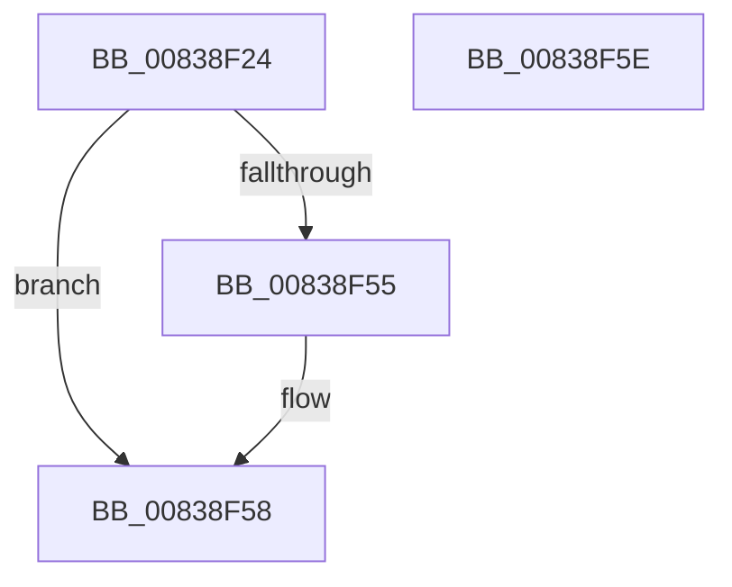

# MinAsn1ParseSignedData

- RVA: `0x00838F24`–`0x00838F5F` (길이 `59` bytes)
- VA: `0x0000000140838F24`
- 실행 섹션: `PAGE`
- PDB 이름 있음: `예`; PDB Function 태그: `아니요`
- unwind 정보 RVA: `0x000AA39C`
- 디코드: `17`개 명령, `59/59` bytes 표시
- 미해석 바이트: `0` (있으면 어셈블리에 `.byte`로 보존)

> 이 문서는 커널 이미지의 기계어와 PDB 기호를 분석해 생성했습니다. 4번과 5번은 함수 원형과 자료형을 바이너리 사용 방식에서 추정한 C 해석이며 원본 소스 복구 결과는 아닙니다.

## 1. Dependencies

- 직접 호출 지점: **1**; 고유 호출 대상: **1**
- 직접 호출자로 확인된 함수: **2**
- RIP 상대 이미지 참조: **1**

### Outgoing calls
- `0x00838F4C` → [MinAsn1ExtractValues](MinAsn1ExtractValues_function_0083A170.md) (function, `0x0083A170`)

### Direct callers
- [MinCrypK_VerifySignedDataKModeEx](MinCrypK_VerifySignedDataKModeEx_function_00838568.md) at `0x0083863C`
- [MinAsn1ExtractParsedCertificatesFromSignedData](MinAsn1ExtractParsedCertificatesFromSignedData_function_0083A0F4.md) at `0x0083A11F`

### Static image references
- `0x00838F3A` → RVA `0x0000D460` (`.rdata`; read)

## 2. Other-region calls and transfers

- 다른 실행 섹션으로 향하는 call: **0**
- 별도 외부 분기/꼬리 이동을 확인하지 못했습니다.

## 3. Assembly (complete function range)

```asm
00838F24  48 8B C4                        mov rax, rsp
00838F27  53                              push rbx
00838F28  48 83 EC 30                     sub rsp, 0x30
00838F2C  49 8B D8                        mov rbx, r8
00838F2F  C7 40 20 18 00 00 00            mov dword ptr [rax + 0x20], 0x18
00838F36  48 89 58 F0                     mov qword ptr [rax - 0x10], rbx
00838F3A  4C 8D 0D 1F 45 7D FF            lea r9, [rip - 0x82bae1]
00838F41  4C 8D 40 20                     lea r8, [rax + 0x20]
00838F45  C7 40 E8 13 00 00 00            mov dword ptr [rax - 0x18], 0x13
00838F4C  E8 1F 12 00 00                  call 0x14083a170
00838F51  85 C0                           test eax, eax
00838F53  7E 03                           jle 0x140838f58
00838F55  8B 43 10                        mov eax, dword ptr [rbx + 0x10]
00838F58  48 83 C4 30                     add rsp, 0x30
00838F5C  5B                              pop rbx
00838F5D  C3                              ret
00838F5E  CC                              int3
```

## 4. C-style interpretation (structured pseudocode)

```c
__int64 __fastcall MinAsn1ParseSignedData(__int64 a1, __int64 a2, __int64 a3)
{
    __int64 result;
    __int64 v_rsp;

    v_rsp = (v_rsp) - (48);
    *(unsigned int *)(v_rsp + 32) = 24;
    *(unsigned __int64 *)(v_rsp - 16) = a3;
    *(unsigned int *)(v_rsp - 24) = 19;
    result = MinAsn1ExtractValues(a1, a2, v_rsp + 32, v_rip - 8567521);
    if (!(condition_is_less_or_equal)) {
        result = *(unsigned int *)(a3 + 16);
    }
    v_rsp = (v_rsp) + (48);
    return result;
}
```

## 5. (Beta) C Style

```c
int64_t MinAsn1ParseSignedData(int64_t Arg1, int64_t Arg2, void *Arg3)
{
    uint8_t *arg3 = (uint8_t *)Arg3;

    int64_t result;
    int64_t local_rsp;

    local_rsp = (local_rsp) - (48);
    *(uint32_t *)(local_rsp + 0x20) = 24;
    *(void **)(local_rsp - 0x10) = Arg3;
    *(uint32_t *)(local_rsp - 0x18) = 19;
    result = MinAsn1ExtractValues(Arg1, Arg2, local_rsp + 32, v_rip - 8567521);
    if (!(condition_is_less_or_equal)) {
        result = *(uint32_t *)(arg3 + 0x10);
    }
    local_rsp = (local_rsp) + (48);
    return result;
}
```

### 관측된 메모리 오프셋

구조체 형식이 확인되지 않은 접근은 인자 기준의 오프셋으로만 기록했습니다.

| 기준 인자 | 오프셋 표현 | 폭 (bit) | 접근 |
|---|---:|---:|---|
| `Arg3` | `+ 0x10` | `32` | `R` |

## 6. Execution-region graph

[열기: 2D/3D 그래프와 함수 탐색 컨트롤 패널](../../../control-panel.html?section=page&rva=0x00838F24&view=graph)

- 2D 그래프는 위에서 아래로 흐르고, 3D 그래프는 빈 공간을 드래그해 회전합니다. Shift+드래그는 이동, 휠은 확대·축소, 함수 노드 선택은 대상 보고서 이동입니다.

### Static fallback


