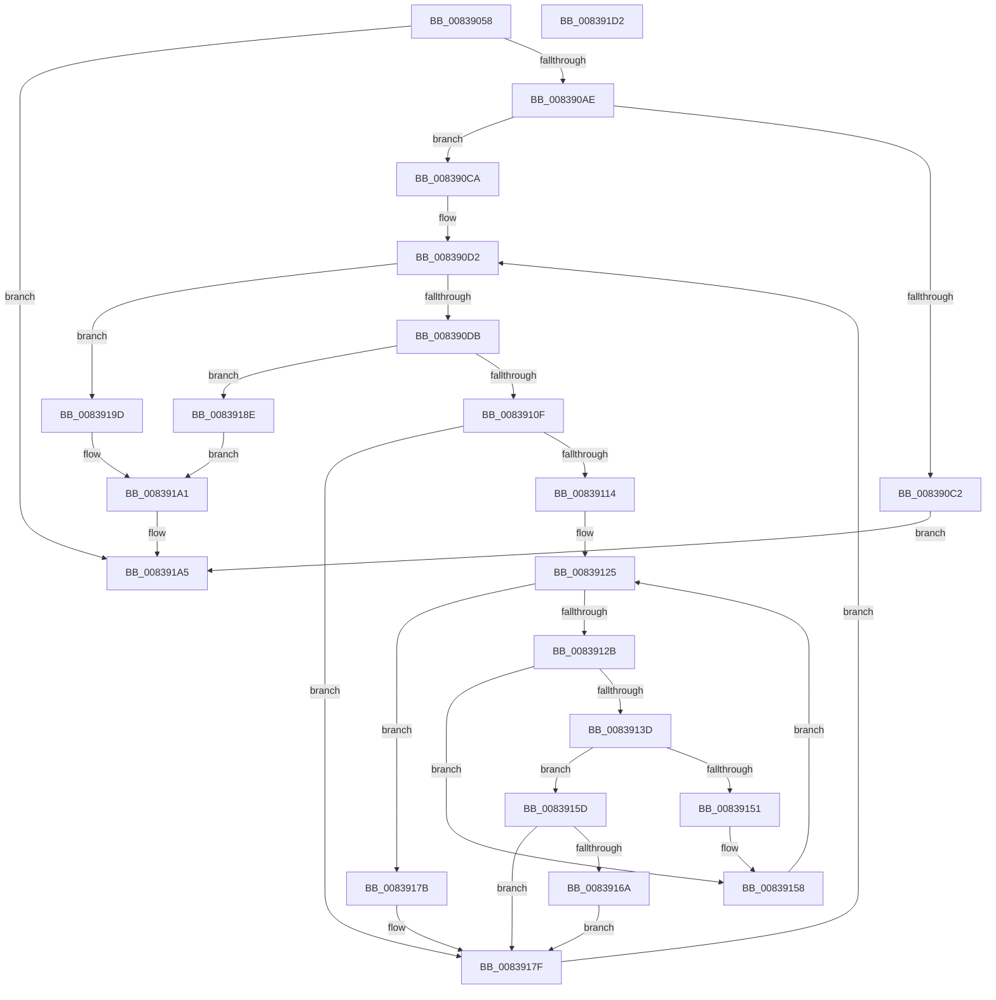

# MinAsn1ParseSingleExtensionValue

- RVA: `0x00839058`–`0x008391D3` (길이 `379` bytes)
- VA: `0x0000000140839058`
- 실행 섹션: `PAGE`
- PDB 이름 있음: `예`; PDB Function 태그: `아니요`
- unwind 정보 RVA: `0x000B8EA4`
- 디코드: `113`개 명령, `379/379` bytes 표시
- 미해석 바이트: `0` (있으면 어셈블리에 `.byte`로 보존)

> 이 문서는 커널 이미지의 기계어와 PDB 기호를 분석해 생성했습니다. 4번과 5번은 함수 원형과 자료형을 바이너리 사용 방식에서 추정한 C 해석이며 원본 소스 복구 결과는 아닙니다.

## 1. Dependencies

- 직접 호출 지점: **4**; 고유 호출 대상: **4**
- 직접 호출자로 확인된 함수: **3**
- RIP 상대 이미지 참조: **2**

### Outgoing calls
- `0x008390B9` → [MinAsn1ExtractContent](MinAsn1ExtractContent_function_0083A00C.md) (function, `0x0083A00C`)
- `0x00839104` → [MinAsn1ExtractValues](MinAsn1ExtractValues_function_0083A170.md) (function, `0x0083A170`)
- `0x00839148` → [memcmp](../../text/6C/memcmp_function_006C6B10.md) (function, `0x006C6B10`)
- `0x008391B2` → [_security_check_cookie](../../text/6A/_security_check_cookie_function_006AC640.md) (function, `0x006AC640`)

### Direct callers
- [I_MinCryptGetCertificateEKUs](I_MinCryptGetCertificateEKUs_function_008367D0.md) at `0x0083680E`
- [MinCryptParseRevocationList](MinCryptParseRevocationList_function_008377D0.md) at `0x0083781E`
- [MinCryptParseRevocationList](MinCryptParseRevocationList_function_008377D0.md) at `0x00837870`
- [MinCryptParseRevocationList](MinCryptParseRevocationList_function_008377D0.md) at `0x008378FB`
- [MincryptValidateBasicConstraints](MincryptValidateBasicConstraints_function_00837B84.md) at `0x00837BF4`

### Static image references
- `0x00839074` → RVA `0x00E0A740` (`.data`; read)
- `0x008390EB` → RVA `0x0000D3B0` (`.rdata`; read)

## 2. Other-region calls and transfers

- 다른 실행 섹션으로 향하는 call: **2**
  - `0x00839148` → [memcmp](../../text/6C/memcmp_function_006C6B10.md) (`PAGE` → `.text`)
  - `0x008391B2` → [_security_check_cookie](../../text/6A/_security_check_cookie_function_006AC640.md) (`PAGE` → `.text`)
- 별도 외부 분기/꼬리 이동을 확인하지 못했습니다.

## 3. Assembly (complete function range)

```asm
00839058  48 89 5C 24 08                  mov qword ptr [rsp + 8], rbx
0083905D  55                              push rbp
0083905E  56                              push rsi
0083905F  57                              push rdi
00839060  41 54                           push r12
00839062  41 55                           push r13
00839064  41 56                           push r14
00839066  41 57                           push r15
00839068  48 8D 6C 24 D9                  lea rbp, [rsp - 0x27]
0083906D  48 81 EC C0 00 00 00            sub rsp, 0xc0
00839074  48 8B 05 C5 16 5D 00            mov rax, qword ptr [rip + 0x5d16c5]
0083907B  48 33 C4                        xor rax, rsp
0083907E  48 89 45 17                     mov qword ptr [rbp + 0x17], rax
00839082  48 8B 72 08                     mov rsi, qword ptr [rdx + 8]
00839086  33 DB                           xor ebx, ebx
00839088  8B 12                           mov edx, dword ptr [rdx]
0083908A  4D 8B E0                        mov r12, r8
0083908D  4C 89 4D B7                     mov qword ptr [rbp - 0x49], r9
00839091  4C 8B F1                        mov r14, rcx
00839094  4C 89 45 AF                     mov qword ptr [rbp - 0x51], r8
00839098  44 8A EB                        mov r13b, bl
0083909B  48 89 4D A7                     mov qword ptr [rbp - 0x59], rcx
0083909F  48 89 5D 9F                     mov qword ptr [rbp - 0x61], rbx
008390A3  89 5D 97                        mov dword ptr [rbp - 0x69], ebx
008390A6  85 D2                           test edx, edx
008390A8  0F 84 F7 00 00 00               je 0x1408391a5
008390AE  4C 8D 4D 9F                     lea r9, [rbp - 0x61]
008390B2  48 8B CE                        mov rcx, rsi
008390B5  4C 8D 45 97                     lea r8, [rbp - 0x69]
008390B9  E8 4E 0F 00 00                  call 0x14083a00c
008390BE  85 C0                           test eax, eax
008390C0  7F 08                           jg 0x1408390ca
008390C2  83 CB FF                        or ebx, 0xffffffff
008390C5  E9 DB 00 00 00                  jmp 0x1408391a5
008390CA  48 8B 7D 9F                     mov rdi, qword ptr [rbp - 0x61]
008390CE  44 8B 7D 97                     mov r15d, dword ptr [rbp - 0x69]
008390D2  45 85 FF                        test r15d, r15d
008390D5  0F 84 C2 00 00 00               je 0x14083919d
008390DB  48 8D 45 C7                     lea rax, [rbp - 0x39]
008390DF  C7 45 97 04 00 00 00            mov dword ptr [rbp - 0x69], 4
008390E6  48 89 44 24 28                  mov qword ptr [rsp + 0x28], rax
008390EB  4C 8D 0D BE 42 7D FF            lea r9, [rip - 0x82bd42]
008390F2  4C 8D 45 97                     lea r8, [rbp - 0x69]
008390F6  C7 44 24 20 05 00 00 00         mov dword ptr [rsp + 0x20], 5
008390FE  41 8B D7                        mov edx, r15d
00839101  48 8B CF                        mov rcx, rdi
00839104  E8 67 10 00 00                  call 0x14083a170
00839109  8B C8                           mov ecx, eax
0083910B  85 C0                           test eax, eax
0083910D  7E 7F                           jle 0x14083918e
0083910F  45 84 ED                        test r13b, r13b
00839112  75 6B                           jne 0x14083917f
00839114  4D 8B 4E 08                     mov r9, qword ptr [r14 + 8]
00839118  41 8B 0E                        mov ecx, dword ptr [r14]
0083911B  44 8B F3                        mov r14d, ebx
0083911E  4C 89 4D 9F                     mov qword ptr [rbp - 0x61], r9
00839122  89 4D 97                        mov dword ptr [rbp - 0x69], ecx
00839125  41 83 FE 01                     cmp r14d, 1
00839129  73 50                           jae 0x14083917b
0083912B  41 8B C6                        mov eax, r14d
0083912E  4C 8D 24 80                     lea r12, [rax + rax*4]
00839132  49 C1 E4 04                     shl r12, 4
00839136  42 3B 4C 25 E7                  cmp ecx, dword ptr [rbp + r12 - 0x19]
0083913B  75 1B                           jne 0x140839158
0083913D  4A 8B 54 25 EF                  mov rdx, qword ptr [rbp + r12 - 0x11]
00839142  44 8B C1                        mov r8d, ecx
00839145  49 8B C9                        mov rcx, r9
00839148  E8 C3 D9 E8 FF                  call 0x1406c6b10
0083914D  85 C0                           test eax, eax
0083914F  74 0C                           je 0x14083915d
00839151  8B 4D 97                        mov ecx, dword ptr [rbp - 0x69]
00839154  4C 8B 4D 9F                     mov r9, qword ptr [rbp - 0x61]
00839158  41 FF C6                        inc r14d
0083915B  EB C8                           jmp 0x140839125
0083915D  4C 8B 75 A7                     mov r14, qword ptr [rbp - 0x59]
00839161  48 8D 45 C7                     lea rax, [rbp - 0x39]
00839165  49 03 C4                        add rax, r12
00839168  74 15                           je 0x14083917f
0083916A  48 8B 45 B7                     mov rax, qword ptr [rbp - 0x49]
0083916E  41 B5 01                        mov r13b, 1
00839171  0F 28 45 07                     movaps xmm0, xmmword ptr [rbp + 7]
00839175  F3 0F 7F 00                     movdqu xmmword ptr [rax], xmm0
00839179  EB 04                           jmp 0x14083917f
0083917B  4C 8B 75 A7                     mov r14, qword ptr [rbp - 0x59]
0083917F  8B 45 D7                        mov eax, dword ptr [rbp - 0x29]
00839182  48 03 F8                        add rdi, rax
00839185  44 2B 7D D7                     sub r15d, dword ptr [rbp - 0x29]
00839189  E9 44 FF FF FF                  jmp 0x1408390d2
0083918E  83 C8 FF                        or eax, 0xffffffff
00839191  85 C9                           test ecx, ecx
00839193  0F 44 C8                        cmove ecx, eax
00839196  2B F7                           sub esi, edi
00839198  8D 1C 31                        lea ebx, [rcx + rsi]
0083919B  EB 04                           jmp 0x1408391a1
0083919D  2B FE                           sub edi, esi
0083919F  8B DF                           mov ebx, edi
008391A1  4C 8B 65 AF                     mov r12, qword ptr [rbp - 0x51]
008391A5  45 88 2C 24                     mov byte ptr [r12], r13b
008391A9  8B C3                           mov eax, ebx
008391AB  48 8B 4D 17                     mov rcx, qword ptr [rbp + 0x17]
008391AF  48 33 CC                        xor rcx, rsp
008391B2  E8 89 34 E7 FF                  call 0x1406ac640
008391B7  48 8B 9C 24 00 01 00 00         mov rbx, qword ptr [rsp + 0x100]
008391BF  48 81 C4 C0 00 00 00            add rsp, 0xc0
008391C6  41 5F                           pop r15
008391C8  41 5E                           pop r14
008391CA  41 5D                           pop r13
008391CC  41 5C                           pop r12
008391CE  5F                              pop rdi
008391CF  5E                              pop rsi
008391D0  5D                              pop rbp
008391D1  C3                              ret
008391D2  CC                              int3
```

## 4. C-style interpretation (structured pseudocode)

```c
__int64 __fastcall MinAsn1ParseSingleExtensionValue(__int64 a1, __int64 a2, __int64 a3, __int64 a4)
{
    __int64 result;
    __int64 v_r12;
    __int64 v_r14;
    __int64 v_r15;
    __int64 v_rbx;
    __int64 v_rdi;
    __int64 v_rsi;
    __int64 v_rsp;
    unsigned __int64 v_stack_m48;
    unsigned __int64 v_stack_m58;
    unsigned __int64 v_stack_m5F;
    unsigned int v_stack_m88;
    unsigned __int64 v_stack_m98;
    unsigned __int64 v_stack_mA8;
    unsigned __int64 v_stack_mB0;
    unsigned __int64 v_stack_mB8;
    unsigned __int64 v_stack_mC0;
    unsigned int v_stack_mC8;
    unsigned __int64 v_stack_mD0;
    unsigned int v_stack_mD8;
    unsigned __int64 v_stack_p8;

    v_stack_p8 = v_rbx;
    v_rsp = (v_rsp) - (192);
    result = (*(unsigned __int64 *)(v_rip + 6100677)) ^ (v_rsp);
    v_stack_m48 = result;
    v_rbx = 0;
    v_stack_mA8 = a4;
    v_stack_mB0 = a3;
    v_stack_mB8 = a1;
    v_stack_mC0 = 0;
    v_stack_mC8 = 0;
    if ((unsigned int)((unsigned int)(*(unsigned int *)(a2))) == 0) goto loc_008391A5;
    result = MinAsn1ExtractContent(*(unsigned __int64 *)(a2 + 8), (unsigned int)(*(unsigned int *)(a2)), v_stack_mC8, v_stack_mC0);
    if (condition_is_greater) goto loc_008390CA;
    v_rbx = (unsigned int)((v_rbx) | (0xFFFFFFFFULL));
    goto loc_008391A5;
loc_008390CA:
loc_008390D2:
    if ((unsigned int)((unsigned int)(v_stack_mC8)) == 0) goto loc_0083919D;
    v_stack_mC8 = 4;
    v_stack_mD0 = v_stack_m98;
    v_stack_mD8 = 5;
    result = MinAsn1ExtractValues(v_stack_mC0, (unsigned int)((unsigned int)((unsigned int)(v_stack_mC8))), v_stack_mC8, v_rip - 8568130);
    if (condition_is_less_or_equal) goto loc_0083918E;
    if (0 != 0) goto loc_0083917F;
    v_stack_mC0 = *(unsigned __int64 *)(a1 + 8);
    v_stack_mC8 = (unsigned int)((unsigned int)(*(unsigned int *)(a1)));
loc_00839125:
    if (((unsigned int)((unsigned int)((unsigned int)(v_rbx)))) >= 1) goto loc_0083917B;
    v_r12 = ((unsigned int)((unsigned int)((unsigned int)((unsigned int)(v_rbx)))) + (unsigned int)((unsigned int)((unsigned int)((unsigned int)(v_rbx)))) * 4) << (4);
    if (((unsigned int)((unsigned int)(*(unsigned int *)(a1)))) != (*(unsigned int *)(v_stack_m5F + v_r12 * 1 - 25))) goto loc_00839158;
    result = memcmp(*(unsigned __int64 *)(a1 + 8), *(unsigned __int64 *)(v_stack_m5F + v_r12 * 1 - 17), (unsigned int)((unsigned int)((unsigned int)(*(unsigned int *)(a1)))), *(unsigned __int64 *)(a1 + 8));
    if ((unsigned int)(result) == 0) goto loc_0083915D;
loc_00839158:
    v_r14 = (unsigned int)(((unsigned int)((unsigned int)(v_rbx))) + 1);
    goto loc_00839125;
loc_0083915D:
    result = (v_stack_m98) + (v_r12);
    if (condition_is_equal) goto loc_0083917F;
    *(unsigned __int64 *)(v_stack_mA8) = v_xmm0;
    goto loc_0083917F;
loc_0083917B:
loc_0083917F:
    v_rdi = (v_stack_mC0) + ((unsigned int)(v_stack_m88));
    v_r15 = (unsigned int)(((unsigned int)(v_stack_mC8)) - (v_stack_m88));
    goto loc_008390D2;
loc_0083918E:
    result = (unsigned int)(((unsigned int)(v_stack_m88)) | (0xFFFFFFFFULL));
    a1 = (unsigned int)(v_stack_mC8);
    if ((unsigned int)((unsigned int)(v_stack_mC8)) == 0) { a1 = (unsigned int)(result); }
    v_rsi = (unsigned int)((*(unsigned __int64 *)(a2 + 8)) - ((unsigned int)(v_rdi)));
    goto loc_008391A1;
loc_0083919D:
    v_rdi = (unsigned int)((v_rdi) - ((unsigned int)(v_rsi)));
loc_008391A1:
loc_008391A5:
    *(unsigned __int8 *)(v_stack_mB0) = 1;
    a1 = (v_stack_m48) ^ (v_rsp);
    result = _security_check_cookie(a1, *(unsigned __int64 *)(v_stack_m5F + v_r12 * 1 - 17), (unsigned int)((unsigned int)((unsigned int)(*(unsigned int *)(a1)))), v_stack_mC0);
    v_rsp = (v_rsp) + (192);
    return result;
}
```

## 5. (Beta) C Style

```c
int64_t MinAsn1ParseSingleExtensionValue(int64_t Arg1, void *Arg2, int64_t Arg3, int64_t Arg4)
{
    uint8_t *arg2 = (uint8_t *)Arg2;

    int64_t result;
    int64_t local_r12;
    int64_t local_r14;
    int64_t local_r15;
    int64_t local_rbx;
    int64_t local_rdi;
    int64_t local_rsi;
    int64_t local_rsp;
    uint64_t v_stack_m48;
    uint64_t v_stack_m58;
    uint64_t v_stack_m5F;
    uint32_t v_stack_m88;
    uint64_t v_stack_m98;
    uint64_t v_stack_mA8;
    uint64_t v_stack_mB0;
    uint64_t v_stack_mB8;
    uint64_t v_stack_mC0;
    uint32_t v_stack_mC8;
    uint64_t v_stack_mD0;
    uint32_t v_stack_mD8;
    uint64_t v_stack_p8;

    v_stack_p8 = local_rbx;
    local_rsp = (local_rsp) - (192);
    result = (*(uint64_t *)(v_rip + 0x5D16C5)) ^ (local_rsp);
    v_stack_m48 = result;
    local_rbx = 0;
    v_stack_mA8 = Arg4;
    v_stack_mB0 = Arg3;
    v_stack_mB8 = Arg1;
    v_stack_mC0 = 0;
    v_stack_mC8 = 0;
    if ((uint32_t)((uint32_t)(*(uint32_t *)(arg2))) == 0) goto loc_008391A5;
    result = MinAsn1ExtractContent(*(uint64_t *)(arg2 + 0x8), (uint32_t)(*(uint32_t *)(arg2)), v_stack_mC8, v_stack_mC0);
    if (condition_is_greater) goto loc_008390CA;
    local_rbx = (uint32_t)((local_rbx) | (0xFFFFFFFFULL));
    goto loc_008391A5;
loc_008390CA:
loc_008390D2:
    if ((uint32_t)((uint32_t)(v_stack_mC8)) == 0) goto loc_0083919D;
    v_stack_mC8 = 4;
    v_stack_mD0 = v_stack_m98;
    v_stack_mD8 = 5;
    result = MinAsn1ExtractValues(v_stack_mC0, (uint32_t)((uint32_t)((uint32_t)(v_stack_mC8))), v_stack_mC8, v_rip - 8568130);
    if (condition_is_less_or_equal) goto loc_0083918E;
    if (0 != 0) goto loc_0083917F;
    v_stack_mC0 = *(uint64_t *)(Arg1 + 0x8);
    v_stack_mC8 = (uint32_t)((uint32_t)(*(uint32_t *)(Arg1)));
loc_00839125:
    if (((uint32_t)((uint32_t)((uint32_t)(local_rbx)))) >= 1) goto loc_0083917B;
    local_r12 = ((uint32_t)((uint32_t)((uint32_t)((uint32_t)(local_rbx)))) + (uint32_t)((uint32_t)((uint32_t)((uint32_t)(local_rbx)))) * 4) << (4);
    if (((uint32_t)((uint32_t)(*(uint32_t *)(Arg1)))) != (*(uint32_t *)(v_stack_m5F + local_r12 * 1 - 0x19))) goto loc_00839158;
    result = memcmp(*(uint64_t *)(Arg1 + 0x8), *(uint64_t *)(v_stack_m5F + local_r12 * 1 - 0x11), (uint32_t)((uint32_t)((uint32_t)(*(uint32_t *)(Arg1)))), *(uint64_t *)(Arg1 + 0x8));
    if ((uint32_t)(result) == 0) goto loc_0083915D;
loc_00839158:
    local_r14 = (uint32_t)(((uint32_t)((uint32_t)(local_rbx))) + 1);
    goto loc_00839125;
loc_0083915D:
    result = (v_stack_m98) + (local_r12);
    if (condition_is_equal) goto loc_0083917F;
    *(uint64_t *)(v_stack_mA8) = v_xmm0;
    goto loc_0083917F;
loc_0083917B:
loc_0083917F:
    local_rdi = (v_stack_mC0) + ((uint32_t)(v_stack_m88));
    local_r15 = (uint32_t)(((uint32_t)(v_stack_mC8)) - (v_stack_m88));
    goto loc_008390D2;
loc_0083918E:
    result = (uint32_t)(((uint32_t)(v_stack_m88)) | (0xFFFFFFFFULL));
    Arg1 = (uint32_t)(v_stack_mC8);
    if ((uint32_t)((uint32_t)(v_stack_mC8)) == 0) { Arg1 = (uint32_t)(result); }
    local_rsi = (uint32_t)((*(uint64_t *)(arg2 + 0x8)) - ((uint32_t)(local_rdi)));
    goto loc_008391A1;
loc_0083919D:
    local_rdi = (uint32_t)((local_rdi) - ((uint32_t)(local_rsi)));
loc_008391A1:
loc_008391A5:
    *(uint8_t *)(v_stack_mB0) = 1;
    Arg1 = (v_stack_m48) ^ (local_rsp);
    result = _security_check_cookie(Arg1, *(uint64_t *)(v_stack_m5F + local_r12 * 1 - 0x11), (uint32_t)((uint32_t)((uint32_t)(*(uint32_t *)(Arg1)))), v_stack_mC0);
    local_rsp = (local_rsp) + (192);
    return result;
}
```

### 관측된 메모리 오프셋

구조체 형식이 확인되지 않은 접근은 인자 기준의 오프셋으로만 기록했습니다.

| 기준 인자 | 오프셋 표현 | 폭 (bit) | 접근 |
|---|---:|---:|---|
| `Arg2` | `+ 0x0` | `32` | `R` |
| `Arg2` | `+ 0x8` | `64` | `R` |

## 6. Execution-region graph

[열기: 2D/3D 그래프와 함수 탐색 컨트롤 패널](../../../control-panel.html?section=page&rva=0x00839058&view=graph)

- 2D 그래프는 위에서 아래로 흐르고, 3D 그래프는 빈 공간을 드래그해 회전합니다. Shift+드래그는 이동, 휠은 확대·축소, 함수 노드 선택은 대상 보고서 이동입니다.

### Static fallback


