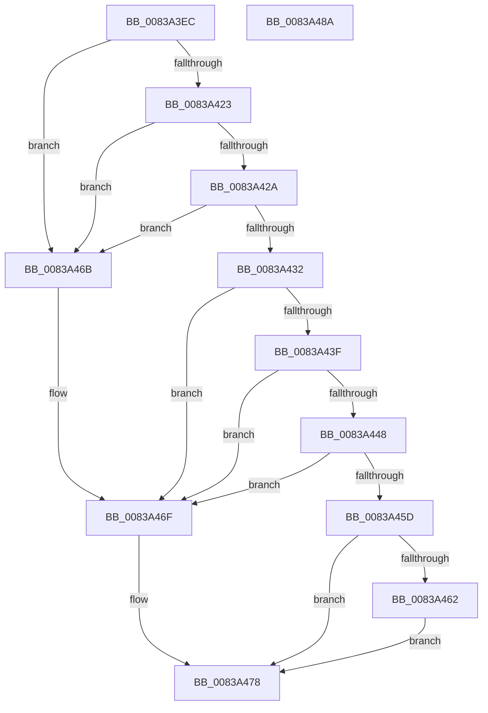

# MinAsn1SignedDataGetContent

- RVA: `0x0083A3EC`–`0x0083A48B` (길이 `159` bytes)
- VA: `0x000000014083A3EC`
- 실행 섹션: `PAGE`
- PDB 이름 있음: `예`; PDB Function 태그: `아니요`
- unwind 정보 RVA: `0x000C4368`
- 디코드: `51`개 명령, `159/159` bytes 표시
- 미해석 바이트: `0` (있으면 어셈블리에 `.byte`로 보존)

> 이 문서는 커널 이미지의 기계어와 PDB 기호를 분석해 생성했습니다. 4번과 5번은 함수 원형과 자료형을 바이너리 사용 방식에서 추정한 C 해석이며 원본 소스 복구 결과는 아닙니다.

## 1. Dependencies

- 직접 호출 지점: **2**; 고유 호출 대상: **2**
- 직접 호출자로 확인된 함수: **1**
- RIP 상대 이미지 참조: **0**

### Outgoing calls
- `0x0083A41A` → [MinAsn1DecodeInteger](MinAsn1DecodeInteger_function_00839DD0.md) (function, `0x00839DD0`)
- `0x0083A44F` → [MinAsn1ExtractContent](MinAsn1ExtractContent_function_0083A00C.md) (function, `0x0083A00C`)

### Direct callers
- [MinCrypK_VerifySignedDataKModeEx](MinCrypK_VerifySignedDataKModeEx_function_00838568.md) at `0x008386BD`

### Static image references
- 디코드된 RIP-relative 메모리 참조가 없습니다.

## 2. Other-region calls and transfers

- 다른 실행 섹션으로 향하는 call: **0**
- 별도 외부 분기/꼬리 이동을 확인하지 못했습니다.

## 3. Assembly (complete function range)

```asm
0083A3EC  48 8B C4                        mov rax, rsp
0083A3EF  48 89 58 10                     mov qword ptr [rax + 0x10], rbx
0083A3F3  48 89 70 20                     mov qword ptr [rax + 0x20], rsi
0083A3F7  57                              push rdi
0083A3F8  48 83 EC 20                     sub rsp, 0x20
0083A3FC  48 83 60 18 00                  and qword ptr [rax + 0x18], 0
0083A401  4C 8D 48 08                     lea r9, [rax + 8]
0083A405  48 8B FA                        mov rdi, rdx
0083A408  C6 40 08 00                     mov byte ptr [rax + 8], 0
0083A40C  8B 51 30                        mov edx, dword ptr [rcx + 0x30]
0083A40F  4C 8D 40 18                     lea r8, [rax + 0x18]
0083A413  48 8B D9                        mov rbx, rcx
0083A416  48 8B 49 38                     mov rcx, qword ptr [rcx + 0x38]
0083A41A  E8 B1 F9 FF FF                  call 0x140839dd0
0083A41F  85 C0                           test eax, eax
0083A421  7E 48                           jle 0x14083a46b
0083A423  80 7C 24 30 00                  cmp byte ptr [rsp + 0x30], 0
0083A428  75 41                           jne 0x14083a46b
0083A42A  48 83 7C 24 40 03               cmp qword ptr [rsp + 0x40], 3
0083A430  72 39                           jb 0x14083a46b
0083A432  48 8D 73 60                     lea rsi, [rbx + 0x60]
0083A436  8B 16                           mov edx, dword ptr [rsi]
0083A438  48 8B C6                        mov rax, rsi
0083A43B  85 D2                           test edx, edx
0083A43D  74 30                           je 0x14083a46f
0083A43F  48 8B 4B 68                     mov rcx, qword ptr [rbx + 0x68]
0083A443  80 39 04                        cmp byte ptr [rcx], 4
0083A446  75 27                           jne 0x14083a46f
0083A448  4C 8D 4F 08                     lea r9, [rdi + 8]
0083A44C  4C 8B C7                        mov r8, rdi
0083A44F  E8 B8 FB FF FF                  call 0x14083a00c
0083A454  8B C8                           mov ecx, eax
0083A456  48 8B C6                        mov rax, rsi
0083A459  85 C9                           test ecx, ecx
0083A45B  7E 12                           jle 0x14083a46f
0083A45D  83 3F 00                        cmp dword ptr [rdi], 0
0083A460  75 16                           jne 0x14083a478
0083A462  48 83 67 08 00                  and qword ptr [rdi + 8], 0
0083A467  33 C9                           xor ecx, ecx
0083A469  EB 0D                           jmp 0x14083a478
0083A46B  48 8D 43 60                     lea rax, [rbx + 0x60]
0083A46F  0F 10 00                        movups xmm0, xmmword ptr [rax]
0083A472  F3 0F 7F 07                     movdqu xmmword ptr [rdi], xmm0
0083A476  8B 0F                           mov ecx, dword ptr [rdi]
0083A478  48 8B 5C 24 38                  mov rbx, qword ptr [rsp + 0x38]
0083A47D  8B C1                           mov eax, ecx
0083A47F  48 8B 74 24 48                  mov rsi, qword ptr [rsp + 0x48]
0083A484  48 83 C4 20                     add rsp, 0x20
0083A488  5F                              pop rdi
0083A489  C3                              ret
0083A48A  CC                              int3
```

## 4. C-style interpretation (structured pseudocode)

```c
__int64 __fastcall MinAsn1SignedDataGetContent(__int64 a1, __int64 a2)
{
    __int64 result;
    __int64 v_rsp;
    unsigned __int64 v_stack_p10;
    unsigned __int64 v_stack_p18;
    unsigned __int64 v_stack_p20;
    unsigned __int8 v_stack_p8;

    *(unsigned __int64 *)(v_rsp + 16) = v_rbx;
    *(unsigned __int64 *)(v_rsp + 32) = v_rsi;
    v_rsp = (v_rsp) - (32);
    *(unsigned __int8 *)(v_rsp + 8) = 0;
    result = MinAsn1DecodeInteger(*(unsigned __int64 *)(a1 + 56), (unsigned int)(*(unsigned int *)(a1 + 48)), v_rsp + 24, v_rsp + 8);
    if (condition_is_less_or_equal) goto loc_0083A46B;
    if (v_stack_p8 != 0) goto loc_0083A46B;
    if (v_stack_p18 < 3) goto loc_0083A46B;
    if ((unsigned int)((unsigned int)(*(unsigned int *)(a1 + 96))) == 0) goto loc_0083A46F;
    if ((*(unsigned __int8 *)(*(unsigned __int64 *)(a1 + 104))) != 4) goto loc_0083A46F;
    result = MinAsn1ExtractContent(*(unsigned __int64 *)(a1 + 104), (unsigned int)(*(unsigned int *)(a1 + 96)), a2, a2 + 8);
    if (condition_is_less_or_equal) goto loc_0083A46F;
    if ((*(unsigned int *)(a2)) != 0) goto loc_0083A478;
    a1 = 0;
    goto loc_0083A478;
loc_0083A46B:
loc_0083A46F:
    *(unsigned __int64 *)(a2) = v_xmm0;
loc_0083A478:
    v_rsp = (v_rsp) + (32);
    return (unsigned int)((unsigned int)((unsigned int)(*(unsigned int *)(a2))));
}
```

## 5. (Beta) C Style

```c
int64_t MinAsn1SignedDataGetContent(void *Arg1, void *Arg2)
{
    uint8_t *arg1 = (uint8_t *)Arg1;
    uint8_t *arg2 = (uint8_t *)Arg2;

    int64_t result;
    int64_t local_rsp;
    uint64_t v_stack_p10;
    uint64_t v_stack_p18;
    uint64_t v_stack_p20;
    uint8_t v_stack_p8;

    *(uint64_t *)(local_rsp + 0x10) = local_rbx;
    *(uint64_t *)(local_rsp + 0x20) = local_rsi;
    local_rsp = (local_rsp) - (32);
    *(uint8_t *)(local_rsp + 0x8) = 0;
    result = MinAsn1DecodeInteger(*(uint64_t *)(arg1 + 0x38), (uint32_t)(*(uint32_t *)(arg1 + 0x30)), local_rsp + 24, local_rsp + 8);
    if (condition_is_less_or_equal) goto loc_0083A46B;
    if (v_stack_p8 != 0) goto loc_0083A46B;
    if (v_stack_p18 < 3) goto loc_0083A46B;
    if ((uint32_t)((uint32_t)(*(uint32_t *)(arg1 + 0x60))) == 0) goto loc_0083A46F;
    if ((*(uint8_t *)(*(uint64_t *)(arg1 + 0x68))) != 4) goto loc_0083A46F;
    result = MinAsn1ExtractContent(*(uint64_t *)(arg1 + 0x68), (uint32_t)(*(uint32_t *)(arg1 + 0x60)), Arg2, Arg2 + 8);
    if (condition_is_less_or_equal) goto loc_0083A46F;
    if ((*(uint32_t *)(arg2)) != 0) goto loc_0083A478;
    Arg1 = 0;
    goto loc_0083A478;
loc_0083A46B:
loc_0083A46F:
    *(uint64_t *)(arg2) = v_xmm0;
loc_0083A478:
    local_rsp = (local_rsp) + (32);
    return (uint32_t)((uint32_t)((uint32_t)(*(uint32_t *)(arg2))));
}
```

### 관측된 메모리 오프셋

구조체 형식이 확인되지 않은 접근은 인자 기준의 오프셋으로만 기록했습니다.

| 기준 인자 | 오프셋 표현 | 폭 (bit) | 접근 |
|---|---:|---:|---|
| `Arg1` | `+ 0x0` | `32` | `R` |
| `Arg1` | `+ 0x0` | `128` | `R` |
| `Arg1` | `+ 0x30` | `32` | `R` |
| `Arg1` | `+ 0x38` | `64` | `R` |
| `Arg1` | `+ 0x60` | `64` | `R` |
| `Arg1` | `+ 0x68` | `64` | `R` |
| `Arg2` | `+ 0x0` | `32` | `R` |
| `Arg2` | `+ 0x0` | `128` | `W` |
| `Arg2` | `+ 0x8` | `64` | `R` |
| `Arg2` | `+ 0x8` | `64` | `R/W` |

## 6. Execution-region graph

[열기: 2D/3D 그래프와 함수 탐색 컨트롤 패널](../../../control-panel.html?section=page&rva=0x0083A3EC&view=graph)

- 2D 그래프는 위에서 아래로 흐르고, 3D 그래프는 빈 공간을 드래그해 회전합니다. Shift+드래그는 이동, 휠은 확대·축소, 함수 노드 선택은 대상 보고서 이동입니다.

### Static fallback


