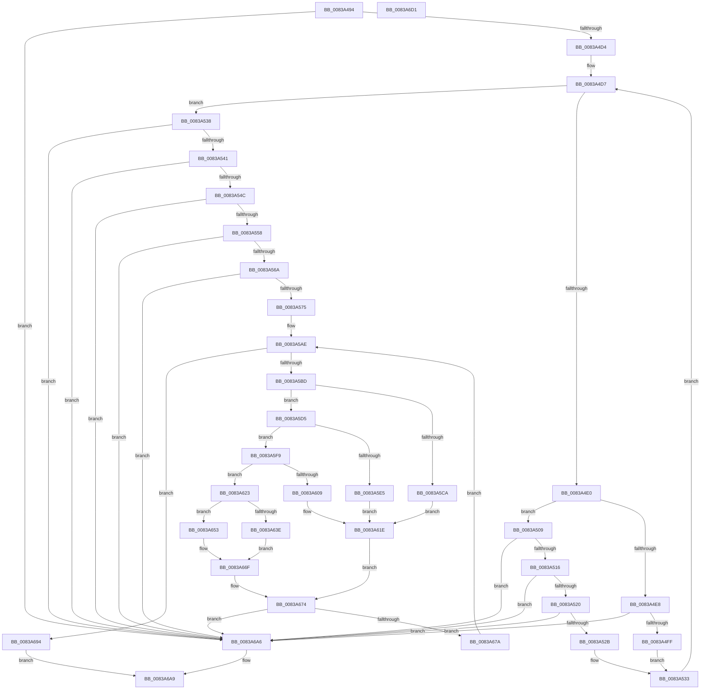

# MinAsn1StringToOid

- RVA: `0x0083A494`–`0x0083A6D2` (길이 `574` bytes)
- VA: `0x000000014083A494`
- 실행 섹션: `PAGE`
- PDB 이름 있음: `예`; PDB Function 태그: `아니요`
- unwind 정보 RVA: `0x000DB000`
- 디코드: `169`개 명령, `574/574` bytes 표시
- 미해석 바이트: `0` (있으면 어셈블리에 `.byte`로 보존)

> 이 문서는 커널 이미지의 기계어와 PDB 기호를 분석해 생성했습니다. 4번과 5번은 함수 원형과 자료형을 바이너리 사용 방식에서 추정한 C 해석이며 원본 소스 복구 결과는 아닙니다.

## 1. Dependencies

- 직접 호출 지점: **2**; 고유 호출 대상: **2**
- 직접 호출자로 확인된 함수: **1**
- RIP 상대 이미지 참조: **1**

### Outgoing calls
- `0x0083A684` → [memcpy](../../text/6C/memcpy_function_006C6840.md) (function, `0x006C6840`)
- `0x0083A6B0` → [_security_check_cookie](../../text/6A/_security_check_cookie_function_006AC640.md) (function, `0x006AC640`)

### Direct callers
- [I_MinCryptCheckEKURequirements](I_MinCryptCheckEKURequirements_function_00839218.md) at `0x00839293`

### Static image references
- `0x0083A4B2` → RVA `0x00E0A740` (`.data`; read)

## 2. Other-region calls and transfers

- 다른 실행 섹션으로 향하는 call: **2**
  - `0x0083A684` → [memcpy](../../text/6C/memcpy_function_006C6840.md) (`PAGE` → `.text`)
  - `0x0083A6B0` → [_security_check_cookie](../../text/6A/_security_check_cookie_function_006AC640.md) (`PAGE` → `.text`)
- 별도 외부 분기/꼬리 이동을 확인하지 못했습니다.

## 3. Assembly (complete function range)

```asm
0083A494  48 89 5C 24 08                  mov qword ptr [rsp + 8], rbx
0083A499  48 89 74 24 18                  mov qword ptr [rsp + 0x18], rsi
0083A49E  55                              push rbp
0083A49F  57                              push rdi
0083A4A0  41 54                           push r12
0083A4A2  41 56                           push r14
0083A4A4  41 57                           push r15
0083A4A6  48 8D 6C 24 C9                  lea rbp, [rsp - 0x37]
0083A4AB  48 81 EC C0 00 00 00            sub rsp, 0xc0
0083A4B2  48 8B 05 87 02 5D 00            mov rax, qword ptr [rip + 0x5d0287]
0083A4B9  48 33 C4                        xor rax, rsp
0083A4BC  48 89 45 27                     mov qword ptr [rbp + 0x27], rax
0083A4C0  33 DB                           xor ebx, ebx
0083A4C2  45 33 C0                        xor r8d, r8d
0083A4C5  48 8B F2                        mov rsi, rdx
0083A4C8  4C 8B C9                        mov r9, rcx
0083A4CB  48 85 C9                        test rcx, rcx
0083A4CE  0F 84 D2 01 00 00               je 0x14083a6a6
0083A4D4  21 5D A7                        and dword ptr [rbp - 0x59], ebx
0083A4D7  45 0F BE 11                     movsx r10d, byte ptr [r9]
0083A4DB  45 84 D2                        test r10b, r10b
0083A4DE  74 58                           je 0x14083a538
0083A4E0  41 8D 42 D0                     lea eax, [r10 - 0x30]
0083A4E4  3C 09                           cmp al, 9
0083A4E6  77 21                           ja 0x14083a509
0083A4E8  8B 54 9D A7                     mov edx, dword ptr [rbp + rbx*4 - 0x59]
0083A4EC  8D 4A FA                        lea ecx, [rdx - 6]
0083A4EF  8D 0C 8A                        lea ecx, [rdx + rcx*4]
0083A4F2  45 8D 14 4A                     lea r10d, [r10 + rcx*2]
0083A4F6  44 3B D2                        cmp r10d, edx
0083A4F9  0F 82 A7 01 00 00               jb 0x14083a6a6
0083A4FF  44 89 54 9D A7                  mov dword ptr [rbp + rbx*4 - 0x59], r10d
0083A504  41 FF C0                        inc r8d
0083A507  EB 2A                           jmp 0x14083a533
0083A509  41 8D 40 FF                     lea eax, [r8 - 1]
0083A50D  83 F8 09                        cmp eax, 9
0083A510  0F 87 90 01 00 00               ja 0x14083a6a6
0083A516  41 80 FA 2E                     cmp r10b, 0x2e
0083A51A  0F 85 86 01 00 00               jne 0x14083a6a6
0083A520  FF C3                           inc ebx
0083A522  83 FB 1F                        cmp ebx, 0x1f
0083A525  0F 83 7B 01 00 00               jae 0x14083a6a6
0083A52B  83 64 9D A7 00                  and dword ptr [rbp + rbx*4 - 0x59], 0
0083A530  45 33 C0                        xor r8d, r8d
0083A533  49 FF C1                        inc r9
0083A536  EB 9F                           jmp 0x14083a4d7
0083A538  45 85 C0                        test r8d, r8d
0083A53B  0F 84 65 01 00 00               je 0x14083a6a6
0083A541  FF C3                           inc ebx
0083A543  83 FB 02                        cmp ebx, 2
0083A546  0F 82 5A 01 00 00               jb 0x14083a6a6
0083A54C  8B 55 AB                        mov edx, dword ptr [rbp - 0x55]
0083A54F  83 FA 28                        cmp edx, 0x28
0083A552  0F 83 4E 01 00 00               jae 0x14083a6a6
0083A558  8B 45 A7                        mov eax, dword ptr [rbp - 0x59]
0083A55B  8D 0C 80                        lea ecx, [rax + rax*4]
0083A55E  8D 04 CA                        lea eax, [rdx + rcx*8]
0083A561  83 F8 7F                        cmp eax, 0x7f
0083A564  0F 87 3C 01 00 00               ja 0x14083a6a6
0083A56A  8B 0E                           mov ecx, dword ptr [rsi]
0083A56C  83 F9 03                        cmp ecx, 3
0083A56F  0F 82 31 01 00 00               jb 0x14083a6a6
0083A575  B8 82 00 00 00                  mov eax, 0x82
0083A57A  BF 03 00 00 00                  mov edi, 3
0083A57F  3B C8                           cmp ecx, eax
0083A581  0F 42 C1                        cmovb eax, ecx
0083A584  8A 4D A7                        mov cl, byte ptr [rbp - 0x59]
0083A587  89 06                           mov dword ptr [rsi], eax
0083A589  44 8D 7F FF                     lea r15d, [rdi - 1]
0083A58D  48 8B 46 08                     mov rax, qword ptr [rsi + 8]
0083A591  C6 00 06                        mov byte ptr [rax], 6
0083A594  8A C1                           mov al, cl
0083A596  C0 E0 02                        shl al, 2
0083A599  02 C8                           add cl, al
0083A59B  48 8B 46 08                     mov rax, qword ptr [rsi + 8]
0083A59F  C0 E1 03                        shl cl, 3
0083A5A2  02 CA                           add cl, dl
0083A5A4  88 48 02                        mov byte ptr [rax + 2], cl
0083A5A7  4C 8B 66 08                     mov r12, qword ptr [rsi + 8]
0083A5AB  4C 03 E7                        add r12, rdi
0083A5AE  41 BB 80 00 00 00               mov r11d, 0x80
0083A5B4  44 3B FB                        cmp r15d, ebx
0083A5B7  0F 83 D7 00 00 00               jae 0x14083a694
0083A5BD  45 8B C7                        mov r8d, r15d
0083A5C0  42 8B 4C 85 A7                  mov ecx, dword ptr [rbp + r8*4 - 0x59]
0083A5C5  41 3B CB                        cmp ecx, r11d
0083A5C8  73 0B                           jae 0x14083a5d5
0083A5CA  8A C1                           mov al, cl
0083A5CC  88 4D 97                        mov byte ptr [rbp - 0x69], cl
0083A5CF  41 8D 43 81                     lea eax, [r11 - 0x7f]
0083A5D3  EB 49                           jmp 0x14083a61e
0083A5D5  8B C1                           mov eax, ecx
0083A5D7  C1 E8 07                        shr eax, 7
0083A5DA  41 0A C3                        or al, r11b
0083A5DD  81 F9 00 40 00 00               cmp ecx, 0x4000
0083A5E3  73 14                           jae 0x14083a5f9
0083A5E5  88 45 97                        mov byte ptr [rbp - 0x69], al
0083A5E8  42 8A 44 85 A7                  mov al, byte ptr [rbp + r8*4 - 0x59]
0083A5ED  24 7F                           and al, 0x7f
0083A5EF  88 45 98                        mov byte ptr [rbp - 0x68], al
0083A5F2  B8 02 00 00 00                  mov eax, 2
0083A5F7  EB 25                           jmp 0x14083a61e
0083A5F9  8B D1                           mov edx, ecx
0083A5FB  C1 EA 0E                        shr edx, 0xe
0083A5FE  41 0A D3                        or dl, r11b
0083A601  81 F9 00 00 20 00               cmp ecx, 0x200000
0083A607  73 1A                           jae 0x14083a623
0083A609  88 45 98                        mov byte ptr [rbp - 0x68], al
0083A60C  42 8A 44 85 A7                  mov al, byte ptr [rbp + r8*4 - 0x59]
0083A611  24 7F                           and al, 0x7f
0083A613  88 55 97                        mov byte ptr [rbp - 0x69], dl
0083A616  88 45 99                        mov byte ptr [rbp - 0x67], al
0083A619  B8 03 00 00 00                  mov eax, 3
0083A61E  4C 8B F0                        mov r14, rax
0083A621  EB 51                           jmp 0x14083a674
0083A623  46 8A 54 85 A7                  mov r10b, byte ptr [rbp + r8*4 - 0x59]
0083A628  44 8B C9                        mov r9d, ecx
0083A62B  41 C1 E9 15                     shr r9d, 0x15
0083A62F  41 80 E2 7F                     and r10b, 0x7f
0083A633  45 0A CB                        or r9b, r11b
0083A636  81 F9 00 00 00 10               cmp ecx, 0x10000000
0083A63C  73 15                           jae 0x14083a653
0083A63E  88 55 98                        mov byte ptr [rbp - 0x68], dl
0083A641  BA 04 00 00 00                  mov edx, 4
0083A646  44 88 4D 97                     mov byte ptr [rbp - 0x69], r9b
0083A64A  88 45 99                        mov byte ptr [rbp - 0x67], al
0083A64D  44 88 55 9A                     mov byte ptr [rbp - 0x66], r10b
0083A651  EB 1C                           jmp 0x14083a66f
0083A653  C1 E9 1C                        shr ecx, 0x1c
0083A656  41 0A CB                        or cl, r11b
0083A659  88 55 99                        mov byte ptr [rbp - 0x67], dl
0083A65C  88 4D 97                        mov byte ptr [rbp - 0x69], cl
0083A65F  BA 05 00 00 00                  mov edx, 5
0083A664  44 88 4D 98                     mov byte ptr [rbp - 0x68], r9b
0083A668  88 45 9A                        mov byte ptr [rbp - 0x66], al
0083A66B  44 88 55 9B                     mov byte ptr [rbp - 0x65], r10b
0083A66F  8B C2                           mov eax, edx
0083A671  4C 8B F2                        mov r14, rdx
0083A674  03 F8                           add edi, eax
0083A676  3B 3E                           cmp edi, dword ptr [rsi]
0083A678  77 2C                           ja 0x14083a6a6
0083A67A  4D 8B C6                        mov r8, r14
0083A67D  48 8D 55 97                     lea rdx, [rbp - 0x69]
0083A681  49 8B CC                        mov rcx, r12
0083A684  E8 B7 C1 E8 FF                  call 0x1406c6840
0083A689  4D 03 E6                        add r12, r14
0083A68C  41 FF C7                        inc r15d
0083A68F  E9 1A FF FF FF                  jmp 0x14083a5ae
0083A694  48 8B 4E 08                     mov rcx, qword ptr [rsi + 8]
0083A698  89 3E                           mov dword ptr [rsi], edi
0083A69A  40 80 EF 02                     sub dil, 2
0083A69E  40 88 79 01                     mov byte ptr [rcx + 1], dil
0083A6A2  8B 06                           mov eax, dword ptr [rsi]
0083A6A4  EB 03                           jmp 0x14083a6a9
0083A6A6  83 C8 FF                        or eax, 0xffffffff
0083A6A9  48 8B 4D 27                     mov rcx, qword ptr [rbp + 0x27]
0083A6AD  48 33 CC                        xor rcx, rsp
0083A6B0  E8 8B 1F E7 FF                  call 0x1406ac640
0083A6B5  4C 8D 9C 24 C0 00 00 00         lea r11, [rsp + 0xc0]
0083A6BD  49 8B 5B 30                     mov rbx, qword ptr [r11 + 0x30]
0083A6C1  49 8B 73 40                     mov rsi, qword ptr [r11 + 0x40]
0083A6C5  49 8B E3                        mov rsp, r11
0083A6C8  41 5F                           pop r15
0083A6CA  41 5E                           pop r14
0083A6CC  41 5C                           pop r12
0083A6CE  5F                              pop rdi
0083A6CF  5D                              pop rbp
0083A6D0  C3                              ret
0083A6D1  CC                              int3
```

## 4. C-style interpretation (structured pseudocode)

```c
__int64 __fastcall MinAsn1StringToOid(__int64 a1, __int64 a2, int a3)
{
    __int64 result;
    __int64 v_r10;
    __int64 v_r12;
    __int64 v_r15;
    __int64 v_rbx;
    __int64 v_rdi;
    __int64 v_rsp;
    unsigned __int64 v_stack_m28;
    unsigned __int64 v_stack_m38;
    unsigned __int64 v_stack_m5F;
    unsigned int v_stack_mB4;
    unsigned int v_stack_mB8;
    unsigned __int8 v_stack_mC4;
    unsigned __int8 v_stack_mC5;
    unsigned __int8 v_stack_mC6;
    unsigned __int8 v_stack_mC7;
    unsigned __int8 v_stack_mC8;
    unsigned __int64 v_stack_p18;
    unsigned __int64 v_stack_p8;

    v_stack_p8 = v_rbx;
    v_stack_p18 = v_rsi;
    v_rsp = (v_rsp) - (192);
    result = (*(unsigned __int64 *)(v_rip + 6095495)) ^ (v_rsp);
    v_stack_m38 = result;
    v_rbx = 0;
    a3 = 0;
    if (a1 == 0) goto loc_0083A6A6;
loc_0083A4D7:
    if ((unsigned __int8)((__int8)(*(unsigned __int8 *)(a1))) == 0) goto loc_0083A538;
    if (((unsigned __int8)((__int8)(*(unsigned __int8 *)(a1)) - 48)) > 9) goto loc_0083A509;
    if (((unsigned int)((__int8)(*(unsigned __int8 *)(a1)) + (unsigned int)(*(unsigned int *)(v_stack_m5F + v_rbx * 4 - 89)) + (unsigned int)(*(unsigned int *)(v_stack_m5F + v_rbx * 4 - 89)) - 6 * 4 * 2)) < ((unsigned int)((unsigned int)(*(unsigned int *)(v_stack_m5F + v_rbx * 4 - 89))))) goto loc_0083A6A6;
    *(unsigned int *)(v_stack_m5F + v_rbx * 4 - 89) = (unsigned int)((__int8)(*(unsigned __int8 *)(a1)) + (unsigned int)(*(unsigned int *)(v_stack_m5F + v_rbx * 4 - 89)) + (unsigned int)(*(unsigned int *)(v_stack_m5F + v_rbx * 4 - 89)) - 6 * 4 * 2);
    a3 = (unsigned int)((a3) + 1);
    goto loc_0083A533;
loc_0083A509:
    if (((unsigned int)(a3 - 1)) > 9) goto loc_0083A6A6;
    if (((unsigned __int8)((__int8)(*(unsigned __int8 *)(a1)) + (unsigned int)(*(unsigned int *)(v_stack_m5F + v_rbx * 4 - 89)) + (unsigned int)(*(unsigned int *)(v_stack_m5F + v_rbx * 4 - 89)) - 6 * 4 * 2)) != 46) goto loc_0083A6A6;
    v_rbx = (unsigned int)((v_rbx) + 1);
    if (((unsigned int)(v_rbx)) >= 31) goto loc_0083A6A6;
    a3 = 0;
loc_0083A533:
    a4 = (a1) + 1;
    goto loc_0083A4D7;
loc_0083A538:
    if (0 == 0) goto loc_0083A6A6;
    v_rbx = (unsigned int)((v_rbx) + 1);
    if (((unsigned int)(v_rbx)) < 2) goto loc_0083A6A6;
    if (((unsigned int)((unsigned int)(v_stack_mB4))) >= 40) goto loc_0083A6A6;
    if (((unsigned int)((unsigned int)(v_stack_mB4) + (unsigned int)(v_stack_mB8) + (unsigned int)(v_stack_mB8) * 4 * 8)) > 127) goto loc_0083A6A6;
    if (((unsigned int)((unsigned int)(*(unsigned int *)(a2)))) < 3) goto loc_0083A6A6;
    result = 130;
    if (((unsigned int)((unsigned int)(*(unsigned int *)(a2)))) < 130) { result = (unsigned int)((unsigned int)(*(unsigned int *)(a2))); }
    *(unsigned int *)(a2) = (unsigned int)(result);
    *(unsigned __int8 *)(*(unsigned __int64 *)(a2 + 8)) = 6;
    result = (unsigned __int8)(((unsigned __int8)(v_stack_mB8)) << (2));
    a1 = (unsigned __int8)((v_stack_mB8) + ((unsigned __int8)(result)));
    a1 = (unsigned __int8)((a1) << (3));
    a1 = (unsigned __int8)((a1) + ((unsigned __int8)((unsigned int)(v_stack_mB4))));
    *(unsigned __int8 *)(*(unsigned __int64 *)(a2 + 8) + 2) = (unsigned __int8)(a1);
    v_r12 = (*(unsigned __int64 *)(a2 + 8)) + (3);
loc_0083A5AE:
    if (((unsigned int)(3 - 1)) >= ((unsigned int)(v_rbx))) goto loc_0083A694;
    if (((unsigned int)((unsigned int)(*(unsigned int *)(v_stack_m5F + (unsigned int)((unsigned int)(3 - 1)) * 4 - 89)))) >= 128) goto loc_0083A5D5;
    v_stack_mC8 = (unsigned __int8)((unsigned int)(*(unsigned int *)(v_stack_m5F + (unsigned int)((unsigned int)(3 - 1)) * 4 - 89)));
    goto loc_0083A61E;
loc_0083A5D5:
    result = (unsigned int)(((unsigned int)((unsigned int)((unsigned int)(*(unsigned int *)(v_stack_m5F + (unsigned int)((unsigned int)(3 - 1)) * 4 - 89))))) >> (7));
    result = (unsigned __int8)((result) | (128));
    if (((unsigned int)((unsigned int)(*(unsigned int *)(v_stack_m5F + (unsigned int)((unsigned int)(3 - 1)) * 4 - 89)))) >= 0x4000ULL) goto loc_0083A5F9;
    v_stack_mC8 = (unsigned __int8)(result);
    result = (unsigned __int8)((*(unsigned __int8 *)(v_stack_m5F + (unsigned int)((unsigned int)(3 - 1)) * 4 - 89)) & (127));
    v_stack_mC7 = (unsigned __int8)(result);
    goto loc_0083A61E;
loc_0083A5F9:
    a2 = (unsigned int)(((unsigned int)((unsigned int)((unsigned int)(*(unsigned int *)(v_stack_m5F + (unsigned int)((unsigned int)(3 - 1)) * 4 - 89))))) >> (14));
    a2 = (unsigned __int8)((a2) | (128));
    if (((unsigned int)((unsigned int)(*(unsigned int *)(v_stack_m5F + (unsigned int)((unsigned int)(3 - 1)) * 4 - 89)))) >= 0x200000ULL) goto loc_0083A623;
    v_stack_mC7 = 2;
    result = (unsigned __int8)((*(unsigned __int8 *)(v_stack_m5F + (unsigned int)((unsigned int)(3 - 1)) * 4 - 89)) & (127));
    v_stack_mC8 = (unsigned __int8)(a2);
    v_stack_mC6 = (unsigned __int8)(result);
loc_0083A61E:
    goto loc_0083A674;
loc_0083A623:
    a4 = (unsigned int)(((unsigned int)((unsigned int)((unsigned int)(*(unsigned int *)(v_stack_m5F + (unsigned int)((unsigned int)(3 - 1)) * 4 - 89))))) >> (21));
    v_r10 = (unsigned __int8)((*(unsigned __int8 *)(v_stack_m5F + (unsigned int)((unsigned int)(3 - 1)) * 4 - 89)) & (127));
    a4 = (unsigned __int8)((a4) | (128));
    if (((unsigned int)((unsigned int)(*(unsigned int *)(v_stack_m5F + (unsigned int)((unsigned int)(3 - 1)) * 4 - 89)))) >= 0x10000000ULL) goto loc_0083A653;
    v_stack_mC7 = (unsigned __int8)(a2);
    v_stack_mC8 = (unsigned __int8)(a4);
    v_stack_mC6 = 3;
    v_stack_mC5 = (unsigned __int8)(v_r10);
    goto loc_0083A66F;
loc_0083A653:
    a1 = (unsigned int)(((unsigned int)(*(unsigned int *)(v_stack_m5F + (unsigned int)((unsigned int)(3 - 1)) * 4 - 89))) >> (28));
    a1 = (unsigned __int8)((a1) | (128));
    v_stack_mC6 = 4;
    v_stack_mC8 = (unsigned __int8)(a1);
    v_stack_mC7 = (unsigned __int8)(a4);
    v_stack_mC5 = 3;
    v_stack_mC4 = (unsigned __int8)(v_r10);
loc_0083A66F:
loc_0083A674:
    v_rdi = (unsigned int)((3) + (5));
    if (((unsigned int)(v_rdi)) > (*(unsigned int *)(a2))) goto loc_0083A6A6;
    result = memcpy(v_r12, v_stack_mC8, 5, a4);
    v_r12 = (v_r12) + (5);
    v_r15 = (unsigned int)((3 - 1) + 1);
    goto loc_0083A5AE;
loc_0083A694:
    *(unsigned int *)(a2) = (unsigned int)(v_rdi);
    v_rdi = (unsigned __int8)((v_rdi) - (2));
    *(unsigned __int8 *)(*(unsigned __int64 *)(a2 + 8) + 1) = (unsigned __int8)(v_rdi);
    goto loc_0083A6A9;
loc_0083A6A6:
    result = (unsigned int)(((unsigned int)(*(unsigned int *)(a2))) | (0xFFFFFFFFULL));
loc_0083A6A9:
    a1 = (v_stack_m38) ^ (v_rsp);
    result = _security_check_cookie(a1, v_stack_mC8, 5, a4);
    return result;
}
```

## 5. (Beta) C Style

```c
int64_t MinAsn1StringToOid(int64_t Arg1, void *Arg2, int32_t Arg3)
{
    uint8_t *arg2 = (uint8_t *)Arg2;

    int64_t result;
    int64_t local_r10;
    int64_t local_r12;
    int64_t local_r15;
    int64_t local_rbx;
    int64_t local_rdi;
    int64_t local_rsp;
    uint64_t v_stack_m28;
    uint64_t v_stack_m38;
    uint64_t v_stack_m5F;
    uint32_t v_stack_mB4;
    uint32_t v_stack_mB8;
    uint8_t v_stack_mC4;
    uint8_t v_stack_mC5;
    uint8_t v_stack_mC6;
    uint8_t v_stack_mC7;
    uint8_t v_stack_mC8;
    uint64_t v_stack_p18;
    uint64_t v_stack_p8;

    v_stack_p8 = local_rbx;
    v_stack_p18 = local_rsi;
    local_rsp = (local_rsp) - (192);
    result = (*(uint64_t *)(v_rip + 0x5D0287)) ^ (local_rsp);
    v_stack_m38 = result;
    local_rbx = 0;
    Arg3 = 0;
    if (Arg1 == 0) goto loc_0083A6A6;
loc_0083A4D7:
    if ((uint8_t)((int8_t)(*(uint8_t *)(Arg1))) == 0) goto loc_0083A538;
    if (((uint8_t)((int8_t)(*(uint8_t *)(Arg1)) - 48)) > 9) goto loc_0083A509;
    if (((uint32_t)((int8_t)(*(uint8_t *)(Arg1)) + (uint32_t)(*(uint32_t *)(v_stack_m5F + local_rbx * 4 - 0x59)) + (uint32_t)(*(uint32_t *)(v_stack_m5F + local_rbx * 4 - 0x59)) - 6 * 4 * 2)) < ((uint32_t)((uint32_t)(*(uint32_t *)(v_stack_m5F + local_rbx * 4 - 0x59))))) goto loc_0083A6A6;
    *(uint32_t *)(v_stack_m5F + local_rbx * 4 - 0x59) = (uint32_t)((int8_t)(*(uint8_t *)(Arg1)) + (uint32_t)(*(uint32_t *)(v_stack_m5F + local_rbx * 4 - 0x59)) + (uint32_t)(*(uint32_t *)(v_stack_m5F + local_rbx * 4 - 0x59)) - 6 * 4 * 2);
    Arg3 = (uint32_t)((Arg3) + 1);
    goto loc_0083A533;
loc_0083A509:
    if (((uint32_t)(Arg3 - 1)) > 9) goto loc_0083A6A6;
    if (((uint8_t)((int8_t)(*(uint8_t *)(Arg1)) + (uint32_t)(*(uint32_t *)(v_stack_m5F + local_rbx * 4 - 0x59)) + (uint32_t)(*(uint32_t *)(v_stack_m5F + local_rbx * 4 - 0x59)) - 6 * 4 * 2)) != 46) goto loc_0083A6A6;
    local_rbx = (uint32_t)((local_rbx) + 1);
    if (((uint32_t)(local_rbx)) >= 31) goto loc_0083A6A6;
    Arg3 = 0;
loc_0083A533:
    a4 = (Arg1) + 1;
    goto loc_0083A4D7;
loc_0083A538:
    if (0 == 0) goto loc_0083A6A6;
    local_rbx = (uint32_t)((local_rbx) + 1);
    if (((uint32_t)(local_rbx)) < 2) goto loc_0083A6A6;
    if (((uint32_t)((uint32_t)(v_stack_mB4))) >= 40) goto loc_0083A6A6;
    if (((uint32_t)((uint32_t)(v_stack_mB4) + (uint32_t)(v_stack_mB8) + (uint32_t)(v_stack_mB8) * 4 * 8)) > 127) goto loc_0083A6A6;
    if (((uint32_t)((uint32_t)(*(uint32_t *)(arg2)))) < 3) goto loc_0083A6A6;
    result = 130;
    if (((uint32_t)((uint32_t)(*(uint32_t *)(arg2)))) < 130) { result = (uint32_t)((uint32_t)(*(uint32_t *)(arg2))); }
    *(uint32_t *)(arg2) = (uint32_t)(result);
    *(uint8_t *)(*(uint64_t *)(arg2 + 0x8)) = 6;
    result = (uint8_t)(((uint8_t)(v_stack_mB8)) << (2));
    Arg1 = (uint8_t)((v_stack_mB8) + ((uint8_t)(result)));
    Arg1 = (uint8_t)((Arg1) << (3));
    Arg1 = (uint8_t)((Arg1) + ((uint8_t)((uint32_t)(v_stack_mB4))));
    *(uint8_t *)(*(uint64_t *)(arg2 + 0x8) + 0x2) = (uint8_t)(Arg1);
    local_r12 = (*(uint64_t *)(arg2 + 0x8)) + (3);
loc_0083A5AE:
    if (((uint32_t)(3 - 1)) >= ((uint32_t)(local_rbx))) goto loc_0083A694;
    if (((uint32_t)((uint32_t)(*(uint32_t *)(v_stack_m5F + (uint32_t)((uint32_t)(3 - 0x1)) * 4 - 0x59)))) >= 128) goto loc_0083A5D5;
    v_stack_mC8 = (uint8_t)((uint32_t)(*(uint32_t *)(v_stack_m5F + (uint32_t)((uint32_t)(3 - 0x1)) * 4 - 0x59)));
    goto loc_0083A61E;
loc_0083A5D5:
    result = (uint32_t)(((uint32_t)((uint32_t)((uint32_t)(*(uint32_t *)(v_stack_m5F + (uint32_t)((uint32_t)(3 - 0x1)) * 4 - 0x59))))) >> (7));
    result = (uint8_t)((result) | (128));
    if (((uint32_t)((uint32_t)(*(uint32_t *)(v_stack_m5F + (uint32_t)((uint32_t)(3 - 0x1)) * 4 - 0x59)))) >= 0x4000ULL) goto loc_0083A5F9;
    v_stack_mC8 = (uint8_t)(result);
    result = (uint8_t)((*(uint8_t *)(v_stack_m5F + (uint32_t)((uint32_t)(3 - 0x1)) * 4 - 0x59)) & (127));
    v_stack_mC7 = (uint8_t)(result);
    goto loc_0083A61E;
loc_0083A5F9:
    Arg2 = (uint32_t)(((uint32_t)((uint32_t)((uint32_t)(*(uint32_t *)(v_stack_m5F + (uint32_t)((uint32_t)(3 - 0x1)) * 4 - 0x59))))) >> (14));
    Arg2 = (uint8_t)((Arg2) | (128));
    if (((uint32_t)((uint32_t)(*(uint32_t *)(v_stack_m5F + (uint32_t)((uint32_t)(3 - 0x1)) * 4 - 0x59)))) >= 0x200000ULL) goto loc_0083A623;
    v_stack_mC7 = 2;
    result = (uint8_t)((*(uint8_t *)(v_stack_m5F + (uint32_t)((uint32_t)(3 - 0x1)) * 4 - 0x59)) & (127));
    v_stack_mC8 = (uint8_t)(Arg2);
    v_stack_mC6 = (uint8_t)(result);
loc_0083A61E:
    goto loc_0083A674;
loc_0083A623:
    a4 = (uint32_t)(((uint32_t)((uint32_t)((uint32_t)(*(uint32_t *)(v_stack_m5F + (uint32_t)((uint32_t)(3 - 0x1)) * 4 - 0x59))))) >> (21));
    local_r10 = (uint8_t)((*(uint8_t *)(v_stack_m5F + (uint32_t)((uint32_t)(3 - 0x1)) * 4 - 0x59)) & (127));
    a4 = (uint8_t)((a4) | (128));
    if (((uint32_t)((uint32_t)(*(uint32_t *)(v_stack_m5F + (uint32_t)((uint32_t)(3 - 0x1)) * 4 - 0x59)))) >= 0x10000000ULL) goto loc_0083A653;
    v_stack_mC7 = (uint8_t)(Arg2);
    v_stack_mC8 = (uint8_t)(a4);
    v_stack_mC6 = 3;
    v_stack_mC5 = (uint8_t)(local_r10);
    goto loc_0083A66F;
loc_0083A653:
    Arg1 = (uint32_t)(((uint32_t)(*(uint32_t *)(v_stack_m5F + (uint32_t)((uint32_t)(3 - 0x1)) * 4 - 0x59))) >> (28));
    Arg1 = (uint8_t)((Arg1) | (128));
    v_stack_mC6 = 4;
    v_stack_mC8 = (uint8_t)(Arg1);
    v_stack_mC7 = (uint8_t)(a4);
    v_stack_mC5 = 3;
    v_stack_mC4 = (uint8_t)(local_r10);
loc_0083A66F:
loc_0083A674:
    local_rdi = (uint32_t)((3) + (5));
    if (((uint32_t)(local_rdi)) > (*(uint32_t *)(arg2))) goto loc_0083A6A6;
    result = memcpy(local_r12, v_stack_mC8, 5, a4);
    local_r12 = (local_r12) + (5);
    local_r15 = (uint32_t)((3 - 1) + 1);
    goto loc_0083A5AE;
loc_0083A694:
    *(uint32_t *)(arg2) = (uint32_t)(local_rdi);
    local_rdi = (uint8_t)((local_rdi) - (2));
    *(uint8_t *)(*(uint64_t *)(arg2 + 0x8) + 0x1) = (uint8_t)(local_rdi);
    goto loc_0083A6A9;
loc_0083A6A6:
    result = (uint32_t)(((uint32_t)(*(uint32_t *)(arg2))) | (0xFFFFFFFFULL));
loc_0083A6A9:
    Arg1 = (v_stack_m38) ^ (local_rsp);
    result = _security_check_cookie(Arg1, v_stack_mC8, 5, a4);
    return result;
}
```

### 관측된 메모리 오프셋

구조체 형식이 확인되지 않은 접근은 인자 기준의 오프셋으로만 기록했습니다.

| 기준 인자 | 오프셋 표현 | 폭 (bit) | 접근 |
|---|---:|---:|---|
| `Arg2` | `+ 0x0` | `32` | `R` |
| `Arg2` | `+ 0x0` | `32` | `W` |
| `Arg2` | `+ 0x8` | `64` | `R` |

## 6. Execution-region graph

[열기: 2D/3D 그래프와 함수 탐색 컨트롤 패널](../../../control-panel.html?section=page&rva=0x0083A494&view=graph)

- 2D 그래프는 위에서 아래로 흐르고, 3D 그래프는 빈 공간을 드래그해 회전합니다. Shift+드래그는 이동, 휠은 확대·축소, 함수 노드 선택은 대상 보고서 이동입니다.

### Static fallback


