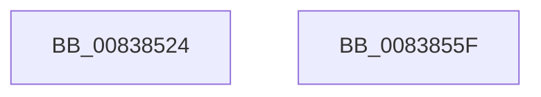

# MinCrypK_VerifySignedDataKMode

- RVA: `0x00838524`–`0x00838560` (길이 `60` bytes)
- VA: `0x0000000140838524`
- 실행 섹션: `PAGE`
- PDB 이름 있음: `예`; PDB Function 태그: `아니요`
- unwind 정보 RVA: `0x0006C2A4`
- 디코드: `13`개 명령, `60/60` bytes 표시
- 미해석 바이트: `0` (있으면 어셈블리에 `.byte`로 보존)

> 이 문서는 커널 이미지의 기계어와 PDB 기호를 분석해 생성했습니다. 4번과 5번은 함수 원형과 자료형을 바이너리 사용 방식에서 추정한 C 해석이며 원본 소스 복구 결과는 아닙니다.

## 1. Dependencies

- 직접 호출 지점: **1**; 고유 호출 대상: **1**
- 직접 호출자로 확인된 함수: **2**
- RIP 상대 이미지 참조: **0**

### Outgoing calls
- `0x00838555` → [MinCrypK_VerifySignedDataKModeEx](MinCrypK_VerifySignedDataKModeEx_function_00838568.md) (function, `0x00838568`)

### Direct callers
- [MinCrypK_ParseRevocationList](../../text/6A/MinCrypK_ParseRevocationList_function_006A602C.md) at `0x006A6073`
- [I_MinCryptVerifyRFC3161TimeStamp](I_MinCryptVerifyRFC3161TimeStamp_function_008382A4.md) at `0x0083830E`

### Static image references
- 디코드된 RIP-relative 메모리 참조가 없습니다.

## 2. Other-region calls and transfers

- 다른 실행 섹션으로 향하는 call: **0**
- 별도 외부 분기/꼬리 이동을 확인하지 못했습니다.

## 3. Assembly (complete function range)

```asm
00838524  48 83 EC 58                     sub rsp, 0x58
00838528  48 8B 84 24 90 00 00 00         mov rax, qword ptr [rsp + 0x90]
00838530  45 33 C9                        xor r9d, r9d
00838533  48 89 44 24 30                  mov qword ptr [rsp + 0x30], rax
00838538  45 33 C0                        xor r8d, r8d
0083853B  48 8B 84 24 88 00 00 00         mov rax, qword ptr [rsp + 0x88]
00838543  48 89 44 24 28                  mov qword ptr [rsp + 0x28], rax
00838548  48 8B 84 24 80 00 00 00         mov rax, qword ptr [rsp + 0x80]
00838550  48 89 44 24 20                  mov qword ptr [rsp + 0x20], rax
00838555  E8 0E 00 00 00                  call 0x140838568
0083855A  48 83 C4 58                     add rsp, 0x58
0083855E  C3                              ret
0083855F  CC                              int3
```

## 4. C-style interpretation (structured pseudocode)

```c
__int64 __fastcall MinCrypK_VerifySignedDataKMode(__int64 a1, __int64 a2, int a3, int a4, __int64 a5, __int64 a6, __int64 a7)
{
    __int64 result;
    __int64 v_rsp;
    unsigned __int64 v_stack_m28;
    unsigned __int64 v_stack_m30;
    unsigned __int64 v_stack_m38;

    v_rsp = (v_rsp) - (88);
    a4 = 0;
    v_stack_m28 = a7;
    a3 = 0;
    v_stack_m30 = a6;
    v_stack_m38 = a5;
    result = MinCrypK_VerifySignedDataKModeEx(a1, a2, a3, a4);
    v_rsp = (v_rsp) + (88);
    return result;
}
```

## 5. (Beta) C Style

```c
int64_t MinCrypK_VerifySignedDataKMode(int64_t Arg1, int64_t Arg2, int32_t Arg3, int32_t Arg4, int64_t Arg5, int64_t Arg6, int64_t Arg7)
{
    int64_t result;
    int64_t local_rsp;
    uint64_t v_stack_m28;
    uint64_t v_stack_m30;
    uint64_t v_stack_m38;

    local_rsp = (local_rsp) - (88);
    Arg4 = 0;
    v_stack_m28 = Arg7;
    Arg3 = 0;
    v_stack_m30 = Arg6;
    v_stack_m38 = Arg5;
    result = MinCrypK_VerifySignedDataKModeEx(Arg1, Arg2, Arg3, Arg4);
    local_rsp = (local_rsp) + (88);
    return result;
}
```

## 6. Execution-region graph

[열기: 2D/3D 그래프와 함수 탐색 컨트롤 패널](../../../control-panel.html?section=page&rva=0x00838524&view=graph)

- 2D 그래프는 위에서 아래로 흐르고, 3D 그래프는 빈 공간을 드래그해 회전합니다. Shift+드래그는 이동, 휠은 확대·축소, 함수 노드 선택은 대상 보고서 이동입니다.

### Static fallback


