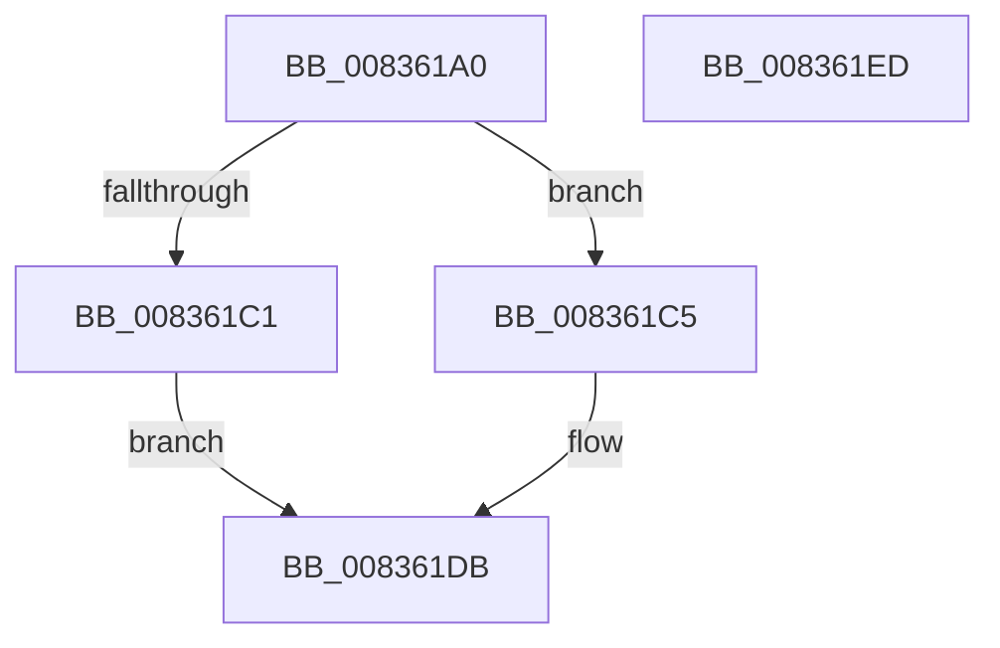

# MinCryptDecodeHashAlgorithmIdentifier

- RVA: `0x008361A0`–`0x008361EE` (길이 `78` bytes)
- VA: `0x00000001408361A0`
- 실행 섹션: `PAGE`
- PDB 이름 있음: `예`; PDB Function 태그: `아니요`
- unwind 정보 RVA: `0x000A02F8`
- 디코드: `20`개 명령, `78/78` bytes 표시
- 미해석 바이트: `0` (있으면 어셈블리에 `.byte`로 보존)

> 이 문서는 커널 이미지의 기계어와 PDB 기호를 분석해 생성했습니다. 4번과 5번은 함수 원형과 자료형을 바이너리 사용 방식에서 추정한 C 해석이며 원본 소스 복구 결과는 아닙니다.

## 1. Dependencies

- 직접 호출 지점: **3**; 고유 호출 대상: **3**
- 직접 호출자로 확인된 함수: **4**
- RIP 상대 이미지 참조: **2**

### Outgoing calls
- `0x008361B8` → [MinAsn1ParseAlgorithmIdentifier](MinAsn1ParseAlgorithmIdentifier_function_00838B8C.md) (function, `0x00838B8C`)
- `0x008361D6` → [MinCryptDecodeOid](MinCryptDecodeOid_function_008361F4.md) (function, `0x008361F4`)
- `0x008361E3` → [_security_check_cookie](../../text/6A/_security_check_cookie_function_006AC640.md) (function, `0x006AC640`)

### Direct callers
- [MinCryptVerifyCertificateWithPolicy2](MinCryptVerifyCertificateWithPolicy2_function_008368A8.md) at `0x00836C32`
- [MinCryptVerifyCertificateWithPolicy2](MinCryptVerifyCertificateWithPolicy2_function_008368A8.md) at `0x00837358`
- [I_MinCryptVerifyAuthenticodeTimeStamp](I_MinCryptVerifyAuthenticodeTimeStamp_function_00838090.md) at `0x00838198`
- [I_MinCryptVerifyRFC3161TimeStamp](I_MinCryptVerifyRFC3161TimeStamp_function_008382A4.md) at `0x0083838D`
- [MinCrypK_VerifySignedDataKModeEx](MinCrypK_VerifySignedDataKModeEx_function_00838568.md) at `0x008387E3`

### Static image references
- `0x008361A4` → RVA `0x00E0A740` (`.data`; read)
- `0x008361CF` → RVA `0x00B51310` (`PAGE`; read)

## 2. Other-region calls and transfers

- 다른 실행 섹션으로 향하는 call: **1**
  - `0x008361E3` → [_security_check_cookie](../../text/6A/_security_check_cookie_function_006AC640.md) (`PAGE` → `.text`)
- 별도 외부 분기/꼬리 이동을 확인하지 못했습니다.

## 3. Assembly (complete function range)

```asm
008361A0  48 83 EC 78                     sub rsp, 0x78
008361A4  48 8B 05 95 45 5D 00            mov rax, qword ptr [rip + 0x5d4595]
008361AB  48 33 C4                        xor rax, rsp
008361AE  48 89 44 24 60                  mov qword ptr [rsp + 0x60], rax
008361B3  48 8D 54 24 20                  lea rdx, [rsp + 0x20]
008361B8  E8 CF 29 00 00                  call 0x140838b8c
008361BD  85 C0                           test eax, eax
008361BF  79 04                           jns 0x1408361c5
008361C1  33 C0                           xor eax, eax
008361C3  EB 16                           jmp 0x1408361db
008361C5  4C 8D 44 24 40                  lea r8, [rsp + 0x40]
008361CA  BA 14 00 00 00                  mov edx, 0x14
008361CF  48 8D 0D 3A B1 31 00            lea rcx, [rip + 0x31b13a]
008361D6  E8 19 00 00 00                  call 0x1408361f4
008361DB  48 8B 4C 24 60                  mov rcx, qword ptr [rsp + 0x60]
008361E0  48 33 CC                        xor rcx, rsp
008361E3  E8 58 64 E7 FF                  call 0x1406ac640
008361E8  48 83 C4 78                     add rsp, 0x78
008361EC  C3                              ret
008361ED  CC                              int3
```

## 4. C-style interpretation (structured pseudocode)

```c
__int64 __fastcall MinCryptDecodeHashAlgorithmIdentifier(void)
{
    __int64 result;
    __int64 v_rsp;
    unsigned __int64 v_stack_m18;
    unsigned __int64 v_stack_m38;
    unsigned __int64 v_stack_m58;

    v_rsp = (v_rsp) - (120);
    result = (*(unsigned __int64 *)(v_rip + 6112661)) ^ (v_rsp);
    v_stack_m18 = result;
    result = MinAsn1ParseAlgorithmIdentifier(a1, v_stack_m58, a3, a4);
    if (!sign_flag) goto loc_008361C5;
    result = 0;
    goto loc_008361DB;
loc_008361C5:
    result = MinCryptDecodeOid(v_rip + 3256634, 20, v_stack_m38, a4);
loc_008361DB:
    a1 = (v_stack_m18) ^ (v_rsp);
    result = _security_check_cookie(a1, 20, v_stack_m38, a4);
    v_rsp = (v_rsp) + (120);
    return result;
}
```

## 5. (Beta) C Style

```c
void MinCryptDecodeHashAlgorithmIdentifier(void)
{
    int64_t result;
    int64_t local_rsp;
    uint64_t v_stack_m18;
    uint64_t v_stack_m38;
    uint64_t v_stack_m58;

    local_rsp = (local_rsp) - (120);
    result = (*(uint64_t *)(v_rip + 0x5D4595)) ^ (local_rsp);
    v_stack_m18 = result;
    result = MinAsn1ParseAlgorithmIdentifier(a1, v_stack_m58, a3, a4);
    if (!sign_flag) goto loc_008361C5;
    result = 0;
    goto loc_008361DB;
loc_008361C5:
    result = MinCryptDecodeOid(v_rip + 3256634, 20, v_stack_m38, a4);
loc_008361DB:
    a1 = (v_stack_m18) ^ (local_rsp);
    result = _security_check_cookie(a1, 20, v_stack_m38, a4);
    local_rsp = (local_rsp) + (120);
    return result;
}
```

## 6. Execution-region graph

[열기: 2D/3D 그래프와 함수 탐색 컨트롤 패널](../../../control-panel.html?section=page&rva=0x008361A0&view=graph)

- 2D 그래프는 위에서 아래로 흐르고, 3D 그래프는 빈 공간을 드래그해 회전합니다. Shift+드래그는 이동, 휠은 확대·축소, 함수 노드 선택은 대상 보고서 이동입니다.

### Static fallback


