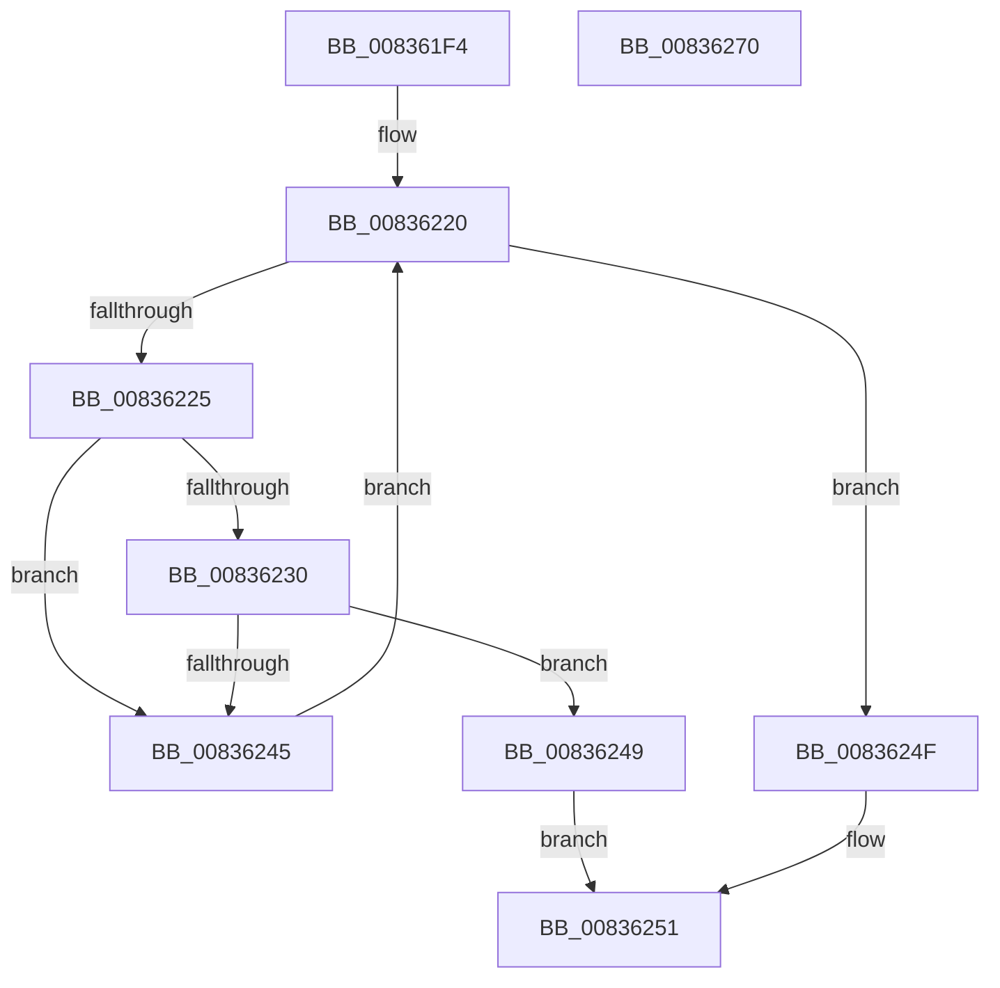

# MinCryptDecodeOid

- RVA: `0x008361F4`–`0x00836271` (길이 `125` bytes)
- VA: `0x00000001408361F4`
- 실행 섹션: `PAGE`
- PDB 이름 있음: `예`; PDB Function 태그: `아니요`
- unwind 정보 RVA: `0x0005FEF8`
- 디코드: `40`개 명령, `125/125` bytes 표시
- 미해석 바이트: `0` (있으면 어셈블리에 `.byte`로 보존)

> 이 문서는 커널 이미지의 기계어와 PDB 기호를 분석해 생성했습니다. 4번과 5번은 함수 원형과 자료형을 바이너리 사용 방식에서 추정한 C 해석이며 원본 소스 복구 결과는 아닙니다.

## 1. Dependencies

- 직접 호출 지점: **1**; 고유 호출 대상: **1**
- 직접 호출자로 확인된 함수: **2**
- RIP 상대 이미지 참조: **0**

### Outgoing calls
- `0x0083623B` → [RtlCompareMemory](../../text/6B/RtlCompareMemory_function_006BA670.md) (function, `0x006BA670`)

### Direct callers
- [MinCryptDecodeHashAlgorithmIdentifier](MinCryptDecodeHashAlgorithmIdentifier_function_008361A0.md) at `0x008361D6`
- [MinCryptVerifySignedHash2](MinCryptVerifySignedHash2_function_008362A0.md) at `0x0083630C`
- [MinCryptVerifySignedHash2](MinCryptVerifySignedHash2_function_008362A0.md) at `0x00836328`

### Static image references
- 디코드된 RIP-relative 메모리 참조가 없습니다.

## 2. Other-region calls and transfers

- 다른 실행 섹션으로 향하는 call: **1**
  - `0x0083623B` → [RtlCompareMemory](../../text/6B/RtlCompareMemory_function_006BA670.md) (`PAGE` → `.text`)
- 별도 외부 분기/꼬리 이동을 확인하지 못했습니다.

## 3. Assembly (complete function range)

```asm
008361F4  48 8B C4                        mov rax, rsp
008361F7  48 89 58 08                     mov qword ptr [rax + 8], rbx
008361FB  48 89 68 10                     mov qword ptr [rax + 0x10], rbp
008361FF  48 89 70 18                     mov qword ptr [rax + 0x18], rsi
00836203  48 89 78 20                     mov qword ptr [rax + 0x20], rdi
00836207  41 54                           push r12
00836209  41 56                           push r14
0083620B  41 57                           push r15
0083620D  48 83 EC 20                     sub rsp, 0x20
00836211  45 8B 30                        mov r14d, dword ptr [r8]
00836214  44 8B FA                        mov r15d, edx
00836217  4D 8B 60 08                     mov r12, qword ptr [r8 + 8]
0083621B  48 8B E9                        mov rbp, rcx
0083621E  33 FF                           xor edi, edi
00836220  41 3B FF                        cmp edi, r15d
00836223  73 2A                           jae 0x14083624f
00836225  48 8D 34 7F                     lea rsi, [rdi + rdi*2]
00836229  44 3B 74 F5 00                  cmp r14d, dword ptr [rbp + rsi*8]
0083622E  75 15                           jne 0x140836245
00836230  48 8B 54 F5 08                  mov rdx, qword ptr [rbp + rsi*8 + 8]
00836235  4D 8B C6                        mov r8, r14
00836238  49 8B CC                        mov rcx, r12
0083623B  E8 30 44 E8 FF                  call 0x1406ba670
00836240  49 3B C6                        cmp rax, r14
00836243  74 04                           je 0x140836249
00836245  FF C7                           inc edi
00836247  EB D7                           jmp 0x140836220
00836249  8B 44 F5 10                     mov eax, dword ptr [rbp + rsi*8 + 0x10]
0083624D  EB 02                           jmp 0x140836251
0083624F  33 C0                           xor eax, eax
00836251  48 8B 5C 24 40                  mov rbx, qword ptr [rsp + 0x40]
00836256  48 8B 6C 24 48                  mov rbp, qword ptr [rsp + 0x48]
0083625B  48 8B 74 24 50                  mov rsi, qword ptr [rsp + 0x50]
00836260  48 8B 7C 24 58                  mov rdi, qword ptr [rsp + 0x58]
00836265  48 83 C4 20                     add rsp, 0x20
00836269  41 5F                           pop r15
0083626B  41 5E                           pop r14
0083626D  41 5C                           pop r12
0083626F  C3                              ret
00836270  CC                              int3
```

## 4. C-style interpretation (structured pseudocode)

```c
__int64 __fastcall MinCryptDecodeOid(__int64 a1, int a2, __int64 a3)
{
    __int64 result;
    __int64 v_rdi;
    __int64 v_rsp;
    unsigned __int64 v_stack_p10;
    unsigned __int64 v_stack_p18;
    unsigned __int64 v_stack_p20;
    unsigned __int64 v_stack_p8;

    *(unsigned __int64 *)(v_rsp + 8) = v_rbx;
    *(unsigned __int64 *)(v_rsp + 16) = v_rbp;
    *(unsigned __int64 *)(v_rsp + 24) = v_rsi;
    *(unsigned __int64 *)(v_rsp + 32) = v_rdi;
    v_rsp = (v_rsp) - (32);
    v_rdi = 0;
loc_00836220:
    if (0 >= ((unsigned int)((unsigned int)(a2)))) goto loc_0083624F;
    if (((unsigned int)((unsigned int)(*(unsigned int *)(a3)))) != (*(unsigned int *)(a1 + v_rdi + v_rdi * 2 * 8))) goto loc_00836245;
    result = RtlCompareMemory(*(unsigned __int64 *)(a3 + 8), *(unsigned __int64 *)(a1 + v_rdi + v_rdi * 2 * 8 + 8), (unsigned int)(*(unsigned int *)(a3)), a4);
    if (result == ((unsigned int)(*(unsigned int *)(a3)))) goto loc_00836249;
loc_00836245:
    v_rdi = (unsigned int)((v_rdi) + 1);
    goto loc_00836220;
loc_00836249:
    goto loc_00836251;
loc_0083624F:
    result = 0;
loc_00836251:
    v_rsp = (v_rsp) + (32);
    return result;
}
```

## 5. (Beta) C Style

```c
int64_t MinCryptDecodeOid(void *Arg1, int32_t Arg2, void *Arg3)
{
    uint8_t *arg1 = (uint8_t *)Arg1;
    uint8_t *arg3 = (uint8_t *)Arg3;

    int64_t result;
    int64_t local_rdi;
    int64_t local_rsp;
    uint64_t v_stack_p10;
    uint64_t v_stack_p18;
    uint64_t v_stack_p20;
    uint64_t v_stack_p8;

    *(uint64_t *)(local_rsp + 0x8) = local_rbx;
    *(uint64_t *)(local_rsp + 0x10) = local_rbp;
    *(uint64_t *)(local_rsp + 0x18) = local_rsi;
    *(uint64_t *)(local_rsp + 0x20) = local_rdi;
    local_rsp = (local_rsp) - (32);
    local_rdi = 0;
loc_00836220:
    if (0 >= ((uint32_t)((uint32_t)(Arg2)))) goto loc_0083624F;
    if (((uint32_t)((uint32_t)(*(uint32_t *)(arg3)))) != (*(uint32_t *)(arg1 + local_rdi + local_rdi * 2 * 8))) goto loc_00836245;
    result = RtlCompareMemory(*(uint64_t *)(arg3 + 0x8), *(uint64_t *)(arg1 + local_rdi + local_rdi * 2 * 8 + 0x8), (uint32_t)(*(uint32_t *)(arg3)), a4);
    if (result == ((uint32_t)(*(uint32_t *)(arg3)))) goto loc_00836249;
loc_00836245:
    local_rdi = (uint32_t)((local_rdi) + 1);
    goto loc_00836220;
loc_00836249:
    goto loc_00836251;
loc_0083624F:
    result = 0;
loc_00836251:
    local_rsp = (local_rsp) + (32);
    return result;
}
```

### 관측된 메모리 오프셋

구조체 형식이 확인되지 않은 접근은 인자 기준의 오프셋으로만 기록했습니다.

| 기준 인자 | 오프셋 표현 | 폭 (bit) | 접근 |
|---|---:|---:|---|
| `Arg1` | `+ 0x0 + rsi*8` | `32` | `R` |
| `Arg1` | `+ 0x8 + rsi*8` | `64` | `R` |
| `Arg1` | `+ 0x10 + rsi*8` | `32` | `R` |
| `Arg3` | `+ 0x0` | `32` | `R` |
| `Arg3` | `+ 0x8` | `64` | `R` |

## 6. Execution-region graph

[열기: 2D/3D 그래프와 함수 탐색 컨트롤 패널](../../../control-panel.html?section=page&rva=0x008361F4&view=graph)

- 2D 그래프는 위에서 아래로 흐르고, 3D 그래프는 빈 공간을 드래그해 회전합니다. Shift+드래그는 이동, 휠은 확대·축소, 함수 노드 선택은 대상 보고서 이동입니다.

### Static fallback


