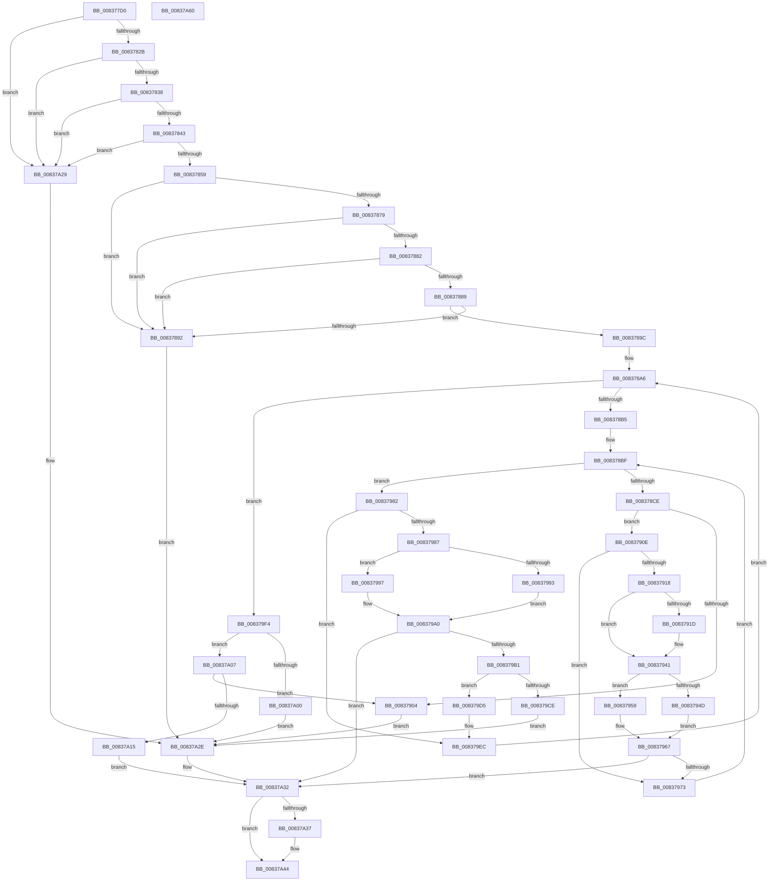

# MinCryptParseRevocationList

- RVA: `0x008377D0`–`0x00837A61` (길이 `657` bytes)
- VA: `0x00000001408377D0`
- 실행 섹션: `PAGE`
- PDB 이름 있음: `예`; PDB Function 태그: `아니요`
- unwind 정보 RVA: `0x000DADD4`
- 디코드: `167`개 명령, `657/657` bytes 표시
- 미해석 바이트: `0` (있으면 어셈블리에 `.byte`로 보존)

> 이 문서는 커널 이미지의 기계어와 PDB 기호를 분석해 생성했습니다. 4번과 5번은 함수 원형과 자료형을 바이너리 사용 방식에서 추정한 C 해석이며 원본 소스 복구 결과는 아닙니다.

## 1. Dependencies

- 직접 호출 지점: **7**; 고유 호출 대상: **5**
- 직접 호출자로 확인된 함수: **1**
- RIP 상대 이미지 참조: **3**

### Outgoing calls
- `0x0083781E` → [MinAsn1ParseSingleExtensionValue](MinAsn1ParseSingleExtensionValue_function_00839058.md) (function, `0x00839058`)
- `0x00837870` → [MinAsn1ParseSingleExtensionValue](MinAsn1ParseSingleExtensionValue_function_00839058.md) (function, `0x00839058`)
- `0x008378FB` → [MinAsn1ParseSingleExtensionValue](MinAsn1ParseSingleExtensionValue_function_00839058.md) (function, `0x00839058`)
- `0x0083793C` → [memcpy](../../text/6C/memcpy_function_006C6840.md) (function, `0x006C6840`)
- `0x008379BC` → [ExAllocatePool2](../../poolcode/B8/ExAllocatePool2_function_00B820F0.md) (function, `0x00B820F0`)
- `0x008379E0` → [memset](../../text/6C/memset_function_006C6C40.md) (function, `0x006C6C40`)
- `0x00837A3F` → [ExFreePoolWithTag](../../poolcode/B8/ExFreePoolWithTag_function_00B82870.md) (function, `0x00B82870`)

### Direct callers
- [MinCrypK_ParseRevocationList](../../text/6A/MinCrypK_ParseRevocationList_function_006A602C.md) at `0x006A611E`

### Static image references
- `0x00837817` → RVA `0x00B4BC48` (`PAGE`; read)
- `0x00837869` → RVA `0x00B4BC58` (`PAGE`; read)
- `0x0083789F` → RVA `0x00B4E460` (`PAGE`; read)

## 2. Other-region calls and transfers

- 다른 실행 섹션으로 향하는 call: **4**
  - `0x0083793C` → [memcpy](../../text/6C/memcpy_function_006C6840.md) (`PAGE` → `.text`)
  - `0x008379BC` → [ExAllocatePool2](../../poolcode/B8/ExAllocatePool2_function_00B820F0.md) (`PAGE` → `POOLCODE`)
  - `0x008379E0` → [memset](../../text/6C/memset_function_006C6C40.md) (`PAGE` → `.text`)
  - `0x00837A3F` → [ExFreePoolWithTag](../../poolcode/B8/ExFreePoolWithTag_function_00B82870.md) (`PAGE` → `POOLCODE`)
- 별도 외부 분기/꼬리 이동을 확인하지 못했습니다.

## 3. Assembly (complete function range)

```asm
008377D0  48 8B C4                        mov rax, rsp
008377D3  48 89 58 08                     mov qword ptr [rax + 8], rbx
008377D7  48 89 70 20                     mov qword ptr [rax + 0x20], rsi
008377DB  4C 89 40 18                     mov qword ptr [rax + 0x18], r8
008377DF  89 50 10                        mov dword ptr [rax + 0x10], edx
008377E2  57                              push rdi
008377E3  41 54                           push r12
008377E5  41 55                           push r13
008377E7  41 56                           push r14
008377E9  41 57                           push r15
008377EB  48 83 EC 60                     sub rsp, 0x60
008377EF  4C 8B E9                        mov r13, rcx
008377F2  0F 57 C0                        xorps xmm0, xmm0
008377F5  0F 11 40 B8                     movups xmmword ptr [rax - 0x48], xmm0
008377F9  C6 40 10 00                     mov byte ptr [rax + 0x10], 0
008377FD  0F 11 40 C8                     movups xmmword ptr [rax - 0x38], xmm0
00837801  33 FF                           xor edi, edi
00837803  48 89 78 B0                     mov qword ptr [rax - 0x50], rdi
00837807  33 DB                           xor ebx, ebx
00837809  89 58 98                        mov dword ptr [rax - 0x68], ebx
0083780C  4C 8D 48 B8                     lea r9, [rax - 0x48]
00837810  4C 8D 40 10                     lea r8, [rax + 0x10]
00837814  48 8B D1                        mov rdx, rcx
00837817  48 8D 0D 2A 44 31 00            lea rcx, [rip + 0x31442a]
0083781E  E8 35 18 00 00                  call 0x140839058
00837823  85 C0                           test eax, eax
00837825  0F 88 FE 01 00 00               js 0x140837a29
0083782B  38 9C 24 98 00 00 00            cmp byte ptr [rsp + 0x98], bl
00837832  0F 84 F1 01 00 00               je 0x140837a29
00837838  83 7C 24 40 02                  cmp dword ptr [rsp + 0x40], 2
0083783D  0F 85 E6 01 00 00               jne 0x140837a29
00837843  48 8B 44 24 48                  mov rax, qword ptr [rsp + 0x48]
00837848  0F B7 08                        movzx ecx, word ptr [rax]
0083784B  B8 64 86 00 00                  mov eax, 0x8664
00837850  66 3B C8                        cmp cx, ax
00837853  0F 85 D0 01 00 00               jne 0x140837a29
00837859  4C 8D 4C 24 40                  lea r9, [rsp + 0x40]
0083785E  4C 8D 84 24 98 00 00 00         lea r8, [rsp + 0x98]
00837866  49 8B D5                        mov rdx, r13
00837869  48 8D 0D E8 43 31 00            lea rcx, [rip + 0x3143e8]
00837870  E8 E3 17 00 00                  call 0x140839058
00837875  85 C0                           test eax, eax
00837877  78 19                           js 0x140837892
00837879  38 9C 24 98 00 00 00            cmp byte ptr [rsp + 0x98], bl
00837880  74 10                           je 0x140837892
00837882  83 7C 24 40 04                  cmp dword ptr [rsp + 0x40], 4
00837887  75 09                           jne 0x140837892
00837889  48 8B 44 24 48                  mov rax, qword ptr [rsp + 0x48]
0083788E  39 18                           cmp dword ptr [rax], ebx
00837890  74 0A                           je 0x14083789c
00837892  BB 24 00 00 C0                  mov ebx, 0xc0000024
00837897  E9 92 01 00 00                  jmp 0x140837a2e
0083789C  45 33 F6                        xor r14d, r14d
0083789F  48 8D 0D BA 6B 31 00            lea rcx, [rip + 0x316bba]
008378A6  44 89 74 24 28                  mov dword ptr [rsp + 0x28], r14d
008378AB  41 83 FE 02                     cmp r14d, 2
008378AF  0F 83 3F 01 00 00               jae 0x1408379f4
008378B5  33 F6                           xor esi, esi
008378B7  48 89 74 24 30                  mov qword ptr [rsp + 0x30], rsi
008378BC  45 33 FF                        xor r15d, r15d
008378BF  44 89 7C 24 24                  mov dword ptr [rsp + 0x24], r15d
008378C4  41 83 FF 0D                     cmp r15d, 0xd
008378C8  0F 83 B4 00 00 00               jae 0x140837982
008378CE  45 8B E7                        mov r12d, r15d
008378D1  4D 03 E4                        add r12, r12
008378D4  42 8B 44 E1 08                  mov eax, dword ptr [rcx + r12*8 + 8]
008378D9  89 44 24 50                     mov dword ptr [rsp + 0x50], eax
008378DD  4A 8B 04 E1                     mov rax, qword ptr [rcx + r12*8]
008378E1  48 89 44 24 58                  mov qword ptr [rsp + 0x58], rax
008378E6  4C 8D 4C 24 40                  lea r9, [rsp + 0x40]
008378EB  4C 8D 84 24 98 00 00 00         lea r8, [rsp + 0x98]
008378F3  49 8B D5                        mov rdx, r13
008378F6  48 8D 4C 24 50                  lea rcx, [rsp + 0x50]
008378FB  E8 58 17 00 00                  call 0x140839058
00837900  85 C0                           test eax, eax
00837902  79 0A                           jns 0x14083790e
00837904  BB 28 04 00 C0                  mov ebx, 0xc0000428
00837909  E9 20 01 00 00                  jmp 0x140837a2e
0083790E  80 BC 24 98 00 00 00 00         cmp byte ptr [rsp + 0x98], 0
00837916  74 5B                           je 0x140837973
00837918  45 85 F6                        test r14d, r14d
0083791B  74 24                           je 0x140837941
0083791D  8B 44 24 40                     mov eax, dword ptr [rsp + 0x40]
00837921  42 89 04 E7                     mov dword ptr [rdi + r12*8], eax
00837925  48 8D 8E D0 00 00 00            lea rcx, [rsi + 0xd0]
0083792C  48 03 CF                        add rcx, rdi
0083792F  4A 89 4C E7 08                  mov qword ptr [rdi + r12*8 + 8], rcx
00837934  44 8B C0                        mov r8d, eax
00837937  48 8B 54 24 48                  mov rdx, qword ptr [rsp + 0x48]
0083793C  E8 FF EE E8 FF                  call 0x1406c6840
00837941  8B 4C 24 40                     mov ecx, dword ptr [rsp + 0x40]
00837945  48 03 CE                        add rcx, rsi
00837948  48 3B CE                        cmp rcx, rsi
0083794B  72 0C                           jb 0x140837959
0083794D  48 8B F1                        mov rsi, rcx
00837950  48 89 4C 24 30                  mov qword ptr [rsp + 0x30], rcx
00837955  33 DB                           xor ebx, ebx
00837957  EB 0E                           jmp 0x140837967
00837959  48 83 CE FF                     or rsi, 0xffffffffffffffff
0083795D  48 89 74 24 30                  mov qword ptr [rsp + 0x30], rsi
00837962  BB 95 00 00 C0                  mov ebx, 0xc0000095
00837967  89 5C 24 20                     mov dword ptr [rsp + 0x20], ebx
0083796B  85 DB                           test ebx, ebx
0083796D  0F 88 BF 00 00 00               js 0x140837a32
00837973  41 FF C7                        inc r15d
00837976  48 8D 0D E3 6A 31 00            lea rcx, [rip + 0x316ae3]
0083797D  E9 3D FF FF FF                  jmp 0x1408378bf
00837982  45 85 F6                        test r14d, r14d
00837985  75 65                           jne 0x1408379ec
00837987  48 8D 96 D0 00 00 00            lea rdx, [rsi + 0xd0]
0083798E  48 3B D6                        cmp rdx, rsi
00837991  72 04                           jb 0x140837997
00837993  33 DB                           xor ebx, ebx
00837995  EB 09                           jmp 0x1408379a0
00837997  48 83 CA FF                     or rdx, 0xffffffffffffffff
0083799B  BB 95 00 00 C0                  mov ebx, 0xc0000095
008379A0  48 89 54 24 30                  mov qword ptr [rsp + 0x30], rdx
008379A5  89 5C 24 20                     mov dword ptr [rsp + 0x20], ebx
008379A9  85 DB                           test ebx, ebx
008379AB  0F 88 81 00 00 00               js 0x140837a32
008379B1  B9 02 01 00 00                  mov ecx, 0x102
008379B6  41 B8 43 49 63 72               mov r8d, 0x72634943
008379BC  E8 2F A7 34 00                  call 0x140b820f0
008379C1  48 8B F8                        mov rdi, rax
008379C4  48 89 44 24 38                  mov qword ptr [rsp + 0x38], rax
008379C9  48 85 C0                        test rax, rax
008379CC  75 07                           jne 0x1408379d5
008379CE  BB 17 00 00 C0                  mov ebx, 0xc0000017
008379D3  EB 59                           jmp 0x140837a2e
008379D5  33 D2                           xor edx, edx
008379D7  41 B8 D0 00 00 00               mov r8d, 0xd0
008379DD  48 8B C8                        mov rcx, rax
008379E0  E8 5B F2 E8 FF                  call 0x1406c6c40
008379E5  48 8D 0D 74 6A 31 00            lea rcx, [rip + 0x316a74]
008379EC  41 FF C6                        inc r14d
008379EF  E9 B2 FE FF FF                  jmp 0x1408378a6
008379F4  F7 87 B0 00 00 00 F7 FF FF FF   test dword ptr [rdi + 0xb0], 0xfffffff7
008379FE  74 07                           je 0x140837a07
00837A00  BB 03 00 43 C0                  mov ebx, 0xc0430003
00837A05  EB 27                           jmp 0x140837a2e
00837A07  8B 87 C0 00 00 00               mov eax, dword ptr [rdi + 0xc0]
00837A0D  A8 1F                           test al, 0x1f
00837A0F  0F 85 EF FE FF FF               jne 0x140837904
00837A15  48 8B 84 24 A0 00 00 00         mov rax, qword ptr [rsp + 0xa0]
00837A1D  48 89 38                        mov qword ptr [rax], rdi
00837A20  33 FF                           xor edi, edi
00837A22  48 89 7C 24 38                  mov qword ptr [rsp + 0x38], rdi
00837A27  EB 09                           jmp 0x140837a32
00837A29  BB 59 00 00 C0                  mov ebx, 0xc0000059
00837A2E  89 5C 24 20                     mov dword ptr [rsp + 0x20], ebx
00837A32  48 85 FF                        test rdi, rdi
00837A35  74 0D                           je 0x140837a44
00837A37  BA 43 49 63 72                  mov edx, 0x72634943
00837A3C  48 8B CF                        mov rcx, rdi
00837A3F  E8 2C AE 34 00                  call 0x140b82870
00837A44  8B C3                           mov eax, ebx
00837A46  4C 8D 5C 24 60                  lea r11, [rsp + 0x60]
00837A4B  49 8B 5B 30                     mov rbx, qword ptr [r11 + 0x30]
00837A4F  49 8B 73 48                     mov rsi, qword ptr [r11 + 0x48]
00837A53  49 8B E3                        mov rsp, r11
00837A56  41 5F                           pop r15
00837A58  41 5E                           pop r14
00837A5A  41 5D                           pop r13
00837A5C  41 5C                           pop r12
00837A5E  5F                              pop rdi
00837A5F  C3                              ret
00837A60  CC                              int3
```

## 4. C-style interpretation (structured pseudocode)

```c
__int64 __fastcall MinCryptParseRevocationList(__int64 a1, int a2, __int64 a3)
{
    __int64 result;
    __int64 v_r12;
    __int64 v_r14;
    __int64 v_r15;
    __int64 v_rbx;
    __int64 v_rdi;
    __int64 v_rsi;
    __int64 v_rsp;
    unsigned __int64 v_stack_m28;
    unsigned __int64 v_stack_m30;
    unsigned int v_stack_m38;
    unsigned __int64 v_stack_m40;
    unsigned int v_stack_m48;
    unsigned __int64 v_stack_m50;
    unsigned __int64 v_stack_m58;
    unsigned int v_stack_m60;
    unsigned int v_stack_m64;
    unsigned int v_stack_m68;
    unsigned __int8 v_stack_p10;
    unsigned __int64 v_stack_p18;

    *(unsigned __int64 *)(v_rsp + 8) = v_rbx;
    *(unsigned __int64 *)(v_rsp + 32) = v_rsi;
    *(unsigned __int64 *)(v_rsp + 24) = a3;
    *(unsigned int *)(v_rsp + 16) = a2;
    v_rsp = (v_rsp) - (96);
    *(unsigned __int64 *)(v_rsp - 72) = v_xmm0;
    *(unsigned __int8 *)(v_rsp + 16) = 0;
    *(unsigned __int64 *)(v_rsp - 56) = v_xmm0;
    v_rdi = 0;
    *(unsigned __int64 *)(v_rsp - 80) = 0;
    v_rbx = 0;
    *(unsigned int *)(v_rsp - 104) = 0;
    result = MinAsn1ParseSingleExtensionValue(v_rip + 3228714, a1, v_rsp + 16, v_rsp - 72);
    if (sign_flag) goto loc_00837A29;
    if (v_stack_p10 == 0) goto loc_00837A29;
    if (v_stack_m48 != 2) goto loc_00837A29;
    if (((unsigned __int16)(*(unsigned __int16 *)(v_stack_m40))) != ((unsigned __int16)((unsigned int)(0x8664ULL)))) goto loc_00837A29;
    result = MinAsn1ParseSingleExtensionValue(v_rip + 3228648, a1, v_stack_p10, v_stack_m48);
    if (sign_flag) goto loc_00837892;
    if (v_stack_p10 == 0) goto loc_00837892;
    if (v_stack_m48 != 4) goto loc_00837892;
    if ((*(unsigned int *)(v_stack_m40)) == 0) goto loc_0083789C;
loc_00837892:
    goto loc_00837A2E;
loc_0083789C:
    v_r14 = 0;
loc_008378A6:
    v_stack_m60 = 0;
    if (0 >= 2) goto loc_008379F4;
    v_rsi = 0;
    v_stack_m58 = 0;
    v_r15 = 0;
loc_008378BF:
    v_stack_m64 = 0;
    if (0 >= 13) goto loc_00837982;
    v_r12 = (0) + (0);
    v_stack_m38 = (unsigned int)((unsigned int)(*(unsigned int *)(v_rip + 3238842 + v_r12 * 8 + 8)));
    v_stack_m30 = *(unsigned __int64 *)(v_rip + 3238842 + v_r12 * 8);
    result = MinAsn1ParseSingleExtensionValue(v_stack_m38, a1, v_stack_p10, v_stack_m48);
    if (!sign_flag) goto loc_0083790E;
loc_00837904:
    goto loc_00837A2E;
loc_0083790E:
    if (v_stack_p10 == 0) goto loc_00837973;
    if (0 != 0) {
        result = v_stack_m48;
        *(unsigned int *)(v_rdi + v_r12 * 8) = (unsigned int)(result);
        a1 = v_rsi + 208;
        a1 = (a1) + (0);
        *(unsigned __int64 *)(v_rdi + v_r12 * 8 + 8) = a1;
        a3 = (unsigned int)(result);
        a2 = v_stack_m40;
        result = memcpy(a1, a2, a3, v_stack_m48);
    }
    a1 = ((unsigned int)(v_stack_m48)) + (0);
    if (a1 < 0) goto loc_00837959;
    v_stack_m58 = a1;
    v_rbx = 0;
    goto loc_00837967;
loc_00837959:
    v_rsi = (a1) | (-1);
    v_stack_m58 = v_rsi;
loc_00837967:
    v_stack_m68 = (unsigned int)((unsigned int)(0xC0000095ULL));
    if (sign_flag) goto loc_00837A32;
loc_00837973:
    v_r15 = (unsigned int)((v_r15) + 1);
    goto loc_008378BF;
loc_00837982:
    if (0 != 0) goto loc_008379EC;
    if ((v_rsi + 208) < v_rsi) goto loc_00837997;
    v_rbx = 0;
    goto loc_008379A0;
loc_00837997:
    a2 = (v_rsi + 208) | (-1);
loc_008379A0:
    v_stack_m58 = a2;
    v_stack_m68 = (unsigned int)((unsigned int)(0xC0000095ULL));
    if (sign_flag) goto loc_00837A32;
    result = ExAllocatePool2(258, a2, (unsigned int)(0x72634943ULL), v_stack_m48);
    v_stack_m50 = result;
    if (result != 0) goto loc_008379D5;
    goto loc_00837A2E;
loc_008379D5:
    a2 = 0;
    result = memset(result, a2, 208, v_stack_m48);
loc_008379EC:
    v_r14 = (unsigned int)((v_r14) + 1);
    goto loc_008378A6;
loc_008379F4:
    if (((*(unsigned int *)(result + 176)) & (0xFFFFFFF7ULL)) == 0) goto loc_00837A07;
    goto loc_00837A2E;
loc_00837A07:
    if ((((unsigned __int8)((unsigned int)(*(unsigned int *)(result + 192)))) & (31)) != 0) goto loc_00837904;
    *(unsigned __int64 *)(v_stack_p18) = result;
    v_rdi = 0;
    v_stack_m50 = 0;
    goto loc_00837A32;
loc_00837A29:
loc_00837A2E:
    v_stack_m68 = (unsigned int)((unsigned int)(0xC0000059ULL));
loc_00837A32:
    result = v_stack_p18;
    if (0 != 0) {
        a2 = 0x72634943ULL;
        a1 = 0;
        result = ExFreePoolWithTag(a1, a2, 208, v_stack_m48);
    }
    return (unsigned int)((unsigned int)((unsigned int)(0xC0000059ULL)));
}
```

## 5. (Beta) C Style

```c
int64_t MinCryptParseRevocationList(int64_t Arg1, int32_t Arg2, int64_t Arg3)
{
    int64_t result;
    int64_t local_r12;
    int64_t local_r14;
    int64_t local_r15;
    int64_t local_rbx;
    int64_t local_rdi;
    int64_t local_rsi;
    int64_t local_rsp;
    uint64_t v_stack_m28;
    uint64_t v_stack_m30;
    uint32_t v_stack_m38;
    uint64_t v_stack_m40;
    uint32_t v_stack_m48;
    uint64_t v_stack_m50;
    uint64_t v_stack_m58;
    uint32_t v_stack_m60;
    uint32_t v_stack_m64;
    uint32_t v_stack_m68;
    uint8_t v_stack_p10;
    uint64_t v_stack_p18;

    *(uint64_t *)(local_rsp + 0x8) = local_rbx;
    *(uint64_t *)(local_rsp + 0x20) = local_rsi;
    *(uint64_t *)(local_rsp + 0x18) = Arg3;
    *(uint32_t *)(local_rsp + 0x10) = Arg2;
    local_rsp = (local_rsp) - (96);
    *(uint64_t *)(local_rsp - 0x48) = v_xmm0;
    *(uint8_t *)(local_rsp + 0x10) = 0;
    *(uint64_t *)(local_rsp - 0x38) = v_xmm0;
    local_rdi = 0;
    *(uint64_t *)(local_rsp - 0x50) = 0;
    local_rbx = 0;
    *(uint32_t *)(local_rsp - 0x68) = 0;
    result = MinAsn1ParseSingleExtensionValue(v_rip + 3228714, Arg1, local_rsp + 16, local_rsp - 72);
    if (sign_flag) goto loc_00837A29;
    if (v_stack_p10 == 0) goto loc_00837A29;
    if (v_stack_m48 != 2) goto loc_00837A29;
    if (((uint16_t)(*(uint16_t *)(v_stack_m40))) != ((uint16_t)((uint32_t)(0x8664ULL)))) goto loc_00837A29;
    result = MinAsn1ParseSingleExtensionValue(v_rip + 3228648, Arg1, v_stack_p10, v_stack_m48);
    if (sign_flag) goto loc_00837892;
    if (v_stack_p10 == 0) goto loc_00837892;
    if (v_stack_m48 != 4) goto loc_00837892;
    if ((*(uint32_t *)(v_stack_m40)) == 0) goto loc_0083789C;
loc_00837892:
    goto loc_00837A2E;
loc_0083789C:
    local_r14 = 0;
loc_008378A6:
    v_stack_m60 = 0;
    if (0 >= 2) goto loc_008379F4;
    local_rsi = 0;
    v_stack_m58 = 0;
    local_r15 = 0;
loc_008378BF:
    v_stack_m64 = 0;
    if (0 >= 13) goto loc_00837982;
    local_r12 = (0) + (0);
    v_stack_m38 = (uint32_t)((uint32_t)(*(uint32_t *)(v_rip + 0x316BBA + local_r12 * 8 + 0x8)));
    v_stack_m30 = *(uint64_t *)(v_rip + 0x316BBA + local_r12 * 8);
    result = MinAsn1ParseSingleExtensionValue(v_stack_m38, Arg1, v_stack_p10, v_stack_m48);
    if (!sign_flag) goto loc_0083790E;
loc_00837904:
    goto loc_00837A2E;
loc_0083790E:
    if (v_stack_p10 == 0) goto loc_00837973;
    if (0 != 0) {
        result = v_stack_m48;
        *(uint32_t *)(local_rdi + local_r12 * 8) = (uint32_t)(result);
        Arg1 = local_rsi + 208;
        Arg1 = (Arg1) + (0);
        *(uint64_t *)(local_rdi + local_r12 * 8 + 0x8) = Arg1;
        Arg3 = (uint32_t)(result);
        Arg2 = v_stack_m40;
        result = memcpy(Arg1, Arg2, Arg3, v_stack_m48);
    }
    Arg1 = ((uint32_t)(v_stack_m48)) + (0);
    if (Arg1 < 0) goto loc_00837959;
    v_stack_m58 = Arg1;
    local_rbx = 0;
    goto loc_00837967;
loc_00837959:
    local_rsi = (Arg1) | (-1);
    v_stack_m58 = local_rsi;
loc_00837967:
    v_stack_m68 = (uint32_t)((uint32_t)(0xC0000095ULL));
    if (sign_flag) goto loc_00837A32;
loc_00837973:
    local_r15 = (uint32_t)((local_r15) + 1);
    goto loc_008378BF;
loc_00837982:
    if (0 != 0) goto loc_008379EC;
    if ((local_rsi + 208) < local_rsi) goto loc_00837997;
    local_rbx = 0;
    goto loc_008379A0;
loc_00837997:
    Arg2 = (local_rsi + 208) | (-1);
loc_008379A0:
    v_stack_m58 = Arg2;
    v_stack_m68 = (uint32_t)((uint32_t)(0xC0000095ULL));
    if (sign_flag) goto loc_00837A32;
    result = ExAllocatePool2(258, Arg2, (uint32_t)(0x72634943ULL), v_stack_m48);
    v_stack_m50 = result;
    if (result != 0) goto loc_008379D5;
    goto loc_00837A2E;
loc_008379D5:
    Arg2 = 0;
    result = memset(result, Arg2, 208, v_stack_m48);
loc_008379EC:
    local_r14 = (uint32_t)((local_r14) + 1);
    goto loc_008378A6;
loc_008379F4:
    if (((*(uint32_t *)(result + 0xB0)) & (0xFFFFFFF7ULL)) == 0) goto loc_00837A07;
    goto loc_00837A2E;
loc_00837A07:
    if ((((uint8_t)((uint32_t)(*(uint32_t *)(result + 0xC0)))) & (31)) != 0) goto loc_00837904;
    *(uint64_t *)(v_stack_p18) = result;
    local_rdi = 0;
    v_stack_m50 = 0;
    goto loc_00837A32;
loc_00837A29:
loc_00837A2E:
    v_stack_m68 = (uint32_t)((uint32_t)(0xC0000059ULL));
loc_00837A32:
    result = v_stack_p18;
    if (0 != 0) {
        Arg2 = 0x72634943ULL;
        Arg1 = 0;
        result = ExFreePoolWithTag(Arg1, Arg2, 208, v_stack_m48);
    }
    return (uint32_t)((uint32_t)((uint32_t)(0xC0000059ULL)));
}
```

## 6. Execution-region graph

[열기: 2D/3D 그래프와 함수 탐색 컨트롤 패널](../../../control-panel.html?section=page&rva=0x008377D0&view=graph)

- 2D 그래프는 위에서 아래로 흐르고, 3D 그래프는 빈 공간을 드래그해 회전합니다. Shift+드래그는 이동, 휠은 확대·축소, 함수 노드 선택은 대상 보고서 이동입니다.

### Static fallback


