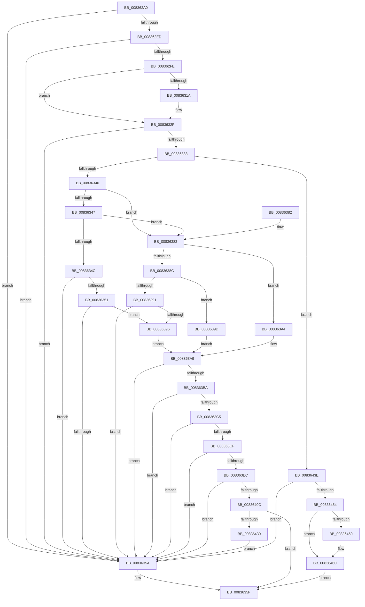

# MinCryptVerifySignedHash2

- RVA: `0x008362A0`–`0x008364BE` (길이 `542` bytes)
- VA: `0x00000001408362A0`
- 실행 섹션: `PAGE`
- PDB 이름 있음: `예`; PDB Function 태그: `아니요`
- unwind 정보 RVA: `0x000DAD04`
- 디코드: `153`개 명령, `542/542` bytes 표시
- 미해석 바이트: `0` (있으면 어셈블리에 `.byte`로 보존)

> 이 문서는 커널 이미지의 기계어와 PDB 기호를 분석해 생성했습니다. 4번과 5번은 함수 원형과 자료형을 바이너리 사용 방식에서 추정한 C 해석이며 원본 소스 복구 결과는 아닙니다.

## 1. Dependencies

- 직접 호출 지점: **12**; 고유 호출 대상: **10**
- 직접 호출자로 확인된 함수: **4**
- RIP 상대 이미지 참조: **3**

### Outgoing calls
- `0x008362E4` → [MinAsn1ParsePublicKeyInfo](MinAsn1ParsePublicKeyInfo_function_00838E94.md) (function, `0x00838E94`)
- `0x008362F5` → [MinAsn1ParseAlgorithmIdentifier](MinAsn1ParseAlgorithmIdentifier_function_00838B8C.md) (function, `0x00838B8C`)
- `0x0083630C` → [MinCryptDecodeOid](MinCryptDecodeOid_function_008361F4.md) (function, `0x008361F4`)
- `0x00836328` → [MinCryptDecodeOid](MinCryptDecodeOid_function_008361F4.md) (function, `0x008361F4`)
- `0x00836351` → [Feature_CodeIntegrity_EccSupport__private_IsEnabledDeviceUsageNoInline](../../text/6A/Feature_CodeIntegrity_EccSupport__private_IsEnabledDeviceUsageNoInline_function_006A5EB0.md) (function, `0x006A5EB0`)
- `0x0083636B` → [_security_check_cookie](../../text/6A/_security_check_cookie_function_006AC640.md) (function, `0x006AC640`)
- `0x008363B1` → [MinAsn1ParseECCSignature](../../text/6A/MinAsn1ParseECCSignature_function_006A6464.md) (function, `0x006A6464`)
- `0x008363DF` → [MinCryptCopyAsn1IntToFixedBuffer](../../text/6A/MinCryptCopyAsn1IntToFixedBuffer_function_006A5E28.md) (function, `0x006A5E28`)
- `0x008363FF` → [MinCryptCopyAsn1IntToFixedBuffer](../../text/6A/MinCryptCopyAsn1IntToFixedBuffer_function_006A5E28.md) (function, `0x006A5E28`)
- `0x0083642A` → [HashpVerifyEcdsaSignature](../84/HashpVerifyEcdsaSignature_function_00841AF4.md) (function, `0x00841AF4`)
- `0x00836447` → [MinAsn1ParseRSAPublicKey](MinAsn1ParseRSAPublicKey_function_00838EDC.md) (function, `0x00838EDC`)
- `0x008364A8` → [HashpVerifyPkcs1Signature](../84/HashpVerifyPkcs1Signature_function_00841C68.md) (function, `0x00841C68`)

### Direct callers
- [MinCryptVerifySignedHash](MinCryptVerifySignedHash_function_00836278.md) at `0x0083628C`
- [MinCryptVerifyCertificateWithPolicy2](MinCryptVerifyCertificateWithPolicy2_function_008368A8.md) at `0x0083713C`
- [I_MinCryptVerifyAuthenticodeTimeStamp](I_MinCryptVerifyAuthenticodeTimeStamp_function_00838090.md) at `0x0083821D`
- [MinCrypK_VerifySignedDataKModeEx](MinCrypK_VerifySignedDataKModeEx_function_00838568.md) at `0x008388BD`

### Static image references
- `0x008362BA` → RVA `0x00E0A740` (`.data`; read)
- `0x00836305` → RVA `0x00B4CE40` (`PAGE`; read)
- `0x00836321` → RVA `0x00B4D700` (`PAGE`; read)

## 2. Other-region calls and transfers

- 다른 실행 섹션으로 향하는 call: **5**
  - `0x00836351` → [Feature_CodeIntegrity_EccSupport__private_IsEnabledDeviceUsageNoInline](../../text/6A/Feature_CodeIntegrity_EccSupport__private_IsEnabledDeviceUsageNoInline_function_006A5EB0.md) (`PAGE` → `.text`)
  - `0x0083636B` → [_security_check_cookie](../../text/6A/_security_check_cookie_function_006AC640.md) (`PAGE` → `.text`)
  - `0x008363B1` → [MinAsn1ParseECCSignature](../../text/6A/MinAsn1ParseECCSignature_function_006A6464.md) (`PAGE` → `.text`)
  - `0x008363DF` → [MinCryptCopyAsn1IntToFixedBuffer](../../text/6A/MinCryptCopyAsn1IntToFixedBuffer_function_006A5E28.md) (`PAGE` → `.text`)
  - `0x008363FF` → [MinCryptCopyAsn1IntToFixedBuffer](../../text/6A/MinCryptCopyAsn1IntToFixedBuffer_function_006A5E28.md) (`PAGE` → `.text`)
- 별도 외부 분기/꼬리 이동을 확인하지 못했습니다.

## 3. Assembly (complete function range)

```asm
008362A0  40 55                           push rbp
008362A2  53                              push rbx
008362A3  56                              push rsi
008362A4  57                              push rdi
008362A5  41 54                           push r12
008362A7  41 56                           push r14
008362A9  41 57                           push r15
008362AB  48 8D AC 24 C0 FB FF FF         lea rbp, [rsp - 0x440]
008362B3  48 81 EC 40 05 00 00            sub rsp, 0x540
008362BA  48 8B 05 7F 44 5D 00            mov rax, qword ptr [rip + 0x5d447f]
008362C1  48 33 C4                        xor rax, rsp
008362C4  48 89 85 30 04 00 00            mov qword ptr [rbp + 0x430], rax
008362CB  4C 8B FA                        mov r15, rdx
008362CE  45 8B E0                        mov r12d, r8d
008362D1  44 8B F1                        mov r14d, ecx
008362D4  48 8D 55 90                     lea rdx, [rbp - 0x70]
008362D8  48 8B 8D A0 04 00 00            mov rcx, qword ptr [rbp + 0x4a0]
008362DF  49 8B F1                        mov rsi, r9
008362E2  33 DB                           xor ebx, ebx
008362E4  E8 AB 2B 00 00                  call 0x140838e94
008362E9  85 C0                           test eax, eax
008362EB  78 6D                           js 0x14083635a
008362ED  48 8D 55 D0                     lea rdx, [rbp - 0x30]
008362F1  48 8D 4D B0                     lea rcx, [rbp - 0x50]
008362F5  E8 92 28 00 00                  call 0x140838b8c
008362FA  85 C0                           test eax, eax
008362FC  78 5C                           js 0x14083635a
008362FE  4C 8D 45 F0                     lea r8, [rbp - 0x10]
00836302  8D 53 02                        lea edx, [rbx + 2]
00836305  48 8D 0D 34 6B 31 00            lea rcx, [rip + 0x316b34]
0083630C  E8 E3 FE FF FF                  call 0x1408361f4
00836311  8B F8                           mov edi, eax
00836313  3D 00 2E 00 00                  cmp eax, 0x2e00
00836318  75 15                           jne 0x14083632f
0083631A  4C 8D 45 00                     lea r8, [rbp]
0083631E  8D 53 03                        lea edx, [rbx + 3]
00836321  48 8D 0D D8 73 31 00            lea rcx, [rip + 0x3173d8]
00836328  E8 C7 FE FF FF                  call 0x1408361f4
0083632D  8B F8                           mov edi, eax
0083632F  85 FF                           test edi, edi
00836331  74 27                           je 0x14083635a
00836333  8B C7                           mov eax, edi
00836335  2D 00 24 00 00                  sub eax, 0x2400
0083633A  0F 84 FE 00 00 00               je 0x14083643e
00836340  2D 01 0A 00 00                  sub eax, 0xa01
00836345  74 3C                           je 0x140836383
00836347  83 E8 01                        sub eax, 1
0083634A  74 37                           je 0x140836383
0083634C  83 F8 01                        cmp eax, 1
0083634F  75 09                           jne 0x14083635a
00836351  E8 5A FB E6 FF                  call 0x1406a5eb0
00836356  85 C0                           test eax, eax
00836358  75 3C                           jne 0x140836396
0083635A  B9 28 04 00 C0                  mov ecx, 0xc0000428
0083635F  8B C1                           mov eax, ecx
00836361  48 8B 8D 30 04 00 00            mov rcx, qword ptr [rbp + 0x430]
00836368  48 33 CC                        xor rcx, rsp
0083636B  E8 D0 62 E7 FF                  call 0x1406ac640
00836370  48 81 C4 40 05 00 00            add rsp, 0x540
00836377  41 5F                           pop r15
00836379  41 5E                           pop r14
0083637B  41 5C                           pop r12
0083637D  5F                              pop rdi
0083637E  5E                              pop rsi
0083637F  5B                              pop rbx
00836380  5D                              pop rbp
00836381  C3                              ret
00836382  CC                              int3
00836383  8B C7                           mov eax, edi
00836385  2D 01 2E 00 00                  sub eax, 0x2e01
0083638A  74 18                           je 0x1408363a4
0083638C  83 E8 01                        sub eax, 1
0083638F  74 0C                           je 0x14083639d
00836391  83 F8 01                        cmp eax, 1
00836394  75 C4                           jne 0x14083635a
00836396  BB 42 00 00 00                  mov ebx, 0x42
0083639B  EB 0C                           jmp 0x1408363a9
0083639D  BB 30 00 00 00                  mov ebx, 0x30
008363A2  EB 05                           jmp 0x1408363a9
008363A4  BB 20 00 00 00                  mov ebx, 0x20
008363A9  48 8D 54 24 50                  lea rdx, [rsp + 0x50]
008363AE  48 8B CE                        mov rcx, rsi
008363B1  E8 AE 00 E7 FF                  call 0x1406a6464
008363B6  85 C0                           test eax, eax
008363B8  78 A0                           js 0x14083635a
008363BA  8D 34 1B                        lea esi, [rbx + rbx]
008363BD  8D 46 01                        lea eax, [rsi + 1]
008363C0  39 45 C0                        cmp dword ptr [rbp - 0x40], eax
008363C3  75 95                           jne 0x14083635a
008363C5  4C 8B 75 C8                     mov r14, qword ptr [rbp - 0x38]
008363C9  41 80 3E 04                     cmp byte ptr [r14], 4
008363CD  75 8B                           jne 0x14083635a
008363CF  8B 54 24 70                     mov edx, dword ptr [rsp + 0x70]
008363D3  4C 8D 45 10                     lea r8, [rbp + 0x10]
008363D7  48 8B 4C 24 78                  mov rcx, qword ptr [rsp + 0x78]
008363DC  44 8B CB                        mov r9d, ebx
008363DF  E8 44 FA E6 FF                  call 0x1406a5e28
008363E4  85 C0                           test eax, eax
008363E6  0F 88 6E FF FF FF               js 0x14083635a
008363EC  8B 55 80                        mov edx, dword ptr [rbp - 0x80]
008363EF  4C 8D 45 10                     lea r8, [rbp + 0x10]
008363F3  48 8B 4D 88                     mov rcx, qword ptr [rbp - 0x78]
008363F7  44 8B CB                        mov r9d, ebx
008363FA  8B C3                           mov eax, ebx
008363FC  4C 03 C0                        add r8, rax
008363FF  E8 24 FA E6 FF                  call 0x1406a5e28
00836404  85 C0                           test eax, eax
00836406  0F 88 4E FF FF FF               js 0x14083635a
0083640C  48 8D 45 10                     lea rax, [rbp + 0x10]
00836410  89 74 24 30                     mov dword ptr [rsp + 0x30], esi
00836414  48 89 44 24 28                  mov qword ptr [rsp + 0x28], rax
00836419  49 8D 56 01                     lea rdx, [r14 + 1]
0083641D  4D 8B CF                        mov r9, r15
00836420  44 89 64 24 20                  mov dword ptr [rsp + 0x20], r12d
00836425  44 8B C6                        mov r8d, esi
00836428  8B CF                           mov ecx, edi
0083642A  E8 C5 B6 00 00                  call 0x140841af4
0083642F  8B C8                           mov ecx, eax
00836431  85 C0                           test eax, eax
00836433  0F 89 26 FF FF FF               jns 0x14083635f
00836439  E9 1C FF FF FF                  jmp 0x14083635a
0083643E  48 8D 54 24 50                  lea rdx, [rsp + 0x50]
00836443  48 8D 4D C0                     lea rcx, [rbp - 0x40]
00836447  E8 90 2A 00 00                  call 0x140838edc
0083644C  85 C0                           test eax, eax
0083644E  0F 88 06 FF FF FF               js 0x14083635a
00836454  48 8B 85 A8 04 00 00            mov rax, qword ptr [rbp + 0x4a8]
0083645B  48 85 C0                        test rax, rax
0083645E  74 0C                           je 0x14083646c
00836460  F6 40 04 40                     test byte ptr [rax + 4], 0x40
00836464  B8 01 00 00 00                  mov eax, 1
00836469  0F 45 D8                        cmovne ebx, eax
0083646C  8B 06                           mov eax, dword ptr [rsi]
0083646E  4D 8B C4                        mov r8, r12
00836471  8B 4C 24 70                     mov ecx, dword ptr [rsp + 0x70]
00836475  8B 55 80                        mov edx, dword ptr [rbp - 0x80]
00836478  4C 8B 4D 88                     mov r9, qword ptr [rbp - 0x78]
0083647C  89 5C 24 48                     mov dword ptr [rsp + 0x48], ebx
00836480  48 89 44 24 40                  mov qword ptr [rsp + 0x40], rax
00836485  48 8B 46 08                     mov rax, qword ptr [rsi + 8]
00836489  48 89 44 24 38                  mov qword ptr [rsp + 0x38], rax
0083648E  48 8B 44 24 78                  mov rax, qword ptr [rsp + 0x78]
00836493  48 89 4C 24 30                  mov qword ptr [rsp + 0x30], rcx
00836498  41 8B CE                        mov ecx, r14d
0083649B  48 89 44 24 28                  mov qword ptr [rsp + 0x28], rax
008364A0  48 89 54 24 20                  mov qword ptr [rsp + 0x20], rdx
008364A5  49 8B D7                        mov rdx, r15
008364A8  E8 BB B7 00 00                  call 0x140841c68
008364AD  B9 28 04 00 C0                  mov ecx, 0xc0000428
008364B2  85 C0                           test eax, eax
008364B4  0F 48 C1                        cmovs eax, ecx
008364B7  8B C8                           mov ecx, eax
008364B9  E9 A1 FE FF FF                  jmp 0x14083635f
```

## 4. C-style interpretation (structured pseudocode)

```c
__int64 __fastcall MinCryptVerifySignedHash2(int a1, __int64 a2, int a3, __int64 a4, __int64 a5, __int64 a6)
{
    __int64 result;
    __int64 v_rbx;
    __int64 v_rdi;
    __int64 v_rsp;
    unsigned __int64 v_stack_m468;
    unsigned __int64 v_stack_m478;
    unsigned __int64 v_stack_m48;
    unsigned __int64 v_stack_m488;
    unsigned __int64 v_stack_m4A8;
    unsigned __int64 v_stack_m4B0;
    unsigned int v_stack_m4B8;
    unsigned __int64 v_stack_m4C8;
    unsigned __int64 v_stack_m4E8;
    unsigned __int64 v_stack_m4F0;
    unsigned int v_stack_m4F8;
    unsigned int v_stack_p20;
    unsigned __int64 v_stack_p28;
    unsigned int v_stack_p30;
    unsigned __int64 v_stack_p38;
    unsigned __int64 v_stack_p40;
    unsigned int v_stack_p48;
    unsigned __int64 v_stack_p50;
    unsigned int v_stack_p70;
    unsigned __int64 v_stack_p78;

    v_rsp = (v_rsp) - (0x540ULL);
    result = (*(unsigned __int64 *)(v_rip + 6112383)) ^ (v_rsp);
    v_stack_m48 = result;
    v_rbx = 0;
    result = MinAsn1ParsePublicKeyInfo(a5, v_stack_m4E8, a3, a4);
    if (sign_flag) goto loc_0083635A;
    result = MinAsn1ParseAlgorithmIdentifier(v_stack_m4C8, v_stack_m4A8, a3, a4);
    if (sign_flag) goto loc_0083635A;
    result = MinCryptDecodeOid(v_rip + 3238708, v_rbx + 2, v_stack_m488, a4);
    v_rdi = (unsigned int)((unsigned int)(result));
    if (((unsigned int)(result)) == 0x2E00ULL) {
        a3 = v_stack_m478;
        a2 = v_rbx + 3;
        a1 = v_rip + 3240920;
        result = MinCryptDecodeOid(a1, a2, a3, a4);
        v_rdi = (unsigned int)(result);
    }
    if ((unsigned int)(v_rdi) == 0) goto loc_0083635A;
    result = (unsigned int)(((unsigned int)((unsigned int)(v_rdi))) - (0x2400ULL));
    if (condition_is_equal) goto loc_0083643E;
    result = (unsigned int)((result) - (0xA01ULL));
    if (condition_is_equal) goto loc_00836383;
    result = (unsigned int)((result) - (1));
    if (condition_is_equal) goto loc_00836383;
    if (((unsigned int)(result)) != 1) goto loc_0083635A;
    result = Feature_CodeIntegrity_EccSupport__private_IsEnabledDeviceUsageNoInline(a1, a2, a3, a4);
    if ((unsigned int)(result) != 0) goto loc_00836396;
loc_0083635A:
loc_0083635F:
    a1 = (v_stack_m48) ^ (v_rsp);
    result = _security_check_cookie(a1, a2, a3, a4);
    v_rsp = (v_rsp) + (0x540ULL);
    return result;
loc_00836383:
    result = (unsigned int)(((unsigned int)((unsigned int)(v_rdi))) - (0x2E01ULL));
    if (condition_is_equal) goto loc_008363A4;
    result = (unsigned int)((result) - (1));
    if (condition_is_equal) goto loc_0083639D;
    if (((unsigned int)(result)) != 1) goto loc_0083635A;
loc_00836396:
    goto loc_008363A9;
loc_0083639D:
    goto loc_008363A9;
loc_008363A4:
loc_008363A9:
    result = MinAsn1ParseECCSignature(a4, v_stack_p50, a3, a4);
    if (sign_flag) goto loc_0083635A;
    if (v_stack_m4B8 != ((unsigned int)(32 + 32 * 1 + 1))) goto loc_0083635A;
    if ((*(unsigned __int8 *)(v_stack_m4B0)) != 4) goto loc_0083635A;
    result = MinCryptCopyAsn1IntToFixedBuffer(v_stack_p78, (unsigned int)(v_stack_p70), v_stack_m468, 32);
    if (sign_flag) goto loc_0083635A;
    a3 = (v_stack_m468) + (32);
    result = MinCryptCopyAsn1IntToFixedBuffer(v_stack_m4F0, (unsigned int)(v_stack_m4F8), a3, 32);
    if (sign_flag) goto loc_0083635A;
    v_stack_p30 = (unsigned int)(32 + 32 * 1);
    v_stack_p28 = v_stack_m468;
    v_stack_p20 = (unsigned int)((unsigned int)(a3));
    result = HashpVerifyEcdsaSignature((unsigned int)((unsigned int)(v_rdi)), v_stack_m4B0 + 1, (unsigned int)((unsigned int)(32 + 32 * 1)), a2);
    if (!sign_flag) goto loc_0083635F;
    goto loc_0083635A;
loc_0083643E:
    result = MinAsn1ParseRSAPublicKey(v_stack_m4B8, v_stack_p50, (unsigned int)((unsigned int)(32 + 32 * 1)), a2);
    if (sign_flag) goto loc_0083635A;
    result = a6;
    v_rbx = 32;
    if (a6 != 0) {
        result = 1;
        v_rbx = 32;
        if (((*(unsigned __int8 *)(a6 + 4)) & (64)) != 0) { v_rbx = (unsigned int)(result); }
    }
    v_stack_p48 = (unsigned int)(v_rbx);
    v_stack_p40 = (unsigned int)(*(unsigned int *)(32 + 32 * 1));
    v_stack_p38 = *(unsigned __int64 *)(32 + 32 * 1 + 8);
    v_stack_p30 = (unsigned int)(v_stack_p70);
    v_stack_p28 = v_stack_p78;
    v_stack_p20 = (unsigned int)(v_stack_m4F8);
    result = HashpVerifyPkcs1Signature((unsigned int)((unsigned int)(v_stack_m4B0)), a2, (unsigned int)(a3), v_stack_m4F0);
    if (sign_flag) { result = (unsigned int)((unsigned int)(0xC0000428ULL)); }
    goto loc_0083635F;
}
```

## 5. (Beta) C Style

```c
int64_t MinCryptVerifySignedHash2(int32_t Arg1, int64_t Arg2, int32_t Arg3, void *Arg4, int64_t Arg5, int64_t Arg6)
{
    uint8_t *arg4 = (uint8_t *)Arg4;

    int64_t result;
    int64_t local_rbx;
    int64_t local_rdi;
    int64_t local_rsp;
    uint64_t v_stack_m468;
    uint64_t v_stack_m478;
    uint64_t v_stack_m48;
    uint64_t v_stack_m488;
    uint64_t v_stack_m4A8;
    uint64_t v_stack_m4B0;
    uint32_t v_stack_m4B8;
    uint64_t v_stack_m4C8;
    uint64_t v_stack_m4E8;
    uint64_t v_stack_m4F0;
    uint32_t v_stack_m4F8;
    uint32_t v_stack_p20;
    uint64_t v_stack_p28;
    uint32_t v_stack_p30;
    uint64_t v_stack_p38;
    uint64_t v_stack_p40;
    uint32_t v_stack_p48;
    uint64_t v_stack_p50;
    uint32_t v_stack_p70;
    uint64_t v_stack_p78;

    local_rsp = (local_rsp) - (0x540ULL);
    result = (*(uint64_t *)(v_rip + 0x5D447F)) ^ (local_rsp);
    v_stack_m48 = result;
    local_rbx = 0;
    result = MinAsn1ParsePublicKeyInfo(Arg5, v_stack_m4E8, Arg3, Arg4);
    if (sign_flag) goto loc_0083635A;
    result = MinAsn1ParseAlgorithmIdentifier(v_stack_m4C8, v_stack_m4A8, Arg3, Arg4);
    if (sign_flag) goto loc_0083635A;
    result = MinCryptDecodeOid(v_rip + 3238708, local_rbx + 2, v_stack_m488, Arg4);
    local_rdi = (uint32_t)((uint32_t)(result));
    if (((uint32_t)(result)) == 0x2E00ULL) {
        Arg3 = v_stack_m478;
        Arg2 = local_rbx + 3;
        Arg1 = v_rip + 3240920;
        result = MinCryptDecodeOid(Arg1, Arg2, Arg3, Arg4);
        local_rdi = (uint32_t)(result);
    }
    if ((uint32_t)(local_rdi) == 0) goto loc_0083635A;
    result = (uint32_t)(((uint32_t)((uint32_t)(local_rdi))) - (0x2400ULL));
    if (condition_is_equal) goto loc_0083643E;
    result = (uint32_t)((result) - (0xA01ULL));
    if (condition_is_equal) goto loc_00836383;
    result = (uint32_t)((result) - (1));
    if (condition_is_equal) goto loc_00836383;
    if (((uint32_t)(result)) != 1) goto loc_0083635A;
    result = Feature_CodeIntegrity_EccSupport__private_IsEnabledDeviceUsageNoInline(Arg1, Arg2, Arg3, Arg4);
    if ((uint32_t)(result) != 0) goto loc_00836396;
loc_0083635A:
loc_0083635F:
    Arg1 = (v_stack_m48) ^ (local_rsp);
    result = _security_check_cookie(Arg1, Arg2, Arg3, Arg4);
    local_rsp = (local_rsp) + (0x540ULL);
    return result;
loc_00836383:
    result = (uint32_t)(((uint32_t)((uint32_t)(local_rdi))) - (0x2E01ULL));
    if (condition_is_equal) goto loc_008363A4;
    result = (uint32_t)((result) - (1));
    if (condition_is_equal) goto loc_0083639D;
    if (((uint32_t)(result)) != 1) goto loc_0083635A;
loc_00836396:
    goto loc_008363A9;
loc_0083639D:
    goto loc_008363A9;
loc_008363A4:
loc_008363A9:
    result = MinAsn1ParseECCSignature(Arg4, v_stack_p50, Arg3, Arg4);
    if (sign_flag) goto loc_0083635A;
    if (v_stack_m4B8 != ((uint32_t)(32 + 32 * 1 + 1))) goto loc_0083635A;
    if ((*(uint8_t *)(v_stack_m4B0)) != 4) goto loc_0083635A;
    result = MinCryptCopyAsn1IntToFixedBuffer(v_stack_p78, (uint32_t)(v_stack_p70), v_stack_m468, 32);
    if (sign_flag) goto loc_0083635A;
    Arg3 = (v_stack_m468) + (32);
    result = MinCryptCopyAsn1IntToFixedBuffer(v_stack_m4F0, (uint32_t)(v_stack_m4F8), Arg3, 32);
    if (sign_flag) goto loc_0083635A;
    v_stack_p30 = (uint32_t)(32 + 32 * 1);
    v_stack_p28 = v_stack_m468;
    v_stack_p20 = (uint32_t)((uint32_t)(Arg3));
    result = HashpVerifyEcdsaSignature((uint32_t)((uint32_t)(local_rdi)), v_stack_m4B0 + 1, (uint32_t)((uint32_t)(32 + 32 * 1)), Arg2);
    if (!sign_flag) goto loc_0083635F;
    goto loc_0083635A;
loc_0083643E:
    result = MinAsn1ParseRSAPublicKey(v_stack_m4B8, v_stack_p50, (uint32_t)((uint32_t)(32 + 32 * 1)), Arg2);
    if (sign_flag) goto loc_0083635A;
    result = Arg6;
    local_rbx = 32;
    if (Arg6 != 0) {
        result = 1;
        local_rbx = 32;
        if (((*(uint8_t *)(Arg6 + 0x4)) & (64)) != 0) { local_rbx = (uint32_t)(result); }
    }
    v_stack_p48 = (uint32_t)(local_rbx);
    v_stack_p40 = (uint32_t)(*(uint32_t *)(32 + 0x20 * 1));
    v_stack_p38 = *(uint64_t *)(32 + 0x20 * 1 + 0x8);
    v_stack_p30 = (uint32_t)(v_stack_p70);
    v_stack_p28 = v_stack_p78;
    v_stack_p20 = (uint32_t)(v_stack_m4F8);
    result = HashpVerifyPkcs1Signature((uint32_t)((uint32_t)(v_stack_m4B0)), Arg2, (uint32_t)(Arg3), v_stack_m4F0);
    if (sign_flag) { result = (uint32_t)((uint32_t)(0xC0000428ULL)); }
    goto loc_0083635F;
}
```

### 관측된 메모리 오프셋

구조체 형식이 확인되지 않은 접근은 인자 기준의 오프셋으로만 기록했습니다.

| 기준 인자 | 오프셋 표현 | 폭 (bit) | 접근 |
|---|---:|---:|---|
| `Arg4` | `+ 0x0` | `32` | `R` |
| `Arg4` | `+ 0x8` | `64` | `R` |

## 6. Execution-region graph

[열기: 2D/3D 그래프와 함수 탐색 컨트롤 패널](../../../control-panel.html?section=page&rva=0x008362A0&view=graph)

- 2D 그래프는 위에서 아래로 흐르고, 3D 그래프는 빈 공간을 드래그해 회전합니다. Shift+드래그는 이동, 휠은 확대·축소, 함수 노드 선택은 대상 보고서 이동입니다.

### Static fallback


