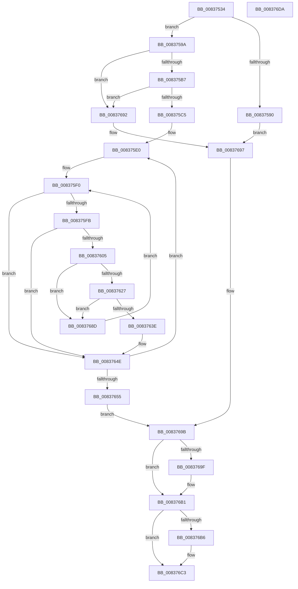

# MincrypK_ParseCertificateChainWithPolicy2

- RVA: `0x00837534`–`0x008376DB` (길이 `423` bytes)
- VA: `0x0000000140837534`
- 실행 섹션: `PAGE`
- PDB 이름 있음: `예`; PDB Function 태그: `아니요`
- unwind 정보 RVA: `0x000DAD28`
- 디코드: `109`개 명령, `423/423` bytes 표시
- 미해석 바이트: `0` (있으면 어셈블리에 `.byte`로 보존)

> 이 문서는 커널 이미지의 기계어와 PDB 기호를 분석해 생성했습니다. 4번과 5번은 함수 원형과 자료형을 바이너리 사용 방식에서 추정한 C 해석이며 원본 소스 복구 결과는 아닙니다.

## 1. Dependencies

- 직접 호출 지점: **6**; 고유 호출 대상: **6**
- 직접 호출자로 확인된 함수: **1**
- RIP 상대 이미지 참조: **0**

### Outgoing calls
- `0x0083757E` → [ExAllocatePool2](../../poolcode/B8/ExAllocatePool2_function_00B820F0.md) (function, `0x00B820F0`)
- `0x008375AA` → [MinAsn1ExtractParsedCertificatesFromSignedData](MinAsn1ExtractParsedCertificatesFromSignedData_function_0083A0F4.md) (function, `0x0083A0F4`)
- `0x00837635` → [memcmp](../../text/6C/memcmp_function_006C6B10.md) (function, `0x006C6B10`)
- `0x00837678` → [MinCryptVerifyCertificateWithPolicy2](MinCryptVerifyCertificateWithPolicy2_function_008368A8.md) (function, `0x008368A8`)
- `0x008376AA` → [I_MinCryptBuildErrorPolicy](I_MinCryptBuildErrorPolicy_function_008391DC.md) (function, `0x008391DC`)
- `0x008376BE` → [ExFreePoolWithTag](../../poolcode/B8/ExFreePoolWithTag_function_00B82870.md) (function, `0x00B82870`)

### Direct callers
- [MincrypK_ParseCertificateChainWithPolicy](MincrypK_ParseCertificateChainWithPolicy_function_0083751C.md) at `0x00837520`

### Static image references
- 디코드된 RIP-relative 메모리 참조가 없습니다.

## 2. Other-region calls and transfers

- 다른 실행 섹션으로 향하는 call: **3**
  - `0x0083757E` → [ExAllocatePool2](../../poolcode/B8/ExAllocatePool2_function_00B820F0.md) (`PAGE` → `POOLCODE`)
  - `0x00837635` → [memcmp](../../text/6C/memcmp_function_006C6B10.md) (`PAGE` → `.text`)
  - `0x008376BE` → [ExFreePoolWithTag](../../poolcode/B8/ExFreePoolWithTag_function_00B82870.md) (`PAGE` → `POOLCODE`)
- 별도 외부 분기/꼬리 이동을 확인하지 못했습니다.

## 3. Assembly (complete function range)

```asm
00837534  48 8B C4                        mov rax, rsp
00837537  48 89 58 08                     mov qword ptr [rax + 8], rbx
0083753B  4C 89 48 20                     mov qword ptr [rax + 0x20], r9
0083753F  4C 89 40 18                     mov qword ptr [rax + 0x18], r8
00837543  56                              push rsi
00837544  57                              push rdi
00837545  41 54                           push r12
00837547  41 55                           push r13
00837549  41 56                           push r14
0083754B  48 83 EC 60                     sub rsp, 0x60
0083754F  49 8B F0                        mov rsi, r8
00837552  8B DA                           mov ebx, edx
00837554  4C 8B F1                        mov r14, rcx
00837557  C7 40 A8 28 04 00 C0            mov dword ptr [rax - 0x58], 0xc0000428
0083755E  48 83 60 C0 00                  and qword ptr [rax - 0x40], 0
00837563  C7 40 20 0A 00 00 00            mov dword ptr [rax + 0x20], 0xa
0083756A  83 60 B4 00                     and dword ptr [rax - 0x4c], 0
0083756E  BA 60 09 00 00                  mov edx, 0x960
00837573  B9 02 01 00 00                  mov ecx, 0x102
00837578  41 B8 43 49 63 72               mov r8d, 0x72634943
0083757E  E8 6D AB 34 00                  call 0x140b820f0
00837583  48 8B F8                        mov rdi, rax
00837586  48 89 44 24 48                  mov qword ptr [rsp + 0x48], rax
0083758B  48 85 C0                        test rax, rax
0083758E  75 0A                           jne 0x14083759a
00837590  BB 17 00 00 C0                  mov ebx, 0xc0000017
00837595  E9 FD 00 00 00                  jmp 0x140837697
0083759A  4C 8B CF                        mov r9, rdi
0083759D  4C 8D 84 24 A8 00 00 00         lea r8, [rsp + 0xa8]
008375A5  8B D3                           mov edx, ebx
008375A7  49 8B CE                        mov rcx, r14
008375AA  E8 45 2B 00 00                  call 0x14083a0f4
008375AF  85 C0                           test eax, eax
008375B1  0F 88 DB 00 00 00               js 0x140837692
008375B7  83 BC 24 A8 00 00 00 00         cmp dword ptr [rsp + 0xa8], 0
008375BF  0F 84 CD 00 00 00               je 0x140837692
008375C5  48 8B F7                        mov rsi, rdi
008375C8  48 89 7C 24 50                  mov qword ptr [rsp + 0x50], rdi
008375CD  8B 8C 24 A8 00 00 00            mov ecx, dword ptr [rsp + 0xa8]
008375D4  83 CB FF                        or ebx, 0xffffffff
008375D7  D3 E3                           shl ebx, cl
008375D9  83 CB 01                        or ebx, 1
008375DC  89 5C 24 38                     mov dword ptr [rsp + 0x38], ebx
008375E0  44 8B F3                        mov r14d, ebx
008375E3  41 F7 D6                        not r14d
008375E6  44 89 74 24 34                  mov dword ptr [rsp + 0x34], r14d
008375EB  48 89 74 24 58                  mov qword ptr [rsp + 0x58], rsi
008375F0  83 64 24 40 00                  and dword ptr [rsp + 0x40], 0
008375F5  45 0F BC E6                     bsf r12d, r14d
008375F9  74 53                           je 0x14083764e
008375FB  44 3B A4 24 A8 00 00 00         cmp r12d, dword ptr [rsp + 0xa8]
00837603  73 49                           jae 0x14083764e
00837605  45 0F B3 E6                     btr r14d, r12d
00837609  44 89 74 24 34                  mov dword ptr [rsp + 0x34], r14d
0083760E  41 8B C4                        mov eax, r12d
00837611  4C 69 E8 F0 00 00 00            imul r13, rax, 0xf0
00837618  4C 03 EF                        add r13, rdi
0083761B  41 8B 45 70                     mov eax, dword ptr [r13 + 0x70]
0083761F  39 86 A0 00 00 00               cmp dword ptr [rsi + 0xa0], eax
00837625  75 66                           jne 0x14083768d
00837627  44 8B C0                        mov r8d, eax
0083762A  49 8B 55 78                     mov rdx, qword ptr [r13 + 0x78]
0083762E  48 8B 8E A8 00 00 00            mov rcx, qword ptr [rsi + 0xa8]
00837635  E8 D6 F4 E8 FF                  call 0x1406c6b10
0083763A  85 C0                           test eax, eax
0083763C  75 4F                           jne 0x14083768d
0083763E  49 8B F5                        mov rsi, r13
00837641  4C 89 6C 24 50                  mov qword ptr [rsp + 0x50], r13
00837646  44 0F AB E3                     bts ebx, r12d
0083764A  89 5C 24 38                     mov dword ptr [rsp + 0x38], ebx
0083764E  48 39 74 24 58                  cmp qword ptr [rsp + 0x58], rsi
00837653  75 8B                           jne 0x1408375e0
00837655  48 83 64 24 28 00               and qword ptr [rsp + 0x28], 0
0083765B  48 8B 84 24 A0 00 00 00         mov rax, qword ptr [rsp + 0xa0]
00837663  48 89 44 24 20                  mov qword ptr [rsp + 0x20], rax
00837668  45 33 C9                        xor r9d, r9d
0083766B  4C 8B C7                        mov r8, rdi
0083766E  8B 94 24 A8 00 00 00            mov edx, dword ptr [rsp + 0xa8]
00837675  48 8B CE                        mov rcx, rsi
00837678  E8 2B F2 FF FF                  call 0x1408368a8
0083767D  8B D8                           mov ebx, eax
0083767F  89 44 24 30                     mov dword ptr [rsp + 0x30], eax
00837683  48 8B B4 24 A0 00 00 00         mov rsi, qword ptr [rsp + 0xa0]
0083768B  EB 0E                           jmp 0x14083769b
0083768D  E9 5E FF FF FF                  jmp 0x1408375f0
00837692  BB 0D 00 00 C0                  mov ebx, 0xc000000d
00837697  89 5C 24 30                     mov dword ptr [rsp + 0x30], ebx
0083769B  85 DB                           test ebx, ebx
0083769D  79 12                           jns 0x1408376b1
0083769F  41 B8 00 00 01 00               mov r8d, 0x10000
008376A5  48 8B D6                        mov rdx, rsi
008376A8  8B CB                           mov ecx, ebx
008376AA  E8 2D 1B 00 00                  call 0x1408391dc
008376AF  8B D8                           mov ebx, eax
008376B1  48 85 FF                        test rdi, rdi
008376B4  74 0D                           je 0x1408376c3
008376B6  BA 43 49 63 72                  mov edx, 0x72634943
008376BB  48 8B CF                        mov rcx, rdi
008376BE  E8 AD B1 34 00                  call 0x140b82870
008376C3  8B C3                           mov eax, ebx
008376C5  48 8B 9C 24 90 00 00 00         mov rbx, qword ptr [rsp + 0x90]
008376CD  48 83 C4 60                     add rsp, 0x60
008376D1  41 5E                           pop r14
008376D3  41 5D                           pop r13
008376D5  41 5C                           pop r12
008376D7  5F                              pop rdi
008376D8  5E                              pop rsi
008376D9  C3                              ret
008376DA  CC                              int3
```

## 4. C-style interpretation (structured pseudocode)

```c
__int64 __fastcall MincrypK_ParseCertificateChainWithPolicy2(__int64 a1, int a2, __int64 a3, __int64 a4)
{
    __int64 result;
    __int64 v_r13;
    __int64 v_r14;
    __int64 v_rbx;
    __int64 v_rsp;
    unsigned __int64 v_stack_m30;
    unsigned __int64 v_stack_m38;
    unsigned __int64 v_stack_m40;
    unsigned int v_stack_m48;
    unsigned int v_stack_m50;
    unsigned int v_stack_m54;
    unsigned int v_stack_m58;
    unsigned __int64 v_stack_m60;
    unsigned __int64 v_stack_m68;
    unsigned __int64 v_stack_p18;
    unsigned __int64 v_stack_p20;
    unsigned __int64 v_stack_p8;

    *(unsigned __int64 *)(v_rsp + 8) = v_rbx;
    *(unsigned __int64 *)(v_rsp + 32) = a4;
    *(unsigned __int64 *)(v_rsp + 24) = a3;
    v_rsp = (v_rsp) - (96);
    *(unsigned int *)(v_rsp - 88) = 0xC0000428ULL;
    *(unsigned int *)(v_rsp + 32) = 10;
    result = ExAllocatePool2(258, (unsigned int)(0x960ULL), (unsigned int)(0x72634943ULL), a4);
    v_stack_m40 = result;
    if (result != 0) goto loc_0083759A;
    goto loc_00837697;
loc_0083759A:
    result = MinAsn1ExtractParsedCertificatesFromSignedData(a1, (unsigned int)((unsigned int)((unsigned int)(0xC0000017ULL))), v_stack_p20, result);
    if (sign_flag) goto loc_00837692;
    if (v_stack_p20 == 0) goto loc_00837692;
    v_stack_m38 = result;
    v_rbx = (unsigned int)(((unsigned int)(0xC0000017ULL)) | (0xFFFFFFFFULL));
    v_rbx = (unsigned int)((v_rbx) << ((unsigned __int8)((unsigned int)(v_stack_p20))));
    v_rbx = (unsigned int)((v_rbx) | (1));
    v_stack_m50 = (unsigned int)(v_rbx);
loc_008375E0:
    v_r14 = (unsigned int)(~((unsigned int)((unsigned int)(v_rbx))));
    v_stack_m54 = (unsigned int)(v_r14);
    v_stack_m30 = result;
loc_008375F0:
    if (condition_is_equal) goto loc_0083764E;
    if (((unsigned int)(v_r12)) >= v_stack_p20) goto loc_0083764E;
    v_stack_m54 = (unsigned int)(v_r14);
    v_r13 = (v_r13) * ((unsigned int)((unsigned int)(v_r12)));
    v_r13 = (v_r13) + (result);
    if ((*(unsigned int *)(result + 160)) != ((unsigned int)((unsigned int)(*(unsigned int *)(v_r13 + 112))))) goto loc_0083768D;
    result = memcmp(*(unsigned __int64 *)(result + 168), *(unsigned __int64 *)(v_r13 + 120), (unsigned int)((unsigned int)((unsigned int)(*(unsigned int *)(v_r13 + 112)))), result);
    if ((unsigned int)(result) != 0) goto loc_0083768D;
    v_stack_m38 = v_r13;
    v_stack_m50 = (unsigned int)(v_rbx);
loc_0083764E:
    if (v_stack_m30 != v_r13) goto loc_008375E0;
    v_stack_m68 = v_stack_p18;
    a4 = 0;
    result = MinCryptVerifyCertificateWithPolicy2(v_r13, (unsigned int)(v_stack_p20), result, a4);
    v_stack_m58 = (unsigned int)(result);
    goto loc_0083769B;
loc_0083768D:
    goto loc_008375F0;
loc_00837692:
loc_00837697:
    v_stack_m58 = (unsigned int)((unsigned int)(0xC000000DULL));
loc_0083769B:
    v_rbx = (unsigned int)(0xC000000DULL);
    if (sign_flag) {
        a3 = 0x10000ULL;
        a2 = v_stack_p18;
        a1 = (unsigned int)((unsigned int)(0xC000000DULL));
        result = I_MinCryptBuildErrorPolicy(a1, a2, a3, a4);
        v_rbx = (unsigned int)(result);
    }
    if (result != 0) {
        a2 = 0x72634943ULL;
        a1 = result;
        result = ExFreePoolWithTag(a1, a2, a3, a4);
    }
    v_rsp = (v_rsp) + (96);
    return (unsigned int)((unsigned int)(v_rbx));
}
```

## 5. (Beta) C Style

```c
int64_t MincrypK_ParseCertificateChainWithPolicy2(int64_t Arg1, int32_t Arg2, int64_t Arg3, int64_t Arg4)
{
    int64_t result;
    int64_t local_r13;
    int64_t local_r14;
    int64_t local_rbx;
    int64_t local_rsp;
    uint64_t v_stack_m30;
    uint64_t v_stack_m38;
    uint64_t v_stack_m40;
    uint32_t v_stack_m48;
    uint32_t v_stack_m50;
    uint32_t v_stack_m54;
    uint32_t v_stack_m58;
    uint64_t v_stack_m60;
    uint64_t v_stack_m68;
    uint64_t v_stack_p18;
    uint64_t v_stack_p20;
    uint64_t v_stack_p8;

    *(uint64_t *)(local_rsp + 0x8) = local_rbx;
    *(uint64_t *)(local_rsp + 0x20) = Arg4;
    *(uint64_t *)(local_rsp + 0x18) = Arg3;
    local_rsp = (local_rsp) - (96);
    *(uint32_t *)(local_rsp - 0x58) = 0xC0000428ULL;
    *(uint32_t *)(local_rsp + 0x20) = 10;
    result = ExAllocatePool2(258, (uint32_t)(0x960ULL), (uint32_t)(0x72634943ULL), Arg4);
    v_stack_m40 = result;
    if (result != 0) goto loc_0083759A;
    goto loc_00837697;
loc_0083759A:
    result = MinAsn1ExtractParsedCertificatesFromSignedData(Arg1, (uint32_t)((uint32_t)((uint32_t)(0xC0000017ULL))), v_stack_p20, result);
    if (sign_flag) goto loc_00837692;
    if (v_stack_p20 == 0) goto loc_00837692;
    v_stack_m38 = result;
    local_rbx = (uint32_t)(((uint32_t)(0xC0000017ULL)) | (0xFFFFFFFFULL));
    local_rbx = (uint32_t)((local_rbx) << ((uint8_t)((uint32_t)(v_stack_p20))));
    local_rbx = (uint32_t)((local_rbx) | (1));
    v_stack_m50 = (uint32_t)(local_rbx);
loc_008375E0:
    local_r14 = (uint32_t)(~((uint32_t)((uint32_t)(local_rbx))));
    v_stack_m54 = (uint32_t)(local_r14);
    v_stack_m30 = result;
loc_008375F0:
    if (condition_is_equal) goto loc_0083764E;
    if (((uint32_t)(local_r12)) >= v_stack_p20) goto loc_0083764E;
    v_stack_m54 = (uint32_t)(local_r14);
    local_r13 = (local_r13) * ((uint32_t)((uint32_t)(local_r12)));
    local_r13 = (local_r13) + (result);
    if ((*(uint32_t *)(result + 0xA0)) != ((uint32_t)((uint32_t)(*(uint32_t *)(local_r13 + 0x70))))) goto loc_0083768D;
    result = memcmp(*(uint64_t *)(result + 0xA8), *(uint64_t *)(local_r13 + 0x78), (uint32_t)((uint32_t)((uint32_t)(*(uint32_t *)(local_r13 + 0x70)))), result);
    if ((uint32_t)(result) != 0) goto loc_0083768D;
    v_stack_m38 = local_r13;
    v_stack_m50 = (uint32_t)(local_rbx);
loc_0083764E:
    if (v_stack_m30 != local_r13) goto loc_008375E0;
    v_stack_m68 = v_stack_p18;
    Arg4 = 0;
    result = MinCryptVerifyCertificateWithPolicy2(local_r13, (uint32_t)(v_stack_p20), result, Arg4);
    v_stack_m58 = (uint32_t)(result);
    goto loc_0083769B;
loc_0083768D:
    goto loc_008375F0;
loc_00837692:
loc_00837697:
    v_stack_m58 = (uint32_t)((uint32_t)(0xC000000DULL));
loc_0083769B:
    local_rbx = (uint32_t)(0xC000000DULL);
    if (sign_flag) {
        Arg3 = 0x10000ULL;
        Arg2 = v_stack_p18;
        Arg1 = (uint32_t)((uint32_t)(0xC000000DULL));
        result = I_MinCryptBuildErrorPolicy(Arg1, Arg2, Arg3, Arg4);
        local_rbx = (uint32_t)(result);
    }
    if (result != 0) {
        Arg2 = 0x72634943ULL;
        Arg1 = result;
        result = ExFreePoolWithTag(Arg1, Arg2, Arg3, Arg4);
    }
    local_rsp = (local_rsp) + (96);
    return (uint32_t)((uint32_t)(local_rbx));
}
```

## 6. Execution-region graph

[열기: 2D/3D 그래프와 함수 탐색 컨트롤 패널](../../../control-panel.html?section=page&rva=0x00837534&view=graph)

- 2D 그래프는 위에서 아래로 흐르고, 3D 그래프는 빈 공간을 드래그해 회전합니다. Shift+드래그는 이동, 휠은 확대·축소, 함수 노드 선택은 대상 보고서 이동입니다.

### Static fallback


