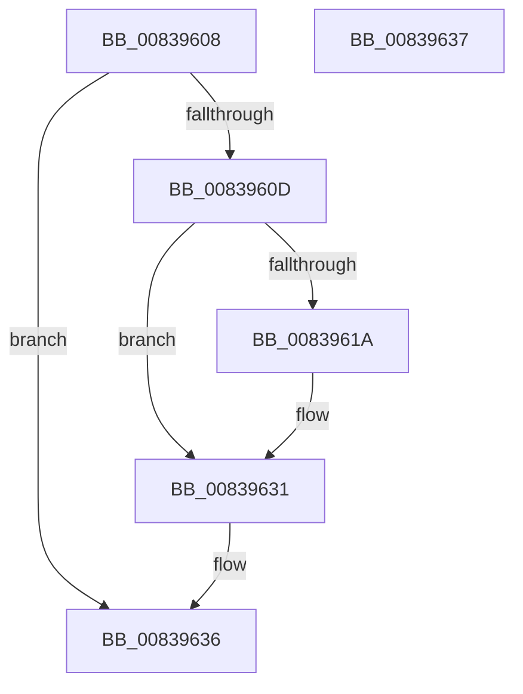

# MincryptFreePolicyInfo

- RVA: `0x00839608`–`0x00839638` (길이 `48` bytes)
- VA: `0x0000000140839608`
- 실행 섹션: `PAGE`
- PDB 이름 있음: `예`; PDB Function 태그: `아니요`
- unwind 정보 RVA: `0x000805BC`
- 디코드: `17`개 명령, `48/48` bytes 표시
- 미해석 바이트: `0` (있으면 어셈블리에 `.byte`로 보존)

> 이 문서는 커널 이미지의 기계어와 PDB 기호를 분석해 생성했습니다. 4번과 5번은 함수 원형과 자료형을 바이너리 사용 방식에서 추정한 C 해석이며 원본 소스 복구 결과는 아닙니다.

## 1. Dependencies

- 직접 호출 지점: **1**; 고유 호출 대상: **1**
- 직접 호출자로 확인된 함수: **1**
- RIP 상대 이미지 참조: **0**

### Outgoing calls
- `0x0083961E` → [I_MincryptFreeChainInfo](I_MincryptFreeChainInfo_function_008395E8.md) (function, `0x008395E8`)

### Direct callers
- [SecureDump_ValidateAmeCertChain](../../text/5A/SecureDump_ValidateAmeCertChain_function_005A38B0.md) at `0x005A3A69`

### Static image references
- 디코드된 RIP-relative 메모리 참조가 없습니다.

## 2. Other-region calls and transfers

- 다른 실행 섹션으로 향하는 call: **0**
- 별도 외부 분기/꼬리 이동을 확인하지 못했습니다.

## 3. Assembly (complete function range)

```asm
00839608  48 85 C9                        test rcx, rcx
0083960B  74 29                           je 0x140839636
0083960D  53                              push rbx
0083960E  48 83 EC 20                     sub rsp, 0x20
00839612  83 39 00                        cmp dword ptr [rcx], 0
00839615  48 8B D9                        mov rbx, rcx
00839618  74 17                           je 0x140839631
0083961A  48 8B 49 10                     mov rcx, qword ptr [rcx + 0x10]
0083961E  E8 C5 FF FF FF                  call 0x1408395e8
00839623  0F 57 C0                        xorps xmm0, xmm0
00839626  0F 11 03                        movups xmmword ptr [rbx], xmm0
00839629  0F 11 43 10                     movups xmmword ptr [rbx + 0x10], xmm0
0083962D  0F 11 43 20                     movups xmmword ptr [rbx + 0x20], xmm0
00839631  48 83 C4 20                     add rsp, 0x20
00839635  5B                              pop rbx
00839636  C3                              ret
00839637  CC                              int3
```

## 4. C-style interpretation (structured pseudocode)

```c
__int64 __fastcall MincryptFreePolicyInfo(__int64 a1)
{
    __int64 result;
    __int64 v_rsp;

    if (a1 == 0) goto loc_00839636;
    v_rsp = (v_rsp) - (32);
    if ((*(unsigned int *)(a1)) != 0) {
        a1 = *(unsigned __int64 *)(a1 + 16);
        result = I_MincryptFreeChainInfo(a1, a2, a3, a4);
        *(unsigned __int64 *)(a1) = v_xmm0;
        *(unsigned __int64 *)(a1 + 16) = v_xmm0;
        *(unsigned __int64 *)(a1 + 32) = v_xmm0;
    }
    v_rsp = (v_rsp) + (32);
loc_00839636:
    return result;
}
```

## 5. (Beta) C Style

```c
int64_t MincryptFreePolicyInfo(int64_t Arg1)
{
    int64_t result;
    int64_t local_rsp;

    if (Arg1 == 0) goto loc_00839636;
    local_rsp = (local_rsp) - (32);
    if ((*(uint32_t *)(Arg1)) != 0) {
        Arg1 = *(uint64_t *)(Arg1 + 0x10);
        result = I_MincryptFreeChainInfo(Arg1, a2, a3, a4);
        *(uint64_t *)(Arg1) = v_xmm0;
        *(uint64_t *)(Arg1 + 0x10) = v_xmm0;
        *(uint64_t *)(Arg1 + 0x20) = v_xmm0;
    }
    local_rsp = (local_rsp) + (32);
loc_00839636:
    return result;
}
```

## 6. Execution-region graph

[열기: 2D/3D 그래프와 함수 탐색 컨트롤 패널](../../../control-panel.html?section=page&rva=0x00839608&view=graph)

- 2D 그래프는 위에서 아래로 흐르고, 3D 그래프는 빈 공간을 드래그해 회전합니다. Shift+드래그는 이동, 휠은 확대·축소, 함수 노드 선택은 대상 보고서 이동입니다.

### Static fallback


