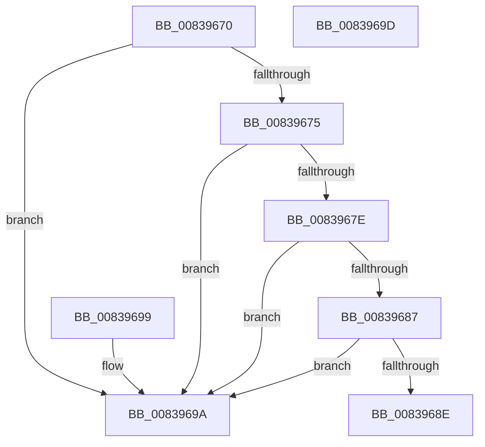

# MincryptGetRootKeyFromPolicy

- RVA: `0x00839670`–`0x0083969E` (길이 `46` bytes)
- VA: `0x0000000140839670`
- 실행 섹션: `PAGE`
- PDB 이름 있음: `예`; PDB Function 태그: `아니요`
- unwind 정보 RVA: `0x000DB714`
- 디코드: `18`개 명령, `46/46` bytes 표시
- 미해석 바이트: `0` (있으면 어셈블리에 `.byte`로 보존)

> 이 문서는 커널 이미지의 기계어와 PDB 기호를 분석해 생성했습니다. 4번과 5번은 함수 원형과 자료형을 바이너리 사용 방식에서 추정한 C 해석이며 원본 소스 복구 결과는 아닙니다.

## 1. Dependencies

- 직접 호출 지점: **0**; 고유 호출 대상: **0**
- 직접 호출자로 확인된 함수: **1**
- RIP 상대 이미지 참조: **0**

### Outgoing calls
- 직접 디코드된 call 명령이 없습니다.

### Direct callers
- [SecureDump_ValidateAmeCertChain](../../text/5A/SecureDump_ValidateAmeCertChain_function_005A38B0.md) at `0x005A3956`

### Static image references
- 디코드된 RIP-relative 메모리 참조가 없습니다.

## 2. Other-region calls and transfers

- 다른 실행 섹션으로 향하는 call: **0**
- 별도 외부 분기/꼬리 이동을 확인하지 못했습니다.

## 3. Assembly (complete function range)

```asm
00839670  83 39 00                        cmp dword ptr [rcx], 0
00839673  74 25                           je 0x14083969a
00839675  48 8B 51 10                     mov rdx, qword ptr [rcx + 0x10]
00839679  48 85 D2                        test rdx, rdx
0083967C  74 1C                           je 0x14083969a
0083967E  F7 41 08 00 00 FF FF            test dword ptr [rcx + 8], 0xffff0000
00839685  75 13                           jne 0x14083969a
00839687  8B 42 10                        mov eax, dword ptr [rdx + 0x10]
0083968A  85 C0                           test eax, eax
0083968C  74 0C                           je 0x14083969a
0083968E  FF C8                           dec eax
00839690  48 C1 E0 04                     shl rax, 4
00839694  48 03 42 08                     add rax, qword ptr [rdx + 8]
00839698  C3                              ret
00839699  CC                              int3
0083969A  33 C0                           xor eax, eax
0083969C  C3                              ret
0083969D  CC                              int3
```

## 4. C-style interpretation (structured pseudocode)

```c
__int64 __fastcall MincryptGetRootKeyFromPolicy(__int64 a1)
{
    __int64 result;

    if ((*(unsigned int *)(a1)) == 0) goto loc_0083969A;
    if (*(unsigned __int64 *)(a1 + 16) == 0) goto loc_0083969A;
    if (((*(unsigned int *)(a1 + 8)) & (0xFFFF0000ULL)) != 0) goto loc_0083969A;
    if ((unsigned int)((unsigned int)(*(unsigned int *)(*(unsigned __int64 *)(a1 + 16) + 16))) == 0) goto loc_0083969A;
    result = (unsigned int)(((unsigned int)(*(unsigned int *)(*(unsigned __int64 *)(a1 + 16) + 16))) - 1);
    result = (result) << (4);
    result = (result) + (*(unsigned __int64 *)(*(unsigned __int64 *)(a1 + 16) + 8));
    return result;
loc_0083969A:
    result = 0;
    return result;
}
```

## 5. (Beta) C Style

```c
int64_t MincryptGetRootKeyFromPolicy(void *Arg1)
{
    uint8_t *arg1 = (uint8_t *)Arg1;

    int64_t result;

    if ((*(uint32_t *)(arg1)) == 0) goto loc_0083969A;
    if (*(uint64_t *)(arg1 + 0x10) == 0) goto loc_0083969A;
    if (((*(uint32_t *)(arg1 + 0x8)) & (0xFFFF0000ULL)) != 0) goto loc_0083969A;
    if ((uint32_t)((uint32_t)(*(uint32_t *)(*(uint64_t *)(arg1 + 0x10) + 0x10))) == 0) goto loc_0083969A;
    result = (uint32_t)(((uint32_t)(*(uint32_t *)(*(uint64_t *)(arg1 + 0x10) + 0x10))) - 1);
    result = (result) << (4);
    result = (result) + (*(uint64_t *)(*(uint64_t *)(arg1 + 0x10) + 0x8));
    return result;
loc_0083969A:
    result = 0;
    return result;
}
```

### 관측된 메모리 오프셋

구조체 형식이 확인되지 않은 접근은 인자 기준의 오프셋으로만 기록했습니다.

| 기준 인자 | 오프셋 표현 | 폭 (bit) | 접근 |
|---|---:|---:|---|
| `Arg1` | `+ 0x0` | `32` | `R` |
| `Arg1` | `+ 0x8` | `32` | `R` |
| `Arg1` | `+ 0x10` | `64` | `R` |

## 6. Execution-region graph

[열기: 2D/3D 그래프와 함수 탐색 컨트롤 패널](../../../control-panel.html?section=page&rva=0x00839670&view=graph)

- 2D 그래프는 위에서 아래로 흐르고, 3D 그래프는 빈 공간을 드래그해 회전합니다. Shift+드래그는 이동, 휠은 확대·축소, 함수 노드 선택은 대상 보고서 이동입니다.

### Static fallback


