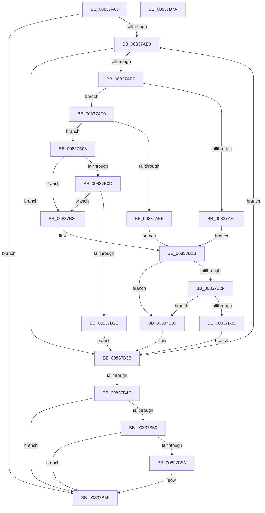

# MincryptIsTimestampBeforeRevocation

- RVA: `0x00837A68`–`0x00837B7B` (길이 `275` bytes)
- VA: `0x0000000140837A68`
- 실행 섹션: `PAGE`
- PDB 이름 있음: `예`; PDB Function 태그: `아니요`
- unwind 정보 RVA: `0x000AEAB0`
- 디코드: `90`개 명령, `275/275` bytes 표시
- 미해석 바이트: `0` (있으면 어셈블리에 `.byte`로 보존)

> 이 문서는 커널 이미지의 기계어와 PDB 기호를 분석해 생성했습니다. 4번과 5번은 함수 원형과 자료형을 바이너리 사용 방식에서 추정한 C 해석이며 원본 소스 복구 결과는 아닙니다.

## 1. Dependencies

- 직접 호출 지점: **2**; 고유 호출 대상: **2**
- 직접 호출자로 확인된 함수: **1**
- RIP 상대 이미지 참조: **0**

### Outgoing calls
- `0x00837ADE` → [I_MinCryptIsCertificateHashRevokedV2](../../text/6A/I_MinCryptIsCertificateHashRevokedV2_function_006A5F24.md) (function, `0x006A5F24`)
- `0x00837B15` → [I_MinCryptIsTimestampSignerTrusted](I_MinCryptIsTimestampSignerTrusted_function_00837714.md) (function, `0x00837714`)

### Direct callers
- [MinCrypK_VerifySignedDataKModeEx](MinCrypK_VerifySignedDataKModeEx_function_00838568.md) at `0x00838967`

### Static image references
- 디코드된 RIP-relative 메모리 참조가 없습니다.

## 2. Other-region calls and transfers

- 다른 실행 섹션으로 향하는 call: **1**
  - `0x00837ADE` → [I_MinCryptIsCertificateHashRevokedV2](../../text/6A/I_MinCryptIsCertificateHashRevokedV2_function_006A5F24.md) (`PAGE` → `.text`)
- 별도 외부 분기/꼬리 이동을 확인하지 못했습니다.

## 3. Assembly (complete function range)

```asm
00837A68  48 89 5C 24 10                  mov qword ptr [rsp + 0x10], rbx
00837A6D  4C 89 44 24 18                  mov qword ptr [rsp + 0x18], r8
00837A72  55                              push rbp
00837A73  56                              push rsi
00837A74  57                              push rdi
00837A75  41 54                           push r12
00837A77  41 55                           push r13
00837A79  41 56                           push r14
00837A7B  41 57                           push r15
00837A7D  48 8B EC                        mov rbp, rsp
00837A80  48 83 EC 40                     sub rsp, 0x40
00837A84  33 C0                           xor eax, eax
00837A86  4C 8B EA                        mov r13, rdx
00837A89  48 8B 51 10                     mov rdx, qword ptr [rcx + 0x10]
00837A8D  48 8B F9                        mov rdi, rcx
00837A90  B3 01                           mov bl, 1
00837A92  48 89 45 F0                     mov qword ptr [rbp - 0x10], rax
00837A96  8B F0                           mov esi, eax
00837A98  88 45 40                        mov byte ptr [rbp + 0x40], al
00837A9B  41 BE 03 06 00 C0               mov r14d, 0xc0000603
00837AA1  89 45 58                        mov dword ptr [rbp + 0x58], eax
00837AA4  44 8B F8                        mov r15d, eax
00837AA7  39 42 30                        cmp dword ptr [rdx + 0x30], eax
00837AAA  0F 86 AF 00 00 00               jbe 0x140837b5f
00837AB0  41 8B C7                        mov eax, r15d
00837AB3  4C 8D 4D F0                     lea r9, [rbp - 0x10]
00837AB7  48 6B C8 78                     imul rcx, rax, 0x78
00837ABB  48 8D 45 58                     lea rax, [rbp + 0x58]
00837ABF  44 8B E6                        mov r12d, esi
00837AC2  48 03 4A 28                     add rcx, qword ptr [rdx + 0x28]
00837AC6  48 89 44 24 28                  mov qword ptr [rsp + 0x28], rax
00837ACB  48 8D 45 40                     lea rax, [rbp + 0x40]
00837ACF  48 89 44 24 20                  mov qword ptr [rsp + 0x20], rax
00837AD4  44 8B 41 04                     mov r8d, dword ptr [rcx + 4]
00837AD8  48 8D 51 08                     lea rdx, [rcx + 8]
00837ADC  8B 09                           mov ecx, dword ptr [rcx]
00837ADE  E8 41 E4 E6 FF                  call 0x1406a5f24
00837AE3  84 C0                           test al, al
00837AE5  74 54                           je 0x140837b3b
00837AE7  49 8B 45 00                     mov rax, qword ptr [r13]
00837AEB  FF C6                           inc esi
00837AED  48 85 C0                        test rax, rax
00837AF0  75 07                           jne 0x140837af9
00837AF2  0F BA 6F 08 1A                  bts dword ptr [rdi + 8], 0x1a
00837AF7  EB 32                           jmp 0x140837b2b
00837AF9  48 3B 45 F0                     cmp rax, qword ptr [rbp - 0x10]
00837AFD  7C 07                           jl 0x140837b06
00837AFF  0F BA 6F 08 18                  bts dword ptr [rdi + 8], 0x18
00837B04  EB 25                           jmp 0x140837b2b
00837B06  8B 4D 58                        mov ecx, dword ptr [rbp + 0x58]
00837B09  85 C9                           test ecx, ecx
00837B0B  74 19                           je 0x140837b26
00837B0D  48 8B 45 50                     mov rax, qword ptr [rbp + 0x50]
00837B11  48 8B 50 10                     mov rdx, qword ptr [rax + 0x10]
00837B15  E8 FA FB FF FF                  call 0x140837714
00837B1A  84 C0                           test al, al
00837B1C  74 08                           je 0x140837b26
00837B1E  41 8B F4                        mov esi, r12d
00837B21  45 33 F6                        xor r14d, r14d
00837B24  EB 15                           jmp 0x140837b3b
00837B26  0F BA 6F 08 19                  bts dword ptr [rdi + 8], 0x19
00837B2B  84 DB                           test bl, bl
00837B2D  74 0A                           je 0x140837b39
00837B2F  80 7D 40 00                     cmp byte ptr [rbp + 0x40], 0
00837B33  74 04                           je 0x140837b39
00837B35  B3 01                           mov bl, 1
00837B37  EB 02                           jmp 0x140837b3b
00837B39  32 DB                           xor bl, bl
00837B3B  48 8B 57 10                     mov rdx, qword ptr [rdi + 0x10]
00837B3F  41 FF C7                        inc r15d
00837B42  44 3B 7A 30                     cmp r15d, dword ptr [rdx + 0x30]
00837B46  0F 82 64 FF FF FF               jb 0x140837ab0
00837B4C  85 F6                           test esi, esi
00837B4E  74 0F                           je 0x140837b5f
00837B50  41 BE 03 06 00 C0               mov r14d, 0xc0000603
00837B56  84 DB                           test bl, bl
00837B58  74 05                           je 0x140837b5f
00837B5A  0F BA 6F 08 17                  bts dword ptr [rdi + 8], 0x17
00837B5F  48 8B 9C 24 88 00 00 00         mov rbx, qword ptr [rsp + 0x88]
00837B67  41 8B C6                        mov eax, r14d
00837B6A  48 83 C4 40                     add rsp, 0x40
00837B6E  41 5F                           pop r15
00837B70  41 5E                           pop r14
00837B72  41 5D                           pop r13
00837B74  41 5C                           pop r12
00837B76  5F                              pop rdi
00837B77  5E                              pop rsi
00837B78  5D                              pop rbp
00837B79  C3                              ret
00837B7A  CC                              int3
```

## 4. C-style interpretation (structured pseudocode)

```c
__int64 __fastcall MincryptIsTimestampBeforeRevocation(__int64 a1, __int64 a2, __int64 a3)
{
    __int64 result;
    __int64 v_r14;
    __int64 v_r15;
    __int64 v_rbx;
    __int64 v_rsi;
    __int64 v_rsp;
    unsigned __int64 v_stack_m48;
    unsigned __int64 v_stack_m50;
    unsigned __int64 v_stack_m58;
    unsigned __int64 v_stack_p10;
    unsigned __int64 v_stack_p18;
    unsigned int v_stack_p20;
    unsigned __int8 v_stack_p8;

    v_stack_p10 = v_rbx;
    v_stack_p18 = a3;
    v_rsp = (v_rsp) - (64);
    result = 0;
    v_stack_m48 = 0;
    v_stack_p8 = 0;
    v_stack_p20 = 0;
    if ((*(unsigned int *)(*(unsigned __int64 *)(a1 + 16) + 48)) <= 0) goto loc_00837B5F;
loc_00837AB0:
    a1 = (a1) * (0);
    a1 = (a1) + (*(unsigned __int64 *)(*(unsigned __int64 *)(a1 + 16) + 40));
    v_stack_m50 = v_stack_p20;
    v_stack_m58 = v_stack_p8;
    result = I_MinCryptIsCertificateHashRevokedV2((unsigned int)(*(unsigned int *)(a1)), a1 + 8, (unsigned int)(*(unsigned int *)(a1 + 4)), v_stack_m48);
    if ((unsigned __int8)(result) == 0) goto loc_00837B3B;
    v_rsi = (unsigned int)((0) + 1);
    if (*(unsigned __int64 *)(a2) != 0) goto loc_00837AF9;
    goto loc_00837B2B;
loc_00837AF9:
    if ((*(unsigned __int64 *)(a2)) < v_stack_m48) goto loc_00837B06;
    goto loc_00837B2B;
loc_00837B06:
    if ((unsigned int)((unsigned int)(v_stack_p20)) == 0) goto loc_00837B26;
    result = I_MinCryptIsTimestampSignerTrusted((unsigned int)(v_stack_p20), *(unsigned __int64 *)(v_stack_p18 + 16), (unsigned int)(*(unsigned int *)(a1 + 4)), v_stack_m48);
    if ((unsigned __int8)(result) == 0) goto loc_00837B26;
    v_r14 = 0;
    goto loc_00837B3B;
loc_00837B26:
loc_00837B2B:
    if (1 == 0) goto loc_00837B39;
    if (v_stack_p8 == 0) goto loc_00837B39;
    goto loc_00837B3B;
loc_00837B39:
    v_rbx = 0;
loc_00837B3B:
    v_r15 = (unsigned int)((0) + 1);
    if (((unsigned int)(v_r15)) < (*(unsigned int *)(*(unsigned __int64 *)(a1 + 16) + 48))) goto loc_00837AB0;
    if (0 == 0) goto loc_00837B5F;
    if (0 != 0) {
    }
    v_rsp = (v_rsp) + (64);
    return (unsigned int)((unsigned int)((unsigned int)(0xC0000603ULL)));
}
```

## 5. (Beta) C Style

```c
int64_t MincryptIsTimestampBeforeRevocation(void *Arg1, void *Arg2, int64_t Arg3)
{
    uint8_t *arg1 = (uint8_t *)Arg1;
    uint8_t *arg2 = (uint8_t *)Arg2;

    int64_t result;
    int64_t local_r14;
    int64_t local_r15;
    int64_t local_rbx;
    int64_t local_rsi;
    int64_t local_rsp;
    uint64_t v_stack_m48;
    uint64_t v_stack_m50;
    uint64_t v_stack_m58;
    uint64_t v_stack_p10;
    uint64_t v_stack_p18;
    uint32_t v_stack_p20;
    uint8_t v_stack_p8;

    v_stack_p10 = local_rbx;
    v_stack_p18 = Arg3;
    local_rsp = (local_rsp) - (64);
    result = 0;
    v_stack_m48 = 0;
    v_stack_p8 = 0;
    v_stack_p20 = 0;
    if ((*(uint32_t *)(*(uint64_t *)(arg1 + 0x10) + 0x30)) <= 0) goto loc_00837B5F;
loc_00837AB0:
    Arg1 = (Arg1) * (0);
    Arg1 = (Arg1) + (*(uint64_t *)(*(uint64_t *)(arg1 + 0x10) + 0x28));
    v_stack_m50 = v_stack_p20;
    v_stack_m58 = v_stack_p8;
    result = I_MinCryptIsCertificateHashRevokedV2((uint32_t)(*(uint32_t *)(arg1)), Arg1 + 8, (uint32_t)(*(uint32_t *)(arg1 + 0x4)), v_stack_m48);
    if ((uint8_t)(result) == 0) goto loc_00837B3B;
    local_rsi = (uint32_t)((0) + 1);
    if (*(uint64_t *)(arg2) != 0) goto loc_00837AF9;
    goto loc_00837B2B;
loc_00837AF9:
    if ((*(uint64_t *)(arg2)) < v_stack_m48) goto loc_00837B06;
    goto loc_00837B2B;
loc_00837B06:
    if ((uint32_t)((uint32_t)(v_stack_p20)) == 0) goto loc_00837B26;
    result = I_MinCryptIsTimestampSignerTrusted((uint32_t)(v_stack_p20), *(uint64_t *)(v_stack_p18 + 0x10), (uint32_t)(*(uint32_t *)(arg1 + 0x4)), v_stack_m48);
    if ((uint8_t)(result) == 0) goto loc_00837B26;
    local_r14 = 0;
    goto loc_00837B3B;
loc_00837B26:
loc_00837B2B:
    if (1 == 0) goto loc_00837B39;
    if (v_stack_p8 == 0) goto loc_00837B39;
    goto loc_00837B3B;
loc_00837B39:
    local_rbx = 0;
loc_00837B3B:
    local_r15 = (uint32_t)((0) + 1);
    if (((uint32_t)(local_r15)) < (*(uint32_t *)(*(uint64_t *)(arg1 + 0x10) + 0x30))) goto loc_00837AB0;
    if (0 == 0) goto loc_00837B5F;
    if (0 != 0) {
    }
    local_rsp = (local_rsp) + (64);
    return (uint32_t)((uint32_t)((uint32_t)(0xC0000603ULL)));
}
```

### 관측된 메모리 오프셋

구조체 형식이 확인되지 않은 접근은 인자 기준의 오프셋으로만 기록했습니다.

| 기준 인자 | 오프셋 표현 | 폭 (bit) | 접근 |
|---|---:|---:|---|
| `Arg1` | `+ 0x8` | `32` | `R/W` |
| `Arg1` | `+ 0x10` | `64` | `R` |
| `Arg2` | `+ 0x0` | `64` | `R` |

## 6. Execution-region graph

[열기: 2D/3D 그래프와 함수 탐색 컨트롤 패널](../../../control-panel.html?section=page&rva=0x00837A68&view=graph)

- 2D 그래프는 위에서 아래로 흐르고, 3D 그래프는 빈 공간을 드래그해 회전합니다. Shift+드래그는 이동, 휠은 확대·축소, 함수 노드 선택은 대상 보고서 이동입니다.

### Static fallback


