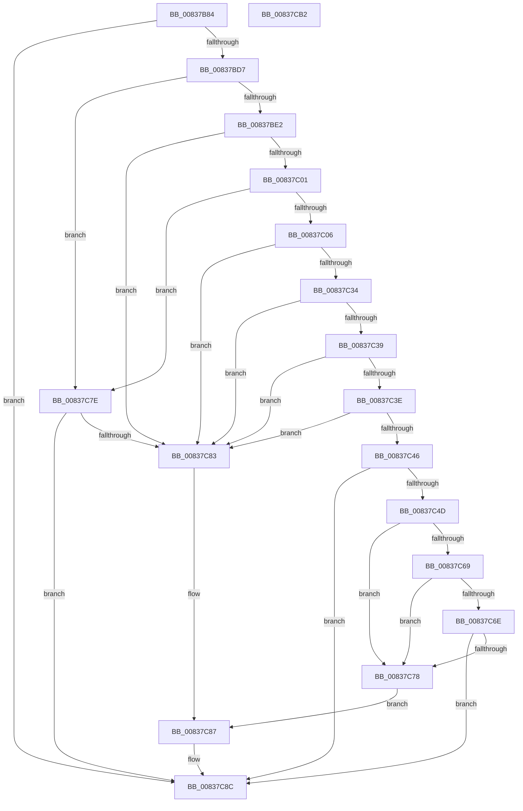

# MincryptValidateBasicConstraints

- RVA: `0x00837B84`–`0x00837CB3` (길이 `303` bytes)
- VA: `0x0000000140837B84`
- 실행 섹션: `PAGE`
- PDB 이름 있음: `예`; PDB Function 태그: `아니요`
- unwind 정보 RVA: `0x000D6764`
- 디코드: `89`개 명령, `303/303` bytes 표시
- 미해석 바이트: `0` (있으면 어셈블리에 `.byte`로 보존)

> 이 문서는 커널 이미지의 기계어와 PDB 기호를 분석해 생성했습니다. 4번과 5번은 함수 원형과 자료형을 바이너리 사용 방식에서 추정한 C 해석이며 원본 소스 복구 결과는 아닙니다.

## 1. Dependencies

- 직접 호출 지점: **4**; 고유 호출 대상: **4**
- 직접 호출자로 확인된 함수: **1**
- RIP 상대 이미지 참조: **3**

### Outgoing calls
- `0x00837BF4` → [MinAsn1ParseSingleExtensionValue](MinAsn1ParseSingleExtensionValue_function_00839058.md) (function, `0x00839058`)
- `0x00837C2B` → [MinAsn1ExtractValues](MinAsn1ExtractValues_function_0083A170.md) (function, `0x0083A170`)
- `0x00837C60` → [MinAsn1DecodeInteger](MinAsn1DecodeInteger_function_00839DD0.md) (function, `0x00839DD0`)
- `0x00837C95` → [_security_check_cookie](../../text/6A/_security_check_cookie_function_006AC640.md) (function, `0x006AC640`)

### Direct callers
- [MinCryptVerifyCertificateWithPolicy2](MinCryptVerifyCertificateWithPolicy2_function_008368A8.md) at `0x00836FA5`

### Static image references
- `0x00837B9E` → RVA `0x00E0A740` (`.data`; read)
- `0x00837BE9` → RVA `0x00B4BC38` (`PAGE`; read)
- `0x00837C18` → RVA `0x0000CF60` (`.rdata`; read)

## 2. Other-region calls and transfers

- 다른 실행 섹션으로 향하는 call: **1**
  - `0x00837C95` → [_security_check_cookie](../../text/6A/_security_check_cookie_function_006AC640.md) (`PAGE` → `.text`)
- 별도 외부 분기/꼬리 이동을 확인하지 못했습니다.

## 3. Assembly (complete function range)

```asm
00837B84  48 89 5C 24 10                  mov qword ptr [rsp + 0x10], rbx
00837B89  48 89 74 24 18                  mov qword ptr [rsp + 0x18], rsi
00837B8E  55                              push rbp
00837B8F  57                              push rdi
00837B90  41 56                           push r14
00837B92  48 8D 6C 24 B9                  lea rbp, [rsp - 0x47]
00837B97  48 81 EC 90 00 00 00            sub rsp, 0x90
00837B9E  48 8B 05 9B 2B 5D 00            mov rax, qword ptr [rip + 0x5d2b9b]
00837BA5  48 33 C4                        xor rax, rsp
00837BA8  48 89 45 37                     mov qword ptr [rbp + 0x37], rax
00837BAC  0F 57 C0                        xorps xmm0, xmm0
00837BAF  33 DB                           xor ebx, ebx
00837BB1  33 C0                           xor eax, eax
00837BB3  89 5D 07                        mov dword ptr [rbp + 7], ebx
00837BB6  48 89 45 2F                     mov qword ptr [rbp + 0x2f], rax
00837BBA  49 8B F9                        mov rdi, r9
00837BBD  41 8A F0                        mov sil, r8b
00837BC0  44 8B F2                        mov r14d, edx
00837BC3  0F 11 45 0F                     movups xmmword ptr [rbp + 0xf], xmm0
00837BC7  0F 11 45 1F                     movups xmmword ptr [rbp + 0x1f], xmm0
00837BCB  0F 11 45 F7                     movups xmmword ptr [rbp - 9], xmm0
00837BCF  85 D2                           test edx, edx
00837BD1  0F 84 B5 00 00 00               je 0x140837c8c
00837BD7  88 5D E7                        mov byte ptr [rbp - 0x19], bl
00837BDA  39 19                           cmp dword ptr [rcx], ebx
00837BDC  0F 84 9C 00 00 00               je 0x140837c7e
00837BE2  48 8B D1                        mov rdx, rcx
00837BE5  4C 8D 4D F7                     lea r9, [rbp - 9]
00837BE9  48 8D 0D 48 40 31 00            lea rcx, [rip + 0x314048]
00837BF0  4C 8D 45 E7                     lea r8, [rbp - 0x19]
00837BF4  E8 5F 14 00 00                  call 0x140839058
00837BF9  85 C0                           test eax, eax
00837BFB  0F 8E 82 00 00 00               jle 0x140837c83
00837C01  38 5D E7                        cmp byte ptr [rbp - 0x19], bl
00837C04  74 78                           je 0x140837c7e
00837C06  8B 55 F7                        mov edx, dword ptr [rbp - 9]
00837C09  8D 4B 03                        lea ecx, [rbx + 3]
00837C0C  48 8D 45 07                     lea rax, [rbp + 7]
00837C10  89 4D EF                        mov dword ptr [rbp - 0x11], ecx
00837C13  48 89 44 24 28                  mov qword ptr [rsp + 0x28], rax
00837C18  4C 8D 0D 41 53 7D FF            lea r9, [rip - 0x82acbf]
00837C1F  89 4C 24 20                     mov dword ptr [rsp + 0x20], ecx
00837C23  4C 8D 45 EF                     lea r8, [rbp - 0x11]
00837C27  48 8B 4D FF                     mov rcx, qword ptr [rbp - 1]
00837C2B  E8 40 25 00 00                  call 0x14083a170
00837C30  85 C0                           test eax, eax
00837C32  7E 4F                           jle 0x140837c83
00837C34  39 5D 07                        cmp dword ptr [rbp + 7], ebx
00837C37  7E 4A                           jle 0x140837c83
00837C39  39 5D 17                        cmp dword ptr [rbp + 0x17], ebx
00837C3C  74 45                           je 0x140837c83
00837C3E  48 8B 45 1F                     mov rax, qword ptr [rbp + 0x1f]
00837C42  38 18                           cmp byte ptr [rax], bl
00837C44  74 3D                           je 0x140837c83
00837C46  8B 55 27                        mov edx, dword ptr [rbp + 0x27]
00837C49  85 D2                           test edx, edx
00837C4B  74 3F                           je 0x140837c8c
00837C4D  48 8B 4D 2F                     mov rcx, qword ptr [rbp + 0x2f]
00837C51  4C 8D 4D E7                     lea r9, [rbp - 0x19]
00837C55  4C 8D 45 EF                     lea r8, [rbp - 0x11]
00837C59  88 5D E7                        mov byte ptr [rbp - 0x19], bl
00837C5C  48 89 5D EF                     mov qword ptr [rbp - 0x11], rbx
00837C60  E8 6B 21 00 00                  call 0x140839dd0
00837C65  85 C0                           test eax, eax
00837C67  7E 0F                           jle 0x140837c78
00837C69  38 5D E7                        cmp byte ptr [rbp - 0x19], bl
00837C6C  75 0A                           jne 0x140837c78
00837C6E  41 8D 4E FF                     lea ecx, [r14 - 1]
00837C72  48 3B 4D EF                     cmp rcx, qword ptr [rbp - 0x11]
00837C76  76 14                           jbe 0x140837c8c
00837C78  0F BA 2F 1B                     bts dword ptr [rdi], 0x1b
00837C7C  EB 09                           jmp 0x140837c87
00837C7E  40 84 F6                        test sil, sil
00837C81  75 09                           jne 0x140837c8c
00837C83  0F BA 2F 1D                     bts dword ptr [rdi], 0x1d
00837C87  BB 28 04 00 C0                  mov ebx, 0xc0000428
00837C8C  8B C3                           mov eax, ebx
00837C8E  48 8B 4D 37                     mov rcx, qword ptr [rbp + 0x37]
00837C92  48 33 CC                        xor rcx, rsp
00837C95  E8 A6 49 E7 FF                  call 0x1406ac640
00837C9A  4C 8D 9C 24 90 00 00 00         lea r11, [rsp + 0x90]
00837CA2  49 8B 5B 28                     mov rbx, qword ptr [r11 + 0x28]
00837CA6  49 8B 73 30                     mov rsi, qword ptr [r11 + 0x30]
00837CAA  49 8B E3                        mov rsp, r11
00837CAD  41 5E                           pop r14
00837CAF  5F                              pop rdi
00837CB0  5D                              pop rbp
00837CB1  C3                              ret
00837CB2  CC                              int3
```

## 4. C-style interpretation (structured pseudocode)

```c
__int64 __fastcall MincryptValidateBasicConstraints(__int64 a1, int a2, unsigned __int8 a3, __int64 a4)
{
    __int64 result;
    __int64 v_rbx;
    __int64 v_rsp;
    unsigned __int64 v_stack_m18;
    unsigned __int64 v_stack_m28;
    unsigned __int64 v_stack_m30;
    unsigned int v_stack_m38;
    unsigned __int64 v_stack_m40;
    unsigned int v_stack_m48;
    unsigned __int64 v_stack_m50;
    unsigned int v_stack_m58;
    unsigned __int64 v_stack_m5F;
    unsigned __int64 v_stack_m60;
    unsigned __int64 v_stack_m68;
    unsigned int v_stack_m70;
    unsigned __int8 v_stack_m78;
    unsigned __int64 v_stack_m80;
    unsigned int v_stack_m88;
    unsigned __int64 v_stack_p10;
    unsigned __int64 v_stack_p18;

    v_stack_p10 = v_rbx;
    v_stack_p18 = v_rsi;
    v_rsp = (v_rsp) - (144);
    result = (*(unsigned __int64 *)(v_rip + 6106011)) ^ (v_rsp);
    v_stack_m28 = result;
    v_rbx = 0;
    result = 0;
    v_stack_m58 = 0;
    v_stack_m30 = 0;
    v_stack_m50 = v_xmm0;
    v_stack_m40 = v_xmm0;
    v_stack_m68 = v_xmm0;
    if (a2 == 0) goto loc_00837C8C;
    v_stack_m78 = 0;
    if ((*(unsigned int *)(a1)) == 0) goto loc_00837C7E;
    result = MinAsn1ParseSingleExtensionValue(v_rip + 3227720, a1, v_stack_m78, v_stack_m68);
    if (condition_is_less_or_equal) goto loc_00837C83;
    if (v_stack_m78 == 0) goto loc_00837C7E;
    v_stack_m70 = (unsigned int)(v_rbx + 3);
    v_stack_m80 = v_stack_m58;
    v_stack_m88 = (unsigned int)(v_rbx + 3);
    result = MinAsn1ExtractValues(v_stack_m60, (unsigned int)(v_stack_m68), v_stack_m70, v_rip - 8563903);
    if (condition_is_less_or_equal) goto loc_00837C83;
    if (v_stack_m58 <= 0) goto loc_00837C83;
    if (v_stack_m48 == 0) goto loc_00837C83;
    if ((*(unsigned __int8 *)(v_stack_m40)) == 0) goto loc_00837C83;
    if ((unsigned int)((unsigned int)(v_stack_m38)) == 0) goto loc_00837C8C;
    v_stack_m78 = 0;
    v_stack_m70 = 0;
    result = MinAsn1DecodeInteger(v_stack_m30, (unsigned int)(v_stack_m38), v_stack_m70, v_stack_m78);
    if (condition_is_less_or_equal) goto loc_00837C78;
    if (v_stack_m78 != 0) goto loc_00837C78;
    if (((unsigned int)(a2) - 1) <= v_stack_m70) goto loc_00837C8C;
loc_00837C78:
    goto loc_00837C87;
loc_00837C7E:
    if (a3 != 0) goto loc_00837C8C;
loc_00837C83:
loc_00837C87:
loc_00837C8C:
    a1 = (v_stack_m28) ^ (v_rsp);
    result = _security_check_cookie(a1, (unsigned int)(v_stack_m38), v_stack_m70, v_stack_m78);
    return result;
}
```

## 5. (Beta) C Style

```c
int64_t MincryptValidateBasicConstraints(void *Arg1, void *Arg2, uint8_t Arg3, void *Arg4)
{
    uint8_t *arg1 = (uint8_t *)Arg1;
    uint8_t *arg2 = (uint8_t *)Arg2;
    uint8_t *arg4 = (uint8_t *)Arg4;

    int64_t result;
    int64_t local_rbx;
    int64_t local_rsp;
    uint64_t v_stack_m18;
    uint64_t v_stack_m28;
    uint64_t v_stack_m30;
    uint32_t v_stack_m38;
    uint64_t v_stack_m40;
    uint32_t v_stack_m48;
    uint64_t v_stack_m50;
    uint32_t v_stack_m58;
    uint64_t v_stack_m5F;
    uint64_t v_stack_m60;
    uint64_t v_stack_m68;
    uint32_t v_stack_m70;
    uint8_t v_stack_m78;
    uint64_t v_stack_m80;
    uint32_t v_stack_m88;
    uint64_t v_stack_p10;
    uint64_t v_stack_p18;

    v_stack_p10 = local_rbx;
    v_stack_p18 = local_rsi;
    local_rsp = (local_rsp) - (144);
    result = (*(uint64_t *)(v_rip + 0x5D2B9B)) ^ (local_rsp);
    v_stack_m28 = result;
    local_rbx = 0;
    result = 0;
    v_stack_m58 = 0;
    v_stack_m30 = 0;
    v_stack_m50 = v_xmm0;
    v_stack_m40 = v_xmm0;
    v_stack_m68 = v_xmm0;
    if (Arg2 == NULL) goto loc_00837C8C;
    v_stack_m78 = 0;
    if ((*(uint32_t *)(arg1)) == 0) goto loc_00837C7E;
    result = MinAsn1ParseSingleExtensionValue(v_rip + 3227720, Arg1, v_stack_m78, v_stack_m68);
    if (condition_is_less_or_equal) goto loc_00837C83;
    if (v_stack_m78 == 0) goto loc_00837C7E;
    v_stack_m70 = (uint32_t)(local_rbx + 3);
    v_stack_m80 = v_stack_m58;
    v_stack_m88 = (uint32_t)(local_rbx + 3);
    result = MinAsn1ExtractValues(v_stack_m60, (uint32_t)(v_stack_m68), v_stack_m70, v_rip - 8563903);
    if (condition_is_less_or_equal) goto loc_00837C83;
    if (v_stack_m58 <= 0) goto loc_00837C83;
    if (v_stack_m48 == 0) goto loc_00837C83;
    if ((*(uint8_t *)(v_stack_m40)) == 0) goto loc_00837C83;
    if ((uint32_t)((uint32_t)(v_stack_m38)) == 0) goto loc_00837C8C;
    v_stack_m78 = 0;
    v_stack_m70 = 0;
    result = MinAsn1DecodeInteger(v_stack_m30, (uint32_t)(v_stack_m38), v_stack_m70, v_stack_m78);
    if (condition_is_less_or_equal) goto loc_00837C78;
    if (v_stack_m78 != 0) goto loc_00837C78;
    if (((uint32_t)(Arg2) - 1) <= v_stack_m70) goto loc_00837C8C;
loc_00837C78:
    goto loc_00837C87;
loc_00837C7E:
    if (Arg3 != 0) goto loc_00837C8C;
loc_00837C83:
loc_00837C87:
loc_00837C8C:
    Arg1 = (v_stack_m28) ^ (local_rsp);
    result = _security_check_cookie(Arg1, (uint32_t)(v_stack_m38), v_stack_m70, v_stack_m78);
    return result;
}
```

### 관측된 메모리 오프셋

구조체 형식이 확인되지 않은 접근은 인자 기준의 오프셋으로만 기록했습니다.

| 기준 인자 | 오프셋 표현 | 폭 (bit) | 접근 |
|---|---:|---:|---|
| `Arg1` | `+ 0x0` | `32` | `R` |
| `Arg2` | `- 0x1` | `32` | `R` |
| `Arg4` | `+ 0x0` | `32` | `R/W` |

## 6. Execution-region graph

[열기: 2D/3D 그래프와 함수 탐색 컨트롤 패널](../../../control-panel.html?section=page&rva=0x00837B84&view=graph)

- 2D 그래프는 위에서 아래로 흐르고, 3D 그래프는 빈 공간을 드래그해 회전합니다. Shift+드래그는 이동, 휠은 확대·축소, 함수 노드 선택은 대상 보고서 이동입니다.

### Static fallback


