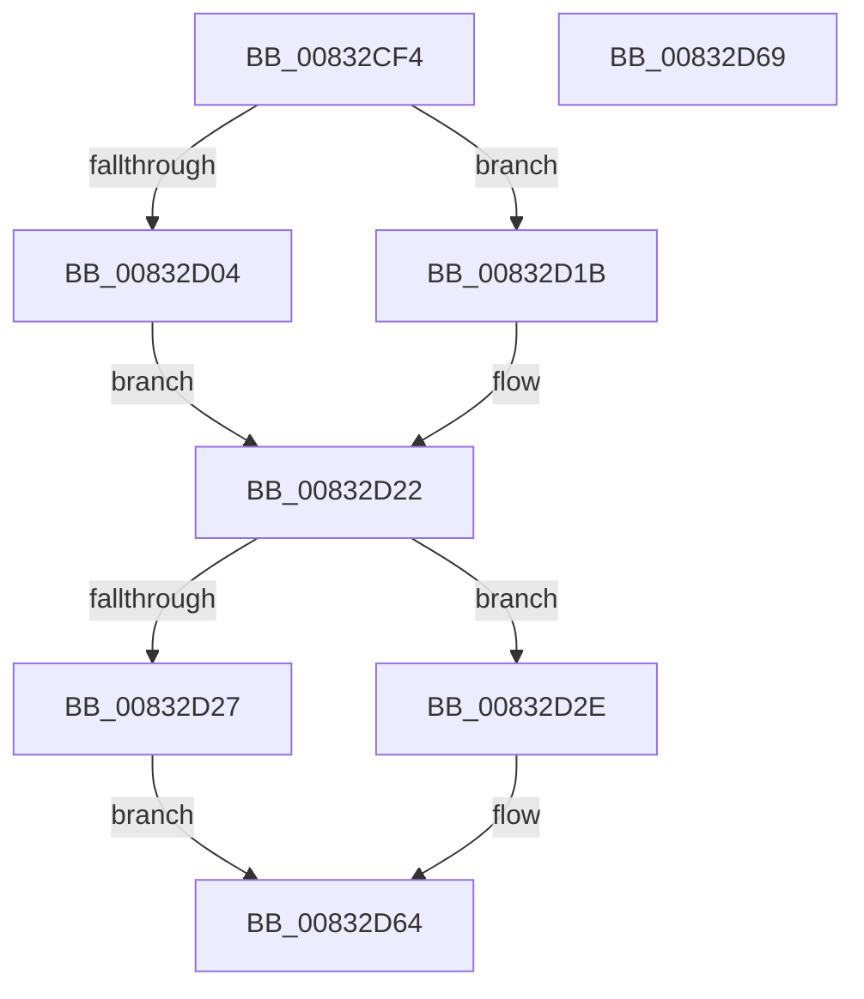

# NtCreateKeyTransacted_Stub

- RVA: `0x00832CF4`–`0x00832D6A` (길이 `118` bytes)
- VA: `0x0000000140832CF4`
- 실행 섹션: `PAGE`
- PDB 이름 있음: `예`; PDB Function 태그: `아니요`
- unwind 정보 RVA: `0x0006C2A4`
- 디코드: `26`개 명령, `118/118` bytes 표시
- 미해석 바이트: `0` (있으면 어셈블리에 `.byte`로 보존)

> 이 문서는 커널 이미지의 기계어와 PDB 기호를 분석해 생성했습니다. 4번과 5번은 함수 원형과 자료형을 바이너리 사용 방식에서 추정한 C 해석이며 원본 소스 복구 결과는 아닙니다.

## 1. Dependencies

- 직접 호출 지점: **1**; 고유 호출 대상: **1**
- 직접 호출자로 확인된 함수: **2**
- RIP 상대 이미지 참조: **5**

### Outgoing calls
- `0x00832D5F` → [guard_dispatch_icall](../../text/6B/guard_dispatch_icall_function_006BAAD0.md) (function, `0x006BAAD0`)

### Direct callers
- [RegRtlCreateTreeTransacted](../93/RegRtlCreateTreeTransacted_function_00931D1C.md) at `0x00931FF9`
- [RegRtlCreateKeyTransacted](../93/RegRtlCreateKeyTransacted_function_0093207C.md) at `0x009321AA`

### Static image references
- `0x00832CF8` → RVA `0x00EEFFD0` (`.data`; read)
- `0x00832D04` → RVA `0x006AE790` (`ZwCreateKeyTransacted`; read)
- `0x00832D0B` → RVA `0x00EEFFD0` (`.data`; write)
- `0x00832D12` → RVA `0x00EEFFC0` (`.data`; write)
- `0x00832D1B` → RVA `0x00EEFFC0` (`.data`; read)

## 2. Other-region calls and transfers

- 다른 실행 섹션으로 향하는 call: **1**
  - `0x00832D5F` → [guard_dispatch_icall](../../text/6B/guard_dispatch_icall_function_006BAAD0.md) (`PAGE` → `.text`)
- 별도 외부 분기/꼬리 이동을 확인하지 못했습니다.

## 3. Assembly (complete function range)

```asm
00832CF4  48 83 EC 58                     sub rsp, 0x58
00832CF8  80 3D D1 D2 6B 00 00            cmp byte ptr [rip + 0x6bd2d1], 0
00832CFF  4C 8B D1                        mov r10, rcx
00832D02  75 17                           jne 0x140832d1b
00832D04  48 8D 05 85 BA E7 FF            lea rax, [rip - 0x18457b]
00832D0B  C6 05 BE D2 6B 00 01            mov byte ptr [rip + 0x6bd2be], 1
00832D12  48 89 05 A7 D2 6B 00            mov qword ptr [rip + 0x6bd2a7], rax
00832D19  EB 07                           jmp 0x140832d22
00832D1B  48 8B 05 9E D2 6B 00            mov rax, qword ptr [rip + 0x6bd29e]
00832D22  48 85 C0                        test rax, rax
00832D25  75 07                           jne 0x140832d2e
00832D27  B8 7A 00 00 C0                  mov eax, 0xc000007a
00832D2C  EB 36                           jmp 0x140832d64
00832D2E  48 8B 8C 24 98 00 00 00         mov rcx, qword ptr [rsp + 0x98]
00832D36  45 33 C9                        xor r9d, r9d
00832D39  48 89 4C 24 38                  mov qword ptr [rsp + 0x38], rcx
00832D3E  48 8B 8C 24 90 00 00 00         mov rcx, qword ptr [rsp + 0x90]
00832D46  48 89 4C 24 30                  mov qword ptr [rsp + 0x30], rcx
00832D4B  8B 8C 24 88 00 00 00            mov ecx, dword ptr [rsp + 0x88]
00832D52  89 4C 24 28                     mov dword ptr [rsp + 0x28], ecx
00832D56  49 8B CA                        mov rcx, r10
00832D59  48 83 64 24 20 00               and qword ptr [rsp + 0x20], 0
00832D5F  E8 6C 7D E8 FF                  call 0x1406baad0
00832D64  48 83 C4 58                     add rsp, 0x58
00832D68  C3                              ret
00832D69  CC                              int3
```

## 4. C-style interpretation (structured pseudocode)

```c
__int64 __fastcall NtCreateKeyTransacted_Stub(__int64 a1, __int64 a2, __int64 a3, int a4, __int64 a5, unsigned int a6, __int64 a7, __int64 a8)
{
    __int64 result;
    __int64 v_rsp;
    unsigned __int64 v_stack_m20;
    unsigned __int64 v_stack_m28;
    unsigned int v_stack_m30;
    unsigned __int64 v_stack_m38;

    v_rsp = (v_rsp) - (88);
    if ((*(unsigned __int8 *)(v_rip + 7066321)) != 0) goto loc_00832D1B;
    *(unsigned __int8 *)(v_rip + 7066302) = 1;
    *(unsigned __int64 *)(v_rip + 7066279) = v_rip - 1590651;
    goto loc_00832D22;
loc_00832D1B:
loc_00832D22:
    if (*(unsigned __int64 *)(v_rip + 7066270) != 0) goto loc_00832D2E;
    goto loc_00832D64;
loc_00832D2E:
    a4 = 0;
    v_stack_m20 = a8;
    v_stack_m28 = a7;
    v_stack_m30 = (unsigned int)((unsigned int)(a6));
    result = guard_dispatch_icall(a1, a2, a3, a4);
loc_00832D64:
    v_rsp = (v_rsp) + (88);
    return result;
}
```

## 5. (Beta) C Style

```c
int64_t NtCreateKeyTransacted_Stub(int64_t Arg1, int64_t Arg2, int64_t Arg3, int32_t Arg4, uint64_t Arg5, uint32_t Arg6, int64_t Arg7, int64_t Arg8)
{
    int64_t result;
    int64_t local_rsp;
    uint64_t v_stack_m20;
    uint64_t v_stack_m28;
    uint32_t v_stack_m30;
    uint64_t v_stack_m38;

    local_rsp = (local_rsp) - (88);
    if ((*(uint8_t *)(v_rip + 0x6BD2D1)) != 0) goto loc_00832D1B;
    *(uint8_t *)(v_rip + 0x6BD2BE) = 1;
    *(uint64_t *)(v_rip + 0x6BD2A7) = v_rip - 1590651;
    goto loc_00832D22;
loc_00832D1B:
loc_00832D22:
    if (*(uint64_t *)(v_rip + 0x6BD29E) != 0) goto loc_00832D2E;
    goto loc_00832D64;
loc_00832D2E:
    Arg4 = 0;
    v_stack_m20 = Arg8;
    v_stack_m28 = Arg7;
    v_stack_m30 = (uint32_t)((uint32_t)(Arg6));
    result = guard_dispatch_icall(Arg1, Arg2, Arg3, Arg4);
loc_00832D64:
    local_rsp = (local_rsp) + (88);
    return result;
}
```

## 6. Execution-region graph

[열기: 2D/3D 그래프와 함수 탐색 컨트롤 패널](../../../control-panel.html?section=page&rva=0x00832CF4&view=graph)

- 2D 그래프는 위에서 아래로 흐르고, 3D 그래프는 빈 공간을 드래그해 회전합니다. Shift+드래그는 이동, 휠은 확대·축소, 함수 노드 선택은 대상 보고서 이동입니다.

### Static fallback


