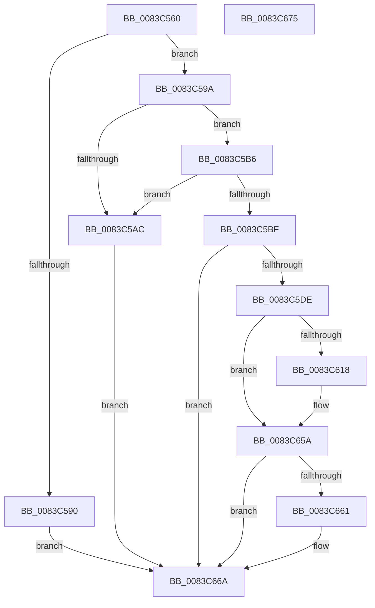

# NtDisableLastKnownGood

- RVA: `0x0083C560`–`0x0083C676` (길이 `278` bytes)
- VA: `0x000000014083C560`
- 실행 섹션: `PAGE`
- PDB 이름 있음: `예`; PDB Function 태그: `아니요`
- unwind 정보 RVA: `0x000DB3E8`
- 디코드: `68`개 명령, `278/278` bytes 표시
- 미해석 바이트: `0` (있으면 어셈블리에 `.byte`로 보존)

> 이 문서는 커널 이미지의 기계어와 PDB 기호를 분석해 생성했습니다. 4번과 5번은 함수 원형과 자료형을 바이너리 사용 방식에서 추정한 C 해석이며 원본 소스 복구 결과는 아닙니다.

## 1. Dependencies

- 직접 호출 지점: **6**; 고유 호출 대상: **6**
- 직접 호출자로 확인된 함수: **0**
- RIP 상대 이미지 참조: **4**

### Outgoing calls
- `0x0083C5A3` → [SeSinglePrivilegeCheck](../87/SeSinglePrivilegeCheck_function_00871E20.md) (function, `0x00871E20`)
- `0x0083C5B6` → [PsIsCurrentThreadInServerSilo](../../text/43/PsIsCurrentThreadInServerSilo_function_004362E0.md) (function, `0x004362E0`)
- `0x0083C5CF` → [_PnpCtxGetCachedContextBaseKey](../8E/_PnpCtxGetCachedContextBaseKey_function_008EFB2C.md) (function, `0x008EFB2C`)
- `0x0083C60D` → [IopCreateRegistryKeyEx](../A8/IopCreateRegistryKeyEx_function_00A89038.md) (function, `0x00A89038`)
- `0x0083C653` → [ZwSetValueKey](../../text/6A/ZwSetValueKey_function_006ADCD0.md) (function, `0x006ADCD0`)
- `0x0083C665` → [ZwClose](../../text/6A/ZwClose_function_006AD2B0.md) (function, `0x006AD2B0`)

### Direct callers
- 이 함수 시작 RVA로 연결되는 직접 call은 확인되지 않았습니다. 간접 호출은 완전히 역산할 수 없습니다.

### Static image references
- `0x0083C59A` → RVA `0x00FD9A78` (`PAGEDATA`; read)
- `0x0083C5BF` → RVA `0x00E66398` (`.data`; read)
- `0x0083C5E4` → RVA `0x00AFFCC0` (` ?? ::NNGAKEGL::`string'`; read)
- `0x0083C61C` → RVA `0x00B0E1C0` (` ?? ::NNGAKEGL::`string'`; read)

## 2. Other-region calls and transfers

- 다른 실행 섹션으로 향하는 call: **3**
  - `0x0083C5B6` → [PsIsCurrentThreadInServerSilo](../../text/43/PsIsCurrentThreadInServerSilo_function_004362E0.md) (`PAGE` → `.text`)
  - `0x0083C653` → [ZwSetValueKey](../../text/6A/ZwSetValueKey_function_006ADCD0.md) (`PAGE` → `.text`)
  - `0x0083C665` → [ZwClose](../../text/6A/ZwClose_function_006AD2B0.md) (`PAGE` → `.text`)
- 별도 외부 분기/꼬리 이동을 확인하지 못했습니다.

## 3. Assembly (complete function range)

```asm
0083C560  40 55                           push rbp
0083C562  53                              push rbx
0083C563  41 57                           push r15
0083C565  48 8B EC                        mov rbp, rsp
0083C568  48 83 EC 40                     sub rsp, 0x40
0083C56C  83 65 20 00                     and dword ptr [rbp + 0x20], 0
0083C570  83 65 F4 00                     and dword ptr [rbp - 0xc], 0
0083C574  65 48 8B 04 25 88 01 00 00      mov rax, qword ptr gs:[0x188]
0083C57D  48 83 65 30 00                  and qword ptr [rbp + 0x30], 0
0083C582  48 83 65 28 00                  and qword ptr [rbp + 0x28], 0
0083C587  80 B8 32 02 00 00 01            cmp byte ptr [rax + 0x232], 1
0083C58E  74 0A                           je 0x14083c59a
0083C590  BB 22 00 00 C0                  mov ebx, 0xc0000022
0083C595  E9 D0 00 00 00                  jmp 0x14083c66a
0083C59A  48 8B 0D D7 D4 79 00            mov rcx, qword ptr [rip + 0x79d4d7]
0083C5A1  B2 01                           mov dl, 1
0083C5A3  E8 78 58 03 00                  call 0x140871e20
0083C5A8  84 C0                           test al, al
0083C5AA  75 0A                           jne 0x14083c5b6
0083C5AC  BB 61 00 00 C0                  mov ebx, 0xc0000061
0083C5B1  E9 B4 00 00 00                  jmp 0x14083c66a
0083C5B6  E8 25 9D BF FF                  call 0x1404362e0
0083C5BB  84 C0                           test al, al
0083C5BD  75 ED                           jne 0x14083c5ac
0083C5BF  48 8B 0D D2 9D 62 00            mov rcx, qword ptr [rip + 0x629dd2]
0083C5C6  4C 8D 45 30                     lea r8, [rbp + 0x30]
0083C5CA  BA 04 00 00 00                  mov edx, 4
0083C5CF  E8 58 35 0B 00                  call 0x1408efb2c
0083C5D4  8B D8                           mov ebx, eax
0083C5D6  85 C0                           test eax, eax
0083C5D8  0F 88 8C 00 00 00               js 0x14083c66a
0083C5DE  48 83 64 24 28 00               and qword ptr [rsp + 0x28], 0
0083C5E4  48 8D 05 D5 36 2C 00            lea rax, [rip + 0x2c36d5]
0083C5EB  48 8B 55 30                     mov rdx, qword ptr [rbp + 0x30]
0083C5EF  4C 8D 45 F0                     lea r8, [rbp - 0x10]
0083C5F3  83 64 24 20 00                  and dword ptr [rsp + 0x20], 0
0083C5F8  48 8D 4D 28                     lea rcx, [rbp + 0x28]
0083C5FC  41 B9 3F 00 0F 00               mov r9d, 0xf003f
0083C602  48 89 45 F8                     mov qword ptr [rbp - 8], rax
0083C606  C7 45 F0 16 00 18 00            mov dword ptr [rbp - 0x10], 0x180016
0083C60D  E8 26 CA 24 00                  call 0x140a89038
0083C612  8B D8                           mov ebx, eax
0083C614  85 C0                           test eax, eax
0083C616  78 42                           js 0x14083c65a
0083C618  48 8B 4D 28                     mov rcx, qword ptr [rbp + 0x28]
0083C61C  48 8D 05 9D 1B 2D 00            lea rax, [rip + 0x2d1b9d]
0083C623  48 89 45 F8                     mov qword ptr [rbp - 8], rax
0083C627  48 8D 55 F0                     lea rdx, [rbp - 0x10]
0083C62B  48 8D 45 20                     lea rax, [rbp + 0x20]
0083C62F  C7 44 24 28 04 00 00 00         mov dword ptr [rsp + 0x28], 4
0083C637  41 B9 04 00 00 00               mov r9d, 4
0083C63D  48 89 44 24 20                  mov qword ptr [rsp + 0x20], rax
0083C642  45 33 C0                        xor r8d, r8d
0083C645  C7 45 20 01 00 00 00            mov dword ptr [rbp + 0x20], 1
0083C64C  C7 45 F0 14 00 16 00            mov dword ptr [rbp - 0x10], 0x160014
0083C653  E8 78 16 E7 FF                  call 0x1406adcd0
0083C658  8B D8                           mov ebx, eax
0083C65A  48 83 7D 28 00                  cmp qword ptr [rbp + 0x28], 0
0083C65F  74 09                           je 0x14083c66a
0083C661  48 8B 4D 28                     mov rcx, qword ptr [rbp + 0x28]
0083C665  E8 46 0C E7 FF                  call 0x1406ad2b0
0083C66A  8B C3                           mov eax, ebx
0083C66C  48 83 C4 40                     add rsp, 0x40
0083C670  41 5F                           pop r15
0083C672  5B                              pop rbx
0083C673  5D                              pop rbp
0083C674  C3                              ret
0083C675  CC                              int3
```

## 4. C-style interpretation (structured pseudocode)

```c
__int64 __fastcall NtDisableLastKnownGood(void)
{
    __int64 result;
    __int64 v_rbx;
    __int64 v_rsp;
    unsigned __int64 v_stack_m20;
    unsigned int v_stack_m24;
    unsigned __int64 v_stack_m28;
    unsigned __int64 v_stack_m30;
    unsigned int v_stack_m38;
    unsigned __int64 v_stack_p10;
    unsigned __int64 v_stack_p18;
    unsigned int v_stack_p8;

    v_rsp = (v_rsp) - (64);
    if ((*(unsigned __int8 *)(*(unsigned __int64 *)(gs_base + (0 + 392)) + 562)) == 1) goto loc_0083C59A;
    goto loc_0083C66A;
loc_0083C59A:
    result = SeSinglePrivilegeCheck(*(unsigned __int64 *)(v_rip + 7984343), 1, a3, a4);
    if ((unsigned __int8)(result) != 0) goto loc_0083C5B6;
loc_0083C5AC:
    goto loc_0083C66A;
loc_0083C5B6:
    result = PsIsCurrentThreadInServerSilo(*(unsigned __int64 *)(v_rip + 7984343), 1, a3, a4);
    if ((unsigned __int8)(result) != 0) goto loc_0083C5AC;
    result = _PnpCtxGetCachedContextBaseKey(*(unsigned __int64 *)(v_rip + 6462930), 4, v_stack_p18, a4);
    if (sign_flag) goto loc_0083C66A;
    v_stack_m20 = v_rip + 2897621;
    v_stack_m28 = 0x180016ULL;
    result = IopCreateRegistryKeyEx(v_stack_p10, v_stack_p18, v_stack_m28, (unsigned int)(0xF003FULL));
    v_rbx = (unsigned int)((unsigned int)(result));
    if (!(sign_flag)) {
        a1 = v_stack_p10;
        result = v_rip + 2956189;
        v_stack_m20 = result;
        a2 = v_stack_m28;
        result = v_stack_p8;
        v_stack_m30 = 4;
        a4 = 4;
        v_stack_m38 = result;
        a3 = 0;
        v_stack_p8 = 1;
        v_stack_m28 = 0x160014ULL;
        result = ZwSetValueKey(a1, a2, a3, a4);
        v_rbx = (unsigned int)(result);
    }
    if (v_stack_p10 != 0) {
        a1 = v_stack_p10;
        result = ZwClose(a1, a2, a3, a4);
    }
    v_rsp = (v_rsp) + (64);
    return (unsigned int)((unsigned int)(v_rbx));
}
```

## 5. (Beta) C Style

```c
void NtDisableLastKnownGood(void)
{
    int64_t result;
    int64_t local_rbx;
    int64_t local_rsp;
    uint64_t v_stack_m20;
    uint32_t v_stack_m24;
    uint64_t v_stack_m28;
    uint64_t v_stack_m30;
    uint32_t v_stack_m38;
    uint64_t v_stack_p10;
    uint64_t v_stack_p18;
    uint32_t v_stack_p8;

    local_rsp = (local_rsp) - (64);
    if ((*(uint8_t *)(*(uint64_t *)(gs_base + (0 + 0x188)) + 0x232)) == 1) goto loc_0083C59A;
    goto loc_0083C66A;
loc_0083C59A:
    result = SeSinglePrivilegeCheck(*(uint64_t *)(v_rip + 0x79D4D7), 1, a3, a4);
    if ((uint8_t)(result) != 0) goto loc_0083C5B6;
loc_0083C5AC:
    goto loc_0083C66A;
loc_0083C5B6:
    result = PsIsCurrentThreadInServerSilo(*(uint64_t *)(v_rip + 0x79D4D7), 1, a3, a4);
    if ((uint8_t)(result) != 0) goto loc_0083C5AC;
    result = _PnpCtxGetCachedContextBaseKey(*(uint64_t *)(v_rip + 0x629DD2), 4, v_stack_p18, a4);
    if (sign_flag) goto loc_0083C66A;
    v_stack_m20 = v_rip + 2897621;
    v_stack_m28 = 0x180016ULL;
    result = IopCreateRegistryKeyEx(v_stack_p10, v_stack_p18, v_stack_m28, (uint32_t)(0xF003FULL));
    local_rbx = (uint32_t)((uint32_t)(result));
    if (!(sign_flag)) {
        a1 = v_stack_p10;
        result = v_rip + 2956189;
        v_stack_m20 = result;
        a2 = v_stack_m28;
        result = v_stack_p8;
        v_stack_m30 = 4;
        a4 = 4;
        v_stack_m38 = result;
        a3 = 0;
        v_stack_p8 = 1;
        v_stack_m28 = 0x160014ULL;
        result = ZwSetValueKey(a1, a2, a3, a4);
        local_rbx = (uint32_t)(result);
    }
    if (v_stack_p10 != 0) {
        a1 = v_stack_p10;
        result = ZwClose(a1, a2, a3, a4);
    }
    local_rsp = (local_rsp) + (64);
    return (uint32_t)((uint32_t)(local_rbx));
}
```

## 6. Execution-region graph

[열기: 2D/3D 그래프와 함수 탐색 컨트롤 패널](../../../control-panel.html?section=page&rva=0x0083C560&view=graph)

- 2D 그래프는 위에서 아래로 흐르고, 3D 그래프는 빈 공간을 드래그해 회전합니다. Shift+드래그는 이동, 휠은 확대·축소, 함수 노드 선택은 대상 보고서 이동입니다.

### Static fallback


