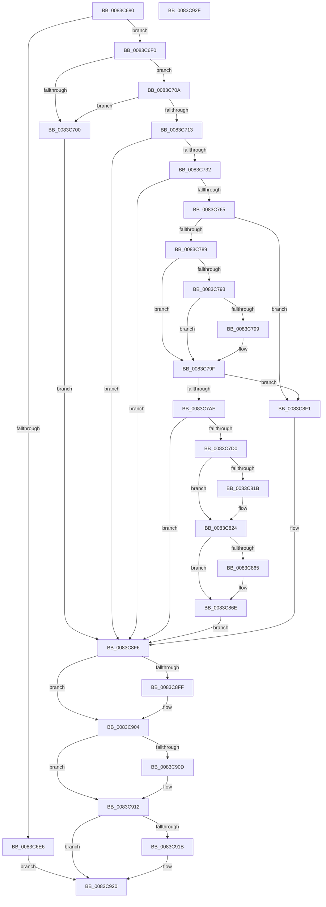

# NtEnableLastKnownGood

- RVA: `0x0083C680`–`0x0083C930` (길이 `688` bytes)
- VA: `0x000000014083C680`
- 실행 섹션: `PAGE`
- PDB 이름 있음: `예`; PDB Function 태그: `아니요`
- unwind 정보 RVA: `0x000DB3D4`
- 디코드: `174`개 명령, `688/688` bytes 표시
- 미해석 바이트: `0` (있으면 어셈블리에 `.byte`로 보존)

> 이 문서는 커널 이미지의 기계어와 PDB 기호를 분석해 생성했습니다. 4번과 5번은 함수 원형과 자료형을 바이너리 사용 방식에서 추정한 C 해석이며 원본 소스 복구 결과는 아닙니다.

## 1. Dependencies

- 직접 호출 지점: **22**; 고유 호출 대상: **13**
- 직접 호출자로 확인된 함수: **0**
- RIP 상대 이미지 참조: **8**

### Outgoing calls
- `0x0083C6F7` → [SeSinglePrivilegeCheck](../87/SeSinglePrivilegeCheck_function_00871E20.md) (function, `0x00871E20`)
- `0x0083C70A` → [PsIsCurrentThreadInServerSilo](../../text/43/PsIsCurrentThreadInServerSilo_function_004362E0.md) (function, `0x004362E0`)
- `0x0083C723` → [_PnpCtxGetCachedContextBaseKey](../8E/_PnpCtxGetCachedContextBaseKey_function_008EFB2C.md) (function, `0x008EFB2C`)
- `0x0083C756` → [IopOpenRegistryKeyEx](../A5/IopOpenRegistryKeyEx_function_00A51B44.md) (function, `0x00A51B44`)
- `0x0083C77C` → [IopGetRegistryValue](../99/IopGetRegistryValue_function_009990EC.md) (function, `0x009990EC`)
- `0x0083C7A1` → [ExFreePoolWithTag](../../poolcode/B8/ExFreePoolWithTag_function_00B82870.md) (function, `0x00B82870`)
- `0x0083C7C1` → [ZwDeleteValueKey](../../text/6A/ZwDeleteValueKey_function_006AECB0.md) (function, `0x006AECB0`)
- `0x0083C7DB` → [RtlInitUnicodeString](../../text/42/RtlInitUnicodeString_function_0042A780.md) (function, `0x0042A780`)
- `0x0083C812` → [ZwOpenKey](../../text/6A/ZwOpenKey_function_006AD310.md) (function, `0x006AD310`)
- `0x0083C81F` → [ZwDeleteKey](../../text/6A/ZwDeleteKey_function_006AEC50.md) (function, `0x006AEC50`)
- `0x0083C82F` → [RtlInitUnicodeString](../../text/42/RtlInitUnicodeString_function_0042A780.md) (function, `0x0042A780`)
- `0x0083C85C` → [ZwOpenKey](../../text/6A/ZwOpenKey_function_006AD310.md) (function, `0x006AD310`)
- `0x0083C869` → [ZwDeleteKey](../../text/6A/ZwDeleteKey_function_006AEC50.md) (function, `0x006AEC50`)
- `0x0083C879` → [RtlInitUnicodeString](../../text/42/RtlInitUnicodeString_function_0042A780.md) (function, `0x0042A780`)
- `0x0083C882` → [IopFileUtilWalkDirectoryTreeBottomUp](../73/IopFileUtilWalkDirectoryTreeBottomUp_function_0073FB40.md) (function, `0x0073FB40`)
- `0x0083C8AB` → [ZwDeleteFile](../../text/6A/ZwDeleteFile_function_006AEC30.md) (function, `0x006AEC30`)
- `0x0083C8BB` → [RtlInitUnicodeString](../../text/42/RtlInitUnicodeString_function_0042A780.md) (function, `0x0042A780`)
- `0x0083C8C4` → [IopFileUtilWalkDirectoryTreeBottomUp](../73/IopFileUtilWalkDirectoryTreeBottomUp_function_0073FB40.md) (function, `0x0073FB40`)
- `0x0083C8E8` → [ZwDeleteFile](../../text/6A/ZwDeleteFile_function_006AEC30.md) (function, `0x006AEC30`)
- `0x0083C8FF` → [ZwClose](../../text/6A/ZwClose_function_006AD2B0.md) (function, `0x006AD2B0`)
- `0x0083C90D` → [ZwClose](../../text/6A/ZwClose_function_006AD2B0.md) (function, `0x006AD2B0`)
- `0x0083C91B` → [ZwClose](../../text/6A/ZwClose_function_006AD2B0.md) (function, `0x006AD2B0`)

### Direct callers
- 이 함수 시작 RVA로 연결되는 직접 call은 확인되지 않았습니다. 간접 호출은 완전히 역산할 수 없습니다.

### Static image references
- `0x0083C6F0` → RVA `0x00FD9A78` (`PAGEDATA`; read)
- `0x0083C713` → RVA `0x00E66398` (`.data`; read)
- `0x0083C736` → RVA `0x00AFFCC0` (` ?? ::NNGAKEGL::`string'`; read)
- `0x0083C769` → RVA `0x00B0E1C0` (` ?? ::NNGAKEGL::`string'`; read)
- `0x0083C7D0` → RVA `0x00B0E260` (` ?? ::NNGAKEGL::`string'`; read)
- `0x0083C824` → RVA `0x00B0E1E0` (` ?? ::NNGAKEGL::`string'`; read)
- `0x0083C86E` → RVA `0x00B0E190` (` ?? ::NNGAKEGL::`string'`; read)
- `0x0083C8B0` → RVA `0x00B0E150` (` ?? ::NNGAKEGL::`string'`; read)

## 2. Other-region calls and transfers

- 다른 실행 섹션으로 향하는 call: **16**
  - `0x0083C70A` → [PsIsCurrentThreadInServerSilo](../../text/43/PsIsCurrentThreadInServerSilo_function_004362E0.md) (`PAGE` → `.text`)
  - `0x0083C7A1` → [ExFreePoolWithTag](../../poolcode/B8/ExFreePoolWithTag_function_00B82870.md) (`PAGE` → `POOLCODE`)
  - `0x0083C7C1` → [ZwDeleteValueKey](../../text/6A/ZwDeleteValueKey_function_006AECB0.md) (`PAGE` → `.text`)
  - `0x0083C7DB` → [RtlInitUnicodeString](../../text/42/RtlInitUnicodeString_function_0042A780.md) (`PAGE` → `.text`)
  - `0x0083C812` → [ZwOpenKey](../../text/6A/ZwOpenKey_function_006AD310.md) (`PAGE` → `.text`)
  - `0x0083C81F` → [ZwDeleteKey](../../text/6A/ZwDeleteKey_function_006AEC50.md) (`PAGE` → `.text`)
  - `0x0083C82F` → [RtlInitUnicodeString](../../text/42/RtlInitUnicodeString_function_0042A780.md) (`PAGE` → `.text`)
  - `0x0083C85C` → [ZwOpenKey](../../text/6A/ZwOpenKey_function_006AD310.md) (`PAGE` → `.text`)
  - `0x0083C869` → [ZwDeleteKey](../../text/6A/ZwDeleteKey_function_006AEC50.md) (`PAGE` → `.text`)
  - `0x0083C879` → [RtlInitUnicodeString](../../text/42/RtlInitUnicodeString_function_0042A780.md) (`PAGE` → `.text`)
  - `0x0083C8AB` → [ZwDeleteFile](../../text/6A/ZwDeleteFile_function_006AEC30.md) (`PAGE` → `.text`)
  - `0x0083C8BB` → [RtlInitUnicodeString](../../text/42/RtlInitUnicodeString_function_0042A780.md) (`PAGE` → `.text`)
  - `0x0083C8E8` → [ZwDeleteFile](../../text/6A/ZwDeleteFile_function_006AEC30.md) (`PAGE` → `.text`)
  - `0x0083C8FF` → [ZwClose](../../text/6A/ZwClose_function_006AD2B0.md) (`PAGE` → `.text`)
  - `0x0083C90D` → [ZwClose](../../text/6A/ZwClose_function_006AD2B0.md) (`PAGE` → `.text`)
  - `0x0083C91B` → [ZwClose](../../text/6A/ZwClose_function_006AD2B0.md) (`PAGE` → `.text`)
- 별도 외부 분기/꼬리 이동을 확인하지 못했습니다.

## 3. Assembly (complete function range)

```asm
0083C680  40 55                           push rbp
0083C682  53                              push rbx
0083C683  56                              push rsi
0083C684  41 57                           push r15
0083C686  48 8D 6C 24 C1                  lea rbp, [rsp - 0x3f]
0083C68B  48 81 EC B8 00 00 00            sub rsp, 0xb8
0083C692  48 83 65 7F 00                  and qword ptr [rbp + 0x7f], 0
0083C697  33 C0                           xor eax, eax
0083C699  48 21 45 67                     and qword ptr [rbp + 0x67], rax
0083C69D  0F 57 C0                        xorps xmm0, xmm0
0083C6A0  48 21 45 6F                     and qword ptr [rbp + 0x6f], rax
0083C6A4  0F 57 C9                        xorps xmm1, xmm1
0083C6A7  48 21 45 77                     and qword ptr [rbp + 0x77], rax
0083C6AB  B2 01                           mov dl, 1
0083C6AD  48 83 65 E7 00                  and qword ptr [rbp - 0x19], 0
0083C6B2  0F 11 45 0F                     movups xmmword ptr [rbp + 0xf], xmm0
0083C6B6  48 89 45 C7                     mov qword ptr [rbp - 0x39], rax
0083C6BA  0F 11 4D EF                     movups xmmword ptr [rbp - 0x11], xmm1
0083C6BE  89 45 CF                        mov dword ptr [rbp - 0x31], eax
0083C6C1  0F 11 45 1F                     movups xmmword ptr [rbp + 0x1f], xmm0
0083C6C5  0F 11 4D FF                     movups xmmword ptr [rbp - 1], xmm1
0083C6C9  0F 11 45 A7                     movups xmmword ptr [rbp - 0x59], xmm0
0083C6CD  0F 11 45 B7                     movups xmmword ptr [rbp - 0x49], xmm0
0083C6D1  0F 11 45 D7                     movups xmmword ptr [rbp - 0x29], xmm0
0083C6D5  65 48 8B 04 25 88 01 00 00      mov rax, qword ptr gs:[0x188]
0083C6DE  38 90 32 02 00 00               cmp byte ptr [rax + 0x232], dl
0083C6E4  74 0A                           je 0x14083c6f0
0083C6E6  BB 22 00 00 C0                  mov ebx, 0xc0000022
0083C6EB  E9 30 02 00 00                  jmp 0x14083c920
0083C6F0  48 8B 0D 81 D3 79 00            mov rcx, qword ptr [rip + 0x79d381]
0083C6F7  E8 24 57 03 00                  call 0x140871e20
0083C6FC  84 C0                           test al, al
0083C6FE  75 0A                           jne 0x14083c70a
0083C700  BB 61 00 00 C0                  mov ebx, 0xc0000061
0083C705  E9 EC 01 00 00                  jmp 0x14083c8f6
0083C70A  E8 D1 9B BF FF                  call 0x1404362e0
0083C70F  84 C0                           test al, al
0083C711  75 ED                           jne 0x14083c700
0083C713  48 8B 0D 7E 9C 62 00            mov rcx, qword ptr [rip + 0x629c7e]
0083C71A  4C 8D 45 7F                     lea r8, [rbp + 0x7f]
0083C71E  BA 04 00 00 00                  mov edx, 4
0083C723  E8 04 34 0B 00                  call 0x1408efb2c
0083C728  8B D8                           mov ebx, eax
0083C72A  85 C0                           test eax, eax
0083C72C  0F 88 C4 01 00 00               js 0x14083c8f6
0083C732  48 8B 55 7F                     mov rdx, qword ptr [rbp + 0x7f]
0083C736  48 8D 05 83 35 2C 00            lea rax, [rip + 0x2c3583]
0083C73D  41 B9 3F 00 0F 00               mov r9d, 0xf003f
0083C743  48 89 45 DF                     mov qword ptr [rbp - 0x21], rax
0083C747  4C 8D 45 D7                     lea r8, [rbp - 0x29]
0083C74B  C7 45 D7 16 00 18 00            mov dword ptr [rbp - 0x29], 0x180016
0083C752  48 8D 4D 67                     lea rcx, [rbp + 0x67]
0083C756  E8 E9 53 21 00                  call 0x140a51b44
0083C75B  8B D8                           mov ebx, eax
0083C75D  85 C0                           test eax, eax
0083C75F  0F 88 91 01 00 00               js 0x14083c8f6
0083C765  48 8B 4D 67                     mov rcx, qword ptr [rbp + 0x67]
0083C769  48 8D 35 50 1A 2D 00            lea rsi, [rip + 0x2d1a50]
0083C770  48 8B D6                        mov rdx, rsi
0083C773  4C 8D 4D E7                     lea r9, [rbp - 0x19]
0083C777  45 33 C0                        xor r8d, r8d
0083C77A  32 DB                           xor bl, bl
0083C77C  E8 6B C9 15 00                  call 0x1409990ec
0083C781  85 C0                           test eax, eax
0083C783  0F 88 68 01 00 00               js 0x14083c8f1
0083C789  48 8B 4D E7                     mov rcx, qword ptr [rbp - 0x19]
0083C78D  83 79 04 04                     cmp dword ptr [rcx + 4], 4
0083C791  75 0C                           jne 0x14083c79f
0083C793  83 79 0C 04                     cmp dword ptr [rcx + 0xc], 4
0083C797  75 06                           jne 0x14083c79f
0083C799  8B 41 08                        mov eax, dword ptr [rcx + 8]
0083C79C  8A 1C 08                        mov bl, byte ptr [rax + rcx]
0083C79F  33 D2                           xor edx, edx
0083C7A1  E8 CA 60 34 00                  call 0x140b82870
0083C7A6  84 DB                           test bl, bl
0083C7A8  0F 84 43 01 00 00               je 0x14083c8f1
0083C7AE  48 8B 4D 67                     mov rcx, qword ptr [rbp + 0x67]
0083C7B2  48 8D 55 D7                     lea rdx, [rbp - 0x29]
0083C7B6  C7 45 D7 14 00 16 00            mov dword ptr [rbp - 0x29], 0x160014
0083C7BD  48 89 75 DF                     mov qword ptr [rbp - 0x21], rsi
0083C7C1  E8 EA 24 E7 FF                  call 0x1406aecb0
0083C7C6  8B D8                           mov ebx, eax
0083C7C8  85 C0                           test eax, eax
0083C7CA  0F 88 26 01 00 00               js 0x14083c8f6
0083C7D0  48 8D 15 89 1A 2D 00            lea rdx, [rip + 0x2d1a89]
0083C7D7  48 8D 4D 0F                     lea rcx, [rbp + 0xf]
0083C7DB  E8 A0 DF BE FF                  call 0x14042a780
0083C7E0  48 83 65 AF 00                  and qword ptr [rbp - 0x51], 0
0083C7E5  48 8D 45 0F                     lea rax, [rbp + 0xf]
0083C7E9  0F 57 C0                        xorps xmm0, xmm0
0083C7EC  48 89 45 B7                     mov qword ptr [rbp - 0x49], rax
0083C7F0  BE 30 00 00 00                  mov esi, 0x30
0083C7F5  4C 8D 45 A7                     lea r8, [rbp - 0x59]
0083C7F9  BB 40 02 00 00                  mov ebx, 0x240
0083C7FE  89 75 A7                        mov dword ptr [rbp - 0x59], esi
0083C801  BA 3F 00 0F 00                  mov edx, 0xf003f
0083C806  89 5D BF                        mov dword ptr [rbp - 0x41], ebx
0083C809  48 8D 4D 6F                     lea rcx, [rbp + 0x6f]
0083C80D  F3 0F 7F 45 C7                  movdqu xmmword ptr [rbp - 0x39], xmm0
0083C812  E8 F9 0A E7 FF                  call 0x1406ad310
0083C817  85 C0                           test eax, eax
0083C819  78 09                           js 0x14083c824
0083C81B  48 8B 4D 6F                     mov rcx, qword ptr [rbp + 0x6f]
0083C81F  E8 2C 24 E7 FF                  call 0x1406aec50
0083C824  48 8D 15 B5 19 2D 00            lea rdx, [rip + 0x2d19b5]
0083C82B  48 8D 4D 1F                     lea rcx, [rbp + 0x1f]
0083C82F  E8 4C DF BE FF                  call 0x14042a780
0083C834  48 83 65 AF 00                  and qword ptr [rbp - 0x51], 0
0083C839  48 8D 45 1F                     lea rax, [rbp + 0x1f]
0083C83D  0F 57 C0                        xorps xmm0, xmm0
0083C840  48 89 45 B7                     mov qword ptr [rbp - 0x49], rax
0083C844  4C 8D 45 A7                     lea r8, [rbp - 0x59]
0083C848  89 75 A7                        mov dword ptr [rbp - 0x59], esi
0083C84B  BA 3F 00 0F 00                  mov edx, 0xf003f
0083C850  89 5D BF                        mov dword ptr [rbp - 0x41], ebx
0083C853  48 8D 4D 77                     lea rcx, [rbp + 0x77]
0083C857  F3 0F 7F 45 C7                  movdqu xmmword ptr [rbp - 0x39], xmm0
0083C85C  E8 AF 0A E7 FF                  call 0x1406ad310
0083C861  85 C0                           test eax, eax
0083C863  78 09                           js 0x14083c86e
0083C865  48 8B 4D 77                     mov rcx, qword ptr [rbp + 0x77]
0083C869  E8 E2 23 E7 FF                  call 0x1406aec50
0083C86E  48 8D 15 1B 19 2D 00            lea rdx, [rip + 0x2d191b]
0083C875  48 8D 4D EF                     lea rcx, [rbp - 0x11]
0083C879  E8 02 DF BE FF                  call 0x14042a780
0083C87E  48 8D 4D EF                     lea rcx, [rbp - 0x11]
0083C882  E8 B9 32 F0 FF                  call 0x14073fb40
0083C887  48 83 65 AF 00                  and qword ptr [rbp - 0x51], 0
0083C88C  48 8D 45 EF                     lea rax, [rbp - 0x11]
0083C890  0F 57 C0                        xorps xmm0, xmm0
0083C893  48 89 45 B7                     mov qword ptr [rbp - 0x49], rax
0083C897  BB 40 00 00 00                  mov ebx, 0x40
0083C89C  89 75 A7                        mov dword ptr [rbp - 0x59], esi
0083C89F  48 8D 4D A7                     lea rcx, [rbp - 0x59]
0083C8A3  89 5D BF                        mov dword ptr [rbp - 0x41], ebx
0083C8A6  F3 0F 7F 45 C7                  movdqu xmmword ptr [rbp - 0x39], xmm0
0083C8AB  E8 80 23 E7 FF                  call 0x1406aec30
0083C8B0  48 8D 15 99 18 2D 00            lea rdx, [rip + 0x2d1899]
0083C8B7  48 8D 4D FF                     lea rcx, [rbp - 1]
0083C8BB  E8 C0 DE BE FF                  call 0x14042a780
0083C8C0  48 8D 4D FF                     lea rcx, [rbp - 1]
0083C8C4  E8 77 32 F0 FF                  call 0x14073fb40
0083C8C9  48 83 65 AF 00                  and qword ptr [rbp - 0x51], 0
0083C8CE  48 8D 45 FF                     lea rax, [rbp - 1]
0083C8D2  0F 57 C0                        xorps xmm0, xmm0
0083C8D5  48 89 45 B7                     mov qword ptr [rbp - 0x49], rax
0083C8D9  48 8D 4D A7                     lea rcx, [rbp - 0x59]
0083C8DD  89 75 A7                        mov dword ptr [rbp - 0x59], esi
0083C8E0  F3 0F 7F 45 C7                  movdqu xmmword ptr [rbp - 0x39], xmm0
0083C8E5  89 5D BF                        mov dword ptr [rbp - 0x41], ebx
0083C8E8  E8 43 23 E7 FF                  call 0x1406aec30
0083C8ED  33 DB                           xor ebx, ebx
0083C8EF  EB 05                           jmp 0x14083c8f6
0083C8F1  BB 01 00 00 C0                  mov ebx, 0xc0000001
0083C8F6  48 8B 4D 6F                     mov rcx, qword ptr [rbp + 0x6f]
0083C8FA  48 85 C9                        test rcx, rcx
0083C8FD  74 05                           je 0x14083c904
0083C8FF  E8 AC 09 E7 FF                  call 0x1406ad2b0
0083C904  48 8B 4D 77                     mov rcx, qword ptr [rbp + 0x77]
0083C908  48 85 C9                        test rcx, rcx
0083C90B  74 05                           je 0x14083c912
0083C90D  E8 9E 09 E7 FF                  call 0x1406ad2b0
0083C912  48 8B 4D 67                     mov rcx, qword ptr [rbp + 0x67]
0083C916  48 85 C9                        test rcx, rcx
0083C919  74 05                           je 0x14083c920
0083C91B  E8 90 09 E7 FF                  call 0x1406ad2b0
0083C920  8B C3                           mov eax, ebx
0083C922  48 81 C4 B8 00 00 00            add rsp, 0xb8
0083C929  41 5F                           pop r15
0083C92B  5E                              pop rsi
0083C92C  5B                              pop rbx
0083C92D  5D                              pop rbp
0083C92E  C3                              ret
0083C92F  CC                              int3
```

## 4. C-style interpretation (structured pseudocode)

```c
__int64 __fastcall NtEnableLastKnownGood(void)
{
    __int64 result;
    __int64 v_rbx;
    __int64 v_rsp;
    unsigned __int64 v_stack_m40;
    unsigned __int64 v_stack_m50;
    unsigned __int64 v_stack_m5F;
    unsigned __int64 v_stack_m60;
    unsigned __int64 v_stack_m70;
    unsigned __int64 v_stack_m78;
    unsigned __int64 v_stack_m80;
    unsigned __int64 v_stack_m88;
    unsigned int v_stack_m90;
    unsigned __int64 v_stack_m98;
    unsigned int v_stack_mA0;
    unsigned __int64 v_stack_mA8;
    unsigned __int64 v_stack_mB0;
    unsigned __int64 v_stack_mB8;
    unsigned __int64 v_stack_p10;
    unsigned __int64 v_stack_p18;
    unsigned __int64 v_stack_p20;
    unsigned __int64 v_stack_p8;

    v_rsp = (v_rsp) - (184);
    result = 0;
    v_stack_m50 = v_xmm0;
    v_stack_m98 = 0;
    v_stack_m70 = v_xmm1;
    v_stack_m90 = 0;
    v_stack_m40 = v_xmm0;
    v_stack_m60 = v_xmm1;
    v_stack_mB8 = v_xmm0;
    v_stack_mA8 = v_xmm0;
    v_stack_m88 = v_xmm0;
    if ((*(unsigned __int8 *)(*(unsigned __int64 *)(gs_base + (0 + 392)) + 562)) == 1) goto loc_0083C6F0;
    goto loc_0083C920;
loc_0083C6F0:
    result = SeSinglePrivilegeCheck(*(unsigned __int64 *)(v_rip + 7984001), 1, a3, a4);
    if ((unsigned __int8)(result) != 0) goto loc_0083C70A;
loc_0083C700:
    goto loc_0083C8F6;
loc_0083C70A:
    result = PsIsCurrentThreadInServerSilo(*(unsigned __int64 *)(v_rip + 7984001), 1, a3, a4);
    if ((unsigned __int8)(result) != 0) goto loc_0083C700;
    result = _PnpCtxGetCachedContextBaseKey(*(unsigned __int64 *)(v_rip + 6462590), 4, v_stack_p20, a4);
    if (sign_flag) goto loc_0083C8F6;
    v_stack_m80 = v_rip + 2897283;
    v_stack_m88 = 0x180016ULL;
    result = IopOpenRegistryKeyEx(v_stack_p8, v_stack_p20, v_stack_m88, (unsigned int)(0xF003FULL));
    if (sign_flag) goto loc_0083C8F6;
    a3 = 0;
    v_rbx = 0;
    result = IopGetRegistryValue(v_stack_p8, v_rip + 2955856, a3, v_stack_m78);
    if (sign_flag) goto loc_0083C8F1;
    if ((*(unsigned int *)(v_stack_m78 + 4)) != 4) goto loc_0083C79F;
    if ((*(unsigned int *)(v_stack_m78 + 12)) == 4) {
        result = *(unsigned int *)(v_stack_m78 + 8);
        v_rbx = *(unsigned __int8 *)(result + v_stack_m78 * 1);
    }
    a2 = 0;
    result = ExFreePoolWithTag(v_stack_m78, a2, a3, v_stack_m78);
    if ((unsigned __int8)(v_rbx) == 0) goto loc_0083C8F1;
    v_stack_m88 = 0x160014ULL;
    v_stack_m80 = v_rip + 2955856;
    result = ZwDeleteValueKey(v_stack_p8, v_stack_m88, a3, v_stack_m78);
    if (sign_flag) goto loc_0083C8F6;
    result = RtlInitUnicodeString(v_stack_m50, v_rip + 2955913, a3, v_stack_m78);
    v_stack_mA8 = v_stack_m50;
    v_stack_mB8 = 48;
    v_stack_mA0 = 576;
    v_stack_m98 = v_xmm0;
    result = ZwOpenKey(v_stack_p10, (unsigned int)(0xF003FULL), v_stack_mB8, v_stack_m78);
    if (!(sign_flag)) {
        a1 = v_stack_p10;
        result = ZwDeleteKey(a1, (unsigned int)(0xF003FULL), v_stack_mB8, v_stack_m78);
    }
    result = RtlInitUnicodeString(v_stack_m40, v_rip + 2955701, v_stack_mB8, v_stack_m78);
    v_stack_mA8 = v_stack_m40;
    v_stack_mB8 = 48;
    v_stack_mA0 = 576;
    v_stack_m98 = v_xmm0;
    result = ZwOpenKey(v_stack_p18, (unsigned int)(0xF003FULL), v_stack_mB8, v_stack_m78);
    if (!(sign_flag)) {
        a1 = v_stack_p18;
        result = ZwDeleteKey(a1, (unsigned int)(0xF003FULL), v_stack_mB8, v_stack_m78);
    }
    result = RtlInitUnicodeString(v_stack_m70, v_rip + 2955547, v_stack_mB8, v_stack_m78);
    result = IopFileUtilWalkDirectoryTreeBottomUp(v_stack_m70, v_rip + 2955547, v_stack_mB8, v_stack_m78);
    v_stack_mA8 = v_stack_m70;
    v_stack_mB8 = 48;
    v_stack_mA0 = 64;
    v_stack_m98 = v_xmm0;
    result = ZwDeleteFile(v_stack_mB8, v_rip + 2955547, v_stack_mB8, v_stack_m78);
    result = RtlInitUnicodeString(v_stack_m60, v_rip + 2955417, v_stack_mB8, v_stack_m78);
    result = IopFileUtilWalkDirectoryTreeBottomUp(v_stack_m60, v_rip + 2955417, v_stack_mB8, v_stack_m78);
    v_stack_mA8 = v_stack_m60;
    v_stack_mB8 = 48;
    v_stack_m98 = v_xmm0;
    v_stack_mA0 = 64;
    result = ZwDeleteFile(v_stack_mB8, v_rip + 2955417, v_stack_mB8, v_stack_m78);
    v_rbx = 0;
    goto loc_0083C8F6;
loc_0083C8F1:
loc_0083C8F6:
    if (v_stack_p10 != 0) {
        result = ZwClose(v_stack_p10, v_rip + 2955417, v_stack_mB8, v_stack_m78);
    }
    if (v_stack_p18 != 0) {
        result = ZwClose(v_stack_p18, v_rip + 2955417, v_stack_mB8, v_stack_m78);
    }
    if (v_stack_p8 != 0) {
        result = ZwClose(v_stack_p8, v_rip + 2955417, v_stack_mB8, v_stack_m78);
    }
    v_rsp = (v_rsp) + (184);
    return (unsigned int)((unsigned int)((unsigned int)(0xC0000001ULL)));
}
```

## 5. (Beta) C Style

```c
void NtEnableLastKnownGood(void)
{
    int64_t result;
    int64_t local_rbx;
    int64_t local_rsp;
    uint64_t v_stack_m40;
    uint64_t v_stack_m50;
    uint64_t v_stack_m5F;
    uint64_t v_stack_m60;
    uint64_t v_stack_m70;
    uint64_t v_stack_m78;
    uint64_t v_stack_m80;
    uint64_t v_stack_m88;
    uint32_t v_stack_m90;
    uint64_t v_stack_m98;
    uint32_t v_stack_mA0;
    uint64_t v_stack_mA8;
    uint64_t v_stack_mB0;
    uint64_t v_stack_mB8;
    uint64_t v_stack_p10;
    uint64_t v_stack_p18;
    uint64_t v_stack_p20;
    uint64_t v_stack_p8;

    local_rsp = (local_rsp) - (184);
    result = 0;
    v_stack_m50 = v_xmm0;
    v_stack_m98 = 0;
    v_stack_m70 = v_xmm1;
    v_stack_m90 = 0;
    v_stack_m40 = v_xmm0;
    v_stack_m60 = v_xmm1;
    v_stack_mB8 = v_xmm0;
    v_stack_mA8 = v_xmm0;
    v_stack_m88 = v_xmm0;
    if ((*(uint8_t *)(*(uint64_t *)(gs_base + (0 + 0x188)) + 0x232)) == 1) goto loc_0083C6F0;
    goto loc_0083C920;
loc_0083C6F0:
    result = SeSinglePrivilegeCheck(*(uint64_t *)(v_rip + 0x79D381), 1, a3, a4);
    if ((uint8_t)(result) != 0) goto loc_0083C70A;
loc_0083C700:
    goto loc_0083C8F6;
loc_0083C70A:
    result = PsIsCurrentThreadInServerSilo(*(uint64_t *)(v_rip + 0x79D381), 1, a3, a4);
    if ((uint8_t)(result) != 0) goto loc_0083C700;
    result = _PnpCtxGetCachedContextBaseKey(*(uint64_t *)(v_rip + 0x629C7E), 4, v_stack_p20, a4);
    if (sign_flag) goto loc_0083C8F6;
    v_stack_m80 = v_rip + 2897283;
    v_stack_m88 = 0x180016ULL;
    result = IopOpenRegistryKeyEx(v_stack_p8, v_stack_p20, v_stack_m88, (uint32_t)(0xF003FULL));
    if (sign_flag) goto loc_0083C8F6;
    a3 = 0;
    local_rbx = 0;
    result = IopGetRegistryValue(v_stack_p8, v_rip + 2955856, a3, v_stack_m78);
    if (sign_flag) goto loc_0083C8F1;
    if ((*(uint32_t *)(v_stack_m78 + 0x4)) != 4) goto loc_0083C79F;
    if ((*(uint32_t *)(v_stack_m78 + 0xC)) == 4) {
        result = *(uint32_t *)(v_stack_m78 + 0x8);
        local_rbx = *(uint8_t *)(result + v_stack_m78 * 1);
    }
    a2 = 0;
    result = ExFreePoolWithTag(v_stack_m78, a2, a3, v_stack_m78);
    if ((uint8_t)(local_rbx) == 0) goto loc_0083C8F1;
    v_stack_m88 = 0x160014ULL;
    v_stack_m80 = v_rip + 2955856;
    result = ZwDeleteValueKey(v_stack_p8, v_stack_m88, a3, v_stack_m78);
    if (sign_flag) goto loc_0083C8F6;
    result = RtlInitUnicodeString(v_stack_m50, v_rip + 2955913, a3, v_stack_m78);
    v_stack_mA8 = v_stack_m50;
    v_stack_mB8 = 48;
    v_stack_mA0 = 576;
    v_stack_m98 = v_xmm0;
    result = ZwOpenKey(v_stack_p10, (uint32_t)(0xF003FULL), v_stack_mB8, v_stack_m78);
    if (!(sign_flag)) {
        a1 = v_stack_p10;
        result = ZwDeleteKey(a1, (uint32_t)(0xF003FULL), v_stack_mB8, v_stack_m78);
    }
    result = RtlInitUnicodeString(v_stack_m40, v_rip + 2955701, v_stack_mB8, v_stack_m78);
    v_stack_mA8 = v_stack_m40;
    v_stack_mB8 = 48;
    v_stack_mA0 = 576;
    v_stack_m98 = v_xmm0;
    result = ZwOpenKey(v_stack_p18, (uint32_t)(0xF003FULL), v_stack_mB8, v_stack_m78);
    if (!(sign_flag)) {
        a1 = v_stack_p18;
        result = ZwDeleteKey(a1, (uint32_t)(0xF003FULL), v_stack_mB8, v_stack_m78);
    }
    result = RtlInitUnicodeString(v_stack_m70, v_rip + 2955547, v_stack_mB8, v_stack_m78);
    result = IopFileUtilWalkDirectoryTreeBottomUp(v_stack_m70, v_rip + 2955547, v_stack_mB8, v_stack_m78);
    v_stack_mA8 = v_stack_m70;
    v_stack_mB8 = 48;
    v_stack_mA0 = 64;
    v_stack_m98 = v_xmm0;
    result = ZwDeleteFile(v_stack_mB8, v_rip + 2955547, v_stack_mB8, v_stack_m78);
    result = RtlInitUnicodeString(v_stack_m60, v_rip + 2955417, v_stack_mB8, v_stack_m78);
    result = IopFileUtilWalkDirectoryTreeBottomUp(v_stack_m60, v_rip + 2955417, v_stack_mB8, v_stack_m78);
    v_stack_mA8 = v_stack_m60;
    v_stack_mB8 = 48;
    v_stack_m98 = v_xmm0;
    v_stack_mA0 = 64;
    result = ZwDeleteFile(v_stack_mB8, v_rip + 2955417, v_stack_mB8, v_stack_m78);
    local_rbx = 0;
    goto loc_0083C8F6;
loc_0083C8F1:
loc_0083C8F6:
    if (v_stack_p10 != 0) {
        result = ZwClose(v_stack_p10, v_rip + 2955417, v_stack_mB8, v_stack_m78);
    }
    if (v_stack_p18 != 0) {
        result = ZwClose(v_stack_p18, v_rip + 2955417, v_stack_mB8, v_stack_m78);
    }
    if (v_stack_p8 != 0) {
        result = ZwClose(v_stack_p8, v_rip + 2955417, v_stack_mB8, v_stack_m78);
    }
    local_rsp = (local_rsp) + (184);
    return (uint32_t)((uint32_t)((uint32_t)(0xC0000001ULL)));
}
```

## 6. Execution-region graph

[열기: 2D/3D 그래프와 함수 탐색 컨트롤 패널](../../../control-panel.html?section=page&rva=0x0083C680&view=graph)

- 2D 그래프는 위에서 아래로 흐르고, 3D 그래프는 빈 공간을 드래그해 회전합니다. Shift+드래그는 이동, 휠은 확대·축소, 함수 노드 선택은 대상 보고서 이동입니다.

### Static fallback


