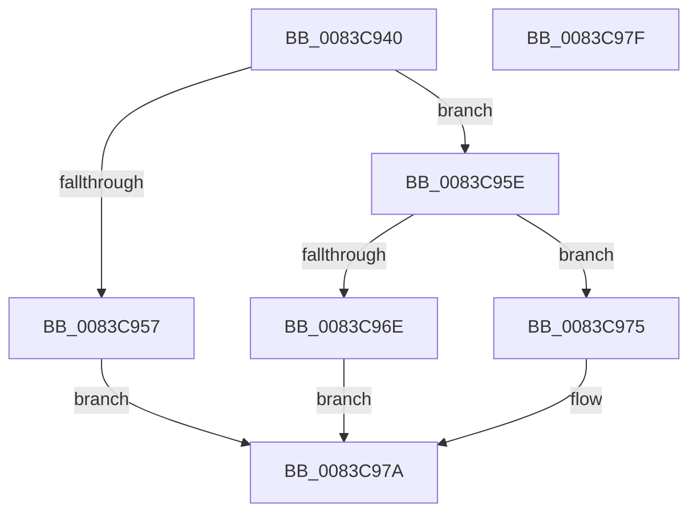

# NtSerializeBoot

- RVA: `0x0083C940`–`0x0083C980` (길이 `64` bytes)
- VA: `0x000000014083C940`
- 실행 섹션: `PAGE`
- PDB 이름 있음: `예`; PDB Function 태그: `아니요`
- unwind 정보 RVA: `0x0005C788`
- 디코드: `17`개 명령, `64/64` bytes 표시
- 미해석 바이트: `0` (있으면 어셈블리에 `.byte`로 보존)

> 이 문서는 커널 이미지의 기계어와 PDB 기호를 분석해 생성했습니다. 4번과 5번은 함수 원형과 자료형을 바이너리 사용 방식에서 추정한 C 해석이며 원본 소스 복구 결과는 아닙니다.

## 1. Dependencies

- 직접 호출 지점: **2**; 고유 호출 대상: **2**
- 직접 호출자로 확인된 함수: **0**
- RIP 상대 이미지 참조: **1**

### Outgoing calls
- `0x0083C965` → [SeSinglePrivilegeCheck](../87/SeSinglePrivilegeCheck_function_00871E20.md) (function, `0x00871E20`)
- `0x0083C975` → [PnpSerializeBoot](../../text/5A/PnpSerializeBoot_function_005A4F1C.md) (function, `0x005A4F1C`)

### Direct callers
- 이 함수 시작 RVA로 연결되는 직접 call은 확인되지 않았습니다. 간접 호출은 완전히 역산할 수 없습니다.

### Static image references
- `0x0083C95E` → RVA `0x00FD9A78` (`PAGEDATA`; read)

## 2. Other-region calls and transfers

- 다른 실행 섹션으로 향하는 call: **1**
  - `0x0083C975` → [PnpSerializeBoot](../../text/5A/PnpSerializeBoot_function_005A4F1C.md) (`PAGE` → `.text`)
- 별도 외부 분기/꼬리 이동을 확인하지 못했습니다.

## 3. Assembly (complete function range)

```asm
0083C940  48 83 EC 28                     sub rsp, 0x28
0083C944  65 48 8B 04 25 88 01 00 00      mov rax, qword ptr gs:[0x188]
0083C94D  B2 01                           mov dl, 1
0083C94F  38 90 32 02 00 00               cmp byte ptr [rax + 0x232], dl
0083C955  74 07                           je 0x14083c95e
0083C957  B8 22 00 00 C0                  mov eax, 0xc0000022
0083C95C  EB 1C                           jmp 0x14083c97a
0083C95E  48 8B 0D 13 D1 79 00            mov rcx, qword ptr [rip + 0x79d113]
0083C965  E8 B6 54 03 00                  call 0x140871e20
0083C96A  84 C0                           test al, al
0083C96C  75 07                           jne 0x14083c975
0083C96E  B8 61 00 00 C0                  mov eax, 0xc0000061
0083C973  EB 05                           jmp 0x14083c97a
0083C975  E8 A2 85 D6 FF                  call 0x1405a4f1c
0083C97A  48 83 C4 28                     add rsp, 0x28
0083C97E  C3                              ret
0083C97F  CC                              int3
```

## 4. C-style interpretation (structured pseudocode)

```c
__int64 __fastcall NtSerializeBoot(void)
{
    __int64 result;
    __int64 v_rsp;

    v_rsp = (v_rsp) - (40);
    if ((*(unsigned __int8 *)(*(unsigned __int64 *)(gs_base + (0 + 392)) + 562)) == 1) goto loc_0083C95E;
    goto loc_0083C97A;
loc_0083C95E:
    result = SeSinglePrivilegeCheck(*(unsigned __int64 *)(v_rip + 7983379), 1, a3, a4);
    if ((unsigned __int8)(result) != 0) goto loc_0083C975;
    goto loc_0083C97A;
loc_0083C975:
    result = PnpSerializeBoot(*(unsigned __int64 *)(v_rip + 7983379), 1, a3, a4);
loc_0083C97A:
    v_rsp = (v_rsp) + (40);
    return result;
}
```

## 5. (Beta) C Style

```c
void NtSerializeBoot(void)
{
    int64_t result;
    int64_t local_rsp;

    local_rsp = (local_rsp) - (40);
    if ((*(uint8_t *)(*(uint64_t *)(gs_base + (0 + 0x188)) + 0x232)) == 1) goto loc_0083C95E;
    goto loc_0083C97A;
loc_0083C95E:
    result = SeSinglePrivilegeCheck(*(uint64_t *)(v_rip + 0x79D113), 1, a3, a4);
    if ((uint8_t)(result) != 0) goto loc_0083C975;
    goto loc_0083C97A;
loc_0083C975:
    result = PnpSerializeBoot(*(uint64_t *)(v_rip + 0x79D113), 1, a3, a4);
loc_0083C97A:
    local_rsp = (local_rsp) + (40);
    return result;
}
```

## 6. Execution-region graph

[열기: 2D/3D 그래프와 함수 탐색 컨트롤 패널](../../../control-panel.html?section=page&rva=0x0083C940&view=graph)

- 2D 그래프는 위에서 아래로 흐르고, 3D 그래프는 빈 공간을 드래그해 회전합니다. Shift+드래그는 이동, 휠은 확대·축소, 함수 노드 선택은 대상 보고서 이동입니다.

### Static fallback


