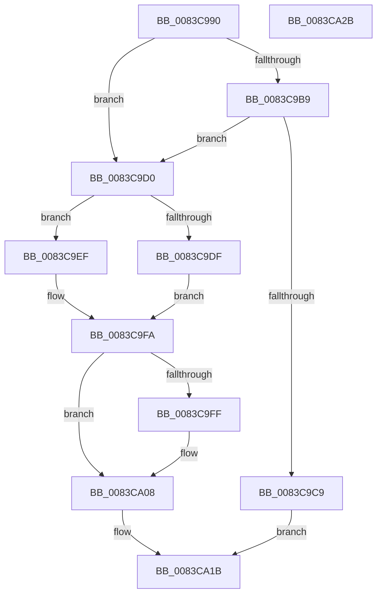

# NtSetDebugFilterState

- RVA: `0x0083C990`–`0x0083CA2C` (길이 `156` bytes)
- VA: `0x000000014083C990`
- 실행 섹션: `PAGE`
- PDB 이름 있음: `예`; PDB Function 태그: `아니요`
- unwind 정보 RVA: `0x00060BC4`
- 디코드: `46`개 명령, `156/156` bytes 표시
- 미해석 바이트: `0` (있으면 어셈블리에 `.byte`로 보존)

> 이 문서는 커널 이미지의 기계어와 PDB 기호를 분석해 생성했습니다. 4번과 5번은 함수 원형과 자료형을 바이너리 사용 방식에서 추정한 C 해석이며 원본 소스 복구 결과는 아닙니다.

## 1. Dependencies

- 직접 호출 지점: **1**; 고유 호출 대상: **1**
- 직접 호출자로 확인된 함수: **2**
- RIP 상대 이미지 참조: **4**

### Outgoing calls
- `0x0083C9C0` → [SeSinglePrivilegeCheck](../87/SeSinglePrivilegeCheck_function_00871E20.md) (function, `0x00871E20`)

### Direct callers
- [DbgSetDebugFilterState](../../text/5E/DbgSetDebugFilterState_function_005E58F0.md) at `0x005E58F4`
- [VfInitBootDriversLoaded](../../init/C4/VfInitBootDriversLoaded_function_00C4BD0C.md) at `0x00C4BEA7`

### Static image references
- `0x0083C9B9` → RVA `0x00FD9A80` (`PAGEDATA`; read)
- `0x0083C9D0` → RVA `0x00E0AA50` (`.data`; read)
- `0x0083C9E2` → RVA `0x0000AC70` (`.rdata`; read)
- `0x0083C9F2` → RVA `0x0000AF98` (`.rdata`; read)

## 2. Other-region calls and transfers

- 다른 실행 섹션으로 향하는 call: **0**
- 별도 외부 분기/꼬리 이동을 확인하지 못했습니다.

## 3. Assembly (complete function range)

```asm
0083C990  48 89 5C 24 08                  mov qword ptr [rsp + 8], rbx
0083C995  48 89 74 24 10                  mov qword ptr [rsp + 0x10], rsi
0083C99A  57                              push rdi
0083C99B  48 83 EC 20                     sub rsp, 0x20
0083C99F  65 48 8B 04 25 88 01 00 00      mov rax, qword ptr gs:[0x188]
0083C9A8  8B DA                           mov ebx, edx
0083C9AA  41 8A F0                        mov sil, r8b
0083C9AD  8B F9                           mov edi, ecx
0083C9AF  8A 90 32 02 00 00               mov dl, byte ptr [rax + 0x232]
0083C9B5  84 D2                           test dl, dl
0083C9B7  74 17                           je 0x14083c9d0
0083C9B9  48 8B 0D C0 D0 79 00            mov rcx, qword ptr [rip + 0x79d0c0]
0083C9C0  E8 5B 54 03 00                  call 0x140871e20
0083C9C5  84 C0                           test al, al
0083C9C7  75 07                           jne 0x14083c9d0
0083C9C9  B8 22 00 00 C0                  mov eax, 0xc0000022
0083C9CE  EB 4B                           jmp 0x14083ca1b
0083C9D0  48 8D 15 79 E0 5C 00            lea rdx, [rip + 0x5ce079]
0083C9D7  81 FF 9C 00 00 00               cmp edi, 0x9c
0083C9DD  73 10                           jae 0x14083c9ef
0083C9DF  0F AE E8                        lfence
0083C9E2  48 8D 15 87 E2 7C FF            lea rdx, [rip - 0x831d79]
0083C9E9  48 8B 14 FA                     mov rdx, qword ptr [rdx + rdi*8]
0083C9ED  EB 0B                           jmp 0x14083c9fa
0083C9EF  83 FF FF                        cmp edi, -1
0083C9F2  48 0F 45 15 9E E5 7C FF         cmovne rdx, qword ptr [rip - 0x831a62]
0083C9FA  83 FB 1F                        cmp ebx, 0x1f
0083C9FD  77 09                           ja 0x14083ca08
0083C9FF  8B CB                           mov ecx, ebx
0083CA01  BB 01 00 00 00                  mov ebx, 1
0083CA06  D3 E3                           shl ebx, cl
0083CA08  8B CB                           mov ecx, ebx
0083CA0A  F7 D1                           not ecx
0083CA0C  23 0A                           and ecx, dword ptr [rdx]
0083CA0E  40 F6 DE                        neg sil
0083CA11  1B C0                           sbb eax, eax
0083CA13  23 C3                           and eax, ebx
0083CA15  0B C8                           or ecx, eax
0083CA17  89 0A                           mov dword ptr [rdx], ecx
0083CA19  33 C0                           xor eax, eax
0083CA1B  48 8B 5C 24 30                  mov rbx, qword ptr [rsp + 0x30]
0083CA20  48 8B 74 24 38                  mov rsi, qword ptr [rsp + 0x38]
0083CA25  48 83 C4 20                     add rsp, 0x20
0083CA29  5F                              pop rdi
0083CA2A  C3                              ret
0083CA2B  CC                              int3
```

## 4. C-style interpretation (structured pseudocode)

```c
__int64 __fastcall NtSetDebugFilterState(int a1, int a2, unsigned __int8 a3)
{
    __int64 result;
    __int64 v_rbx;
    __int64 v_rsi;
    __int64 v_rsp;
    unsigned __int64 v_stack_p10;
    unsigned __int64 v_stack_p8;

    v_stack_p8 = v_rbx;
    v_stack_p10 = v_rsi;
    v_rsp = (v_rsp) - (32);
    if ((unsigned __int8)(*(unsigned __int8 *)(*(unsigned __int64 *)(gs_base + (0 + 392)) + 562)) == 0) goto loc_0083C9D0;
    result = SeSinglePrivilegeCheck(*(unsigned __int64 *)(v_rip + 7983296), *(unsigned __int8 *)(*(unsigned __int64 *)(gs_base + (0 + 392)) + 562), a3, a4);
    if ((unsigned __int8)(result) != 0) goto loc_0083C9D0;
    goto loc_0083CA1B;
loc_0083C9D0:
    if (((unsigned int)((unsigned int)(a1))) >= 156) goto loc_0083C9EF;
    goto loc_0083C9FA;
loc_0083C9EF:
    a2 = *(unsigned __int64 *)(v_rip - 8592761 + (unsigned int)(a1) * 8);
    if (((unsigned int)((unsigned int)(a1))) != -1) { a2 = *(unsigned __int64 *)(v_rip - 8591970); }
loc_0083C9FA:
    v_rbx = (unsigned int)(a2);
    if (((unsigned int)((unsigned int)(a2))) <= 31) {
        a1 = (unsigned int)((unsigned int)(a2));
        v_rbx = 1;
        v_rbx = (unsigned int)((v_rbx) << ((unsigned __int8)(a1)));
    }
    a1 = (unsigned int)(~((unsigned int)((unsigned int)(v_rbx))));
    a1 = (unsigned int)((a1) & (*(unsigned int *)(a2)));
    v_rsi = (unsigned __int8)(-(a3));
    result = (unsigned int)(((unsigned int)(0xC0000022ULL)) & ((unsigned int)(v_rbx)));
    a1 = (unsigned int)((a1) | ((unsigned int)(result)));
    *(unsigned int *)(a2) = a1;
    result = 0;
loc_0083CA1B:
    v_rsp = (v_rsp) + (32);
    return result;
}
```

## 5. (Beta) C Style

```c
int64_t NtSetDebugFilterState(int32_t Arg1, int32_t Arg2, uint8_t Arg3)
{
    int64_t result;
    int64_t local_rbx;
    int64_t local_rsi;
    int64_t local_rsp;
    uint64_t v_stack_p10;
    uint64_t v_stack_p8;

    v_stack_p8 = local_rbx;
    v_stack_p10 = local_rsi;
    local_rsp = (local_rsp) - (32);
    if ((uint8_t)(*(uint8_t *)(*(uint64_t *)(gs_base + (0 + 0x188)) + 0x232)) == 0) goto loc_0083C9D0;
    result = SeSinglePrivilegeCheck(*(uint64_t *)(v_rip + 0x79D0C0), *(uint8_t *)(*(uint64_t *)(gs_base + (0 + 0x188)) + 0x232), Arg3, a4);
    if ((uint8_t)(result) != 0) goto loc_0083C9D0;
    goto loc_0083CA1B;
loc_0083C9D0:
    if (((uint32_t)((uint32_t)(Arg1))) >= 156) goto loc_0083C9EF;
    goto loc_0083C9FA;
loc_0083C9EF:
    Arg2 = *(uint64_t *)(v_rip - 0x831D79 + (uint32_t)(Arg1) * 8);
    if (((uint32_t)((uint32_t)(Arg1))) != -1) { Arg2 = *(uint64_t *)(v_rip - 0x831A62); }
loc_0083C9FA:
    local_rbx = (uint32_t)(Arg2);
    if (((uint32_t)((uint32_t)(Arg2))) <= 31) {
        Arg1 = (uint32_t)((uint32_t)(Arg2));
        local_rbx = 1;
        local_rbx = (uint32_t)((local_rbx) << ((uint8_t)(Arg1)));
    }
    Arg1 = (uint32_t)(~((uint32_t)((uint32_t)(local_rbx))));
    Arg1 = (uint32_t)((Arg1) & (*(uint32_t *)(Arg2)));
    local_rsi = (uint8_t)(-(Arg3));
    result = (uint32_t)(((uint32_t)(0xC0000022ULL)) & ((uint32_t)(local_rbx)));
    Arg1 = (uint32_t)((Arg1) | ((uint32_t)(result)));
    *(uint32_t *)(Arg2) = Arg1;
    result = 0;
loc_0083CA1B:
    local_rsp = (local_rsp) + (32);
    return result;
}
```

## 6. Execution-region graph

[열기: 2D/3D 그래프와 함수 탐색 컨트롤 패널](../../../control-panel.html?section=page&rva=0x0083C990&view=graph)

- 2D 그래프는 위에서 아래로 흐르고, 3D 그래프는 빈 공간을 드래그해 회전합니다. Shift+드래그는 이동, 휠은 확대·축소, 함수 노드 선택은 대상 보고서 이동입니다.

### Static fallback


