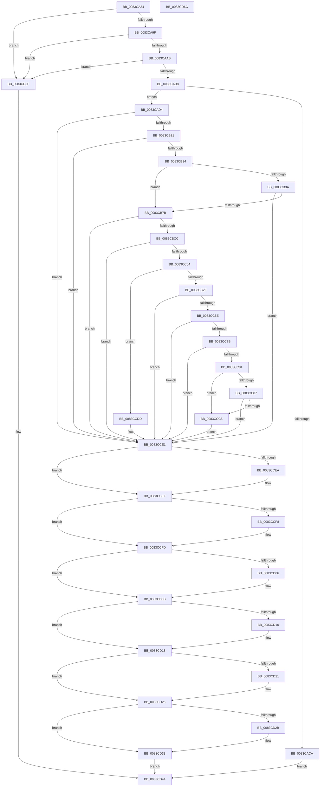

# ObCreateSiloRootDirectory

- RVA: `0x0083CA34`–`0x0083CD6D` (길이 `825` bytes)
- VA: `0x000000014083CA34`
- 실행 섹션: `PAGE`
- PDB 이름 있음: `예`; PDB Function 태그: `아니요`
- unwind 정보 RVA: `0x000DB3F8`
- 디코드: `214`개 명령, `825/825` bytes 표시
- 미해석 바이트: `0` (있으면 어셈블리에 `.byte`로 보존)

> 이 문서는 커널 이미지의 기계어와 PDB 기호를 분석해 생성했습니다. 4번과 5번은 함수 원형과 자료형을 바이너리 사용 방식에서 추정한 C 해석이며 원본 소스 복구 결과는 아닙니다.

## 1. Dependencies

- 직접 호출 지점: **25**; 고유 호출 대상: **20**
- 직접 호출자로 확인된 함수: **1**
- RIP 상대 이미지 참조: **8**

### Outgoing calls
- `0x0083CAAB` → [PsIsJobParentImmutable](../A2/PsIsJobParentImmutable_function_00A23A88.md) (function, `0x00A23A88`)
- `0x0083CAB8` → [PsGetParentSilo](../A7/PsGetParentSilo_function_00A70760.md) (function, `0x00A70760`)
- `0x0083CAC0` → [HalAdjustResourceList](../../text/48/HalAdjustResourceList_function_0048FDC0.md) (function, `0x0048FDC0`)
- `0x0083CAD7` → [PsGetParentSilo](../A7/PsGetParentSilo_function_00A70760.md) (function, `0x00A70760`)
- `0x0083CADF` → [PsAttachSiloToCurrentThread](../../text/44/PsAttachSiloToCurrentThread_function_004428C0.md) (function, `0x004428C0`)
- `0x0083CB02` → [PsGetSiloIdentifier](../A7/PsGetSiloIdentifier_function_00A7F480.md) (function, `0x00A7F480`)
- `0x0083CB12` → [RtlIntegerToUnicodeString](../91/RtlIntegerToUnicodeString_function_0091D3E0.md) (function, `0x0091D3E0`)
- `0x0083CB25` → [ObpGetSilosRootDirectory](ObpGetSilosRootDirectory_function_0083CF00.md) (function, `0x0083CF00`)
- `0x0083CB6C` → [ZwOpenDirectoryObject](../../text/6A/ZwOpenDirectoryObject_function_006ADBD0.md) (function, `0x006ADBD0`)
- `0x0083CBBD` → [ZwCreateDirectoryObjectEx](../../text/6A/ZwCreateDirectoryObjectEx_function_006AE670.md) (function, `0x006AE670`)
- `0x0083CBF1` → [ObReferenceObjectByHandle](../86/ObReferenceObjectByHandle_function_00868DB0.md) (function, `0x00868DB0`)
- `0x0083CC20` → [PsCreateSiloContext](../9E/PsCreateSiloContext_function_009E8110.md) (function, `0x009E8110`)
- `0x0083CC37` → [ObfReferenceObjectWithTag](../../text/21/ObfReferenceObjectWithTag_function_00210710.md) (function, `0x00210710`)
- `0x0083CC4F` → [PsInsertSiloContext](../9E/PsInsertSiloContext_function_009E7D40.md) (function, `0x009E7D40`)
- `0x0083CC70` → [PsInsertPermanentSiloContextEx](../9E/PsInsertPermanentSiloContextEx_function_009E8224.md) (function, `0x009E8224`)
- `0x0083CCBA` → [ZwOpenDirectoryObject](../../text/6A/ZwOpenDirectoryObject_function_006ADBD0.md) (function, `0x006ADBD0`)
- `0x0083CCD4` → [ObpInitializeRootNamespace](../74/ObpInitializeRootNamespace_function_0074E588.md) (function, `0x0074E588`)
- `0x0083CCEA` → [ZwClose](../../text/6A/ZwClose_function_006AD2B0.md) (function, `0x006AD2B0`)
- `0x0083CCF8` → [ZwClose](../../text/6A/ZwClose_function_006AD2B0.md) (function, `0x006AD2B0`)
- `0x0083CD06` → [ZwClose](../../text/6A/ZwClose_function_006AD2B0.md) (function, `0x006AD2B0`)
- `0x0083CD13` → [ObfDereferenceObject](../../text/2F/ObfDereferenceObject_function_002F9350.md) (function, `0x002F9350`)
- `0x0083CD21` → [ZwClose](../../text/6A/ZwClose_function_006AD2B0.md) (function, `0x006AD2B0`)
- `0x0083CD2E` → [HalPutDmaAdapter](../../text/48/HalPutDmaAdapter_function_0048E530.md) (function, `0x0048E530`)
- `0x0083CD36` → [PsDetachSiloFromCurrentThread](../../text/44/PsDetachSiloFromCurrentThread_function_00449AC0.md) (function, `0x00449AC0`)
- `0x0083CD4B` → [_security_check_cookie](../../text/6A/_security_check_cookie_function_006AC640.md) (function, `0x006AC640`)

### Direct callers
- [NtSetInformationJobObject](../9F/NtSetInformationJobObject_function_009F84C0.md) at `0x009FA327`

### Static image references
- `0x0083CA52` → RVA `0x00E0A740` (`.data`; read)
- `0x0083CB3E` → RVA `0x00B4B5D0` (`ObpRootDirectoryName`; read)
- `0x0083CBA4` → RVA `0x00FD9AA8` (`PAGEDATA`; read)
- `0x0083CBCC` → RVA `0x00F0F650` (`.data`; read)
- `0x0083CC0D` → RVA `0x0083CEC0` (`ObpDirectoryTeardownCallback`; read)
- `0x0083CC49` → RVA `0x00FC5164` (`ALMOSTRO`; read)
- `0x0083CC5E` → RVA `0x00FC5068` (`ALMOSTRO`; read)
- `0x0083CC8C` → RVA `0x00B4B5F0` (`ObpGlobalDosDevicesShortName`; read)

## 2. Other-region calls and transfers

- 다른 실행 섹션으로 향하는 call: **14**
  - `0x0083CAC0` → [HalAdjustResourceList](../../text/48/HalAdjustResourceList_function_0048FDC0.md) (`PAGE` → `.text`)
  - `0x0083CADF` → [PsAttachSiloToCurrentThread](../../text/44/PsAttachSiloToCurrentThread_function_004428C0.md) (`PAGE` → `.text`)
  - `0x0083CB6C` → [ZwOpenDirectoryObject](../../text/6A/ZwOpenDirectoryObject_function_006ADBD0.md) (`PAGE` → `.text`)
  - `0x0083CBBD` → [ZwCreateDirectoryObjectEx](../../text/6A/ZwCreateDirectoryObjectEx_function_006AE670.md) (`PAGE` → `.text`)
  - `0x0083CC37` → [ObfReferenceObjectWithTag](../../text/21/ObfReferenceObjectWithTag_function_00210710.md) (`PAGE` → `.text`)
  - `0x0083CCBA` → [ZwOpenDirectoryObject](../../text/6A/ZwOpenDirectoryObject_function_006ADBD0.md) (`PAGE` → `.text`)
  - `0x0083CCEA` → [ZwClose](../../text/6A/ZwClose_function_006AD2B0.md) (`PAGE` → `.text`)
  - `0x0083CCF8` → [ZwClose](../../text/6A/ZwClose_function_006AD2B0.md) (`PAGE` → `.text`)
  - `0x0083CD06` → [ZwClose](../../text/6A/ZwClose_function_006AD2B0.md) (`PAGE` → `.text`)
  - `0x0083CD13` → [ObfDereferenceObject](../../text/2F/ObfDereferenceObject_function_002F9350.md) (`PAGE` → `.text`)
  - `0x0083CD21` → [ZwClose](../../text/6A/ZwClose_function_006AD2B0.md) (`PAGE` → `.text`)
  - `0x0083CD2E` → [HalPutDmaAdapter](../../text/48/HalPutDmaAdapter_function_0048E530.md) (`PAGE` → `.text`)
  - `0x0083CD36` → [PsDetachSiloFromCurrentThread](../../text/44/PsDetachSiloFromCurrentThread_function_00449AC0.md) (`PAGE` → `.text`)
  - `0x0083CD4B` → [_security_check_cookie](../../text/6A/_security_check_cookie_function_006AC640.md) (`PAGE` → `.text`)
- 별도 외부 분기/꼬리 이동을 확인하지 못했습니다.

## 3. Assembly (complete function range)

```asm
0083CA34  48 89 5C 24 10                  mov qword ptr [rsp + 0x10], rbx
0083CA39  48 89 74 24 18                  mov qword ptr [rsp + 0x18], rsi
0083CA3E  55                              push rbp
0083CA3F  57                              push rdi
0083CA40  41 54                           push r12
0083CA42  41 56                           push r14
0083CA44  41 57                           push r15
0083CA46  48 8D 6C 24 C9                  lea rbp, [rsp - 0x37]
0083CA4B  48 81 EC C0 00 00 00            sub rsp, 0xc0
0083CA52  48 8B 05 E7 DC 5C 00            mov rax, qword ptr [rip + 0x5cdce7]
0083CA59  48 33 C4                        xor rax, rsp
0083CA5C  48 89 45 2F                     mov qword ptr [rbp + 0x2f], rax
0083CA60  33 C0                           xor eax, eax
0083CA62  33 FF                           xor edi, edi
0083CA64  48 21 45 B7                     and qword ptr [rbp - 0x49], rax
0083CA68  0F 57 C0                        xorps xmm0, xmm0
0083CA6B  48 21 45 BF                     and qword ptr [rbp - 0x41], rax
0083CA6F  45 33 FF                        xor r15d, r15d
0083CA72  48 21 45 A7                     and qword ptr [rbp - 0x59], rax
0083CA76  44 8B F2                        mov r14d, edx
0083CA79  48 21 45 C7                     and qword ptr [rbp - 0x39], rax
0083CA7D  48 8B F1                        mov rsi, rcx
0083CA80  48 89 45 EF                     mov qword ptr [rbp - 0x11], rax
0083CA84  89 45 F7                        mov dword ptr [rbp - 9], eax
0083CA87  48 89 7D AF                     mov qword ptr [rbp - 0x51], rdi
0083CA8B  0F 11 45 CF                     movups xmmword ptr [rbp - 0x31], xmm0
0083CA8F  0F 11 45 DF                     movups xmmword ptr [rbp - 0x21], xmm0
0083CA93  F7 C2 F8 FF FF FF               test edx, 0xfffffff8
0083CA99  0F 85 A0 02 00 00               jne 0x14083cd3f
0083CA9F  8B C2                           mov eax, edx
0083CAA1  24 06                           and al, 6
0083CAA3  3C 04                           cmp al, 4
0083CAA5  0F 84 94 02 00 00               je 0x14083cd3f
0083CAAB  E8 D8 6F 1E 00                  call 0x140a23a88
0083CAB0  84 C0                           test al, al
0083CAB2  0F 84 87 02 00 00               je 0x14083cd3f
0083CAB8  E8 A3 3C 23 00                  call 0x140a70760
0083CABD  48 8B D8                        mov rbx, rax
0083CAC0  E8 FB 32 C5 FF                  call 0x14048fdc0
0083CAC5  48 3B D8                        cmp rbx, rax
0083CAC8  74 0A                           je 0x14083cad4
0083CACA  B8 19 07 00 C0                  mov eax, 0xc0000719
0083CACF  E9 70 02 00 00                  jmp 0x14083cd44
0083CAD4  48 8B CE                        mov rcx, rsi
0083CAD7  E8 84 3C 23 00                  call 0x140a70760
0083CADC  48 8B C8                        mov rcx, rax
0083CADF  E8 DC 5D C0 FF                  call 0x1404428c0
0083CAE4  4C 8B E0                        mov r12, rax
0083CAE7  0F 57 C0                        xorps xmm0, xmm0
0083CAEA  0F 11 45 07                     movups xmmword ptr [rbp + 7], xmm0
0083CAEE  B8 16 00 00 00                  mov eax, 0x16
0083CAF3  48 8B CE                        mov rcx, rsi
0083CAF6  66 89 45 09                     mov word ptr [rbp + 9], ax
0083CAFA  48 8D 45 17                     lea rax, [rbp + 0x17]
0083CAFE  48 89 45 0F                     mov qword ptr [rbp + 0xf], rax
0083CB02  E8 79 29 24 00                  call 0x140a7f480
0083CB07  8B C8                           mov ecx, eax
0083CB09  4C 8D 45 07                     lea r8, [rbp + 7]
0083CB0D  BA 0A 00 00 00                  mov edx, 0xa
0083CB12  E8 C9 08 0E 00                  call 0x14091d3e0
0083CB17  8B D8                           mov ebx, eax
0083CB19  85 C0                           test eax, eax
0083CB1B  0F 88 C0 01 00 00               js 0x14083cce1
0083CB21  48 8D 4D BF                     lea rcx, [rbp - 0x41]
0083CB25  E8 D6 03 00 00                  call 0x14083cf00
0083CB2A  8B D8                           mov ebx, eax
0083CB2C  85 C0                           test eax, eax
0083CB2E  0F 88 AD 01 00 00               js 0x14083cce1
0083CB34  41 F6 C6 01                     test r14b, 1
0083CB38  74 41                           je 0x14083cb7b
0083CB3A  48 21 7D D7                     and qword ptr [rbp - 0x29], rdi
0083CB3E  48 8D 05 8B EA 30 00            lea rax, [rip + 0x30ea8b]
0083CB45  0F 57 C0                        xorps xmm0, xmm0
0083CB48  48 89 45 DF                     mov qword ptr [rbp - 0x21], rax
0083CB4C  4C 8D 45 CF                     lea r8, [rbp - 0x31]
0083CB50  C7 45 CF 30 00 00 00            mov dword ptr [rbp - 0x31], 0x30
0083CB57  BA 03 00 00 00                  mov edx, 3
0083CB5C  C7 45 E7 00 02 00 00            mov dword ptr [rbp - 0x19], 0x200
0083CB63  48 8D 4D C7                     lea rcx, [rbp - 0x39]
0083CB67  F3 0F 7F 45 EF                  movdqu xmmword ptr [rbp - 0x11], xmm0
0083CB6C  E8 5F 10 E7 FF                  call 0x1406adbd0
0083CB71  8B D8                           mov ebx, eax
0083CB73  85 C0                           test eax, eax
0083CB75  0F 88 66 01 00 00               js 0x14083cce1
0083CB7B  48 8B 45 BF                     mov rax, qword ptr [rbp - 0x41]
0083CB7F  4C 8D 45 CF                     lea r8, [rbp - 0x31]
0083CB83  4C 8B 4D C7                     mov r9, qword ptr [rbp - 0x39]
0083CB87  48 8D 4D A7                     lea rcx, [rbp - 0x59]
0083CB8B  48 21 7D F7                     and qword ptr [rbp - 9], rdi
0083CB8F  BA 0F 00 0F 00                  mov edx, 0xf000f
0083CB94  21 7C 24 20                     and dword ptr [rsp + 0x20], edi
0083CB98  48 89 45 D7                     mov qword ptr [rbp - 0x29], rax
0083CB9C  48 8D 45 07                     lea rax, [rbp + 7]
0083CBA0  48 89 45 DF                     mov qword ptr [rbp - 0x21], rax
0083CBA4  48 8B 05 FD CE 79 00            mov rax, qword ptr [rip + 0x79cefd]
0083CBAB  48 89 45 EF                     mov qword ptr [rbp - 0x11], rax
0083CBAF  C7 45 CF 30 00 00 00            mov dword ptr [rbp - 0x31], 0x30
0083CBB6  C7 45 E7 50 02 00 00            mov dword ptr [rbp - 0x19], 0x250
0083CBBD  E8 AE 1A E7 FF                  call 0x1406ae670
0083CBC2  8B D8                           mov ebx, eax
0083CBC4  85 C0                           test eax, eax
0083CBC6  0F 88 15 01 00 00               js 0x14083cce1
0083CBCC  4C 8B 05 7D 2A 6D 00            mov r8, qword ptr [rip + 0x6d2a7d]
0083CBD3  48 8D 45 FF                     lea rax, [rbp - 1]
0083CBD7  48 21 7C 24 28                  and qword ptr [rsp + 0x28], rdi
0083CBDC  45 33 C9                        xor r9d, r9d
0083CBDF  48 8B 4D A7                     mov rcx, qword ptr [rbp - 0x59]
0083CBE3  BA 0F 00 0F 00                  mov edx, 0xf000f
0083CBE8  48 21 7D FF                     and qword ptr [rbp - 1], rdi
0083CBEC  48 89 44 24 20                  mov qword ptr [rsp + 0x20], rax
0083CBF1  E8 BA C1 02 00                  call 0x140868db0
0083CBF6  4C 8B 7D FF                     mov r15, qword ptr [rbp - 1]
0083CBFA  8B D8                           mov ebx, eax
0083CBFC  85 C0                           test eax, eax
0083CBFE  0F 88 DD 00 00 00               js 0x14083cce1
0083CC04  BA 10 00 00 00                  mov edx, 0x10
0083CC09  48 8D 45 AF                     lea rax, [rbp - 0x51]
0083CC0D  4C 8D 0D AC 02 00 00            lea r9, [rip + 0x2ac]
0083CC14  48 89 44 24 20                  mov qword ptr [rsp + 0x20], rax
0083CC19  48 8B CE                        mov rcx, rsi
0083CC1C  44 8D 42 F1                     lea r8d, [rdx - 0xf]
0083CC20  E8 EB B4 1A 00                  call 0x1409e8110
0083CC25  8B D8                           mov ebx, eax
0083CC27  85 C0                           test eax, eax
0083CC29  0F 88 AE 00 00 00               js 0x14083ccdd
0083CC2F  BA 4F 62 54 72                  mov edx, 0x7254624f
0083CC34  49 8B CF                        mov rcx, r15
0083CC37  E8 D4 3A 9D FF                  call 0x140210710
0083CC3C  48 8B 7D AF                     mov rdi, qword ptr [rbp - 0x51]
0083CC40  48 8B CE                        mov rcx, rsi
0083CC43  4C 8B C7                        mov r8, rdi
0083CC46  4C 89 3F                        mov qword ptr [rdi], r15
0083CC49  8B 15 15 85 78 00               mov edx, dword ptr [rip + 0x788515]
0083CC4F  E8 EC B0 1A 00                  call 0x1409e7d40
0083CC54  8B D8                           mov ebx, eax
0083CC56  85 C0                           test eax, eax
0083CC58  0F 88 83 00 00 00               js 0x14083cce1
0083CC5E  8B 15 04 84 78 00               mov edx, dword ptr [rip + 0x788404]
0083CC64  41 B9 01 00 00 00               mov r9d, 1
0083CC6A  4D 8B C7                        mov r8, r15
0083CC6D  48 8B CE                        mov rcx, rsi
0083CC70  E8 AF B5 1A 00                  call 0x1409e8224
0083CC75  8B D8                           mov ebx, eax
0083CC77  85 C0                           test eax, eax
0083CC79  78 66                           js 0x14083cce1
0083CC7B  41 F6 C6 02                     test r14b, 2
0083CC7F  74 60                           je 0x14083cce1
0083CC81  41 F6 C6 04                     test r14b, 4
0083CC85  74 3E                           je 0x14083ccc5
0083CC87  48 83 65 D7 00                  and qword ptr [rbp - 0x29], 0
0083CC8C  48 8D 05 5D E9 30 00            lea rax, [rip + 0x30e95d]
0083CC93  0F 57 C0                        xorps xmm0, xmm0
0083CC96  48 89 45 DF                     mov qword ptr [rbp - 0x21], rax
0083CC9A  4C 8D 45 CF                     lea r8, [rbp - 0x31]
0083CC9E  C7 45 CF 30 00 00 00            mov dword ptr [rbp - 0x31], 0x30
0083CCA5  BA 03 00 00 00                  mov edx, 3
0083CCAA  C7 45 E7 00 02 00 00            mov dword ptr [rbp - 0x19], 0x200
0083CCB1  48 8D 4D B7                     lea rcx, [rbp - 0x49]
0083CCB5  F3 0F 7F 45 EF                  movdqu xmmword ptr [rbp - 0x11], xmm0
0083CCBA  E8 11 0F E7 FF                  call 0x1406adbd0
0083CCBF  8B D8                           mov ebx, eax
0083CCC1  85 C0                           test eax, eax
0083CCC3  78 1C                           js 0x14083cce1
0083CCC5  4C 8B 45 B7                     mov r8, qword ptr [rbp - 0x49]
0083CCC9  4C 8D 4F 08                     lea r9, [rdi + 8]
0083CCCD  48 8B 55 A7                     mov rdx, qword ptr [rbp - 0x59]
0083CCD1  48 8B CE                        mov rcx, rsi
0083CCD4  E8 AF 18 F1 FF                  call 0x14074e588
0083CCD9  8B D8                           mov ebx, eax
0083CCDB  EB 04                           jmp 0x14083cce1
0083CCDD  48 8B 7D AF                     mov rdi, qword ptr [rbp - 0x51]
0083CCE1  48 8B 4D B7                     mov rcx, qword ptr [rbp - 0x49]
0083CCE5  48 85 C9                        test rcx, rcx
0083CCE8  74 05                           je 0x14083ccef
0083CCEA  E8 C1 05 E7 FF                  call 0x1406ad2b0
0083CCEF  48 8B 4D BF                     mov rcx, qword ptr [rbp - 0x41]
0083CCF3  48 85 C9                        test rcx, rcx
0083CCF6  74 05                           je 0x14083ccfd
0083CCF8  E8 B3 05 E7 FF                  call 0x1406ad2b0
0083CCFD  48 8B 4D A7                     mov rcx, qword ptr [rbp - 0x59]
0083CD01  48 85 C9                        test rcx, rcx
0083CD04  74 05                           je 0x14083cd0b
0083CD06  E8 A5 05 E7 FF                  call 0x1406ad2b0
0083CD0B  4D 85 FF                        test r15, r15
0083CD0E  74 08                           je 0x14083cd18
0083CD10  49 8B CF                        mov rcx, r15
0083CD13  E8 38 C6 AB FF                  call 0x1402f9350
0083CD18  48 8B 4D C7                     mov rcx, qword ptr [rbp - 0x39]
0083CD1C  48 85 C9                        test rcx, rcx
0083CD1F  74 05                           je 0x14083cd26
0083CD21  E8 8A 05 E7 FF                  call 0x1406ad2b0
0083CD26  48 85 FF                        test rdi, rdi
0083CD29  74 08                           je 0x14083cd33
0083CD2B  48 8B CF                        mov rcx, rdi
0083CD2E  E8 FD 17 C5 FF                  call 0x14048e530
0083CD33  49 8B CC                        mov rcx, r12
0083CD36  E8 85 CD C0 FF                  call 0x140449ac0
0083CD3B  8B C3                           mov eax, ebx
0083CD3D  EB 05                           jmp 0x14083cd44
0083CD3F  B8 0D 00 00 C0                  mov eax, 0xc000000d
0083CD44  48 8B 4D 2F                     mov rcx, qword ptr [rbp + 0x2f]
0083CD48  48 33 CC                        xor rcx, rsp
0083CD4B  E8 F0 F8 E6 FF                  call 0x1406ac640
0083CD50  4C 8D 9C 24 C0 00 00 00         lea r11, [rsp + 0xc0]
0083CD58  49 8B 5B 38                     mov rbx, qword ptr [r11 + 0x38]
0083CD5C  49 8B 73 40                     mov rsi, qword ptr [r11 + 0x40]
0083CD60  49 8B E3                        mov rsp, r11
0083CD63  41 5F                           pop r15
0083CD65  41 5E                           pop r14
0083CD67  41 5C                           pop r12
0083CD69  5F                              pop rdi
0083CD6A  5D                              pop rbp
0083CD6B  C3                              ret
0083CD6C  CC                              int3
```

## 4. C-style interpretation (structured pseudocode)

```c
__int64 __fastcall ObCreateSiloRootDirectory(__int64 a1, int a2)
{
    __int64 result;
    __int64 v_r15;
    __int64 v_rdi;
    __int64 v_rsp;
    unsigned __int64 v_stack_m28;
    unsigned __int64 v_stack_m30;
    unsigned __int64 v_stack_m48;
    unsigned __int64 v_stack_m50;
    unsigned __int16 v_stack_m56;
    unsigned __int64 v_stack_m58;
    unsigned __int64 v_stack_m5F;
    unsigned __int64 v_stack_m60;
    unsigned int v_stack_m68;
    unsigned __int64 v_stack_m70;
    unsigned int v_stack_m78;
    unsigned __int64 v_stack_m80;
    unsigned __int64 v_stack_m88;
    unsigned __int64 v_stack_m90;
    unsigned __int64 v_stack_m98;
    unsigned __int64 v_stack_mA0;
    unsigned __int64 v_stack_mA8;
    unsigned __int64 v_stack_mB0;
    unsigned __int64 v_stack_mB8;
    unsigned __int64 v_stack_mC0;
    unsigned int v_stack_mC8;
    unsigned __int64 v_stack_p10;
    unsigned __int64 v_stack_p18;

    v_stack_p10 = v_rbx;
    v_stack_p18 = v_rsi;
    v_rsp = (v_rsp) - (192);
    result = (*(unsigned __int64 *)(v_rip + 6085863)) ^ (v_rsp);
    v_stack_m30 = result;
    result = 0;
    v_rdi = 0;
    v_r15 = 0;
    v_stack_m70 = 0;
    v_stack_m68 = 0;
    v_stack_mB0 = 0;
    v_stack_m90 = v_xmm0;
    v_stack_m80 = v_xmm0;
    if (((a2) & (0xFFFFFFF8ULL)) != 0) goto loc_0083CD3F;
    result = (unsigned __int8)(((unsigned int)(a2)) & (6));
    if (((unsigned __int8)(result)) == 4) goto loc_0083CD3F;
    result = PsIsJobParentImmutable(a1, a2, a3, a4);
    if ((unsigned __int8)(result) == 0) goto loc_0083CD3F;
    result = PsGetParentSilo(a1, a2, a3, a4);
    result = HalAdjustResourceList(a1, a2, a3, a4);
    if (result == result) goto loc_0083CAD4;
    goto loc_0083CD44;
loc_0083CAD4:
    result = PsGetParentSilo(a1, a2, a3, a4);
    result = PsAttachSiloToCurrentThread(result, a2, a3, a4);
    v_stack_m58 = v_xmm0;
    v_stack_m56 = 22;
    v_stack_m50 = v_stack_m48;
    result = PsGetSiloIdentifier(a1, a2, a3, a4);
    result = RtlIntegerToUnicodeString((unsigned int)((unsigned int)(result)), 10, v_stack_m58, a4);
    if (sign_flag) goto loc_0083CCE1;
    result = ObpGetSilosRootDirectory(v_stack_mA0, 10, v_stack_m58, a4);
    if (sign_flag) goto loc_0083CCE1;
    if ((((unsigned __int8)((unsigned int)(a2))) & (1)) == 0) goto loc_0083CB7B;
    v_stack_m80 = v_rip + 3205771;
    v_stack_m90 = 48;
    v_stack_m78 = 512;
    v_stack_m70 = v_xmm0;
    result = ZwOpenDirectoryObject(v_stack_m98, 3, v_stack_m90, a4);
    if (sign_flag) goto loc_0083CCE1;
loc_0083CB7B:
    v_stack_m88 = v_stack_mA0;
    v_stack_m80 = v_stack_m58;
    v_stack_m70 = *(unsigned __int64 *)(v_rip + 7982845);
    v_stack_m90 = 48;
    v_stack_m78 = 592;
    result = ZwCreateDirectoryObjectEx(v_stack_mB8, (unsigned int)(0xF000FULL), v_stack_m90, v_stack_m98);
    if (sign_flag) goto loc_0083CCE1;
    a4 = 0;
    v_stack_mC8 = v_stack_m60;
    result = ObReferenceObjectByHandle(v_stack_mB8, (unsigned int)(0xF000FULL), *(unsigned __int64 *)(v_rip + 7154301), a4);
    if (sign_flag) goto loc_0083CCE1;
    v_stack_mC8 = v_stack_mB0;
    result = PsCreateSiloContext(a1, 16, 16 - 15, v_rip + 684);
    if (sign_flag) goto loc_0083CCDD;
    result = ObfReferenceObjectWithTag(v_stack_m60, (unsigned int)(0x7254624FULL), 16 - 15, v_rip + 684);
    *(unsigned __int64 *)(v_stack_mB0) = v_stack_m60;
    result = PsInsertSiloContext(a1, (unsigned int)(*(unsigned int *)(v_rip + 7898389)), v_stack_mB0, v_rip + 684);
    if (sign_flag) goto loc_0083CCE1;
    result = PsInsertPermanentSiloContextEx(a1, (unsigned int)(*(unsigned int *)(v_rip + 7898116)), v_stack_m60, 1);
    if (sign_flag) goto loc_0083CCE1;
    if ((((unsigned __int8)((unsigned int)(a2))) & (2)) == 0) goto loc_0083CCE1;
    if ((((unsigned __int8)((unsigned int)(a2))) & (4)) == 0) goto loc_0083CCC5;
    v_stack_m80 = v_rip + 3205469;
    v_stack_m90 = 48;
    v_stack_m78 = 512;
    v_stack_m70 = v_xmm0;
    result = ZwOpenDirectoryObject(v_stack_mA8, 3, v_stack_m90, 1);
    if (sign_flag) goto loc_0083CCE1;
loc_0083CCC5:
    result = ObpInitializeRootNamespace(a1, v_stack_mB8, v_stack_mA8, v_stack_mB0 + 8);
    goto loc_0083CCE1;
loc_0083CCDD:
loc_0083CCE1:
    if (v_stack_mA8 != 0) {
        result = ZwClose(v_stack_mA8, v_stack_mB8, v_stack_mA8, v_stack_mB0 + 8);
    }
    if (v_stack_mA0 != 0) {
        result = ZwClose(v_stack_mA0, v_stack_mB8, v_stack_mA8, v_stack_mB0 + 8);
    }
    if (v_stack_mB8 != 0) {
        result = ZwClose(v_stack_mB8, v_stack_mB8, v_stack_mA8, v_stack_mB0 + 8);
    }
    if (v_stack_m60 != 0) {
        a1 = v_stack_m60;
        result = ObfDereferenceObject(a1, v_stack_mB8, v_stack_mA8, v_stack_mB0 + 8);
    }
    if (v_stack_m98 != 0) {
        result = ZwClose(v_stack_m98, v_stack_mB8, v_stack_mA8, v_stack_mB0 + 8);
    }
    if (v_stack_mB0 != 0) {
        a1 = v_stack_mB0;
        result = HalPutDmaAdapter(a1, v_stack_mB8, v_stack_mA8, v_stack_mB0 + 8);
    }
    result = PsDetachSiloFromCurrentThread(result, v_stack_mB8, v_stack_mA8, v_stack_mB0 + 8);
    goto loc_0083CD44;
loc_0083CD3F:
loc_0083CD44:
    a1 = (v_stack_m30) ^ (v_rsp);
    result = _security_check_cookie(a1, v_stack_mB8, v_stack_mA8, v_stack_mB0 + 8);
    return result;
}
```

## 5. (Beta) C Style

```c
int64_t ObCreateSiloRootDirectory(int64_t Arg1, int32_t Arg2)
{
    int64_t result;
    int64_t local_r15;
    int64_t local_rdi;
    int64_t local_rsp;
    uint64_t v_stack_m28;
    uint64_t v_stack_m30;
    uint64_t v_stack_m48;
    uint64_t v_stack_m50;
    uint16_t v_stack_m56;
    uint64_t v_stack_m58;
    uint64_t v_stack_m5F;
    uint64_t v_stack_m60;
    uint32_t v_stack_m68;
    uint64_t v_stack_m70;
    uint32_t v_stack_m78;
    uint64_t v_stack_m80;
    uint64_t v_stack_m88;
    uint64_t v_stack_m90;
    uint64_t v_stack_m98;
    uint64_t v_stack_mA0;
    uint64_t v_stack_mA8;
    uint64_t v_stack_mB0;
    uint64_t v_stack_mB8;
    uint64_t v_stack_mC0;
    uint32_t v_stack_mC8;
    uint64_t v_stack_p10;
    uint64_t v_stack_p18;

    v_stack_p10 = local_rbx;
    v_stack_p18 = local_rsi;
    local_rsp = (local_rsp) - (192);
    result = (*(uint64_t *)(v_rip + 0x5CDCE7)) ^ (local_rsp);
    v_stack_m30 = result;
    result = 0;
    local_rdi = 0;
    local_r15 = 0;
    v_stack_m70 = 0;
    v_stack_m68 = 0;
    v_stack_mB0 = 0;
    v_stack_m90 = v_xmm0;
    v_stack_m80 = v_xmm0;
    if (((Arg2) & (0xFFFFFFF8ULL)) != 0) goto loc_0083CD3F;
    result = (uint8_t)(((uint32_t)(Arg2)) & (6));
    if (((uint8_t)(result)) == 4) goto loc_0083CD3F;
    result = PsIsJobParentImmutable(Arg1, Arg2, a3, a4);
    if ((uint8_t)(result) == 0) goto loc_0083CD3F;
    result = PsGetParentSilo(Arg1, Arg2, a3, a4);
    result = HalAdjustResourceList(Arg1, Arg2, a3, a4);
    if (result == result) goto loc_0083CAD4;
    goto loc_0083CD44;
loc_0083CAD4:
    result = PsGetParentSilo(Arg1, Arg2, a3, a4);
    result = PsAttachSiloToCurrentThread(result, Arg2, a3, a4);
    v_stack_m58 = v_xmm0;
    v_stack_m56 = 22;
    v_stack_m50 = v_stack_m48;
    result = PsGetSiloIdentifier(Arg1, Arg2, a3, a4);
    result = RtlIntegerToUnicodeString((uint32_t)((uint32_t)(result)), 10, v_stack_m58, a4);
    if (sign_flag) goto loc_0083CCE1;
    result = ObpGetSilosRootDirectory(v_stack_mA0, 10, v_stack_m58, a4);
    if (sign_flag) goto loc_0083CCE1;
    if ((((uint8_t)((uint32_t)(Arg2))) & (1)) == 0) goto loc_0083CB7B;
    v_stack_m80 = v_rip + 3205771;
    v_stack_m90 = 48;
    v_stack_m78 = 512;
    v_stack_m70 = v_xmm0;
    result = ZwOpenDirectoryObject(v_stack_m98, 3, v_stack_m90, a4);
    if (sign_flag) goto loc_0083CCE1;
loc_0083CB7B:
    v_stack_m88 = v_stack_mA0;
    v_stack_m80 = v_stack_m58;
    v_stack_m70 = *(uint64_t *)(v_rip + 0x79CEFD);
    v_stack_m90 = 48;
    v_stack_m78 = 592;
    result = ZwCreateDirectoryObjectEx(v_stack_mB8, (uint32_t)(0xF000FULL), v_stack_m90, v_stack_m98);
    if (sign_flag) goto loc_0083CCE1;
    a4 = 0;
    v_stack_mC8 = v_stack_m60;
    result = ObReferenceObjectByHandle(v_stack_mB8, (uint32_t)(0xF000FULL), *(uint64_t *)(v_rip + 0x6D2A7D), a4);
    if (sign_flag) goto loc_0083CCE1;
    v_stack_mC8 = v_stack_mB0;
    result = PsCreateSiloContext(Arg1, 16, 16 - 15, v_rip + 684);
    if (sign_flag) goto loc_0083CCDD;
    result = ObfReferenceObjectWithTag(v_stack_m60, (uint32_t)(0x7254624FULL), 16 - 15, v_rip + 684);
    *(uint64_t *)(v_stack_mB0) = v_stack_m60;
    result = PsInsertSiloContext(Arg1, (uint32_t)(*(uint32_t *)(v_rip + 0x788515)), v_stack_mB0, v_rip + 684);
    if (sign_flag) goto loc_0083CCE1;
    result = PsInsertPermanentSiloContextEx(Arg1, (uint32_t)(*(uint32_t *)(v_rip + 0x788404)), v_stack_m60, 1);
    if (sign_flag) goto loc_0083CCE1;
    if ((((uint8_t)((uint32_t)(Arg2))) & (2)) == 0) goto loc_0083CCE1;
    if ((((uint8_t)((uint32_t)(Arg2))) & (4)) == 0) goto loc_0083CCC5;
    v_stack_m80 = v_rip + 3205469;
    v_stack_m90 = 48;
    v_stack_m78 = 512;
    v_stack_m70 = v_xmm0;
    result = ZwOpenDirectoryObject(v_stack_mA8, 3, v_stack_m90, 1);
    if (sign_flag) goto loc_0083CCE1;
loc_0083CCC5:
    result = ObpInitializeRootNamespace(Arg1, v_stack_mB8, v_stack_mA8, v_stack_mB0 + 8);
    goto loc_0083CCE1;
loc_0083CCDD:
loc_0083CCE1:
    if (v_stack_mA8 != 0) {
        result = ZwClose(v_stack_mA8, v_stack_mB8, v_stack_mA8, v_stack_mB0 + 8);
    }
    if (v_stack_mA0 != 0) {
        result = ZwClose(v_stack_mA0, v_stack_mB8, v_stack_mA8, v_stack_mB0 + 8);
    }
    if (v_stack_mB8 != 0) {
        result = ZwClose(v_stack_mB8, v_stack_mB8, v_stack_mA8, v_stack_mB0 + 8);
    }
    if (v_stack_m60 != 0) {
        Arg1 = v_stack_m60;
        result = ObfDereferenceObject(Arg1, v_stack_mB8, v_stack_mA8, v_stack_mB0 + 8);
    }
    if (v_stack_m98 != 0) {
        result = ZwClose(v_stack_m98, v_stack_mB8, v_stack_mA8, v_stack_mB0 + 8);
    }
    if (v_stack_mB0 != 0) {
        Arg1 = v_stack_mB0;
        result = HalPutDmaAdapter(Arg1, v_stack_mB8, v_stack_mA8, v_stack_mB0 + 8);
    }
    result = PsDetachSiloFromCurrentThread(result, v_stack_mB8, v_stack_mA8, v_stack_mB0 + 8);
    goto loc_0083CD44;
loc_0083CD3F:
loc_0083CD44:
    Arg1 = (v_stack_m30) ^ (local_rsp);
    result = _security_check_cookie(Arg1, v_stack_mB8, v_stack_mA8, v_stack_mB0 + 8);
    return result;
}
```

## 6. Execution-region graph

[열기: 2D/3D 그래프와 함수 탐색 컨트롤 패널](../../../control-panel.html?section=page&rva=0x0083CA34&view=graph)

- 2D 그래프는 위에서 아래로 흐르고, 3D 그래프는 빈 공간을 드래그해 회전합니다. Shift+드래그는 이동, 휠은 확대·축소, 함수 노드 선택은 대상 보고서 이동입니다.

### Static fallback


