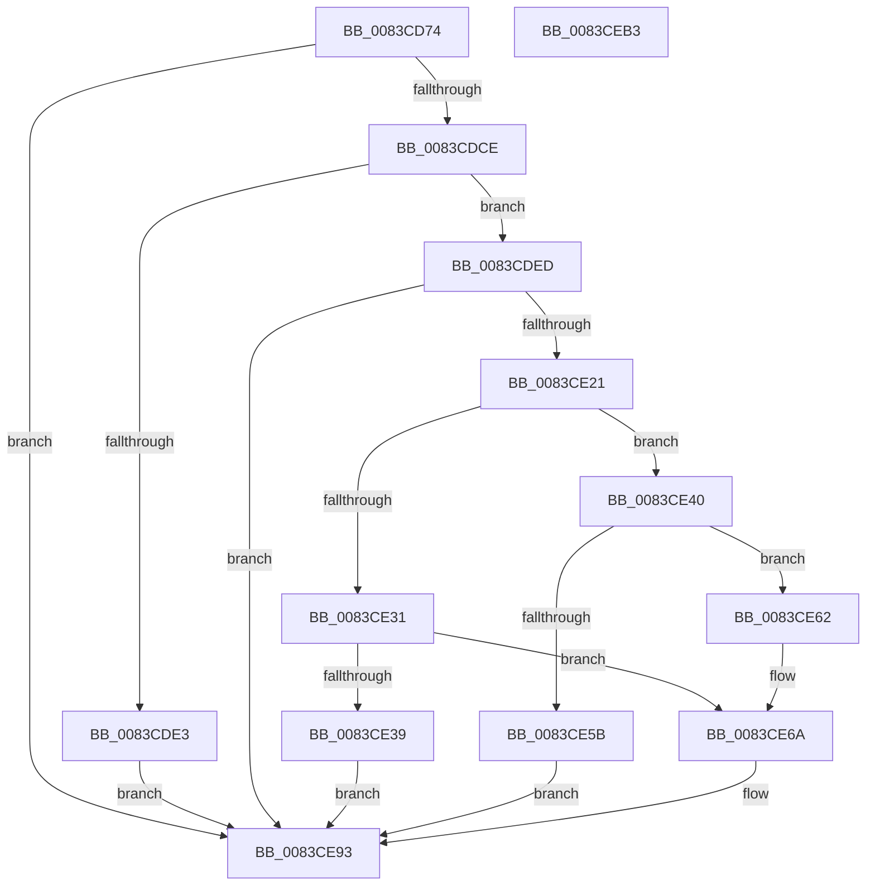

# ObGetSiloRootDirectoryPath

- RVA: `0x0083CD74`–`0x0083CEB4` (길이 `320` bytes)
- VA: `0x000000014083CD74`
- 실행 섹션: `PAGE`
- PDB 이름 있음: `예`; PDB Function 태그: `아니요`
- unwind 정보 RVA: `0x000DB420`
- 디코드: `88`개 명령, `320/320` bytes 표시
- 미해석 바이트: `0` (있으면 어셈블리에 `.byte`로 보존)

> 이 문서는 커널 이미지의 기계어와 PDB 기호를 분석해 생성했습니다. 4번과 5번은 함수 원형과 자료형을 바이너리 사용 방식에서 추정한 C 해석이며 원본 소스 복구 결과는 아닙니다.

## 1. Dependencies

- 직접 호출 지점: **10**; 고유 호출 대상: **9**
- 직접 호출자로 확인된 함수: **2**
- RIP 상대 이미지 참조: **4**

### Outgoing calls
- `0x0083CDBE` → [PsGetPermanentSiloContext](../../text/3E/PsGetPermanentSiloContext_function_003EE100.md) (function, `0x003EE100`)
- `0x0083CDD1` → [PsGetParentSilo](../A7/PsGetParentSilo_function_00A70760.md) (function, `0x00A70760`)
- `0x0083CDD9` → [PsGetCurrentSilo](../../text/40/PsGetCurrentSilo_function_004094A0.md) (function, `0x004094A0`)
- `0x0083CE08` → [PsGetSiloIdentifier](../A7/PsGetSiloIdentifier_function_00A7F480.md) (function, `0x00A7F480`)
- `0x0083CE18` → [RtlIntegerToUnicodeString](../91/RtlIntegerToUnicodeString_function_0091D3E0.md) (function, `0x0091D3E0`)
- `0x0083CE4D` → [ExAllocatePool2](../../poolcode/B8/ExAllocatePool2_function_00B820F0.md) (function, `0x00B820F0`)
- `0x0083CE74` → [RtlCopyUnicodeString](../../text/3F/RtlCopyUnicodeString_function_003FEF30.md) (function, `0x003FEF30`)
- `0x0083CE80` → [RtlAppendUnicodeStringToString](../../text/40/RtlAppendUnicodeStringToString_function_0040FA50.md) (function, `0x0040FA50`)
- `0x0083CE8C` → [RtlAppendUnicodeStringToString](../../text/40/RtlAppendUnicodeStringToString_function_0040FA50.md) (function, `0x0040FA50`)
- `0x0083CE9A` → [_security_check_cookie](../../text/6A/_security_check_cookie_function_006AC640.md) (function, `0x006AC640`)

### Direct callers
- [PspConvertSiloToServerSilo](../77/PspConvertSiloToServerSilo_function_0077F9B4.md) at `0x0077FA83`
- [sub_00B316B4](../B3/Unknown_function_00B316B4.md) at `0x00B31FF3`

### Static image references
- `0x0083CD87` → RVA `0x00E0A740` (`.data`; read)
- `0x0083CDA0` → RVA `0x00FC5068` (`ALMOSTRO`; read)
- `0x0083CDA6` → RVA `0x00AFC990` (` ?? ::NNGAKEGL::`string'`; read)
- `0x0083CE6A` → RVA `0x00B4B060` (`ObpSilosDirectoryName`; read)

## 2. Other-region calls and transfers

- 다른 실행 섹션으로 향하는 call: **7**
  - `0x0083CDBE` → [PsGetPermanentSiloContext](../../text/3E/PsGetPermanentSiloContext_function_003EE100.md) (`PAGE` → `.text`)
  - `0x0083CDD9` → [PsGetCurrentSilo](../../text/40/PsGetCurrentSilo_function_004094A0.md) (`PAGE` → `.text`)
  - `0x0083CE4D` → [ExAllocatePool2](../../poolcode/B8/ExAllocatePool2_function_00B820F0.md) (`PAGE` → `POOLCODE`)
  - `0x0083CE74` → [RtlCopyUnicodeString](../../text/3F/RtlCopyUnicodeString_function_003FEF30.md) (`PAGE` → `.text`)
  - `0x0083CE80` → [RtlAppendUnicodeStringToString](../../text/40/RtlAppendUnicodeStringToString_function_0040FA50.md) (`PAGE` → `.text`)
  - `0x0083CE8C` → [RtlAppendUnicodeStringToString](../../text/40/RtlAppendUnicodeStringToString_function_0040FA50.md) (`PAGE` → `.text`)
  - `0x0083CE9A` → [_security_check_cookie](../../text/6A/_security_check_cookie_function_006AC640.md) (`PAGE` → `.text`)
- 별도 외부 분기/꼬리 이동을 확인하지 못했습니다.

## 3. Assembly (complete function range)

```asm
0083CD74  48 89 5C 24 18                  mov qword ptr [rsp + 0x18], rbx
0083CD79  55                              push rbp
0083CD7A  56                              push rsi
0083CD7B  57                              push rdi
0083CD7C  41 56                           push r14
0083CD7E  41 57                           push r15
0083CD80  48 8B EC                        mov rbp, rsp
0083CD83  48 83 EC 60                     sub rsp, 0x60
0083CD87  48 8B 05 B2 D9 5C 00            mov rax, qword ptr [rip + 0x5cd9b2]
0083CD8E  48 33 C4                        xor rax, rsp
0083CD91  48 89 45 F8                     mov qword ptr [rbp - 8], rax
0083CD95  48 8B FA                        mov rdi, rdx
0083CD98  48 C7 45 D0 02 00 04 00         mov qword ptr [rbp - 0x30], 0x40002
0083CDA0  8B 15 C2 82 78 00               mov edx, dword ptr [rip + 0x7882c2]
0083CDA6  48 8D 05 E3 FB 2B 00            lea rax, [rip + 0x2bfbe3]
0083CDAD  4C 8D 45 C0                     lea r8, [rbp - 0x40]
0083CDB1  48 89 45 D8                     mov qword ptr [rbp - 0x28], rax
0083CDB5  48 8B F1                        mov rsi, rcx
0083CDB8  41 BF 02 00 00 00               mov r15d, 2
0083CDBE  E8 3D 13 BB FF                  call 0x1403ee100
0083CDC3  45 33 F6                        xor r14d, r14d
0083CDC6  85 C0                           test eax, eax
0083CDC8  0F 88 C5 00 00 00               js 0x14083ce93
0083CDCE  48 8B CE                        mov rcx, rsi
0083CDD1  E8 8A 39 23 00                  call 0x140a70760
0083CDD6  48 8B D8                        mov rbx, rax
0083CDD9  E8 C2 C6 BC FF                  call 0x1404094a0
0083CDDE  48 3B C3                        cmp rax, rbx
0083CDE1  74 0A                           je 0x14083cded
0083CDE3  B8 19 07 00 C0                  mov eax, 0xc0000719
0083CDE8  E9 A6 00 00 00                  jmp 0x14083ce93
0083CDED  0F 57 C0                        xorps xmm0, xmm0
0083CDF0  B8 16 00 00 00                  mov eax, 0x16
0083CDF5  0F 11 45 C0                     movups xmmword ptr [rbp - 0x40], xmm0
0083CDF9  66 89 45 C2                     mov word ptr [rbp - 0x3e], ax
0083CDFD  48 8B CE                        mov rcx, rsi
0083CE00  48 8D 45 E0                     lea rax, [rbp - 0x20]
0083CE04  48 89 45 C8                     mov qword ptr [rbp - 0x38], rax
0083CE08  E8 73 26 24 00                  call 0x140a7f480
0083CE0D  8B C8                           mov ecx, eax
0083CE0F  4C 8D 45 C0                     lea r8, [rbp - 0x40]
0083CE13  BA 0A 00 00 00                  mov edx, 0xa
0083CE18  E8 C3 05 0E 00                  call 0x14091d3e0
0083CE1D  85 C0                           test eax, eax
0083CE1F  78 72                           js 0x14083ce93
0083CE21  0F B7 5D C0                     movzx ebx, word ptr [rbp - 0x40]
0083CE25  83 C3 0C                        add ebx, 0xc
0083CE28  41 03 DF                        add ebx, r15d
0083CE2B  4C 39 77 08                     cmp qword ptr [rdi + 8], r14
0083CE2F  74 0F                           je 0x14083ce40
0083CE31  0F B7 47 02                     movzx eax, word ptr [rdi + 2]
0083CE35  3B C3                           cmp eax, ebx
0083CE37  73 31                           jae 0x14083ce6a
0083CE39  B8 23 00 00 C0                  mov eax, 0xc0000023
0083CE3E  EB 53                           jmp 0x14083ce93
0083CE40  8B D3                           mov edx, ebx
0083CE42  B9 00 01 00 00                  mov ecx, 0x100
0083CE47  41 B8 4F 62 4E 6D               mov r8d, 0x6d4e624f
0083CE4D  E8 9E 52 34 00                  call 0x140b820f0
0083CE52  48 89 47 08                     mov qword ptr [rdi + 8], rax
0083CE56  48 85 C0                        test rax, rax
0083CE59  75 07                           jne 0x14083ce62
0083CE5B  B8 9A 00 00 C0                  mov eax, 0xc000009a
0083CE60  EB 31                           jmp 0x14083ce93
0083CE62  66 44 89 37                     mov word ptr [rdi], r14w
0083CE66  66 89 5F 02                     mov word ptr [rdi + 2], bx
0083CE6A  48 8D 15 EF E1 30 00            lea rdx, [rip + 0x30e1ef]
0083CE71  48 8B CF                        mov rcx, rdi
0083CE74  E8 B7 20 BC FF                  call 0x1403fef30
0083CE79  48 8D 55 D0                     lea rdx, [rbp - 0x30]
0083CE7D  48 8B CF                        mov rcx, rdi
0083CE80  E8 CB 2B BD FF                  call 0x14040fa50
0083CE85  48 8D 55 C0                     lea rdx, [rbp - 0x40]
0083CE89  48 8B CF                        mov rcx, rdi
0083CE8C  E8 BF 2B BD FF                  call 0x14040fa50
0083CE91  33 C0                           xor eax, eax
0083CE93  48 8B 4D F8                     mov rcx, qword ptr [rbp - 8]
0083CE97  48 33 CC                        xor rcx, rsp
0083CE9A  E8 A1 F7 E6 FF                  call 0x1406ac640
0083CE9F  48 8B 9C 24 A0 00 00 00         mov rbx, qword ptr [rsp + 0xa0]
0083CEA7  48 83 C4 60                     add rsp, 0x60
0083CEAB  41 5F                           pop r15
0083CEAD  41 5E                           pop r14
0083CEAF  5F                              pop rdi
0083CEB0  5E                              pop rsi
0083CEB1  5D                              pop rbp
0083CEB2  C3                              ret
0083CEB3  CC                              int3
```

## 4. C-style interpretation (structured pseudocode)

```c
__int64 __fastcall ObGetSiloRootDirectoryPath(__int64 a1, __int64 a2)
{
    __int64 result;
    __int64 v_r14;
    __int64 v_rbx;
    __int64 v_rsp;
    unsigned __int64 v_stack_m30;
    unsigned __int64 v_stack_m48;
    unsigned __int64 v_stack_m50;
    unsigned __int64 v_stack_m58;
    unsigned __int64 v_stack_m60;
    unsigned __int16 v_stack_m66;
    unsigned __int64 v_stack_m68;
    unsigned __int64 v_stack_p18;

    v_stack_p18 = v_rbx;
    v_rsp = (v_rsp) - (96);
    result = (*(unsigned __int64 *)(v_rip + 6085042)) ^ (v_rsp);
    v_stack_m30 = result;
    v_stack_m58 = 0x40002ULL;
    v_stack_m50 = v_rip + 2882531;
    result = PsGetPermanentSiloContext(a1, (unsigned int)(*(unsigned int *)(v_rip + 7897794)), v_stack_m68, a4);
    v_r14 = 0;
    if (sign_flag) goto loc_0083CE93;
    result = PsGetParentSilo(a1, (unsigned int)(*(unsigned int *)(v_rip + 7897794)), v_stack_m68, a4);
    result = PsGetCurrentSilo(a1, (unsigned int)(*(unsigned int *)(v_rip + 7897794)), v_stack_m68, a4);
    if (result == result) goto loc_0083CDED;
    goto loc_0083CE93;
loc_0083CDED:
    v_stack_m68 = v_xmm0;
    v_stack_m66 = 22;
    v_stack_m60 = v_stack_m48;
    result = PsGetSiloIdentifier(a1, (unsigned int)(*(unsigned int *)(v_rip + 7897794)), v_stack_m68, a4);
    result = RtlIntegerToUnicodeString((unsigned int)((unsigned int)(result)), 10, v_stack_m68, a4);
    if (sign_flag) goto loc_0083CE93;
    v_rbx = (unsigned int)((v_stack_m68) + (12));
    v_rbx = (unsigned int)((v_rbx) + (2));
    if ((*(unsigned __int64 *)(a2 + 8)) == 0) goto loc_0083CE40;
    if (((unsigned int)(*(unsigned __int16 *)(a2 + 2))) >= ((unsigned int)(v_rbx))) goto loc_0083CE6A;
    goto loc_0083CE93;
loc_0083CE40:
    result = ExAllocatePool2(256, (unsigned int)((unsigned int)(v_rbx)), (unsigned int)(0x6D4E624FULL), a4);
    *(unsigned __int64 *)(a2 + 8) = result;
    if (result != 0) goto loc_0083CE62;
    goto loc_0083CE93;
loc_0083CE62:
    *(unsigned __int16 *)(a2) = 0;
    *(unsigned __int16 *)(a2 + 2) = (unsigned __int16)(v_rbx);
loc_0083CE6A:
    result = RtlCopyUnicodeString(a2, v_rip + 3203567, (unsigned int)(0x6D4E624FULL), a4);
    result = RtlAppendUnicodeStringToString(a2, v_stack_m58, (unsigned int)(0x6D4E624FULL), a4);
    result = RtlAppendUnicodeStringToString(a2, v_stack_m68, (unsigned int)(0x6D4E624FULL), a4);
    result = 0;
loc_0083CE93:
    a1 = (v_stack_m30) ^ (v_rsp);
    result = _security_check_cookie(a1, v_stack_m68, (unsigned int)(0x6D4E624FULL), a4);
    v_rsp = (v_rsp) + (96);
    return result;
}
```

## 5. (Beta) C Style

```c
int64_t ObGetSiloRootDirectoryPath(int64_t Arg1, void *Arg2)
{
    uint8_t *arg2 = (uint8_t *)Arg2;

    int64_t result;
    int64_t local_r14;
    int64_t local_rbx;
    int64_t local_rsp;
    uint64_t v_stack_m30;
    uint64_t v_stack_m48;
    uint64_t v_stack_m50;
    uint64_t v_stack_m58;
    uint64_t v_stack_m60;
    uint16_t v_stack_m66;
    uint64_t v_stack_m68;
    uint64_t v_stack_p18;

    v_stack_p18 = local_rbx;
    local_rsp = (local_rsp) - (96);
    result = (*(uint64_t *)(v_rip + 0x5CD9B2)) ^ (local_rsp);
    v_stack_m30 = result;
    v_stack_m58 = 0x40002ULL;
    v_stack_m50 = v_rip + 2882531;
    result = PsGetPermanentSiloContext(Arg1, (uint32_t)(*(uint32_t *)(v_rip + 0x7882C2)), v_stack_m68, a4);
    local_r14 = 0;
    if (sign_flag) goto loc_0083CE93;
    result = PsGetParentSilo(Arg1, (uint32_t)(*(uint32_t *)(v_rip + 0x7882C2)), v_stack_m68, a4);
    result = PsGetCurrentSilo(Arg1, (uint32_t)(*(uint32_t *)(v_rip + 0x7882C2)), v_stack_m68, a4);
    if (result == result) goto loc_0083CDED;
    goto loc_0083CE93;
loc_0083CDED:
    v_stack_m68 = v_xmm0;
    v_stack_m66 = 22;
    v_stack_m60 = v_stack_m48;
    result = PsGetSiloIdentifier(Arg1, (uint32_t)(*(uint32_t *)(v_rip + 0x7882C2)), v_stack_m68, a4);
    result = RtlIntegerToUnicodeString((uint32_t)((uint32_t)(result)), 10, v_stack_m68, a4);
    if (sign_flag) goto loc_0083CE93;
    local_rbx = (uint32_t)((v_stack_m68) + (12));
    local_rbx = (uint32_t)((local_rbx) + (2));
    if ((*(uint64_t *)(arg2 + 0x8)) == 0) goto loc_0083CE40;
    if (((uint32_t)(*(uint16_t *)(arg2 + 0x2))) >= ((uint32_t)(local_rbx))) goto loc_0083CE6A;
    goto loc_0083CE93;
loc_0083CE40:
    result = ExAllocatePool2(256, (uint32_t)((uint32_t)(local_rbx)), (uint32_t)(0x6D4E624FULL), a4);
    *(uint64_t *)(arg2 + 0x8) = result;
    if (result != 0) goto loc_0083CE62;
    goto loc_0083CE93;
loc_0083CE62:
    *(uint16_t *)(arg2) = 0;
    *(uint16_t *)(arg2 + 0x2) = (uint16_t)(local_rbx);
loc_0083CE6A:
    result = RtlCopyUnicodeString(Arg2, v_rip + 3203567, (uint32_t)(0x6D4E624FULL), a4);
    result = RtlAppendUnicodeStringToString(Arg2, v_stack_m58, (uint32_t)(0x6D4E624FULL), a4);
    result = RtlAppendUnicodeStringToString(Arg2, v_stack_m68, (uint32_t)(0x6D4E624FULL), a4);
    result = 0;
loc_0083CE93:
    Arg1 = (v_stack_m30) ^ (local_rsp);
    result = _security_check_cookie(Arg1, v_stack_m68, (uint32_t)(0x6D4E624FULL), a4);
    local_rsp = (local_rsp) + (96);
    return result;
}
```

### 관측된 메모리 오프셋

구조체 형식이 확인되지 않은 접근은 인자 기준의 오프셋으로만 기록했습니다.

| 기준 인자 | 오프셋 표현 | 폭 (bit) | 접근 |
|---|---:|---:|---|
| `Arg2` | `+ 0x0` | `16` | `W` |
| `Arg2` | `+ 0x2` | `16` | `R` |
| `Arg2` | `+ 0x2` | `16` | `W` |
| `Arg2` | `+ 0x8` | `64` | `R` |
| `Arg2` | `+ 0x8` | `64` | `W` |

## 6. Execution-region graph

[열기: 2D/3D 그래프와 함수 탐색 컨트롤 패널](../../../control-panel.html?section=page&rva=0x0083CD74&view=graph)

- 2D 그래프는 위에서 아래로 흐르고, 3D 그래프는 빈 공간을 드래그해 회전합니다. Shift+드래그는 이동, 휠은 확대·축소, 함수 노드 선택은 대상 보고서 이동입니다.

### Static fallback


